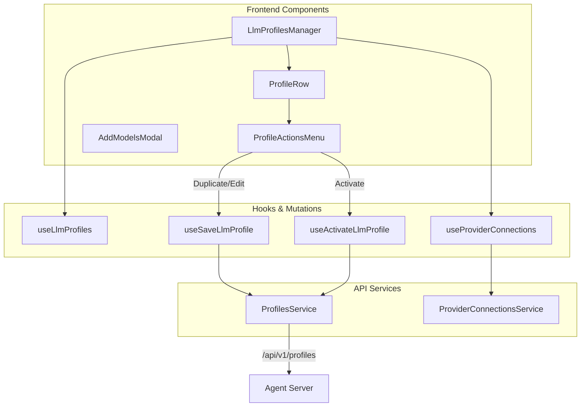
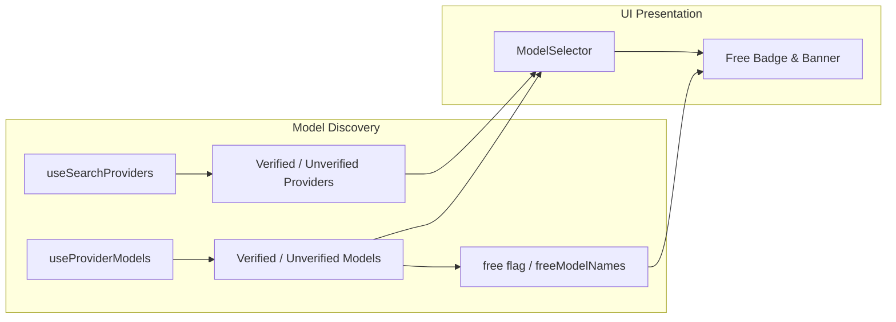
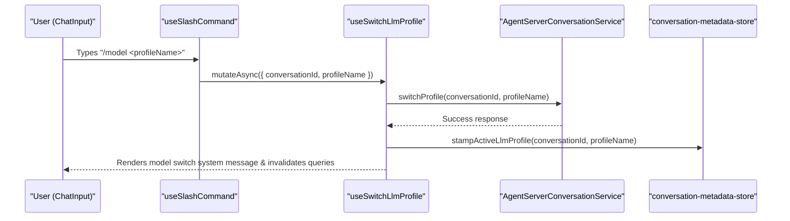
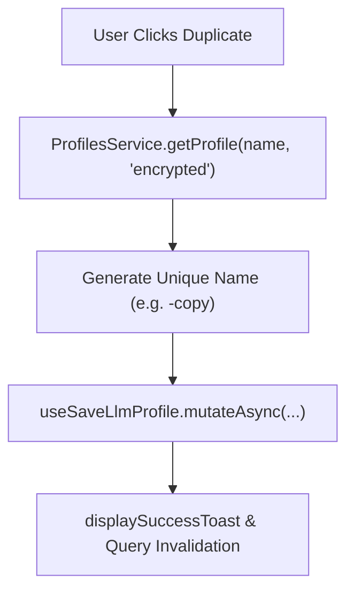

# LLM Profiles and Model Management

Relevant source files

The following files were used as context for generating this wiki page:

- [__tests__/api/cloud/provider-connections-service.test.ts](__tests__/api/cloud/provider-connections-service.test.ts)
- [__tests__/components/features/chat/components/chat-input-llm-profile-picker.test.tsx](__tests__/components/features/chat/components/chat-input-llm-profile-picker.test.tsx)
- [__tests__/components/features/chat/model-messages.test.tsx](__tests__/components/features/chat/model-messages.test.tsx)
- [__tests__/components/features/chat/uploaded-image-preview.test.tsx](__tests__/components/features/chat/uploaded-image-preview.test.tsx)
- [__tests__/components/features/settings/settings-dropdown-input.test.tsx](__tests__/components/features/settings/settings-dropdown-input.test.tsx)
- [__tests__/components/modals/settings/model-selector-openhands.test.tsx](__tests__/components/modals/settings/model-selector-openhands.test.tsx)
- [__tests__/components/settings/agent-profiles/agent-profiles-manager.test.tsx](__tests__/components/settings/agent-profiles/agent-profiles-manager.test.tsx)
- [__tests__/components/settings/llm-profiles/add-models-modal.test.tsx](__tests__/components/settings/llm-profiles/add-models-modal.test.tsx)
- [__tests__/components/settings/llm-profiles/delete-profile-modal.test.tsx](__tests__/components/settings/llm-profiles/delete-profile-modal.test.tsx)
- [__tests__/components/settings/llm-profiles/llm-profiles-manager.test.tsx](__tests__/components/settings/llm-profiles/llm-profiles-manager.test.tsx)
- [__tests__/components/settings/llm-profiles/profile-actions-menu.test.tsx](__tests__/components/settings/llm-profiles/profile-actions-menu.test.tsx)
- [__tests__/components/settings/llm-profiles/profile-row.test.tsx](__tests__/components/settings/llm-profiles/profile-row.test.tsx)
- [__tests__/components/settings/llm-profiles/profiles-body.test.tsx](__tests__/components/settings/llm-profiles/profiles-body.test.tsx)
- [__tests__/components/settings/llm-profiles/rename-profile-modal.test.tsx](__tests__/components/settings/llm-profiles/rename-profile-modal.test.tsx)
- [__tests__/hooks/chat/use-model-interceptor.test.tsx](__tests__/hooks/chat/use-model-interceptor.test.tsx)
- [__tests__/hooks/chat/use-slash-command.test.ts](__tests__/hooks/chat/use-slash-command.test.ts)
- [__tests__/hooks/mutation/use-switch-llm-profile.test.tsx](__tests__/hooks/mutation/use-switch-llm-profile.test.tsx)
- [__tests__/hooks/send-message.test.tsx](__tests__/hooks/send-message.test.tsx)
- [__tests__/hooks/use-model-catalog-warning.test.tsx](__tests__/hooks/use-model-catalog-warning.test.tsx)
- [__tests__/stores/btw-store.test.ts](__tests__/stores/btw-store.test.ts)
- [__tests__/stores/model-store.test.ts](__tests__/stores/model-store.test.ts)
- [__tests__/stores/pinned-conversations-store.test.ts](__tests__/stores/pinned-conversations-store.test.ts)
- [__tests__/utils/format-model-name.test.ts](__tests__/utils/format-model-name.test.ts)
- [hero.ts](hero.ts)
- [src/api/cloud/provider-connections-service.api.ts](src/api/cloud/provider-connections-service.api.ts)
- [src/api/provider-connections-service/provider-connections-service.api.ts](src/api/provider-connections-service/provider-connections-service.api.ts)
- [src/components/features/chat/uploaded-files.test.tsx](src/components/features/chat/uploaded-files.test.tsx)
- [src/components/features/conversation-panel/conversation-card/conversation-card-title.tsx](src/components/features/conversation-panel/conversation-card/conversation-card-title.tsx)
- [src/components/features/settings/agent-profiles/agent-profile-row.tsx](src/components/features/settings/agent-profiles/agent-profile-row.tsx)
- [src/components/features/settings/api-key-modal-base.tsx](src/components/features/settings/api-key-modal-base.tsx)
- [src/components/features/settings/llm-profiles/add-models-modal.tsx](src/components/features/settings/llm-profiles/add-models-modal.tsx)
- [src/components/features/settings/llm-profiles/delete-profile-modal.tsx](src/components/features/settings/llm-profiles/delete-profile-modal.tsx)
- [src/components/features/settings/llm-profiles/llm-profiles-manager.tsx](src/components/features/settings/llm-profiles/llm-profiles-manager.tsx)
- [src/components/features/settings/llm-profiles/profile-actions-menu.tsx](src/components/features/settings/llm-profiles/profile-actions-menu.tsx)
- [src/components/features/settings/llm-profiles/profile-row.tsx](src/components/features/settings/llm-profiles/profile-row.tsx)
- [src/components/features/settings/llm-profiles/profiles-body.tsx](src/components/features/settings/llm-profiles/profiles-body.tsx)
- [src/components/features/settings/llm-profiles/provider-connection-actions-menu.tsx](src/components/features/settings/llm-profiles/provider-connection-actions-menu.tsx)
- [src/components/features/settings/llm-profiles/provider-connection-modal.tsx](src/components/features/settings/llm-profiles/provider-connection-modal.tsx)
- [src/components/features/settings/llm-profiles/provider-connection-row.tsx](src/components/features/settings/llm-profiles/provider-connection-row.tsx)
- [src/components/features/settings/llm-profiles/provider-connections-manager.test.tsx](src/components/features/settings/llm-profiles/provider-connections-manager.test.tsx)
- [src/components/features/settings/llm-profiles/provider-connections-manager.tsx](src/components/features/settings/llm-profiles/provider-connections-manager.tsx)
- [src/components/features/settings/llm-profiles/rename-profile-modal.tsx](src/components/features/settings/llm-profiles/rename-profile-modal.tsx)
- [src/components/features/settings/settings-dropdown-input.tsx](src/components/features/settings/settings-dropdown-input.tsx)
- [src/components/shared/modals/settings/model-selector.tsx](src/components/shared/modals/settings/model-selector.tsx)
- [src/components/shared/model-catalog-warning.tsx](src/components/shared/model-catalog-warning.tsx)
- [src/hooks/chat/use-model-interceptor.ts](src/hooks/chat/use-model-interceptor.ts)
- [src/hooks/mutation/use-switch-llm-profile.ts](src/hooks/mutation/use-switch-llm-profile.ts)
- [src/hooks/query/use-provider-connections.ts](src/hooks/query/use-provider-connections.ts)
- [src/hooks/use-model-catalog-warning.ts](src/hooks/use-model-catalog-warning.ts)
- [src/utils/format-model-name.ts](src/utils/format-model-name.ts)
- [src/utils/sdk-http-error.ts](src/utils/sdk-http-error.ts)
- [tailwind.config.js](tailwind.config.js)
- [tests/e2e/mock-llm/settings/mock-llm-provider-connection-selector.spec.ts](tests/e2e/mock-llm/settings/mock-llm-provider-connection-selector.spec.ts)

This page documents the configuration system for Large Language Models (LLMs) in OpenHands. It covers LLM profiles (named configurations), the `ProfilesService` API, frontend management components (`LlmProfilesManager`, `ProfileRow`, `ProfileActionsMenu`), model selection and discovery (`ModelSelector`), and the mechanisms for in-conversation model switching via `useSwitchLlmProfile`.

Sources: [src/api/profiles-service/profiles-service.api.ts:5-50](), [src/components/features/settings/llm-profiles/llm-profiles-manager.tsx:31-70]()

---

## Overview

OpenHands uses a multi-layered configuration system to manage LLM interactions. While the backend defines the technical parameters, the frontend provides a robust management layer for **LLM Profiles**—named sets of configurations (model, API key, base URL, provider connections) that users can save, duplicate, rename, delete, and switch between.

The system supports standard providers (OpenAI, Anthropic, etc.) via LiteLLM proxies as well as DB-driven **Free Models** (e.g., `openhands/deepseek-v4-flash`) routed through the OpenHands proxy and flagged dynamically via `useFreeModels`.

Sources: [src/components/features/settings/llm-profiles/llm-profiles-manager.tsx:31-70](), [src/components/features/settings/llm-profiles/profile-row.tsx:32-49](), [src/utils/format-model-name.ts:16-51]()

---

## LLM Profiles Architecture

In the OpenHands architecture, LLM settings are managed through `ProfilesService` and rendered via `LlmProfilesManager` and `ProfileRow`.

### Data Flow: Profile Management

The `LlmProfilesManager` serves as the primary coordinator for profile CRUD operations, provider connections, and profile activation.

Sources: [src/components/features/settings/llm-profiles/llm-profiles-manager.tsx:31-134](), [src/components/features/settings/llm-profiles/profile-row.tsx:32-118](), [src/components/features/settings/llm-profiles/profile-actions-menu.tsx:44-200]()

### Key Components & Services

| Component / Service | File Path & Role |
|---------------------|------------------|
| `LlmProfilesManager` | [src/components/features/settings/llm-profiles/llm-profiles-manager.tsx:31-218]() — Coordinates profile listing, activation, duplication, and provider connection integration. |
| `ProfileRow` | [src/components/features/settings/llm-profiles/profile-row.tsx:32-118]() — Renders an individual profile row with default badges, connection warnings, and trigger ellipsis menu. |
| `ProfileActionsMenu` | [src/components/features/settings/llm-profiles/profile-actions-menu.tsx:44-227]() — Portaled dropdown menu providing Edit, Rename, Duplicate, Set as default, and Delete actions. |
| `ProfilesService` | [src/api/profiles-service/profiles-service.api.ts:5-50]() — API client interfacing with agent-server profile endpoints (`/api/v1/profiles`). |

Sources: [src/components/features/settings/llm-profiles/llm-profiles-manager.tsx:31-218](), [src/components/features/settings/llm-profiles/profile-row.tsx:32-118](), [src/components/features/settings/llm-profiles/profile-actions-menu.tsx:44-227]()

---

## Model Discovery and Selection

The `ModelSelector` component provides a unified autocomplete interface for selecting LLM providers and models across settings and configuration dialogs.

### Verified vs. Unverified Models
The system categorizes providers and models into **Verified** and **Unverified** pools using `useSearchProviders` and `useProviderModels`. The `ModelSelector` groups items accordingly in `AutocompleteSection` elements.

### DB-Driven Free Models
Free models are determined dynamically via the backend model list carrying a `free` flag per item (accessed through `useProviderModels` and `useFreeModels`), rather than hardcoded client-side logic. The UI renders a "Free" badge and a specialized note (`FreeOpenHandsModelsNote`) for qualifying models.

Sources: [src/components/shared/modals/settings/model-selector.tsx:36-121](), [src/utils/format-model-name.ts:16-61](), [__tests__/components/modals/settings/model-selector-openhands.test.tsx:23-60]()

---

## In-Conversation Model Switching

OpenHands supports switching LLM profiles mid-conversation without altering global personal settings.

### Slash Commands and Interceptor Flow
The `useSlashCommand` hook detects `/model` commands in the chat input, displaying a completion menu of saved LLM profiles. Selecting a profile triggers the model switch mutation.

Sources: [src/hooks/mutation/use-switch-llm-profile.ts:50-97](), [__tests__/hooks/chat/use-slash-command.test.ts:181-220]()

### The `useSwitchLlmProfile` Mutation
Defined in `src/hooks/mutation/use-switch-llm-profile.ts`, this hook handles two distinct branches:
1. **Conversation Branch (`conversationId` is set)**: Calls `AgentServerConversationService.switchProfile`, records a switch message anchor via `recordModelSwitchMessage`, and stamps the active profile locally [src/hooks/mutation/use-switch-llm-profile.ts:70-84]().
2. **Global Branch (`conversationId` is null)**: Activates the profile globally, invalidates the `SettingsService` cache, and refreshes personal query keys [src/hooks/mutation/use-switch-llm-profile.ts:85-95]().

Sources: [src/hooks/mutation/use-switch-llm-profile.ts:50-97]()

---

## Profile Creation, Duplication, and Editing

### Duplication & CRUD Workflows
The `LlmProfilesManager` handles profile duplication by fetching the full profile configuration with encrypted secrets (`ProfilesService.getProfile(profile.name, "encrypted")`), generating a unique suffixed name (`{name}-copy`, `{name}-copy-1`), and persisting it via `useSaveLlmProfile` [src/components/features/settings/llm-profiles/llm-profiles-manager.tsx:100-125]().

Sources: [src/components/features/settings/llm-profiles/llm-profiles-manager.tsx:100-133]()

### Provider Connections Integration
In local and org-scoped cloud modes, profiles can be associated with a `provider_connection_id`, allowing multiple profiles to share a single set of API credentials managed centrally via `ProviderConnectionsService` [src/components/features/settings/llm-profiles/llm-profiles-manager.tsx:43-84]().

Sources: [src/components/features/settings/llm-profiles/llm-profiles-manager.tsx:31-134](), [src/api/provider-connections-service/provider-connections-service.api.ts:1-30]()