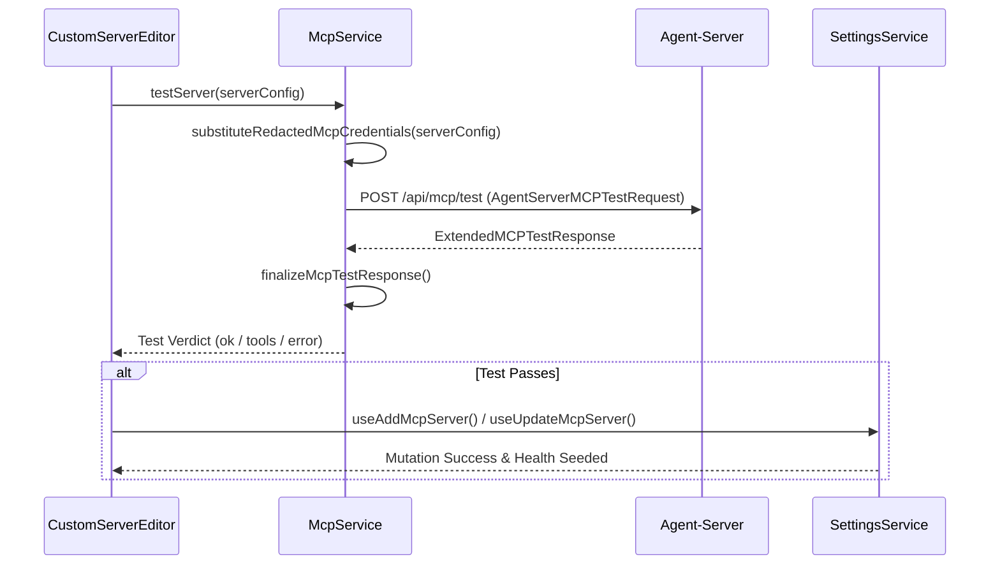
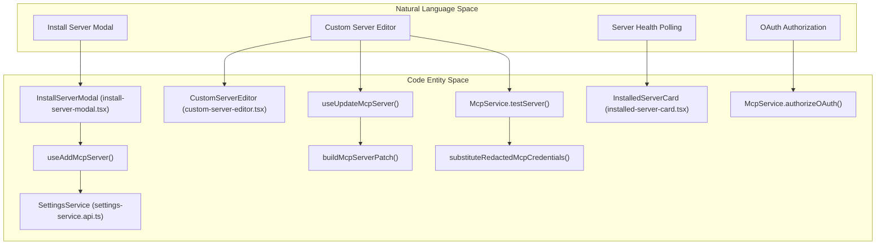

# MCP Server Management

Relevant source files

The following files were used as context for generating this wiki page:

- [__tests__/api/mcp-service/mcp-service.api.test.ts](__tests__/api/mcp-service/mcp-service.api.test.ts)
- [__tests__/components/features/mcp-page/custom-server-editor.test.tsx](__tests__/components/features/mcp-page/custom-server-editor.test.tsx)
- [__tests__/components/features/mcp-page/install-server-modal.test.tsx](__tests__/components/features/mcp-page/install-server-modal.test.tsx)
- [__tests__/components/features/mcp-page/mcp-server-health.test.tsx](__tests__/components/features/mcp-page/mcp-server-health.test.tsx)
- [__tests__/hooks/mutation/use-mcp-server-mutations-error-toast.test.ts](__tests__/hooks/mutation/use-mcp-server-mutations-error-toast.test.ts)
- [__tests__/hooks/mutation/use-update-mcp-server.test.ts](__tests__/hooks/mutation/use-update-mcp-server.test.ts)
- [__tests__/utils/mcp-test-error-message.test.ts](__tests__/utils/mcp-test-error-message.test.ts)
- [src/api/agent-server-adapter.test.ts](src/api/agent-server-adapter.test.ts)
- [src/api/mcp-service/mcp-redacted-credentials.test.ts](src/api/mcp-service/mcp-redacted-credentials.test.ts)
- [src/api/mcp-service/mcp-redacted-credentials.ts](src/api/mcp-service/mcp-redacted-credentials.ts)
- [src/api/mcp-service/mcp-service.api.test.ts](src/api/mcp-service/mcp-service.api.test.ts)
- [src/api/mcp-service/mcp-service.api.ts](src/api/mcp-service/mcp-service.api.ts)
- [src/components/features/conversation/conversation-overview-mcp-panel.tsx](src/components/features/conversation/conversation-overview-mcp-panel.tsx)
- [src/components/features/mcp-page/custom-server-editor.tsx](src/components/features/mcp-page/custom-server-editor.tsx)
- [src/components/features/mcp-page/install-server-modal.tsx](src/components/features/mcp-page/install-server-modal.tsx)
- [src/components/features/mcp-page/mcp-server-health.tsx](src/components/features/mcp-page/mcp-server-health.tsx)
- [src/hooks/mutation/use-add-mcp-server.ts](src/hooks/mutation/use-add-mcp-server.ts)
- [src/hooks/mutation/use-delete-mcp-server.ts](src/hooks/mutation/use-delete-mcp-server.ts)
- [src/hooks/mutation/use-save-settings.ts](src/hooks/mutation/use-save-settings.ts)
- [src/hooks/mutation/use-update-mcp-server.ts](src/hooks/mutation/use-update-mcp-server.ts)
- [src/hooks/query/query-keys.test.ts](src/hooks/query/query-keys.test.ts)
- [src/hooks/query/query-keys.ts](src/hooks/query/query-keys.ts)
- [src/utils/mcp-test-error-message.ts](src/utils/mcp-test-error-message.ts)

## Purpose and Scope

The MCP (Model Context Protocol) management system provides a comprehensive interface for discovering, installing, and configuring external tools and services. It bridges the gap between the frontend UI, the local `agent-server` runtime, and persistent storage. The system supports three transport layers: `stdio` (local processes), `sse` (Server-Sent Events), and `shttp` (stateless HTTP).

A key architectural constraint is that MCP connectivity probes are executed by the local `agent-server` rather than the browser, ensuring that environment variables and network contexts match the agent's runtime environment. The `agent_settings.mcp_config` configuration is forwarded to both built-in OpenHands agents and external ACP (Agent Client Protocol) subprocesses [src/components/features/mcp-page/install-server-modal.tsx:159-162](), [src/api/mcp-service/mcp-service.api.ts:198-205](), [src/hooks/mutation/use-add-mcp-server.ts:17-41]().

**Sources:** [src/components/features/mcp-page/install-server-modal.tsx:159-162](), [src/api/mcp-service/mcp-service.api.ts:198-205](), [src/hooks/mutation/use-add-mcp-server.ts:17-41]()

---

## Data Architecture and Utilities

### Canonical Configuration and Redaction
OpenHands uses a name-keyed map (`MCPConfig`) as the stable identity for servers. The frontend utilities normalize diverse backend shapes into this canonical form.

| Code Entity | Role | Source Pointer |
|:---|:---|:---|
| `MCPServerConfig` | Frontend UI-specific type including a unique `id` for tracking edits. | [src/components/features/mcp-page/install-server-modal.tsx:18-18]() |
| `parseMcpConfig` | Normalizes incoming API payloads into a consistent map of transport-specific definitions. | [src/hooks/mutation/use-add-mcp-server.ts:29-31]() |
| `toCanonicalMcpServer` | Converts a UI `MCPServerConfig` back into the SDK-standard format for persistence. | [src/hooks/mutation/use-add-mcp-server.ts:37-40]() |
| `substituteRedactedMcpCredentials` | Merges user input with stored secrets, ensuring `**********` is never persisted back. | [src/api/mcp-service/mcp-service.api.ts:61-63]() |
| `buildMcpServerPatch` | Generates a sparse diff that omits unchanged redacted fields but clears them if auth changes. | [src/hooks/mutation/use-update-mcp-server.ts:70-73]() |

**Sources:** [src/components/features/mcp-page/install-server-modal.tsx:18-18](), [src/hooks/mutation/use-add-mcp-server.ts:29-40](), [src/api/mcp-service/mcp-service.api.ts:61-63](), [src/hooks/mutation/use-update-mcp-server.ts:70-73]()

---

## UI Components: InstallServerModal, CustomServerEditor, and InstalledServerCard

### Marketplace Installation and Custom Editors
The management interface exposes two primary modal workflows for adding or modifying servers:

1. **`InstallServerModal`**: Used for marketplace and catalog entries. It constructs template-specific initial field states via `makeInitialState` [src/components/features/mcp-page/install-server-modal.tsx:124-153](), handles markdown link parsing in descriptions via `renderHelperText` [src/components/features/mcp-page/install-server-modal.tsx:47-72](), and executes pre-save connection tests before invoking `useAddMcpServer` [src/hooks/mutation/use-add-mcp-server.ts:17-54]().
2. **`CustomServerEditor`**: A wrapper around `MCPServerForm` that supports both creation (`server.id === ""`) and editing of arbitrary `stdio`, `sse`, or `shttp` servers [src/components/features/mcp-page/custom-server-editor.tsx:36-45](). It handles OAuth authentication flows via `McpService.authorizeOAuth` and seeds server health upon successful test verification [src/components/features/mcp-page/custom-server-editor.tsx:106-117]().
3. **`InstalledServerCard`**: Renders the health status dot, summary metrics, action buttons for manual polling (`testServer`), and triggers the edit modal or configuration deletion.

**Sources:** [src/components/features/mcp-page/install-server-modal.tsx:47-153](), [src/components/features/mcp-page/custom-server-editor.tsx:36-117](), [src/hooks/mutation/use-add-mcp-server.ts:17-54]()

---

## Form Validation and Field Management

The configuration forms enforce strict validation to prevent runtime agent failures:
- **Server Name Validation**: Names must be unique within the `mcp_config` map and conform to canonical naming rules via `toMcpServerName` [src/hooks/mutation/use-update-mcp-server.ts:59-67]().
- **Credential Optionality**: `isCredentialOptional` and `optionNeedsCredentialField` inspect transport connection options to determine if environment variables or API keys are required or optional [src/components/features/mcp-page/install-server-modal.tsx:93-113]().
- **Sparse Mutations**: `useAddMcpServer` and `useUpdateMcpServer` ensure that mutations apply sparse updates (`SettingsService.createMcpServer` and `SettingsService.patchMcpServer`), preserving sibling servers and safely triggering TanStack Query cache invalidations for personal settings [src/hooks/mutation/use-add-mcp-server.ts:42-53](), [src/hooks/mutation/use-update-mcp-server.ts:76-86]().

**Sources:** [src/components/features/mcp-page/install-server-modal.tsx:93-113](), [src/hooks/mutation/use-add-mcp-server.ts:42-53](), [src/hooks/mutation/use-update-mcp-server.ts:59-86]()

---

## Connectivity Testing, Health Checks, and McpService API

The `McpService` class coordinates communication with the local or remote agent-server MCP testing routes [src/api/mcp-service/mcp-service.api.ts:198-205]().

### Logic Flow: Install and Test Pipeline

### Health Monitoring Integration
The health store coordinates status badges (`unchecked`, `checking`, `healthy`, `failed`) across installed server cards:
- `seedMcpServerHealth` injects pre-save test results directly into the health store to prevent duplicate network probes right after installation [src/components/features/mcp-page/custom-server-editor.tsx:106-117]().
- `clearMcpServerHealth` invalidates old verdicts when a server configuration or identifier is updated [src/hooks/mutation/use-update-mcp-server.ts:77-81]().

**Sources:** [src/api/mcp-service/mcp-service.api.ts:198-205](), [src/components/features/mcp-page/custom-server-editor.tsx:106-117](), [src/hooks/mutation/use-update-mcp-server.ts:77-81]()

---

## Code Entity Mapping

**Sources:** [src/components/features/mcp-page/install-server-modal.tsx:161-167](), [src/components/features/mcp-page/custom-server-editor.tsx:41-45](), [src/hooks/mutation/use-add-mcp-server.ts:17-41](), [src/hooks/mutation/use-update-mcp-server.ts:16-75](), [src/api/mcp-service/mcp-service.api.ts:61-63]()