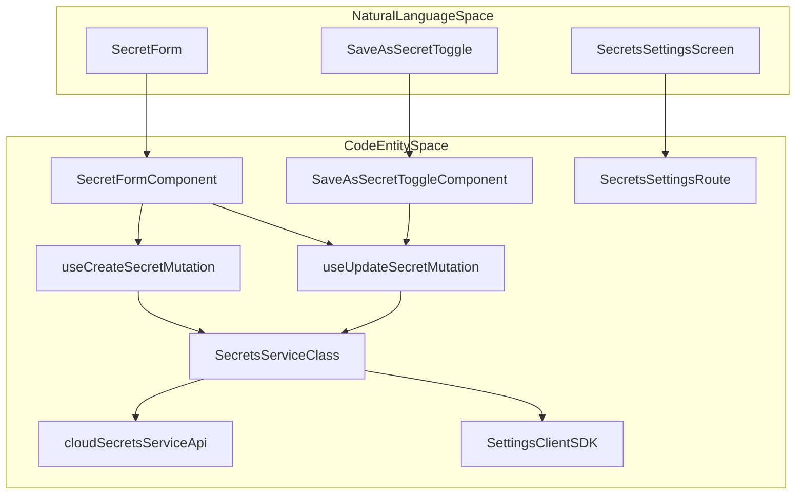
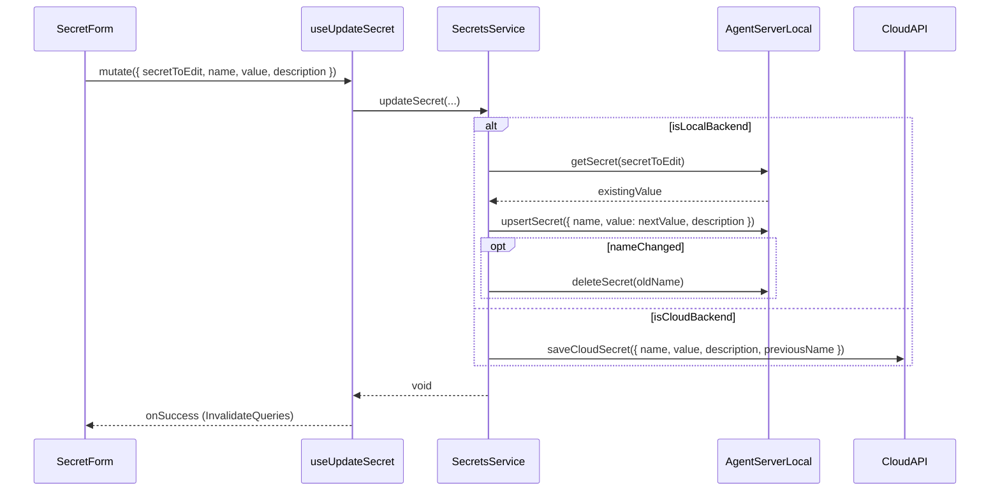

# Secrets Management

Relevant source files

The following files were used as context for generating this wiki page:

- [.agents/skills/frontend-development/references/guide.md](.agents/skills/frontend-development/references/guide.md)
- [__tests__/components/features/mcp-page/save-as-secret-toggle.test.tsx](__tests__/components/features/mcp-page/save-as-secret-toggle.test.tsx)
- [__tests__/components/features/settings/secrets-settings/secret-form-behavior.test.tsx](__tests__/components/features/settings/secrets-settings/secret-form-behavior.test.tsx)
- [__tests__/components/settings/llm-profiles/profile-name-input.test.tsx](__tests__/components/settings/llm-profiles/profile-name-input.test.tsx)
- [__tests__/hooks/mutation/use-save-fields-as-secrets.test.ts](__tests__/hooks/mutation/use-save-fields-as-secrets.test.ts)
- [__tests__/scripts/inline-styles-lint.test.ts](__tests__/scripts/inline-styles-lint.test.ts)
- [__tests__/scripts/raw-colors-lint.test.ts](__tests__/scripts/raw-colors-lint.test.ts)
- [__tests__/scripts/restyle-lint.test.ts](__tests__/scripts/restyle-lint.test.ts)
- [__tests__/scripts/static-classes-lint.test.ts](__tests__/scripts/static-classes-lint.test.ts)
- [eslint.config.js](eslint.config.js)
- [specs/mcp-secret-selection.md](specs/mcp-secret-selection.md)
- [src/components/features/home/shared/toggle-button.tsx](src/components/features/home/shared/toggle-button.tsx)
- [src/components/features/mcp-page/index.ts](src/components/features/mcp-page/index.ts)
- [src/components/features/mcp-page/save-as-secret-toggle.tsx](src/components/features/mcp-page/save-as-secret-toggle.tsx)
- [src/components/features/settings/brand-button.tsx](src/components/features/settings/brand-button.tsx)
- [src/components/features/settings/llm-profiles/index.ts](src/components/features/settings/llm-profiles/index.ts)
- [src/components/features/settings/llm-profiles/profile-name-input.tsx](src/components/features/settings/llm-profiles/profile-name-input.tsx)
- [src/components/features/settings/secrets-settings/secret-form.tsx](src/components/features/settings/secrets-settings/secret-form.tsx)
- [src/components/features/settings/settings-input.tsx](src/components/features/settings/settings-input.tsx)

## Purpose and Scope

The secrets management system in OpenHands handles the storage, validation, and retrieval of sensitive credentials, including Git provider tokens, Model Context Protocol (MCP) server environment variables, and custom user-defined secrets (e.g., API keys for external services). The system supports both **Local** (OpenHands Agent Server) and **Cloud** (OpenHands Cloud API) backends, providing a unified interface for the frontend to manage these sensitive values securely.

This document covers the `SecretsService` implementation, the `SecretForm` UI, mutation hooks like `useUpdateSecret`, the `SaveAsSecretToggle` component used during MCP server onboarding, and how secrets are referenced as `LookupSecrets` during conversation initialization.

Sources: [src/api/secrets-service.ts:3-10](), [src/components/features/settings/secrets-settings/secret-form.tsx:5-6](), [src/components/features/mcp-page/save-as-secret-toggle.tsx:13-17]()

## Architecture Overview

The system bridges the React frontend to backend storage through the `SecretsService` class and TanStack Query mutations. It detects the active backend type and routes requests accordingly.

### Secrets System Mapping

Sources: [src/api/secrets-service.ts:3-15](), [src/components/features/settings/secrets-settings/secret-form.tsx:23-34](), [src/components/features/mcp-page/save-as-secret-toggle.tsx:13-17]()

### Secrets Data Flow

Sources: [src/api/secrets-service.ts:90-121](), [src/components/features/settings/secrets-settings/secret-form.tsx:81-94](), [src/api/cloud/secrets-service.api.ts:88-108]()

## Secrets Service and Mutation Hooks

The `SecretsService` class provides static methods for CRUD operations on secrets, managing the differences between Local and Cloud storage formats.

### Key Functions and Hooks
*   **`getSecrets()`**: Fetches secret metadata (`CustomSecretWithoutValue`) while excluding actual secret values [src/api/secrets-service.ts:20-23]().
*   **`useCreateSecret` & `useUpdateSecret`**: TanStack Query mutation hooks that handle optimistic updates, error states, and cache invalidation for `secrets-search` and `secrets` query keys [__tests__/components/features/settings/secrets-settings/secret-form-behavior.test.tsx:28-34](), [src/components/features/settings/secrets-settings/secret-form.tsx:58-65]().
*   **`updateSecret(secretToEdit, name, description, value)`**: Handles complex updates. If a value is omitted during an edit, it fetches the existing value first to prevent accidental clearing [src/api/secrets-service.ts:107-116]().

Sources: [src/api/secrets-service.ts:26-121](), [src/components/features/settings/secrets-settings/secret-form.tsx:31-34]()

## Secret Form UI and Save-As-Secret Toggle

### Secret Form
The `SecretForm` component manages inputs for adding or editing custom secrets.
*   **Validation**: Enforces strict naming conventions using a regex pattern `^[a-zA-Z][a-zA-Z0-9_]{0,63}$` [src/components/features/settings/secrets-settings/secret-form.tsx:164]().
*   **Edit Mode**: Exposes an optional value field that starts blank; leaving it blank preserves the current secret value [src/components/features/settings/secrets-settings/secret-form.tsx:173]().

### Save-As-Secret Toggle
The `SaveAsSecretToggle` component allows users to instantly store environment variables or credentials specified during MCP server installation into the secure secrets vault [src/components/features/mcp-page/save-as-secret-toggle.tsx:13-71]().
*   **Accessibility**: Implements a visually hidden checkbox (`sr-only`) paired with a custom `ToggleSwitchVisual` track while maintaining keyboard accessibility and isolated help tooltips [__tests__/components/features/mcp-page/save-as-secret-toggle.test.tsx:68-80](), [src/components/features/mcp-page/save-as-secret-toggle.tsx:34-40]().

Sources: [src/components/features/settings/secrets-settings/secret-form.tsx:149-219](), [src/components/features/mcp-page/save-as-secret-toggle.tsx:13-71](), [specs/mcp-secret-selection.md:3-11]()

## Usage in Conversations

When an agent conversation initializes, secrets are referenced via `LookupSecrets` rather than passing raw plain-text values in the payload.

1.  **Reference Mapping**: The frontend identifies which custom secret names are required by the active agent profile or MCP workspace bindings.
2.  **Payload Bundling**: Secret identifiers are bundled into the conversation start request.
3.  **Secure Injection**: The backend runtime retrieves the secret values from the encrypted store and injects them into the agent container environment.

Sources: [src/api/secrets-service.ts:20-23](), [src/components/features/settings/secrets-settings/secret-form.tsx:81-94]()