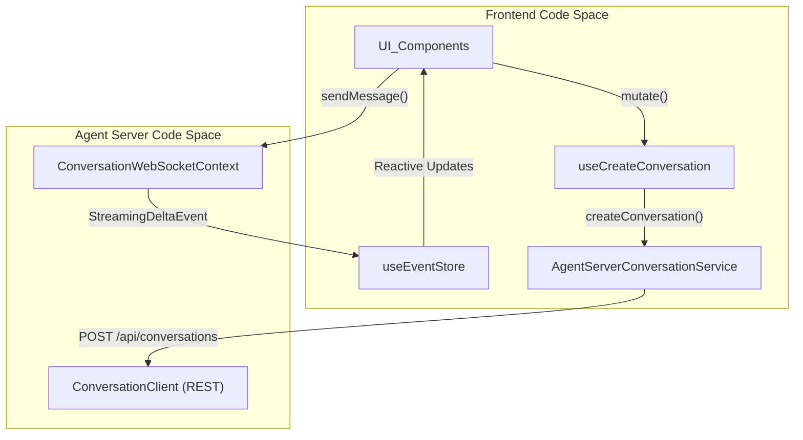
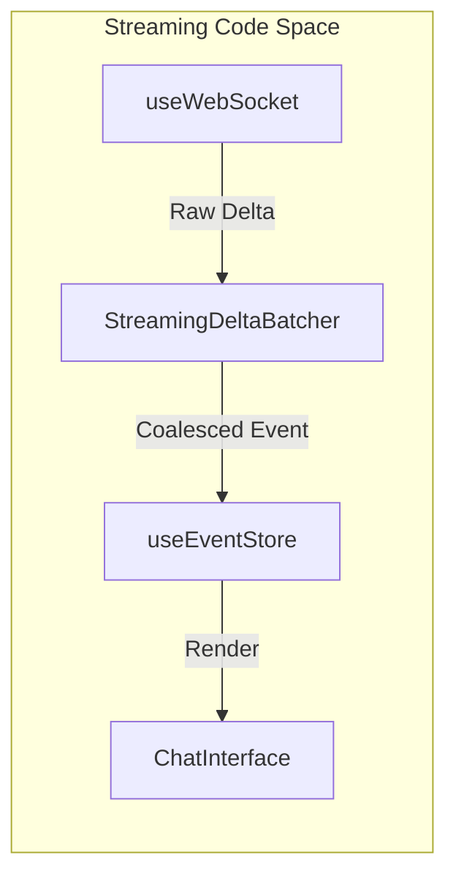

# Conversation System

Relevant source files

The following files were used as context for generating this wiki page:

- [__tests__/api/agent-server-adapter.test.ts](__tests__/api/agent-server-adapter.test.ts)
- [__tests__/api/agent-server-conversation-service.test.ts](__tests__/api/agent-server-conversation-service.test.ts)
- [__tests__/api/use-create-conversation-metadata.test.ts](__tests__/api/use-create-conversation-metadata.test.ts)
- [__tests__/hooks/mutation/use-create-conversation.test.tsx](__tests__/hooks/mutation/use-create-conversation.test.tsx)
- [__tests__/hooks/mutation/use-switch-llm-profile-and-log.test.tsx](__tests__/hooks/mutation/use-switch-llm-profile-and-log.test.tsx)
- [src/api/agent-server-adapter.ts](src/api/agent-server-adapter.ts)
- [src/api/conversation-metadata-store.ts](src/api/conversation-metadata-store.ts)
- [src/api/conversation-service/agent-server-conversation-service.api.ts](src/api/conversation-service/agent-server-conversation-service.api.ts)
- [src/api/conversation-service/agent-server-conversation-service.types.ts](src/api/conversation-service/agent-server-conversation-service.types.ts)
- [src/hooks/mutation/use-create-conversation.ts](src/hooks/mutation/use-create-conversation.ts)
- [src/hooks/mutation/use-switch-llm-profile-and-log.ts](src/hooks/mutation/use-switch-llm-profile-and-log.ts)
- [src/i18n/translation.json](src/i18n/translation.json)

The Conversation System manages the end-to-end lifecycle of agent interactions, encompassing state persistence, real-time event streaming via WebSockets, and the complex UI orchestration of the conversation panel and main view. It serves as the primary bridge between the user's intent and the Agent Server's execution via `AgentServerConversationService` [src/api/conversation-service/agent-server-conversation-service.api.ts:1-75]().

For details on specific subsystems, see the child pages:
- [Conversation Service and Lifecycle](#7.1) — Document `AgentServerConversationService`: `createConversation` pipeline, `sendMessage`, search, fork, switchProfile, `conversation-metadata-store`, child conversation launch, stop/pause mutations.
- [WebSocket and Event Streaming](#7.2) — Document `ConversationWebSocketContext`, `useWebSocket`, `useEventStore`, `streaming-delta-batcher`, status utilities, page-visibility reconnect, and event-service for older events.
- [Conversation Panel and List](#7.3) — Document the `ConversationPanel` sidebar: pagination, filtering, sorting, grouping, tags, pinned/archived conversations, `ConversationCard` and its context menu, preferences store.
- [Conversation Tabs and Main View](#7.4) — Document `ConversationTabs` (chat, files, commits, browser, terminal, planner, usage), tab content containers, context menu, `ConversationName` inline editing, mobile panel pages, right-panel toggle, `canvas-ui` service.
- [Conversation Modals: Skills, Hooks, and System Message](#7.5) — Document the conversation-panel modals: `skills-modal` and sections, `hooks-modal` and `hook-matcher-content`, `plugins-modal`, `system-message-modal`, and conversation workspace boundaries.

---

## System Architecture

The system operates across three primary layers: the **API Service Layer** (REST), the **Streaming Layer** (WebSockets), and the **State Management Layer** (Zustand/TanStack Query).

### Conversation Data Flow

**Sources:**
- [src/api/conversation-service/agent-server-conversation-service.api.ts:1-75]()
- [src/hooks/mutation/use-create-conversation.ts:1-65]()
- [src/stores/use-event-store.ts:1-50]()

---

## Conversation Lifecycle and Service

The `AgentServerConversationService` manages the creation, searching, and modification of conversations. It normalizes data from the Agent Server into `AppConversation` objects, handling differences between Local and Cloud backends [src/api/conversation-service/agent-server-conversation-service.api.ts:413-520]().

### Key Service Components
- **`buildStartConversationRequest`**: Assembles the complex payload required to boot an agent, including LLM profiles, workspace paths, and bundled skills. It handles the discriminator between `OpenHands` and `ACP` agent types [src/api/agent-server-adapter.ts:448-650]().
- **`toAppConversation`**: Transforms raw `DirectConversationInfo` from the wire into the application's internal conversation model, resolving tags like `acpserver` for UI badges [src/api/agent-server-adapter.ts:285-390]().
- **Metadata Persistence**: The `conversation-metadata-store` tracks frontend-specific state like `selected_repository`, `git_provider`, and `workspace_mode` that are not stored on the server [src/api/conversation-metadata-store.ts:1-60]().
- **Creation Pipeline**: `useCreateConversation` handles the orchestration of fetching active agent profiles and resolving LLM settings before calling the service [src/hooks/mutation/use-create-conversation.ts:62-150]().

For details, see [Conversation Service and Lifecycle](#7.1).

**Sources:**
- [src/api/agent-server-adapter.ts:54-117]()
- [src/api/conversation-service/agent-server-conversation-service.api.ts:413-520]()
- [src/hooks/mutation/use-create-conversation.ts:80-140]()

---

## WebSocket and Event Streaming

Real-time interaction is powered by the `ConversationWebSocketContext`. It maintains two primary connections: a **Main Socket** for standard agent events and a **Planning Socket** for high-level task orchestration.

### Streaming Pipeline

- **`useWebSocket`**: A robust hook managing connection state, heartbeats, and automatic reconnection logic. It constructs URLs using `buildWebSocketUrl` [src/hooks/use-websocket.ts:17-155]().
- **`StreamingDeltaBatcher`**: Coalesces high-frequency token streams into manageable UI updates (≤1 render per frame) to prevent browser lag [src/utils/streaming-delta-batcher.ts:1-40]().
- **`useEventStore`**: A Zustand store that accumulates `OpenHandsEvent` objects, performing de-duplication and chronological sorting [src/stores/use-event-store.ts:153-160]().
- **Event Synchronization**: The context uses `useConversationHistory` to load initial state via REST before switching to WebSocket streaming [src/contexts/conversation-websocket-context.tsx:179-210]().

For details, see [WebSocket and Event Streaming](#7.2).

**Sources:**
- [src/contexts/conversation-websocket-context.tsx:162-180]()
- [src/hooks/use-websocket.ts:56-118]()
- [src/api/agent-server-adapter.ts:850-900]()

---

## Conversation UI Components

The UI is split between navigation/management (Sidebar) and the active workspace (Main View).

### Conversation Panel (Sidebar)
The `ConversationPanel` handles the organizational aspects of the system:
- **Filtering & Grouping**: Conversations can be grouped chronologically or by workspace/repository using `ConversationPanelPreferencesStore`.
- **Search**: Integrated search across conversation titles and metadata via `searchConversations` [src/api/conversation-service/agent-server-conversation-service.api.ts:355-390]().

### Conversation Tabs and Main View
The main view provides a multi-tab environment for interacting with the agent:
- **`ConversationTabs`**: Switches between Chat, Files, Terminal, Browser, and Planner views.
- **Inline Editing**: Allows renaming conversations directly in the header, which triggers `updateConversationTitle` on the backend.
- **Context Management**: The `ActiveBackendContext` ensures the UI is pointing to the correct agent-server instance (Local vs Cloud) [src/api/agent-server-config.ts:167-175]().

### Modals and Workspace Boundaries
Modal dialogs support advanced configuration, including `skills-modal`, `hooks-modal`, `plugins-modal`, and `system-message-modal`. These define runtime boundaries and inject custom tools or scripts into individual conversation workspaces.

For details, see [Conversation Panel and List](#7.3), [Conversation Tabs and Main View](#7.4), and [Conversation Modals: Skills, Hooks, and System Message](#7.5).

**Sources:**
- [src/api/conversation-metadata-store.ts:57-80]()
- [src/api/agent-server-config.ts:209-225]()
- [src/api/agent-server-adapter.ts:159-202]()