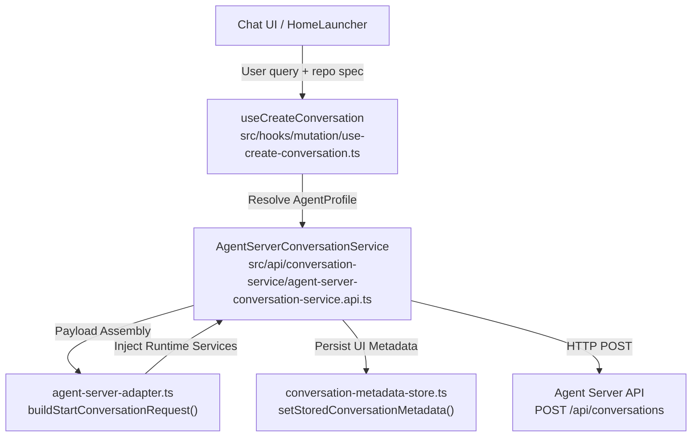

# Conversation Service and Lifecycle

Relevant source files

The following files were used as context for generating this wiki page:

- [__tests__/api/agent-server-adapter.test.ts](__tests__/api/agent-server-adapter.test.ts)
- [__tests__/api/agent-server-conversation-service.test.ts](__tests__/api/agent-server-conversation-service.test.ts)
- [__tests__/api/cloud/conversation-create.test.ts](__tests__/api/cloud/conversation-create.test.ts)
- [__tests__/api/use-create-conversation-metadata.test.ts](__tests__/api/use-create-conversation-metadata.test.ts)
- [__tests__/hooks/mutation/pause-conversation-mutation-behavior.test.tsx](__tests__/hooks/mutation/pause-conversation-mutation-behavior.test.tsx)
- [__tests__/hooks/mutation/use-create-conversation.test.tsx](__tests__/hooks/mutation/use-create-conversation.test.tsx)
- [__tests__/hooks/mutation/use-switch-llm-profile-and-log.test.tsx](__tests__/hooks/mutation/use-switch-llm-profile-and-log.test.tsx)
- [__tests__/hooks/mutation/use-unified-stop-conversation.test.tsx](__tests__/hooks/mutation/use-unified-stop-conversation.test.tsx)
- [__tests__/hooks/query/use-conversation-skills.test.tsx](__tests__/hooks/query/use-conversation-skills.test.tsx)
- [__tests__/hooks/query/use-paginated-conversations.test.tsx](__tests__/hooks/query/use-paginated-conversations.test.tsx)
- [__tests__/hooks/query/use-user-conversation.test.tsx](__tests__/hooks/query/use-user-conversation.test.tsx)
- [__tests__/routes/conversation-backend-switch.test.tsx](__tests__/routes/conversation-backend-switch.test.tsx)
- [__tests__/services/child-conversation-launch.test.ts](__tests__/services/child-conversation-launch.test.ts)
- [src/api/agent-server-adapter.ts](src/api/agent-server-adapter.ts)
- [src/api/cloud/cloud-sandbox-resume-suppression.ts](src/api/cloud/cloud-sandbox-resume-suppression.ts)
- [src/api/cloud/proxy.test.ts](src/api/cloud/proxy.test.ts)
- [src/api/conversation-metadata-store.ts](src/api/conversation-metadata-store.ts)
- [src/api/conversation-service/agent-server-conversation-service.api.ts](src/api/conversation-service/agent-server-conversation-service.api.ts)
- [src/api/conversation-service/agent-server-conversation-service.types.ts](src/api/conversation-service/agent-server-conversation-service.types.ts)
- [src/hooks/mutation/use-cloud-sandbox-auto-resume.ts](src/hooks/mutation/use-cloud-sandbox-auto-resume.ts)
- [src/hooks/mutation/use-create-conversation.ts](src/hooks/mutation/use-create-conversation.ts)
- [src/hooks/mutation/use-new-conversation-command.ts](src/hooks/mutation/use-new-conversation-command.ts)
- [src/hooks/mutation/use-pause-conversation.ts](src/hooks/mutation/use-pause-conversation.ts)
- [src/hooks/mutation/use-switch-llm-profile-and-log.ts](src/hooks/mutation/use-switch-llm-profile-and-log.ts)
- [src/hooks/mutation/use-unified-stop-conversation.ts](src/hooks/mutation/use-unified-stop-conversation.ts)
- [src/hooks/query/use-paginated-conversations.ts](src/hooks/query/use-paginated-conversations.ts)
- [src/hooks/query/use-sub-conversations.ts](src/hooks/query/use-sub-conversations.ts)
- [src/hooks/query/use-user-conversation.ts](src/hooks/query/use-user-conversation.ts)
- [src/i18n/translation.json](src/i18n/translation.json)
- [src/query-client-config.ts](src/query-client-config.ts)
- [src/routes/conversation.tsx](src/routes/conversation.tsx)
- [src/services/child-conversation-launch.ts](src/services/child-conversation-launch.ts)

## Purpose and Scope

The **AgentServerConversationService** [`src/api/conversation-service/agent-server-conversation-service.api.ts:1-75`]() serves as the primary frontend orchestration layer for managing OpenHands conversations. It coordinates the complete conversation lifecycle—from initial creation via `useCreateConversation` [src/hooks/mutation/use-create-conversation.ts:74-120]() and payload building via `buildStartConversationRequest` [src/api/agent-server-adapter.ts:13-21]() to real-time messaging, searching, forking, profile switching, and local metadata persistence.

Sources: [src/api/conversation-service/agent-server-conversation-service.api.ts:1-75](), [src/hooks/mutation/use-create-conversation.ts:74-120](), [src/api/agent-server-adapter.ts:13-21]()

---

## Service Architecture & Core Entities

The conversation system bridges UI components with the `agent-server` through specialized abstraction layers, state stores, and adapter modules.

| Entity / Module | Role & Responsibilities |
| :--- | :--- |
| `AgentServerConversationService` [src/api/conversation-service/agent-server-conversation-service.api.ts:1-75]() | Core API client providing methods for conversation CRUD, forking, searching, and profile actions. |
| `agent-server-adapter.ts` [src/api/agent-server-adapter.ts:1-52]() | Assembles complex `AppConversationStartRequest` payloads and normalizes backend responses via `toAppConversation`. |
| `conversation-metadata-store.ts` [src/api/conversation-metadata-store.ts:1-67]() | Local browser persistence for UI-specific context (e.g., workspace modes, repository attachments). |
| `useCreateConversation` [src/hooks/mutation/use-create-conversation.ts:74-120]() | React mutation hook orchestrating agent profile discovery, settings injection, and telemetry. |
| `usePaginatedConversations` [src/hooks/query/use-paginated-conversations.ts:10-63]() | Infinite query hook managing conversation sidebar lists and periodic background polling. |

Sources: [src/api/conversation-service/agent-server-conversation-service.api.ts:1-75](), [src/api/agent-server-adapter.ts:1-52](), [src/api/conversation-metadata-store.ts:1-67](), [src/hooks/mutation/use-create-conversation.ts:74-120](), [src/hooks/query/use-paginated-conversations.ts:10-63]()

### Conversation Architecture Diagram

This diagram bridges the **Natural Language Space** (User Intent) to the **Code Entity Space** (Service Methods and Adapters).

Sources: [src/hooks/mutation/use-create-conversation.ts:101-156](), [src/api/conversation-service/agent-server-conversation-service.api.ts:1-75](), [src/api/agent-server-adapter.ts:13-21]()

---

## Conversation Creation Pipeline (`createConversation`)

The conversation creation pipeline is initiated by `useCreateConversation` [src/hooks/mutation/use-create-conversation.ts:74-120](), which performs pre-flight profile and settings checks before delegating to `AgentServerConversationService.createConversation` [src/api/conversation-service/agent-server-conversation-service.api.ts:1-75]().

### Pipeline Execution Flow

```mermaid
graph LR
    Start["useCreateConversation.mutate()"] --> Profiles["Query ensureQueryData<br/>AgentProfilesService.listProfiles"]
    Profiles --> Resolve["Resolve agentProfileId & LLM Profiles"]
    Resolve --> Build["buildStartConversationRequest()<br/>agent-server-adapter.ts"]
    Build --> Call["AgentServerConversationService.createConversation()"]
    Call --> Meta["setStoredConversationMetadata()<br/>conversation-metadata-store.ts"]
```

1. **Profile Resolution:** The hook ensures cached agent profiles are warm using `queryClient.ensureQueryData` against `AgentProfilesService.listProfiles` [src/hooks/mutation/use-create-conversation.ts:128-136]().
2. **Payload Construction:** Calls `buildStartConversationRequest` to bundle initial messages, repository parameters, plugins, and client tools into an `AppConversationStartRequest` [src/api/conversation-service/agent-server-conversation-service.types.ts:67-104]().
3. **Metadata Persistence:** Upon successful creation, repository bindings, working directories, and workspace modes are saved via `setStoredConversationMetadata` [__tests__/api/use-create-conversation-metadata.test.ts:160-166]().

Sources: [src/hooks/mutation/use-create-conversation.ts:74-156](), [src/api/conversation-service/agent-server-conversation-service.types.ts:67-104](), [__tests__/api/use-create-conversation-metadata.test.ts:160-166]()

---

## Messaging, Search, and Forking

Once initialized, conversations interact with the backend via REST endpoints and WebSockets managed by `AgentServerConversationService`.

- **Sending Messages (`sendMessage`):** Dispatches user or system messages containing text or image payloads (`SendMessageRequest`) [src/api/conversation-service/agent-server-conversation-service.types.ts:62-65]() to the active conversation session.
- **Searching Conversations (`searchConversations`):** Used by `usePaginatedConversations` to query paginated conversation lists with limits and page tokens [src/hooks/query/use-paginated-conversations.ts:32-35]().
- **Forking Conversations (`forkConversation`):** Clones an existing conversation state and history from a specific point using `ForkConversationRequest` payloads [src/api/conversation-service/agent-server-conversation-service.api.ts:4-7]().

Sources: [src/api/conversation-service/agent-server-conversation-service.types.ts:62-65](), [src/hooks/query/use-paginated-conversations.ts:32-35](), [src/api/conversation-service/agent-server-conversation-service.api.ts:4-7]()

---

## Profile Switching and Runtime Updates

Mid-conversation mutations allow changing agent configurations, models, or profiles dynamically.

- **Profile Switching (`switchProfile`):** Updates the active agent profile or underlying LLM configuration during an active session [src/api/conversation-service/agent-server-conversation-service.api.ts:28-28]().
- **Model Interception:** Hooks like `use-switch-acp-model` and model switch loggers record model transitions into the event stream for audit and UI consistency.

Sources: [src/api/conversation-service/agent-server-conversation-service.api.ts:28-28]()

---

## Conversation Metadata Store (`conversation-metadata-store.ts`)

While the backend agent server maintains execution state and event logs, the frontend uses `conversation-metadata-store.ts` to persist client-side UI configurations per conversation ID [src/api/conversation-metadata-store.ts:1-67]().

| Metadata Key | Type | Description |
| :--- | :--- | :--- |
| `selected_repository` | `string \| null` | The git repository name attached to the conversation [__tests__/api/use-create-conversation-metadata.test.ts:161-161](). |
| `selected_branch` | `string \| null` | The active target branch for git operations [__tests__/api/use-create-conversation-metadata.test.ts:162-162](). |
| `git_provider` | `Provider \| null` | The hosting provider (e.g. `github`, `gitlab`) [__tests__/api/use-create-conversation-metadata.test.ts:163-163](). |
| `selected_workspace` | `string \| null` | Local directory path for workspace isolation [__tests__/api/use-create-conversation-metadata.test.ts:185-185](). |
| `workspace_mode` | `WorkspaceMode` | Mode indicator (`local_repo`, `new_worktree`, `sandbox_only`) [__tests__/api/use-create-conversation-metadata.test.ts:165-165](). |

Sources: [src/api/conversation-metadata-store.ts:1-67](), [__tests__/api/use-create-conversation-metadata.test.ts:160-186]()

---

## Child Conversation Launch & Sub-Conversations

Conversations can spawn child tasks or sub-conversations (such as local planners or delegated sub-tasks).

- **Client Tools:** The adapter registers `LAUNCH_CHILD_CONVERSATION_CLIENT_TOOL` and `CANVAS_UI_CLIENT_TOOL` with the runtime, enabling agents to initiate child workflows [src/api/agent-server-adapter.ts:62-70]().
- **Server Tracking:** Child conversation links are tracked via `sub_conversation_ids` returned in `DirectConversationInfo` and `AppConversation` responses [src/api/agent-server-adapter.ts:158-158]().

Sources: [src/api/agent-server-adapter.ts:62-70](), [src/api/agent-server-adapter.ts:158-158]()

---

## Stop and Pause Mutations

Execution control is managed via unified mutation hooks that interact with the agent server to halt or suspend conversation loops.

- **Stop Mutations:** `use-unified-stop-conversation.ts` handles stopping active agent runs and cancelling execution tasks.
- **Pause Mutations:** `use-pause-conversation.ts` handles pausing cloud sandboxes and local execution states without terminating container lifecycles.

Sources: [src/hooks/mutation/use-unified-stop-conversation.ts](), [src/hooks/mutation/use-pause-conversation.ts]()