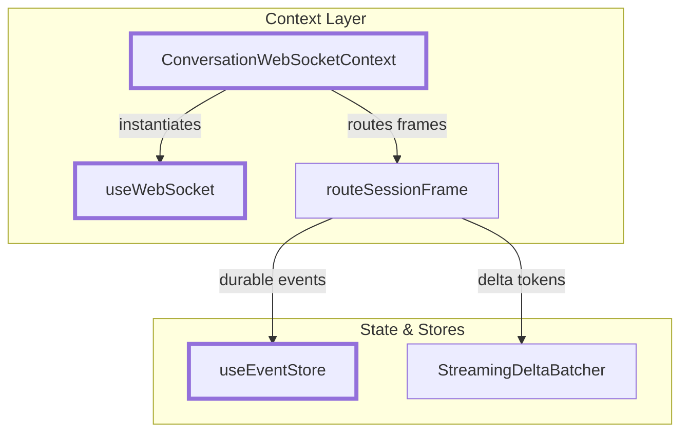
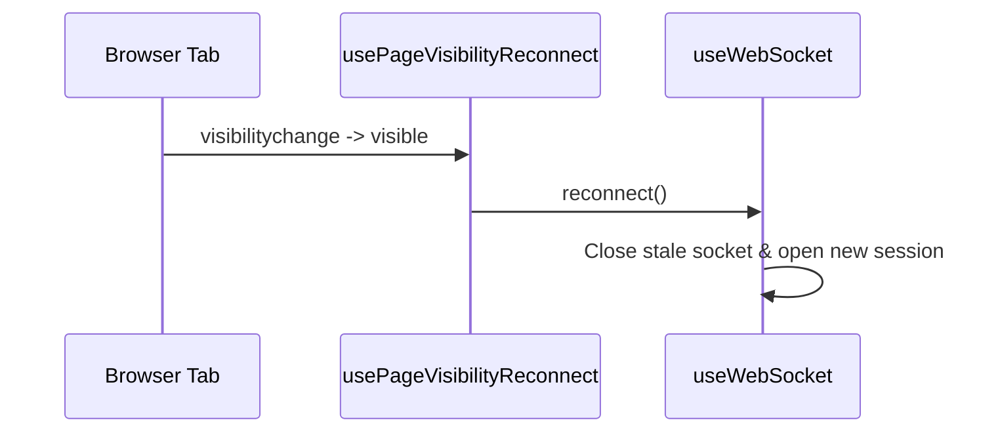
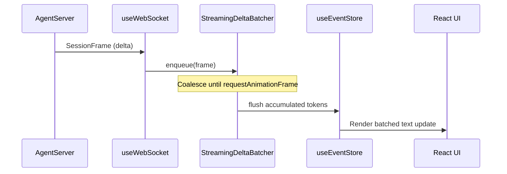
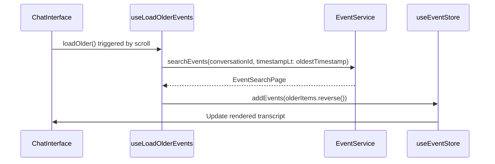

# WebSocket and Event Streaming

Relevant source files

The following files were used as context for generating this wiki page:

- [__tests__/api/event-service.test.ts](__tests__/api/event-service.test.ts)
- [__tests__/build-websocket-url.test.ts](__tests__/build-websocket-url.test.ts)
- [__tests__/components/chat/chat-interface.test.tsx](__tests__/components/chat/chat-interface.test.tsx)
- [__tests__/components/chat/message-display-continuity.test.tsx](__tests__/components/chat/message-display-continuity.test.tsx)
- [__tests__/contexts/conversation-websocket-context.test.tsx](__tests__/contexts/conversation-websocket-context.test.tsx)
- [__tests__/contexts/conversation-websocket-provider.behavior.test.tsx](__tests__/contexts/conversation-websocket-provider.behavior.test.tsx)
- [__tests__/hooks/query/use-conversation-history.test.tsx](__tests__/hooks/query/use-conversation-history.test.tsx)
- [__tests__/hooks/query/use-has-git-commits.test.tsx](__tests__/hooks/query/use-has-git-commits.test.tsx)
- [__tests__/hooks/query/use-local-git-info.test.tsx](__tests__/hooks/query/use-local-git-info.test.tsx)
- [__tests__/hooks/use-load-older-events.test.tsx](__tests__/hooks/use-load-older-events.test.tsx)
- [__tests__/hooks/use-page-visibility-reconnect.test.ts](__tests__/hooks/use-page-visibility-reconnect.test.ts)
- [__tests__/hooks/use-websocket-regressions.test.ts](__tests__/hooks/use-websocket-regressions.test.ts)
- [__tests__/hooks/use-websocket.test.ts](__tests__/hooks/use-websocket.test.ts)
- [__tests__/stores/use-event-store.test.ts](__tests__/stores/use-event-store.test.ts)
- [__tests__/utils/status.test.ts](__tests__/utils/status.test.ts)
- [__tests__/utils/streaming-delta-batcher.test.ts](__tests__/utils/streaming-delta-batcher.test.ts)
- [__tests__/utils/websocket-url.test.ts](__tests__/utils/websocket-url.test.ts)
- [src/api/event-service/event-service.api.ts](src/api/event-service/event-service.api.ts)
- [src/api/event-service/event-service.types.ts](src/api/event-service/event-service.types.ts)
- [src/components/features/chat/chat-interface.tsx](src/components/features/chat/chat-interface.tsx)
- [src/components/features/conversation/transcript-export-modal.tsx](src/components/features/conversation/transcript-export-modal.tsx)
- [src/contexts/conversation-websocket-context.tsx](src/contexts/conversation-websocket-context.tsx)
- [src/hooks/query/use-conversation-history.ts](src/hooks/query/use-conversation-history.ts)
- [src/hooks/query/use-has-git-commits.ts](src/hooks/query/use-has-git-commits.ts)
- [src/hooks/query/use-local-git-info.ts](src/hooks/query/use-local-git-info.ts)
- [src/hooks/use-bash-command-runner.ts](src/hooks/use-bash-command-runner.ts)
- [src/hooks/use-load-older-events.ts](src/hooks/use-load-older-events.ts)
- [src/hooks/use-page-visibility-reconnect.ts](src/hooks/use-page-visibility-reconnect.ts)
- [src/hooks/use-unified-websocket-status.ts](src/hooks/use-unified-websocket-status.ts)
- [src/hooks/use-websocket.ts](src/hooks/use-websocket.ts)
- [src/stores/use-event-store.ts](src/stores/use-event-store.ts)
- [src/utils/status.ts](src/utils/status.ts)
- [src/utils/streaming-delta-batcher.ts](src/utils/streaming-delta-batcher.ts)
- [src/utils/transcript-export/__snapshots__/index.test.ts.snap](src/utils/transcript-export/__snapshots__/index.test.ts.snap)
- [src/utils/websocket-url.ts](src/utils/websocket-url.ts)

This wiki page documents the frontend WebSocket architecture and event streaming system in OpenHands. It covers `ConversationWebSocketContext`, the underlying `useWebSocket` hook, the Zustand-based `useEventStore` for state management, streaming delta batching, status utilities, page-visibility reconnection, and REST-backed older event loading via `EventService`.

---

## 1. WebSocket Infrastructure and Context

OpenHands uses WebSockets as the primary transport for real-time agent interactions. The `ConversationWebSocketProvider` manages both the main agent event stream and secondary socket streams (such as planning agent sockets) for a given conversation [src/contexts/conversation-websocket-context.tsx:98-114]().

The underlying `useWebSocket` hook manages the socket lifecycle, tracking connection states (`CONNECTING`, `OPEN`, `CLOSING`, `CLOSED`), parsing incoming frames, and executing reconnection routines [src/hooks/use-websocket.ts:3-150]().

**Sources:** [src/contexts/conversation-websocket-context.tsx:98-180](), [src/hooks/use-websocket.ts:3-150]()

---

## 2. URL Construction and Page-Visibility Reconnect

### URL Construction

WebSocket URLs are dynamically generated using `buildWebSocketUrl`, which extracts the base host and path prefix from the conversation's endpoint URL and handles protocol upgrades (`ws:` or `wss:` depending on page security and target host configuration) [src/utils/websocket-url.ts:87-115]().

### Page-Visibility Reconnect

The `usePageVisibilityReconnect` hook monitors browser tab focus via the `visibilitychange` event. When a user returns to a backgrounded tab where the WebSocket connection dropped or stalled, the hook automatically triggers a reconnection sequence [src/hooks/use-page-visibility-reconnect.ts:1-50]().

**Sources:** [src/utils/websocket-url.ts:87-115](), [src/hooks/use-page-visibility-reconnect.ts:1-50]()

---

## 3. Event Management Store (`useEventStore`)

The `useEventStore` Zustand store acts as the single source of truth for all conversation events accumulated in memory [src/stores/use-event-store.ts:1-50]().

*   **Deduplication**: Incoming events are filtered by their unique `id` against an `eventIds` `Set` to prevent duplicate renders [src/stores/use-event-store.ts:99-102]().
*   **Chronological Sorting**: Events are kept sorted by timestamp using comparison utilities [src/stores/use-event-store.ts:24-35]().
*   **UI Projection**: Action events are mapped to corresponding observation events via UI projection handlers to maintain a clean message transcript [src/stores/use-event-store.ts:127]().

**Sources:** [src/stores/use-event-store.ts:1-127]()

---

## 4. Streaming Deltas and Batching (`streaming-delta-batcher`)

High-frequency token streaming from LLM agent responses can saturate React's render pipeline. The `StreamingDeltaBatcher` coalesces incoming `delta` frames and flushes them to `useEventStore` synchronized with browser repaint cycles using `requestAnimationFrame` [src/utils/streaming-delta-batcher.ts:1-50](), [src/contexts/conversation-websocket-context.tsx:148-180]().

**Sources:** [src/utils/streaming-delta-batcher.ts:1-50](), [src/contexts/conversation-websocket-context.tsx:148-180]()

---

## 5. Status Utilities

Status helper functions (`getStatusColor`, `getStatusText`, and connection state matchers) translate raw backend execution states and WebSocket connection enums into displayable labels and badge styling for UI status indicators [src/utils/status.ts:1-40]().

**Sources:** [src/utils/status.ts:1-40]()

---

## 6. Historical Events and Lazy Loading (`EventService`)

When a conversation loads, initial history is fetched via REST. As users scroll up within the chat interface, older events are lazily fetched using `EventService.searchEvents` combined with the `useLoadOlderEvents` hook [src/api/event-service/event-service.api.ts:75-154](), [src/hooks/use-load-older-events.ts:44-165]().

**Sources:** [src/api/event-service/event-service.api.ts:75-154](), [src/hooks/use-load-older-events.ts:44-165]()