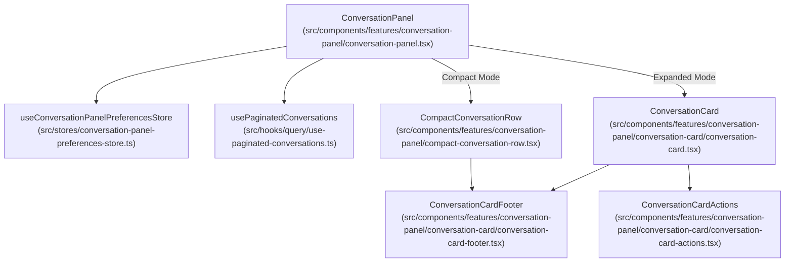
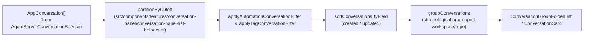

# Conversation Panel and List

Relevant source files

The following files were used as context for generating this wiki page:

- [__tests__/components/features/conversation-panel/advanced-conversation-options-modal.test.tsx](__tests__/components/features/conversation-panel/advanced-conversation-options-modal.test.tsx)
- [__tests__/components/features/conversation-panel/conversation-active-tag-filters.test.tsx](__tests__/components/features/conversation-panel/conversation-active-tag-filters.test.tsx)
- [__tests__/components/features/conversation-panel/conversation-card.test.tsx](__tests__/components/features/conversation-panel/conversation-card.test.tsx)
- [__tests__/components/features/conversation-panel/conversation-layouts-menu.test.tsx](__tests__/components/features/conversation-panel/conversation-layouts-menu.test.tsx)
- [__tests__/components/features/conversation-panel/conversation-panel-list-helpers.test.ts](__tests__/components/features/conversation-panel/conversation-panel-list-helpers.test.ts)
- [__tests__/components/features/conversation-panel/conversation-tag-chips.test.tsx](__tests__/components/features/conversation-panel/conversation-tag-chips.test.tsx)
- [__tests__/components/features/conversation-panel/conversation-tag-display.test.ts](__tests__/components/features/conversation-panel/conversation-tag-display.test.ts)
- [__tests__/components/features/conversation-panel/edit-conversation-tags-modal.test.tsx](__tests__/components/features/conversation-panel/edit-conversation-tags-modal.test.tsx)
- [__tests__/hooks/mutation/use-update-conversation-tags.test.tsx](__tests__/hooks/mutation/use-update-conversation-tags.test.tsx)
- [__tests__/hooks/use-conversation-name-context-menu.test.tsx](__tests__/hooks/use-conversation-name-context-menu.test.tsx)
- [__tests__/hooks/use-download-conversation.test.ts](__tests__/hooks/use-download-conversation.test.ts)
- [__tests__/stores/conversation-panel-preferences-store.test.ts](__tests__/stores/conversation-panel-preferences-store.test.ts)
- [src/components/features/conversation-panel/compact-conversation-row.tsx](src/components/features/conversation-panel/compact-conversation-row.tsx)
- [src/components/features/conversation-panel/conversation-active-tag-filters.tsx](src/components/features/conversation-panel/conversation-active-tag-filters.tsx)
- [src/components/features/conversation-panel/conversation-card/conversation-card-actions.tsx](src/components/features/conversation-panel/conversation-card/conversation-card-actions.tsx)
- [src/components/features/conversation-panel/conversation-card/conversation-card-footer.tsx](src/components/features/conversation-panel/conversation-card/conversation-card-footer.tsx)
- [src/components/features/conversation-panel/conversation-card/conversation-card.tsx](src/components/features/conversation-panel/conversation-card/conversation-card.tsx)
- [src/components/features/conversation-panel/conversation-card/conversation-tag-chips.tsx](src/components/features/conversation-panel/conversation-card/conversation-tag-chips.tsx)
- [src/components/features/conversation-panel/conversation-card/conversation-tag-display.ts](src/components/features/conversation-panel/conversation-card/conversation-tag-display.ts)
- [src/components/features/conversation-panel/conversation-card/conversation-tag-icons.ts](src/components/features/conversation-panel/conversation-card/conversation-tag-icons.ts)
- [src/components/features/conversation-panel/conversation-layouts-menu.tsx](src/components/features/conversation-panel/conversation-layouts-menu.tsx)
- [src/components/features/conversation-panel/conversation-panel-list-helpers.ts](src/components/features/conversation-panel/conversation-panel-list-helpers.ts)
- [src/components/features/conversation-panel/conversation-panel.tsx](src/components/features/conversation-panel/conversation-panel.tsx)
- [src/hooks/use-conversation-name-context-menu.ts](src/hooks/use-conversation-name-context-menu.ts)
- [src/hooks/use-download-conversation.ts](src/hooks/use-download-conversation.ts)
- [src/stores/conversation-panel-preferences-store.ts](src/stores/conversation-panel-preferences-store.ts)

## Purpose and Scope

The Conversation Panel is the primary navigation sidebar for managing agent interactions within Agent Canvas. It provides a comprehensive interface for pagination, filtering, sorting, grouping, tagging, and handling pinned or archived conversations. This page documents the component architecture, data transformation logic, state persistence via the preferences store, the `ConversationCard` component, and its associated context menus and action handlers.

Sources: [src/components/features/conversation-panel/conversation-panel.tsx:79-85](), [src/stores/conversation-panel-preferences-store.ts:13-18]()

---

## Component Architecture and Layouts

The sidebar navigation is orchestrated by `ConversationPanel` [src/components/features/conversation-panel/conversation-panel.tsx:79-82](), which adapts its presentation based on whether the sidebar is fully expanded or collapsed into a compact icon-only rail (`compact` prop) [src/components/features/conversation-panel/conversation-panel.tsx:81](). 

When collapsed, conversations are rendered as `CompactConversationRow` components [src/components/features/conversation-panel/compact-conversation-row.tsx:41-60](), displaying an agent status dot `ConversationStatusDot` [src/components/features/conversation-panel/conversation-status-dot.tsx]() inside a HeroUI `Tooltip` [src/components/features/conversation-panel/compact-conversation-row.tsx:99-126]() that previews the card content on hover.

Title: "Conversation Panel Component Hierarchy to Code Entities"

Sources: [src/components/features/conversation-panel/conversation-panel.tsx:79-135](), [src/components/features/conversation-panel/compact-conversation-row.tsx:41-60](), [src/stores/conversation-panel-preferences-store.ts:123-125]()

---

## Data Flow and List Transformation Helpers

The raw list of conversations fetched from the backend is transformed using pure utility functions defined in `conversation-panel-list-helpers.ts`. These functions handle pagination boundaries, timestamp cutoffs, tag filtering, sorting fields, and hierarchical grouping.

### Partitioning and Filtering
- **Cutoff Partitioning**: `partitionByCutoff` [src/components/features/conversation-panel/conversation-panel-list-helpers.ts:62-79]() splits conversations into `recent` and `older` buckets based on `olderConversationCutoff` thresholds (`1h`, `1d`, `7d`, `30d`) [src/components/features/conversation-panel/conversation-panel-list-helpers.ts:27-46]().
- **Automation Filtering**: `applyAutomationConversationFilter` [src/components/features/conversation-panel/conversation-panel-list-helpers.ts]() filters conversations based on `automationFilterMode` (`all`, `hide-automations`, `only-automations`) and selected automation name facets [src/stores/conversation-panel-preferences-store.ts:46-48]().
- **Tag Filtering**: `applyTagConversationFilter` [src/components/features/conversation-panel/conversation-panel-list-helpers.ts]() restricts the list to conversations matching selected tag facets.

### Sorting and Grouping
- **Sorting**: `sortConversationsByField` [src/components/features/conversation-panel/conversation-panel-list-helpers.ts]() sorts items by `created` or `updated` timestamps in descending order.
- **Grouping**: `groupConversations` [src/components/features/conversation-panel/conversation-panel-list-helpers.ts]() clusters conversations into folders based on `organizeMode` (`grouped` vs `chronological`), normalizing workspace paths and repository URLs (stripping trailing slashes and `.git` suffixes) [__tests__/components/features/conversation-panel/conversation-panel-list-helpers.test.ts:98-110]().

Title: "Conversation List Transformation Pipeline"

Sources: [src/components/features/conversation-panel/conversation-panel-list-helpers.ts:27-79](), [__tests__/components/features/conversation-panel/conversation-panel-list-helpers.test.ts:98-110]()

---

## The Conversation Card and Compact Rows

The `ConversationCard` [src/components/features/conversation-panel/conversation-card/conversation-card.tsx:73-105]() component renders individual conversation entries in the expanded panel.

### Metadata and Footer Components
- **`ConversationCardFooter`** [src/components/features/conversation-panel/conversation-card/conversation-card-footer.tsx:78-94](): Renders repository links, timestamps via `formatTimeDelta` [src/components/features/conversation-panel/conversation-card/conversation-card-footer.tsx:168](), and agent/model chips.
- **Agent & Model Chips**: Gated by the `showLlmProfiles` preference [src/stores/conversation-panel-preferences-store.ts:40](), OpenHands conversations display the native model name formatted via `formatNativeModelName` [src/components/features/conversation-panel/conversation-card/conversation-card-footer.tsx:134](), while ACP conversations show provider brand icons and resolved model labels via `labelForAcpModel` [src/components/features/conversation-panel/conversation-card/conversation-card-footer.tsx:119]().
- **Tag Chips**: Non-reserved metadata tags (e.g., `origin: slack`) are displayed as raised pill chips using `getDisplayConversationTags` [src/components/features/conversation-panel/conversation-card/conversation-card.tsx:111]().
- **Pinned & Archived State**: Managed via `usePinnedConversationsStore` [src/components/features/conversation-panel/conversation-panel.tsx:62]() and `useArchivedConversationsStore` [src/components/features/conversation-panel/conversation-panel.tsx:61](), allowing pin toggles and conditional archive filtering.

Sources: [src/components/features/conversation-panel/conversation-card/conversation-card.tsx:73-113](), [src/components/features/conversation-panel/conversation-card/conversation-card-footer.tsx:78-138]()

---

## Context Menu and Actions

Conversation cards and headers expose context menus managed by `useConversationNameContextMenu` [src/hooks/use-conversation-name-context-menu.ts:31-36]() and `ConversationCardActions` [src/components/features/conversation-panel/conversation-card/conversation-card-actions.tsx:28-42]().

### Actions and Mutations
- **Renaming**: Switches title mode between `view` and `edit` via `onChangeTitle` callbacks [src/components/features/conversation-panel/conversation-card/conversation-card.tsx:108-120]().
- **Execution Control**: Triggers conversation stopping/pausing via `useUnifiedPauseConversation` [src/hooks/use-conversation-name-context-menu.ts:42]().
- **Deletion**: Triggers deletion via `useDeleteConversation` [src/hooks/use-conversation-name-context-menu.ts:41](), navigating away if the active thread is removed [src/hooks/use-conversation-name-context-menu.ts:79-82]().
- **Export & VS Code**: Fetches VS Code deep links via `ConversationService.getVSCodeUrl` [src/components/features/conversation-panel/conversation-card/conversation-card.tsx:174]() or downloads logs via `useDownloadConversation` [src/hooks/use-download-conversation.ts]().
- **Sharing**: Builds public share URLs via `buildAgentCanvasUrl` [src/hooks/use-conversation-name-context-menu.ts:171-174]() and copies them to the clipboard [src/hooks/use-conversation-name-context-menu.ts:177-186]().

Sources: [src/hooks/use-conversation-name-context-menu.ts:31-186](), [src/components/features/conversation-panel/conversation-card/conversation-card-actions.tsx:28-143]()

---

## Preferences and Persistence Store

User display choices and layout narrowing filters are stored in `useConversationPanelPreferencesStore` [src/stores/conversation-panel-preferences-store.ts:123-125](), which persists state to `localStorage` using `zustand/persist` [src/stores/conversation-panel-preferences-store.ts:2-18]().

### Persisted State Properties
| State Field | Type | Default Value | Description |
| :--- | :--- | :--- | :--- |
| `showOlderConversations` | `boolean` | `true` | Toggles visibility of conversations older than the cutoff threshold. |
| `olderConversationCutoff` | `OlderConversationCutoff` | `"7d"` | Age threshold (`1h`, `1d`, `7d`, `30d`) for older items [src/components/features/conversation-panel/conversation-panel-list-helpers.ts:27-36](). |
| `showArchivedConversations` | `boolean` | `false` | Toggles visibility of archived threads. |
| `organizeMode` | `OrganizeMode` | `"chronological"` | Layout style (`chronological` or `grouped`) [src/components/features/conversation-panel/conversation-panel-list-helpers.ts:22](). |
| `conversationSort` | `ConversationSortField` | `"updated"` | Sorting key (`created` or `updated`) [src/components/features/conversation-panel/conversation-panel-list-helpers.ts:20](). |
| `threadScope` | `ThreadScope` | `"all"` | Scope filter (`all` or `relevant`) [src/components/features/conversation-panel/conversation-panel-list-helpers.ts:21](). |
| `automationFilterMode` | `AutomationFilterMode` | `"all"` | Automation filter mode [src/components/features/conversation-panel/conversation-panel-list-helpers.ts:23-26](). |
| `showRepoBranchMetadata` | `boolean` | `false` | Renders repository and branch metadata pills on cards. |
| `showLlmProfiles` | `boolean` | `false` | Renders the LLM model / ACP provider chip [src/stores/conversation-panel-preferences-store.ts:40](). |
| `showTagsMetadata` | `boolean` | `true` | Renders custom server tags on conversation cards. |

Sources: [src/stores/conversation-panel-preferences-store.ts:31-74](), [src/stores/conversation-panel-preferences-store.ts:113-121]()