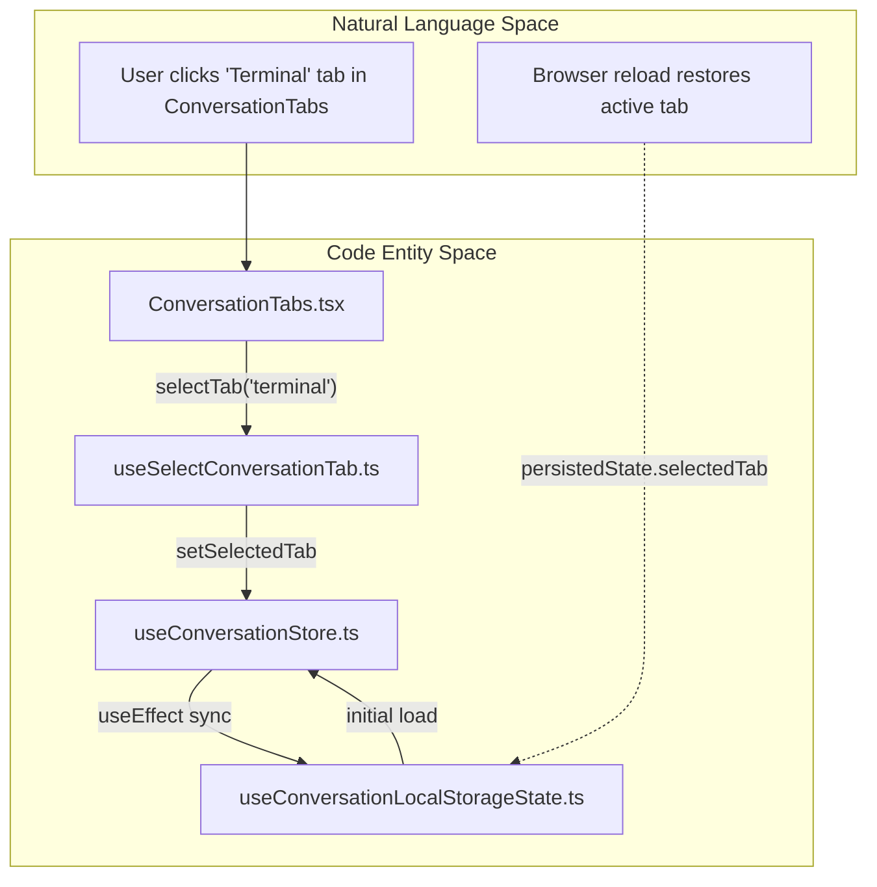
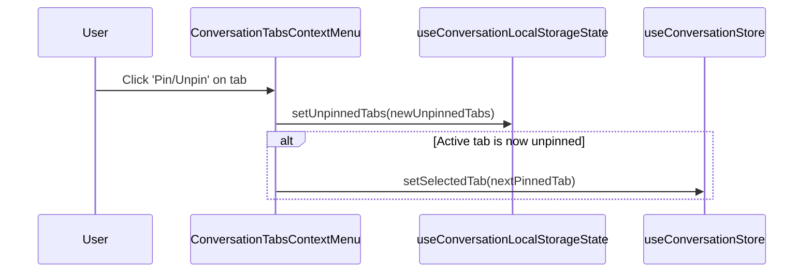

# Conversation Tabs and Main View

Relevant source files

The following files were used as context for generating this wiki page:

- [__tests__/components/automations/automation-setup-draft-service.test.ts](__tests__/components/automations/automation-setup-draft-service.test.ts)
- [__tests__/components/automations/automation-setup-panel.test.tsx](__tests__/components/automations/automation-setup-panel.test.tsx)
- [__tests__/components/chat/chat-add-file-button.test.tsx](__tests__/components/chat/chat-add-file-button.test.tsx)
- [__tests__/components/context-menu/tools-context-menu.test.tsx](__tests__/components/context-menu/tools-context-menu.test.tsx)
- [__tests__/components/features/conversation-panel/plugins-modal.test.tsx](__tests__/components/features/conversation-panel/plugins-modal.test.tsx)
- [__tests__/components/features/conversation/conversation-main.test.tsx](__tests__/components/features/conversation/conversation-main.test.tsx)
- [__tests__/components/features/conversation/conversation-mobile-panel-page.test.tsx](__tests__/components/features/conversation/conversation-mobile-panel-page.test.tsx)
- [__tests__/components/features/conversation/conversation-name-context-menu.test.tsx](__tests__/components/features/conversation/conversation-name-context-menu.test.tsx)
- [__tests__/components/features/conversation/conversation-name-with-status.integration.test.tsx](__tests__/components/features/conversation/conversation-name-with-status.integration.test.tsx)
- [__tests__/components/features/conversation/conversation-name-with-status.test.tsx](__tests__/components/features/conversation/conversation-name-with-status.test.tsx)
- [__tests__/components/features/conversation/conversation-name.test.tsx](__tests__/components/features/conversation/conversation-name.test.tsx)
- [__tests__/components/features/conversation/conversation-tab-content.test.tsx](__tests__/components/features/conversation/conversation-tab-content.test.tsx)
- [__tests__/components/features/conversation/conversation-tabs-context-menu.test.tsx](__tests__/components/features/conversation/conversation-tabs-context-menu.test.tsx)
- [__tests__/components/features/conversation/conversation-tabs.test.tsx](__tests__/components/features/conversation/conversation-tabs.test.tsx)
- [__tests__/components/features/settings/settings-nav-divider.test.tsx](__tests__/components/features/settings/settings-nav-divider.test.tsx)
- [__tests__/components/features/settings/settings-nav-header.test.tsx](__tests__/components/features/settings/settings-nav-header.test.tsx)
- [__tests__/hooks/use-conversation-panel-route.test.tsx](__tests__/hooks/use-conversation-panel-route.test.tsx)
- [__tests__/hooks/use-unified-vscode-url.test.tsx](__tests__/hooks/use-unified-vscode-url.test.tsx)
- [__tests__/scripts/docker-vscode-route-sync.test.ts](__tests__/scripts/docker-vscode-route-sync.test.ts)
- [__tests__/scripts/vscode-base-path-opt-in.test.ts](__tests__/scripts/vscode-base-path-opt-in.test.ts)
- [__tests__/services/canvas-ui.test.ts](__tests__/services/canvas-ui.test.ts)
- [__tests__/tools/automation-form-tool.test.ts](__tests__/tools/automation-form-tool.test.ts)
- [__tests__/utils/vscode-origin.test.ts](__tests__/utils/vscode-origin.test.ts)
- [src/api/automation-form-client-tool.ts](src/api/automation-form-client-tool.ts)
- [src/api/automation-form-session.ts](src/api/automation-form-session.ts)
- [src/api/automation-setup-types.ts](src/api/automation-setup-types.ts)
- [src/api/conversation-service/conversation-service.api.ts](src/api/conversation-service/conversation-service.api.ts)
- [src/components/features/automations/setup/automation-setup-draft-service.ts](src/components/features/automations/setup/automation-setup-draft-service.ts)
- [src/components/features/automations/setup/automation-setup-panel.tsx](src/components/features/automations/setup/automation-setup-panel.tsx)
- [src/components/features/chat/chat-add-file-button.tsx](src/components/features/chat/chat-add-file-button.tsx)
- [src/components/features/controls/tools-context-menu.tsx](src/components/features/controls/tools-context-menu.tsx)
- [src/components/features/conversation-panel/conversation-card/conversation-card-context-menu.tsx](src/components/features/conversation-panel/conversation-card/conversation-card-context-menu.tsx)
- [src/components/features/conversation/conversation-main/conversation-main.tsx](src/components/features/conversation/conversation-main/conversation-main.tsx)
- [src/components/features/conversation/conversation-main/conversation-mobile-panel-page.tsx](src/components/features/conversation/conversation-main/conversation-mobile-panel-page.tsx)
- [src/components/features/conversation/conversation-name-context-menu.tsx](src/components/features/conversation/conversation-name-context-menu.tsx)
- [src/components/features/conversation/conversation-name-with-status.tsx](src/components/features/conversation/conversation-name-with-status.tsx)
- [src/components/features/conversation/conversation-name.tsx](src/components/features/conversation/conversation-name.tsx)
- [src/components/features/conversation/conversation-tabs/conversation-planner-build-bar.tsx](src/components/features/conversation/conversation-tabs/conversation-planner-build-bar.tsx)
- [src/components/features/conversation/conversation-tabs/conversation-tab-content/conversation-tab-content.tsx](src/components/features/conversation/conversation-tabs/conversation-tab-content/conversation-tab-content.tsx)
- [src/components/features/conversation/conversation-tabs/conversation-tab-content/tab-container.tsx](src/components/features/conversation/conversation-tabs/conversation-tab-content/tab-container.tsx)
- [src/components/features/conversation/conversation-tabs/conversation-tab-nav.tsx](src/components/features/conversation/conversation-tabs/conversation-tab-nav.tsx)
- [src/components/features/conversation/conversation-tabs/conversation-tabs-context-menu.tsx](src/components/features/conversation/conversation-tabs/conversation-tabs-context-menu.tsx)
- [src/components/features/conversation/conversation-tabs/conversation-tabs.tsx](src/components/features/conversation/conversation-tabs/conversation-tabs.tsx)
- [src/hooks/query/use-unified-vscode-url.ts](src/hooks/query/use-unified-vscode-url.ts)
- [src/hooks/use-conversation-panel-route.ts](src/hooks/use-conversation-panel-route.ts)
- [src/routes/automation-setup-new.tsx](src/routes/automation-setup-new.tsx)
- [src/services/canvas-ui.ts](src/services/canvas-ui.ts)

## Purpose and Scope

This page documents the conversation main view and tabbed inspection system within the Agent Canvas frontend (`@openhands/agent-canvas`). It covers the layout architecture using resizable panels, mobile panel views, right-panel toggles, the tabbed interface for inspecting agent outputs (`files`, `commits`, `planner`, `terminal`, `browser`, `usage`, and `tasklist`), tab content containers, the `canvas-ui` service, tab context menus with pinning logic, and inline editing via `ConversationName`.

---

## Root Layout and Resizable Panels

The conversation main view is hosted within a flexible layout managed by `ConversationMain` [src/components/features/conversation/conversation-main/conversation-main.tsx:79-116]() inside `root-layout.tsx` [src/routes/root-layout.tsx:121-143](). It adapts dynamically to desktop split-pane configurations and mobile drawer views.

### Component Hierarchy and Right-Panel Toggle

1.  **Chat Panel (Left):** Always present, containing the chat interface wrapper and header controls [src/components/features/conversation/conversation-main/conversation-main.tsx:8-9]().
2.  **Tabs Panel (Right):** A side panel hosting `ConversationTabs` and `ConversationTabContent` [src/components/features/conversation/conversation-tabs/conversation-tab-content/conversation-tab-content.tsx:9]().
3.  **RightPanelToggle:** Controlled via the header toolbar in `ConversationNameWithStatus` to show or hide the tabs drawer [src/components/features/conversation/conversation-name-with-status.tsx:18]().

### Resizable Paneling Logic

The `useResizablePanels` hook manages the horizontal split between the chat container and the side panel [src/components/features/conversation/conversation-main/conversation-main.tsx:109-115]().

*   **Storage Key:** Panel widths are persisted in `localStorage` under `desktop-layout-panel-width` [src/components/features/conversation/conversation-main/conversation-main.tsx:114]().
*   **Constraints:** Defaults to a 50% split, bounded between a minimum width of 30% and a maximum of 80% for the left panel [src/components/features/conversation/conversation-main/conversation-main.tsx:111-113]().

Sources: [src/components/features/conversation/conversation-main/conversation-main.tsx:79-116](), [src/components/features/conversation/conversation-name-with-status.tsx:18](), [src/routes/root-layout.tsx:121-143]()

---

## Conversation Name and Inline Editing

The `ConversationName` component enables direct inspection and modification of active conversation titles [src/components/features/conversation/conversation-name.tsx:18-24]().

### Implementation Details

*   **View vs Edit Mode:** Maintained via the `titleMode` state (`"view"` or `"edit"`). Double-clicking the title switches the element to an inline `<input>` [src/components/features/conversation/conversation-name.tsx:24-71]().
*   **Persistence:** Triggered on input `blur` or when pressing the `Enter` key. If modified, it invokes `updateConversation` via `useUpdateConversation` and displays a success toast [src/components/features/conversation/conversation-name.tsx:73-92]().
*   **Server Status Context:** Integrated alongside `ConversationNameWithStatus`, which exposes execution status indicators, runtime start/stop triggers via `ServerStatusContextMenu`, and mobile navigation handlers [src/components/features/conversation/conversation-name-with-status.tsx:26-159]().

Sources: [src/components/features/conversation/conversation-name.tsx:18-102](), [src/components/features/conversation/conversation-name-with-status.tsx:26-159]()

---

## Conversation Tabs Interface

The `ConversationTabs` component provides a navigation header for switching between output inspection tabs [src/components/features/conversation/conversation-tabs/conversation-tabs.tsx:34-149]().

### Tab Configuration

| Tab Value | Role | Icon | Availability Condition |
| :--- | :--- | :--- | :--- |
| `files` | Workspace file tree and editor | `DocumentIcon` | Always (Default leftmost tab) |
| `commits` | Git diffs and commit history | `LuFileDiff` | Always |
| `tasklist` | Structured task tracking | `DoubleCheckIcon` | When `hasTaskList` is `true` [src/components/features/conversation/conversation-tabs/conversation-tabs.tsx:151-162]() |
| `planner` | Agent planning and strategy | `ListTodo` | Always (or cloud backends) |
| `terminal` | Interactive bash shell | `SquareChevronRight` | Always |
| `browser` | Web browsing visualization | `Globe` | Always |
| `usage` | LLM token and cost tracking | `Gauge` | Always |

Sources: [src/components/features/conversation/conversation-tabs/conversation-tabs.tsx:34-162]()

### Data Flow and State Persistence

Tab selections are synchronized with Zustand via `useConversationStore` and persisted to `localStorage` through `useConversationLocalStorageState` [src/components/features/conversation/conversation-tabs/conversation-tabs.tsx:42-48]().

Sources: [src/components/features/conversation/conversation-tabs/conversation-tabs.tsx:42-74](), [src/stores/conversation-store.ts]()

---

## Tab Content Containers and Canvas UI Service

Tab contents are rendered dynamically using `ConversationTabContent` and supporting tab containers [src/components/features/conversation/conversation-tabs/conversation-tab-content/conversation-tab-content.tsx:9]().

*   **Dynamic Container Routing:** `ConversationTabContent` evaluates the active `selectedTab` from `useConversationStore` and mounts the appropriate view (e.g., file viewer, terminal emulator, git diff list, or usage monitor) [src/components/features/conversation/conversation-tabs/conversation-tab-content/conversation-tab-content.tsx:9-61]().
*   **Canvas UI Service (`src/services/canvas-ui.ts`):** Acts as a coordination layer for canvas interactions, handling specialized UI bindings, layout state adjustments, and event broadcasts across tab boundaries.

Sources: [src/components/features/conversation/conversation-tabs/conversation-tab-content/conversation-tab-content.tsx:9-61](), [src/services/canvas-ui.ts]()

---

## Context Menu and Tab Pinning

The `ConversationTabsContextMenu` component provides options for pinning or unpinning tabs and navigating directly to hidden views [src/components/features/conversation/conversation-tabs/conversation-tabs-context-menu.tsx:42-106]().

*   **Viewport Clamping and Portals:** Uses `clampLeftToViewport` and React portals to prevent the menu from being clipped by the side drawer boundaries [src/components/features/conversation/conversation-tabs/conversation-tabs-context-menu.tsx:55-96]().
*   **Pinning Logic:** Pinned tabs remain permanently visible in the `ConversationTabs` bar. Unpinned tabs are hidden unless currently selected [src/components/features/conversation/conversation-tabs/conversation-tabs.tsx:167-170]().

Sources: [src/components/features/conversation/conversation-tabs/conversation-tabs-context-menu.tsx:42-175](), [src/components/features/conversation/conversation-tabs/conversation-tabs.tsx:167-170]()