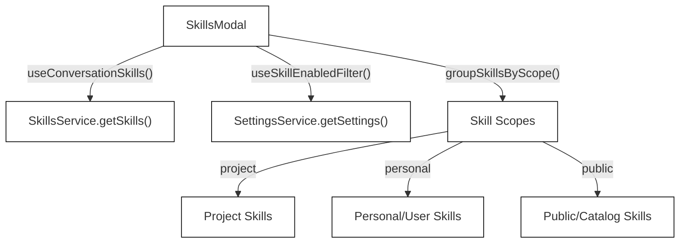
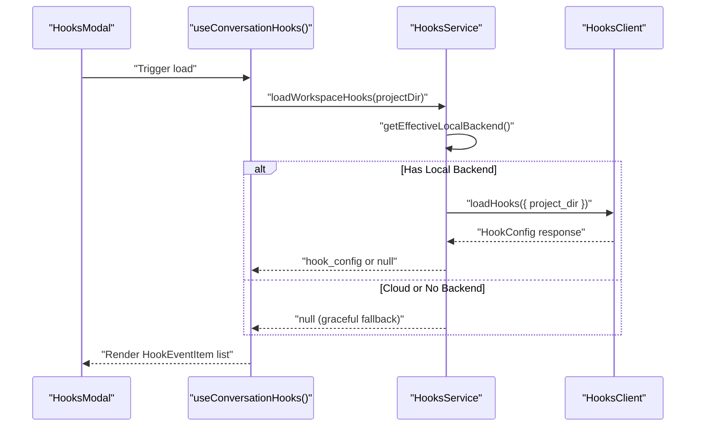
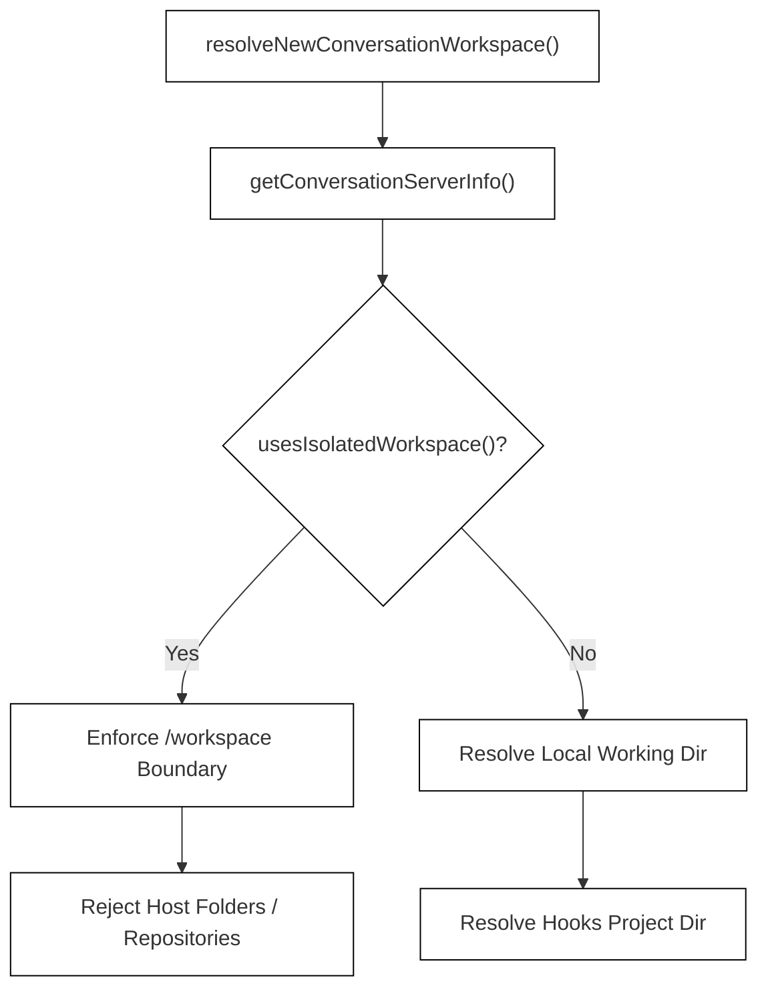

# Conversation Modals: Skills, Hooks, and System Message

Relevant source files

The following files were used as context for generating this wiki page:

- [__tests__/api/agent-server-client-options.test.ts](__tests__/api/agent-server-client-options.test.ts)
- [__tests__/api/docker-conversation-boundaries.test.ts](__tests__/api/docker-conversation-boundaries.test.ts)
- [__tests__/api/hooks-service.test.ts](__tests__/api/hooks-service.test.ts)
- [__tests__/components/features/conversation-panel/conversation-lg-modals-viewport.test.tsx](__tests__/components/features/conversation-panel/conversation-lg-modals-viewport.test.tsx)
- [__tests__/components/features/conversation-panel/hooks-modal.test.tsx](__tests__/components/features/conversation-panel/hooks-modal.test.tsx)
- [__tests__/components/modals/skills/skill-modal.test.tsx](__tests__/components/modals/skills/skill-modal.test.tsx)
- [__tests__/utils/skill-scope.test.ts](__tests__/utils/skill-scope.test.ts)
- [src/api/conversation-workspace.ts](src/api/conversation-workspace.ts)
- [src/api/hooks-service.ts](src/api/hooks-service.ts)
- [src/components/features/chat/open-repository-modal.tsx](src/components/features/chat/open-repository-modal.tsx)
- [src/components/features/conversation-panel/hook-matcher-content.tsx](src/components/features/conversation-panel/hook-matcher-content.tsx)
- [src/components/features/conversation-panel/hooks-empty-state.tsx](src/components/features/conversation-panel/hooks-empty-state.tsx)
- [src/components/features/conversation-panel/hooks-modal-header.tsx](src/components/features/conversation-panel/hooks-modal-header.tsx)
- [src/components/features/conversation-panel/hooks-modal.tsx](src/components/features/conversation-panel/hooks-modal.tsx)
- [src/components/features/conversation-panel/plugins-modal.tsx](src/components/features/conversation-panel/plugins-modal.tsx)
- [src/components/features/conversation-panel/skill-item.tsx](src/components/features/conversation-panel/skill-item.tsx)
- [src/components/features/conversation-panel/skill-triggers.tsx](src/components/features/conversation-panel/skill-triggers.tsx)
- [src/components/features/conversation-panel/skills-modal-header.tsx](src/components/features/conversation-panel/skills-modal-header.tsx)
- [src/components/features/conversation-panel/skills-modal-section.tsx](src/components/features/conversation-panel/skills-modal-section.tsx)
- [src/components/features/conversation-panel/skills-modal.tsx](src/components/features/conversation-panel/skills-modal.tsx)
- [src/components/features/conversation-panel/system-message-modal.tsx](src/components/features/conversation-panel/system-message-modal.tsx)
- [src/components/features/conversation-panel/system-message-modal/system-message-header.tsx](src/components/features/conversation-panel/system-message-modal/system-message-header.tsx)
- [src/components/features/conversation-panel/system-message-modal/tool-parameters.tsx](src/components/features/conversation-panel/system-message-modal/tool-parameters.tsx)

## Purpose and Scope
This document details the conversation-panel modals within the Agent Canvas frontend (`@openhands/agent-canvas`). Specifically, it covers the implementation, data flows, and boundaries for the **Skills Modal**, **Hooks Modal**, **Plugins Modal**, **System Message Modal**, and **Conversation Workspace Boundaries**. These modals provide runtime visibility into active agent capabilities, loaded hooks, plugin snapshots, system prompts, and workspace isolation states during an active conversation session.

---

## 1. Skills Modal and Scopes
The **Skills Modal** surfaces the agent capabilities currently active or available within the context of a conversation workspace. It interacts with the conversation skills hook to scope the catalog and filters out disabled capabilities [src/components/features/conversation-panel/skills-modal.tsx:42-56]().

### Implementation & Data Flow
`SkillsModal` uses `useConversationSkills()` to fetch project, user, and public skills [src/components/features/conversation-panel/skills-modal.tsx:42-48](). The active workspace directory is resolved via `getAgentServerWorkingDir()` [src/components/features/conversation-panel/skills-modal.tsx:36] to group skills by scope (`project`, `personal`, `public`) via `groupSkillsByScope` [src/components/features/conversation-panel/skills-modal.tsx:58-61] following `SKILL_SCOPE_ORDER` [src/components/features/conversation-panel/skills-modal.tsx:95].

*Diagram 1: Skills Modal Data Flow Architecture*

Sources:
- `src/components/features/conversation-panel/skills-modal.tsx`
- `src/utils/skill-scope.ts`

---

## 2. Hooks Modal and Hook Matchers
The **Hooks Modal** provides insight into execution hooks configured for a workspace (`.openhands/hooks.json`), allowing users to inspect event triggers, matchers, timeouts, and asynchronous command executions [src/components/features/conversation-panel/hooks-modal.tsx:21-90]().

### Implementation & Data Flow
- **`HooksService.loadWorkspaceHooks()`**: Evaluates effective local backends, bypassing loading attempts on cloud backends or unseeded registries [src/api/hooks-service.ts:13-28]().
- **`HooksModal`**: Fetches active conversation hooks via `useConversationHooks()` [src/components/features/conversation-panel/hooks-modal.tsx:26-32]. It handles agent readiness states (`useAgentState()`) [src/components/features/conversation-panel/hooks-modal.tsx:22] and maps hook events to `HookEventItem` and `HookMatcherContent` components [src/components/features/conversation-panel/hook-matcher-content.tsx:14-76].

*Diagram 2: Hooks Service Load Lifecycle*

Sources:
- `src/components/features/conversation-panel/hooks-modal.tsx`
- `src/components/features/conversation-panel/hook-matcher-content.tsx`
- `src/api/hooks-service.ts`

---

## 3. Plugins Modal
The **Plugins Modal** presents a display-only inventory of plugins loaded into the active conversation. 

### Implementation & Data Flow
Because the agent-server does not expose a live conversation's loaded plugins directly via a real-time endpoint, `PluginsModal` reads a client-side metadata snapshot captured at conversation creation via `useConversationPlugins()` [src/components/features/conversation-panel/plugins-modal.tsx:31-33]. It differentiates between local plugins and source-managed plugins using `isLocalPluginSource()` and `getPluginSourceLabel()` [src/components/features/conversation-panel/plugins-modal.tsx:71-75].

Sources:
- `src/components/features/conversation-panel/plugins-modal.tsx`

---

## 4. System Message Modal
The **System Message Modal** exposes the active agent’s system prompts, underlying tool definitions, parameters, and version metadata [src/components/features/conversation-panel/system-message-modal.tsx:19-79].

### Structure and Tabs
- **System Tab**: Displays the raw system prompt text instructions.
- **Tools Tab**: Enumerates available tools, descriptions, and parameter schemas via `ToolParameters`.

Sources:
- `src/components/features/conversation-panel/system-message-modal.tsx`
- `src/utils/system-message-adapter.ts`

---

## 5. Conversation Workspace Boundaries & Isolated Runtimes
Conversation workspaces enforce strict storage and security boundaries depending on whether the agent server runs in a containerized environment (`docker`) or a local directory [src/api/conversation-workspace.ts:18-66].

### Workspace Resolution and Docker Isolation
When `usesIsolatedWorkspace()` evaluates to `true` (via `ServerClient.getServerInfo()` yielding `conversation_runtime: "docker"`), the backend locks conversations into an isolated `/workspace` path [src/api/conversation-workspace.ts:18-66].

*Diagram 3: Workspace Resolution Boundary Logic*

Sources:
- `src/api/conversation-workspace.ts`
- `__tests__/api/docker-conversation-boundaries.test.ts`