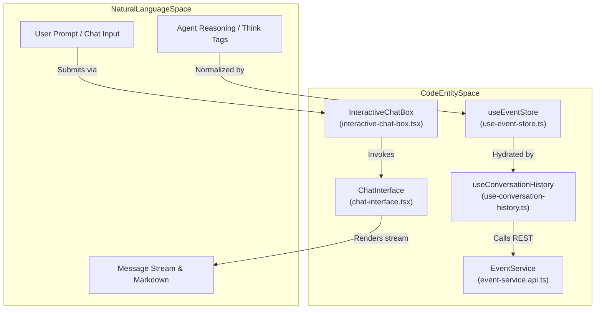
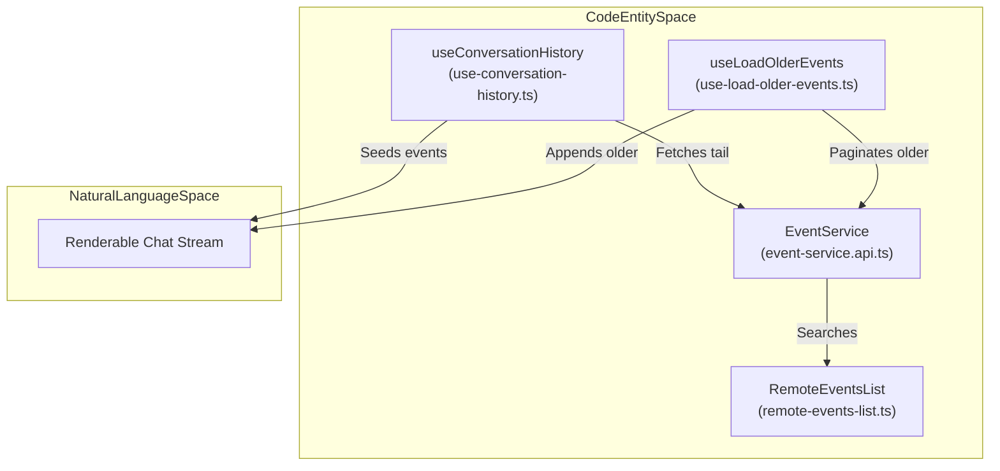

# Chat Interface

Relevant source files

The following files were used as context for generating this wiki page:

- [__tests__/api/event-service.test.ts](__tests__/api/event-service.test.ts)
- [__tests__/components/chat/chat-interface.test.tsx](__tests__/components/chat/chat-interface.test.tsx)
- [__tests__/hooks/query/use-conversation-history.test.tsx](__tests__/hooks/query/use-conversation-history.test.tsx)
- [__tests__/hooks/use-load-older-events.test.tsx](__tests__/hooks/use-load-older-events.test.tsx)
- [src/api/event-service/event-service.api.ts](src/api/event-service/event-service.api.ts)
- [src/api/event-service/event-service.types.ts](src/api/event-service/event-service.types.ts)
- [src/components/features/chat/chat-interface.tsx](src/components/features/chat/chat-interface.tsx)
- [src/components/features/conversation/transcript-export-modal.tsx](src/components/features/conversation/transcript-export-modal.tsx)
- [src/hooks/query/use-conversation-history.ts](src/hooks/query/use-conversation-history.ts)
- [src/hooks/use-load-older-events.ts](src/hooks/use-load-older-events.ts)
- [src/utils/transcript-export/__snapshots__/index.test.ts.snap](src/utils/transcript-export/__snapshots__/index.test.ts.snap)

## Purpose and Scope

The Chat Interface serves as the primary interaction hub between the user and the OpenHands agent runtime [src/components/features/chat/chat-interface.tsx:69-83](). It manages real-time message streams, handles user input (including file uploads, drafts, and commands), and renders complex agent states such as tool executions, reasoning steps, and error banners [src/components/features/chat/chat-interface.tsx:103-118]().

As a parent page, this document provides a high-level overview of the chat subsystems. For detailed technical specifications, refer to the child pages:
- [Chat Interface and Input](#8.1) — Documenting `ChatInterface`, `CustomChatInput`, `InteractiveChatBox`, and draft persistence [src/components/features/chat/chat-interface.tsx:69]().
- [Event Rendering and Message Display](#8.2) — Documenting the event normalization pipeline, `handleEventForUI`, and message list components [src/components/conversation-events/chat/messages.tsx:42]().
- [Chat Model Switching and Context Window](#8.3) — Documenting in-conversation model switching, profile pickers, and token context usage [src/hooks/use-load-older-events.ts:172-176]().
- [Git Control Bar and File Operations](#8.4) — Documenting `GitControlBar`, diff viewers, and file synchronization hooks [src/components/features/chat/chat-interface.tsx:70]().

**Sources:**
- [src/components/features/chat/chat-interface.tsx:69-118]()
- [src/components/conversation-events/chat/messages.tsx:42]()
- [src/hooks/use-load-older-events.ts:172-176]()

---

## Architecture Overview

The chat interface bridges the **Natural Language Space** (user prompts, agent thoughts, conversational responses) with the **Code Entity Space** (underlying agent server events, tool calls, REST queries via `EventService`, and WebSocket synchronization).

### Chat System Architecture
Title: Chat System Architecture and Component Mapping

**Sources:**
- [src/components/features/chat/chat-interface.tsx:69-83]()
- [src/api/event-service/event-service.api.ts:39-45]()
- [src/hooks/query/use-conversation-history.ts:37-40]()

---

## Sub-System Overviews

### 1. Chat Interface and Input
The input subsystem coordinates user interaction, supporting rich text prompts, file uploads with validation, draft persistence, and optimistic user message enqueuing [src/components/features/chat/chat-interface.tsx:110-118](). It provides send and stop mutation controls alongside docked composer targets [src/components/features/chat/chat-interface.tsx:58-83]().
- For details, see [Chat Interface and Input](#8.1).

**Sources:**
- [src/components/features/chat/chat-interface.tsx:58-118]()

### 2. Event Rendering and Message Display
The event display pipeline translates raw WebSocket streams and REST history pages into structured UI components [src/components/conversation-events/chat/messages.tsx:42](). It uses `handleEventForUI` to supersede streaming deltas, groups consecutive tool invocations, and renders markdown content alongside error banners [src/components/features/chat/chat-interface.tsx:38-42]().
- For details, see [Event Rendering and Message Display](#8.2).

**Sources:**
- [src/components/features/chat/chat-interface.tsx:38-42]()
- [src/components/conversation-events/chat/messages.tsx:42]()

### 3. Chat Model Switching and Context Window
Users can switch LLM profiles mid-conversation using slash commands or interceptors [src/hooks/use-load-older-events.ts:172-176](). This subsystem tracks active models, records model switch observations, and displays context window consumption metrics.
- For details, see [Chat Model Switching and Context Window](#8.3).

**Sources:**
- [src/hooks/use-load-older-events.ts:172-176]()

### 4. Git Control Bar and File Operations
Embedded directly above or within the chat experience, the git control and file subsystem exposes branch selection, push/pull actions, PR creation triggers, unified diff views, and auto-refresh hooks triggered during file edits [src/components/features/chat/chat-interface.tsx:70,84]().
- For details, see [Git Control Bar and File Operations](#8.4).

**Sources:**
- [src/components/features/chat/chat-interface.tsx:70-84]()

---

## Event Pipeline and Data Flow

### Event Pipeline Flow
Title: Event Pipeline Flow from Storage to UI Rendering

**Sources:**
- [src/api/event-service/event-service.api.ts:139-148]()
- [src/hooks/query/use-conversation-history.ts:73-81]()
- [src/hooks/use-load-older-events.ts:141-150]()