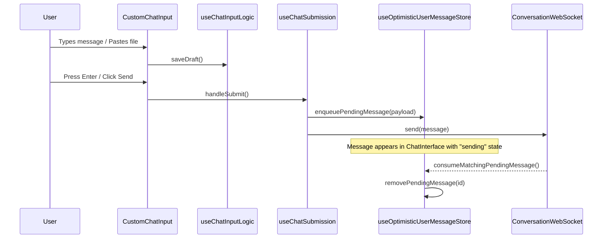

# Chat Interface and Input

<details>
<summary>Relevant source files</summary>

The following files were used as context for generating this wiki page:

- [__tests__/components/automations/create-instructions.test.tsx](__tests__/components/automations/create-instructions.test.tsx)
- [__tests__/components/features/chat/components/chat-input-actions.test.tsx](__tests__/components/features/chat/components/chat-input-actions.test.tsx)
- [__tests__/components/features/chat/pending-user-messages.test.tsx](__tests__/components/features/chat/pending-user-messages.test.tsx)
- [__tests__/components/features/chat/plan-preview.test.tsx](__tests__/components/features/chat/plan-preview.test.tsx)
- [__tests__/components/features/chat/remove-file-button.test.tsx](__tests__/components/features/chat/remove-file-button.test.tsx)
- [__tests__/components/features/conversation/agent-status.test.tsx](__tests__/components/features/conversation/agent-status.test.tsx)
- [__tests__/components/features/diff-viewer/file-diff-viewer.test.tsx](__tests__/components/features/diff-viewer/file-diff-viewer.test.tsx)
- [__tests__/components/features/skills/skill-card-pill-row.test.tsx](__tests__/components/features/skills/skill-card-pill-row.test.tsx)
- [__tests__/components/features/skills/skill-detail-modal.test.tsx](__tests__/components/features/skills/skill-detail-modal.test.tsx)
- [__tests__/components/onboarding/say-hello-step.test.tsx](__tests__/components/onboarding/say-hello-step.test.tsx)
- [__tests__/e2e/mock-llm-reporting.test.ts](__tests__/e2e/mock-llm-reporting.test.ts)
- [__tests__/hooks/query/use-task-polling.test.tsx](__tests__/hooks/query/use-task-polling.test.tsx)
- [__tests__/hooks/use-click-outside-element.test.tsx](__tests__/hooks/use-click-outside-element.test.tsx)
- [__tests__/hooks/use-handle-build-plan-click.test.ts](__tests__/hooks/use-handle-build-plan-click.test.ts)
- [__tests__/hooks/use-settings-nav-items.test.tsx](__tests__/hooks/use-settings-nav-items.test.tsx)
- [__tests__/routes/app-settings.test.tsx](__tests__/routes/app-settings.test.tsx)
- [__tests__/stores/conversation-store.test.ts](__tests__/stores/conversation-store.test.ts)
- [__tests__/stores/optimistic-user-message-store.test.ts](__tests__/stores/optimistic-user-message-store.test.ts)
- [src/components/features/automations/create-instructions.tsx](src/components/features/automations/create-instructions.tsx)
- [src/components/features/chat/chat-play-button.tsx](src/components/features/chat/chat-play-button.tsx)
- [src/components/features/chat/chat-send-button.tsx](src/components/features/chat/chat-send-button.tsx)
- [src/components/features/chat/chat-stop-button.tsx](src/components/features/chat/chat-stop-button.tsx)
- [src/components/features/chat/components/chat-input-actions.tsx](src/components/features/chat/components/chat-input-actions.tsx)
- [src/components/features/chat/components/chat-input-llm-profile-picker.tsx](src/components/features/chat/components/chat-input-llm-profile-picker.tsx)
- [src/components/features/chat/components/chat-input-model.tsx](src/components/features/chat/components/chat-input-model.tsx)
- [src/components/features/chat/components/chat-input-profile-picker.tsx](src/components/features/chat/components/chat-input-profile-picker.tsx)
- [src/components/features/chat/interactive-chat-box.tsx](src/components/features/chat/interactive-chat-box.tsx)
- [src/components/features/chat/remove-file-button.tsx](src/components/features/chat/remove-file-button.tsx)
- [src/components/features/chat/uploaded-file.tsx](src/components/features/chat/uploaded-file.tsx)
- [src/components/features/chat/uploaded-files.tsx](src/components/features/chat/uploaded-files.tsx)
- [src/components/features/chat/uploaded-image.tsx](src/components/features/chat/uploaded-image.tsx)
- [src/components/features/controls/agent-status.tsx](src/components/features/controls/agent-status.tsx)
- [src/components/features/controls/server-status-context-menu.tsx](src/components/features/controls/server-status-context-menu.tsx)
- [src/components/features/diff-viewer/file-diff-viewer.tsx](src/components/features/diff-viewer/file-diff-viewer.tsx)
- [src/components/features/home/llm-not-configured-banner.tsx](src/components/features/home/llm-not-configured-banner.tsx)
- [src/components/features/onboarding/steps/say-hello-step.tsx](src/components/features/onboarding/steps/say-hello-step.tsx)
- [src/components/features/skills/skill-card-pill-row.tsx](src/components/features/skills/skill-card-pill-row.tsx)
- [src/constants/settings-nav.tsx](src/constants/settings-nav.tsx)
- [src/hooks/chat/use-chat-input-logic.ts](src/hooks/chat/use-chat-input-logic.ts)
- [src/hooks/query/use-task-polling.ts](src/hooks/query/use-task-polling.ts)
- [src/hooks/use-click-outside-element.ts](src/hooks/use-click-outside-element.ts)
- [src/hooks/use-launch-skill-in-chat.ts](src/hooks/use-launch-skill-in-chat.ts)
- [src/hooks/use-settings-nav-items.ts](src/hooks/use-settings-nav-items.ts)
- [src/routes/app-settings.tsx](src/routes/app-settings.tsx)
- [src/stores/conversation-store.ts](src/stores/conversation-store.ts)
- [src/stores/optimistic-user-message-store.ts](src/stores/optimistic-user-message-store.ts)
- [src/utils/settings-utils.ts](src/utils/settings-utils.ts)
- [tests/e2e/automations-filters-popover.spec.ts](tests/e2e/automations-filters-popover.spec.ts)
- [tests/e2e/mock-llm/scripts/upsert-pr-comment.mjs](tests/e2e/mock-llm/scripts/upsert-pr-comment.mjs)

</details>


## Purpose and Scope

The Chat Interface serves as the primary interaction hub between the user and the OpenHands agent. It encapsulates the message history, input mechanisms, and real-time status indicators. This system is responsible for orchestrating user input (text, files, slash commands), managing optimistic UI updates for low-latency feedback, and handling complex agent states like confirmation requests for high-risk actions.

The interface bridges the **Natural Language Space** (user prompts) into the **Code Entity Space** by translating UI interactions into structured events sent via `ConversationWebSocket` or REST APIs.

**Sources**: [src/components/features/chat/components/chat-input-actions.tsx:48-71](), [src/hooks/chat/use-chat-input-logic.ts:17-120]()

## Component Architecture

The chat interface is composed of a container (`ChatInterface`) that manages layout and state coordination, and a specialized input system (`CustomChatInput`) that handles rich text entry.

### Chat Interface System Diagram
Title: Chat Interface and Input Component Hierarchy
```mermaid
graph TD
    subgraph "ChatInterface [chat-interface.tsx]"
        "Messages"["Messages (Event Rendering)"]
        "PendingMessages"["PendingUserMessages (Optimistic UI)"]
        "ChatInput"["CustomChatInput (Input Area)"]
        "Banners"["Status/Error Banners"]
    end

    subgraph "CustomChatInput [custom-chat-input.tsx]"
        "Grip"["ChatInputGrip (Resizable)"]
        "Container"["ChatInputContainer"]
        "Actions"["ChatInputActions [chat-input-actions.tsx]"]
        "HiddenFile"["HiddenFileInput"]
    end

    subgraph "ChatInputActions [chat-input-actions.tsx]"
        "FileBtn"["ChatAddFileButton"]
        "ProfilePicker"["ChatInputLlmProfilePicker"]
        "ModelPicker"["ChatInputModel [chat-input-model.tsx]"]
        "SendBtn"["ChatSendButton"]
    end

    "ChatInput" --> "Grip"
    "ChatInput" --> "Container"
    "Container" --> "Actions"
    "Actions" --> "FileBtn"
    "Actions" --> "ProfilePicker"
    "Actions" --> "ModelPicker"
```

| Component | Responsibility | Key Files |
|-----------|----------------|-----------|
| `ChatInterface` | Main container; manages scroll, agent state banners, and event filtering. | [src/components/features/chat/chat-interface.tsx]() |
| `CustomChatInput` | Orchestrates input logic, file handling, and resizing. | [src/components/features/chat/custom-chat-input.tsx]() |
| `ChatInputActions` | Renders the toolbar inside the input (file upload, model picker, agent status). | [src/components/features/chat/components/chat-input-actions.tsx]() |
| `InteractiveChatBox` | Wraps input with interceptors for specialized commands. | [src/components/features/chat/interactive-chat-box.tsx]() |
| `PendingUserMessages` | Displays messages sent but not yet acknowledged by the server. | [src/components/features/chat/pending-user-messages.tsx]() |

**Sources**: [src/components/features/chat/components/chat-input-actions.tsx:48-118](), [src/components/features/chat/components/chat-input-model.tsx:152-207]()

## Chat Input Logic and State

The input system uses custom hooks to separate concerns such as draft persistence, content validation, and event handling.

### Input Data Flow
Title: User Input to WebSocket Event Flow


### Key Logic Hooks
- `useChatInputLogic`: Manages the `contenteditable` reference, draft persistence via `useDraftPersistence`, and content checking. [src/hooks/chat/use-chat-input-logic.ts:17-120]()
- `useOptimisticUserMessageStore`: Tracks local pending messages (`sending` or `error`), providing automatic timeouts (`PENDING_MESSAGE_TIMEOUT_MS`) to flag failed sends. [src/stores/optimistic-user-message-store.ts:20-94]()

**Sources**: [src/hooks/chat/use-chat-input-logic.ts:17-120](), [src/stores/optimistic-user-message-store.ts:18-163]()

## Input Actions and Tooling

The `ChatInputActions` component [src/components/features/chat/components/chat-input-actions.tsx:61-71]() supplies contextual actions based on backend type and conversation state:
- **LLM Profile vs Model Picker**:
  - In OpenHands mode, uses `ChatInputLlmProfilePicker` [src/components/features/chat/components/chat-input-actions.tsx:9-11]() to select configuration profiles.
  - In ACP mode, uses `ChatInputModel` [src/components/features/chat/components/chat-input-model.tsx:152-207]() to directly switch model identifiers via `useSwitchAcpModel` [src/components/features/chat/components/chat-input-model.tsx:54-67]().
- **Send & Stop Buttons**: Coordinates submission state and execution halting using pause/resume mutation hooks (`useUnifiedPauseConversation` [src/components/features/chat/components/chat-input-actions.tsx:21](), `usePauseConversation` [src/components/features/chat/components/chat-input-actions.tsx:23]()).

**Sources**: [src/components/features/chat/components/chat-input-actions.tsx:61-100](), [src/components/features/chat/components/chat-input-model.tsx:152-207]()

## Optimistic/Pending User Messages and Storage

The optimistic message store guarantees responsive UI rendering before network round-trips complete.

- **Queue Management**: `enqueuePendingMessage` generates local identifiers (`generatePendingId`) [src/stores/optimistic-user-message-store.ts:108-109]() and registers a watchdog timer [src/stores/optimistic-user-message-store.ts:157-162]() that flips stuck messages to `error` state after `PENDING_MESSAGE_TIMEOUT_MS` [src/stores/optimistic-user-message-store.ts:18]().
- **Event Consumption**: `consumeMatchingPendingMessage` matches incoming server event history against pending items by content and conversation context [src/stores/optimistic-user-message-store.ts:79-83]().

**Sources**: [src/stores/optimistic-user-message-store.ts:20-163]()