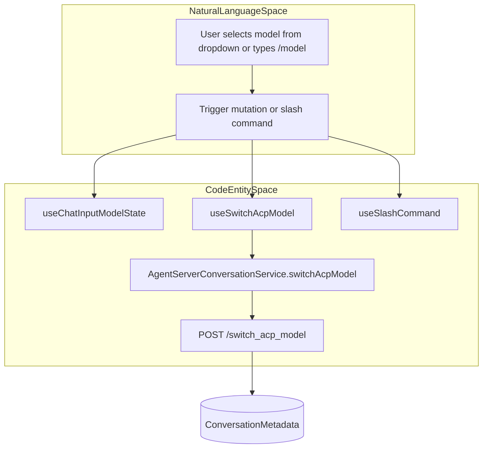
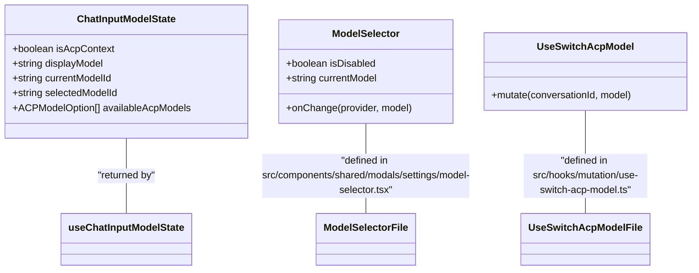

# Chat Model Switching and Context Window

Relevant source files

The following files were used as context for generating this wiki page:

- [__tests__/components/features/chat/components/chat-input-llm-profile-picker.test.tsx](__tests__/components/features/chat/components/chat-input-llm-profile-picker.test.tsx)
- [__tests__/components/features/chat/components/chat-input-model.test.tsx](__tests__/components/features/chat/components/chat-input-model.test.tsx)
- [__tests__/components/features/chat/model-messages.test.tsx](__tests__/components/features/chat/model-messages.test.tsx)
- [__tests__/components/features/chat/uploaded-image-preview.test.tsx](__tests__/components/features/chat/uploaded-image-preview.test.tsx)
- [__tests__/components/features/settings/settings-dropdown-input.test.tsx](__tests__/components/features/settings/settings-dropdown-input.test.tsx)
- [__tests__/components/modals/settings/model-selector-openhands.test.tsx](__tests__/components/modals/settings/model-selector-openhands.test.tsx)
- [__tests__/hooks/chat/use-slash-command.test.ts](__tests__/hooks/chat/use-slash-command.test.ts)
- [__tests__/hooks/mutation/use-switch-acp-model.test.tsx](__tests__/hooks/mutation/use-switch-acp-model.test.tsx)
- [__tests__/hooks/send-message.test.tsx](__tests__/hooks/send-message.test.tsx)
- [__tests__/hooks/use-chat-input-model-state.test.tsx](__tests__/hooks/use-chat-input-model-state.test.tsx)
- [__tests__/utils/format-model-name.test.ts](__tests__/utils/format-model-name.test.ts)
- [hero.ts](hero.ts)
- [src/components/features/chat/uploaded-files.test.tsx](src/components/features/chat/uploaded-files.test.tsx)
- [src/components/features/settings/settings-dropdown-input.tsx](src/components/features/settings/settings-dropdown-input.tsx)
- [src/components/shared/modals/settings/model-selector.tsx](src/components/shared/modals/settings/model-selector.tsx)
- [src/hooks/mutation/use-switch-acp-model.ts](src/hooks/mutation/use-switch-acp-model.ts)
- [src/hooks/use-acp-model-context.ts](src/hooks/use-acp-model-context.ts)
- [src/hooks/use-chat-input-model-state.ts](src/hooks/use-chat-input-model-state.ts)
- [src/utils/format-model-name.ts](src/utils/format-model-name.ts)
- [tailwind.config.js](tailwind.config.js)

This page documents the technical implementation of in-conversation model switching, LLM profile pickers, and the visualization of LLM context window usage within the OpenHands chat interface and settings system.

## Overview and Architecture

OpenHands provides dynamic model switching during active conversations for both native OpenHands agents and Agent Client Protocol (ACP) agents. The frontend coordinates state through specialized hooks, mutations, and profile selection components.

Title: Model Switching Flow and Code Entities

Sources: [src/hooks/use-chat-input-model-state.ts:38-158](), [src/hooks/mutation/use-switch-acp-model.ts:48-138](), [__tests__/hooks/chat/use-slash-command.test.ts:181-220]()

---

## In-Conversation Model State and Switching

Model switching allows users to change the LLM powering the agent without losing conversation history.

### Chat Input Model State
The `useChatInputModelState` hook (`[src/hooks/use-chat-input-model-state.ts:38-158]()`) coordinates active model identification:
* **ACP Context Detection**: Determines if the current view is an active ACP conversation or home ACP configuration using `useAcpModelContext` [src/hooks/use-chat-input-model-state.ts:51-57]().
* **Model Resolution**: Resolves model identifiers and checks active session models via `useAcpSessionModels` and `useAcpModelDiscovery` [src/hooks/use-chat-input-model-state.ts:71-82]().
* **Permission Gating**: Checks organizational permissions (`canManageOrgProfiles`) on cloud backends to restrict unauthorized modifications [src/hooks/use-chat-input-model-state.ts:126-127]().

### ACP Model Switching Mutation
The `useSwitchAcpModel` hook (`[src/hooks/mutation/use-switch-acp-model.ts:48-138]()`) handles live model switching for active sessions and persistence for home screen defaults:
* **Active Conversation**: Calls `AgentServerConversationService.switchAcpModel` to perform a live in-place switch via the backend session API [src/hooks/mutation/use-switch-acp-model.ts:53-61]().
* **Home Page Persist**: Resolves active agent profiles and saves model selections via `AgentProfilesService.saveProfile` or falls back to global settings diffs [src/hooks/mutation/use-switch-acp-model.ts:71-113]().
* **Query Invalidation**: Invalidates relevant conversation and settings query caches to update UI elements immediately [src/hooks/mutation/use-switch-acp-model.ts:114-131]().

Title: Chat Model and Context Window Component Architecture

Sources: [src/hooks/use-chat-input-model-state.ts:23-36](), [src/components/shared/modals/settings/model-selector.tsx:24-34](), [src/hooks/mutation/use-switch-acp-model.ts:48-52]()

Sources: [src/hooks/use-chat-input-model-state.ts:38-158](), [src/hooks/mutation/use-switch-acp-model.ts:48-138]()

---

## LLM Profile Picker and Model Selection

The settings and chat interfaces provide pickers to configure providers and models.

### Model Selector Component
The `ModelSelector` component (`[src/components/shared/modals/settings/model-selector.tsx:36-113]`) renders verified and unverified model/provider autocomplete fields using HeroUI primitives:
* **Provider Search**: Integrates with `useSearchProviders` to populate verified provider lists [src/components/shared/modals/settings/model-selector.tsx:50-64]().
* **Model Discovery**: Queries model availability via `useProviderModels` and identifies free models dynamically using backend flags [src/components/shared/modals/settings/model-selector.tsx:51-84]().
* **Display Formatting**: Uses formatting utilities (`[src/utils/format-model-name.ts:45-61]()`) to format model names and attach free tier badges (`formatModelNameForDisplay`, `formatNativeModelName`).

Sources: [src/components/shared/modals/settings/model-selector.tsx:36-113](), [src/utils/format-model-name.ts:45-88]()

---

## Slash Commands for Model Selection

Users can switch models via chat input slash commands.
* **Command Interception**: `useSlashCommand` (`[__tests__/hooks/chat/use-slash-command.test.ts:181-220]()`) matches the `/model` prefix and filters stored LLM profiles for quick completion.
* **Dynamic Suggestions**: Suggests configured profiles (e.g. `/model haiku`) and appends free status indicators based on `useFreeModelsStore` state [__tests__/hooks/chat/use-slash-command.test.ts:201-216]().

Sources: [__tests__/hooks/chat/use-slash-command.test.ts:181-220]()

---

## Context Window Usage and Metering

The context window meter provides real-time feedback on token consumption relative to the model's maximum limit.

| Component / Utility | Role | Implementation Detail |
|---------------------|------|-----------------------|
| `useContextWindowUsage` | Data Hook | Tracks token usage metrics and compares them against the active LLM limit. |
| `ContextWindowRing` | Circular SVG Meter | Animates token saturation arcs using SVG stroke offsets. |
| `ContextWindowMeter` | Popover & Trigger | Manages popover state and provides context compaction triggers. |

### Context Compaction
When token usage approaches saturation limits, users can trigger context compaction actions that instruct the agent to summarize previous conversation turns, reducing overall token overhead.

Sources: [src/components/features/chat/components/context-window-ring.tsx:4-82](), [src/components/features/chat/components/context-window-meter.tsx:37-184]()