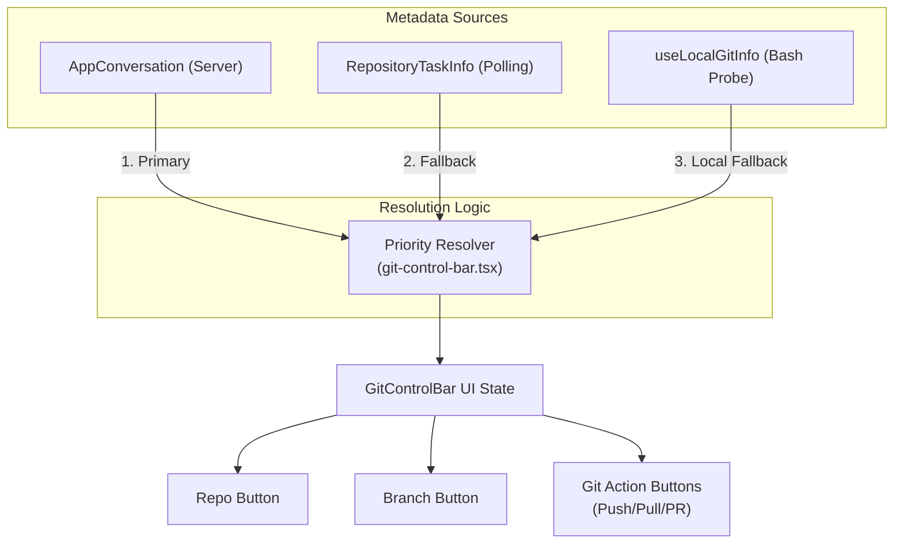
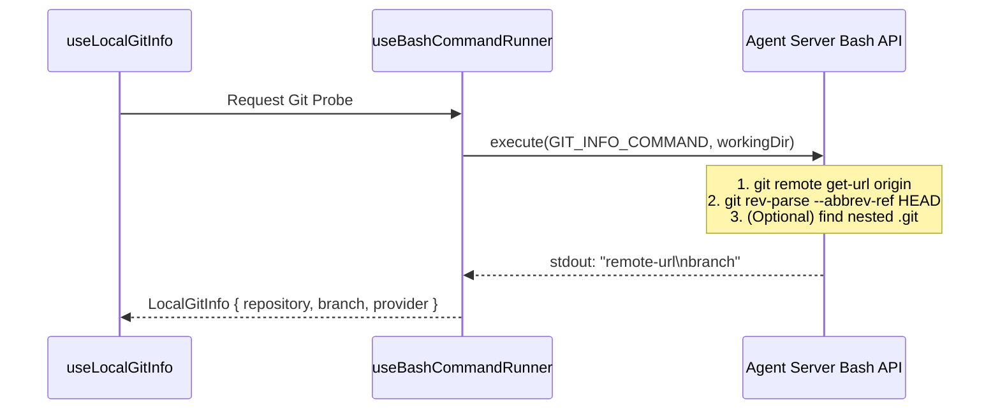
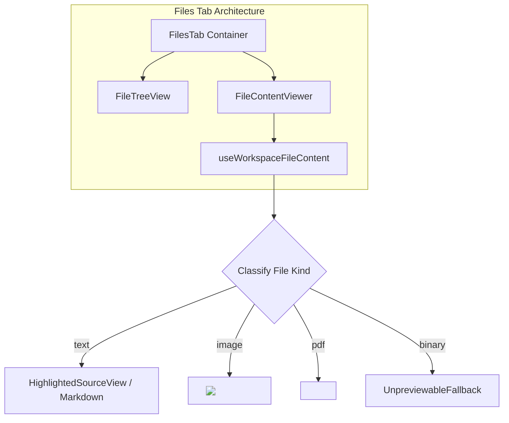
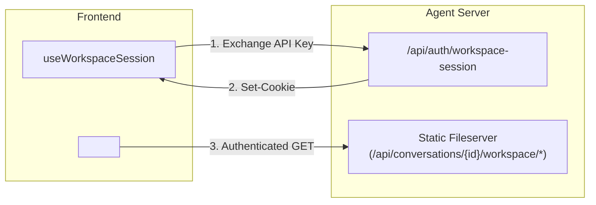
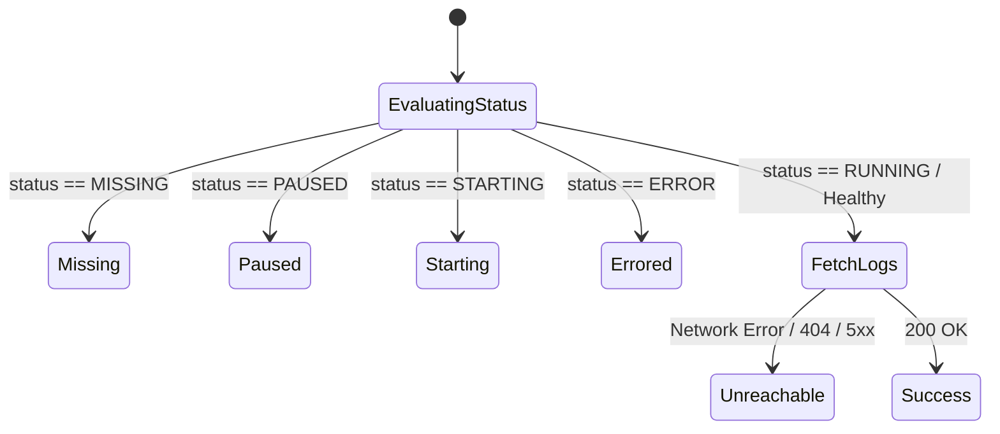

# Git Control Bar and File Operations

<details>
<summary>Relevant source files</summary>

The following files were used as context for generating this wiki page:

- [__tests__/api/agent-server-conversation-service-condense.test.ts](__tests__/api/agent-server-conversation-service-condense.test.ts)
- [__tests__/api/agent-server-conversation-service-regressions.test.ts](__tests__/api/agent-server-conversation-service-regressions.test.ts)
- [__tests__/api/agent-server-git-service.test.ts](__tests__/api/agent-server-git-service.test.ts)
- [__tests__/api/bash-service.test.ts](__tests__/api/bash-service.test.ts)
- [__tests__/api/cloud/conversation-title.test.ts](__tests__/api/cloud/conversation-title.test.ts)
- [__tests__/api/runtime-service/agent-server-runtime-service.test.ts](__tests__/api/runtime-service/agent-server-runtime-service.test.ts)
- [__tests__/components/automations/detail/prompt-section.test.tsx](__tests__/components/automations/detail/prompt-section.test.tsx)
- [__tests__/components/features/chat/change-agent-context-menu.test.tsx](__tests__/components/features/chat/change-agent-context-menu.test.tsx)
- [__tests__/components/features/chat/git-control-bar-pull-button.test.tsx](__tests__/components/features/chat/git-control-bar-pull-button.test.tsx)
- [__tests__/components/features/chat/git-control-bar-repo-button.test.tsx](__tests__/components/features/chat/git-control-bar-repo-button.test.tsx)
- [__tests__/components/features/chat/git-control-bar.test.tsx](__tests__/components/features/chat/git-control-bar.test.tsx)
- [__tests__/components/features/files-tab/file-content-viewer.test.tsx](__tests__/components/features/files-tab/file-content-viewer.test.tsx)
- [__tests__/hooks/query/use-acp-model-discovery.test.tsx](__tests__/hooks/query/use-acp-model-discovery.test.tsx)
- [__tests__/hooks/query/use-acp-session-models.test.tsx](__tests__/hooks/query/use-acp-session-models.test.tsx)
- [__tests__/hooks/query/use-workspace-file-content.test.tsx](__tests__/hooks/query/use-workspace-file-content.test.tsx)
- [__tests__/hooks/query/use-workspace-files.test.tsx](__tests__/hooks/query/use-workspace-files.test.tsx)
- [__tests__/hooks/query/use-workspace-session.test.tsx](__tests__/hooks/query/use-workspace-session.test.tsx)
- [__tests__/hooks/use-auto-refresh-files-on-edit.test.tsx](__tests__/hooks/use-auto-refresh-files-on-edit.test.tsx)
- [__tests__/routes/files-tab.test.tsx](__tests__/routes/files-tab.test.tsx)
- [__tests__/stores/use-workspace-mutation-counter.test.ts](__tests__/stores/use-workspace-mutation-counter.test.ts)
- [__tests__/utils/azure-devops-remote-links.test.ts](__tests__/utils/azure-devops-remote-links.test.ts)
- [__tests__/utils/parse-git-remote-url.test.ts](__tests__/utils/parse-git-remote-url.test.ts)
- [src/api/bash-service/bash-service.api.ts](src/api/bash-service/bash-service.api.ts)
- [src/api/cloud/conversation-service.api.ts](src/api/cloud/conversation-service.api.ts)
- [src/api/event-service/event-service.api.test.ts](src/api/event-service/event-service.api.test.ts)
- [src/api/git-service/agent-server-git-service.api.ts](src/api/git-service/agent-server-git-service.api.ts)
- [src/api/runtime-service/agent-server-runtime-service.ts](src/api/runtime-service/agent-server-runtime-service.ts)
- [src/components/features/automations/git-sync/git-sync-overview-section.test.tsx](src/components/features/automations/git-sync/git-sync-overview-section.test.tsx)
- [src/components/features/automations/git-sync/git-sync-overview-section.tsx](src/components/features/automations/git-sync/git-sync-overview-section.tsx)
- [src/components/features/chat/git-control-bar-branch-button.tsx](src/components/features/chat/git-control-bar-branch-button.tsx)
- [src/components/features/chat/git-control-bar-pr-button.tsx](src/components/features/chat/git-control-bar-pr-button.tsx)
- [src/components/features/chat/git-control-bar-pull-button.tsx](src/components/features/chat/git-control-bar-pull-button.tsx)
- [src/components/features/chat/git-control-bar-push-button.tsx](src/components/features/chat/git-control-bar-push-button.tsx)
- [src/components/features/chat/git-control-bar-repo-button.tsx](src/components/features/chat/git-control-bar-repo-button.tsx)
- [src/components/features/chat/git-control-bar.tsx](src/components/features/chat/git-control-bar.tsx)
- [src/components/features/files-tab/file-content-viewer.tsx](src/components/features/files-tab/file-content-viewer.tsx)
- [src/context/scroll-context.tsx](src/context/scroll-context.tsx)
- [src/hooks/query/use-bash-command-logs.ts](src/hooks/query/use-bash-command-logs.ts)
- [src/hooks/query/use-workspace-file-content.ts](src/hooks/query/use-workspace-file-content.ts)
- [src/hooks/query/use-workspace-files.ts](src/hooks/query/use-workspace-files.ts)
- [src/hooks/query/use-workspace-session.ts](src/hooks/query/use-workspace-session.ts)
- [src/hooks/use-auto-refresh-files-on-edit.ts](src/hooks/use-auto-refresh-files-on-edit.ts)
- [src/routes/files-tab.tsx](src/routes/files-tab.tsx)
- [src/stores/files-tab-store.ts](src/stores/files-tab-store.ts)
- [src/stores/use-workspace-mutation-counter.ts](src/stores/use-workspace-mutation-counter.ts)
- [src/utils/parse-git-remote-url.ts](src/utils/parse-git-remote-url.ts)

</details>


## Purpose and Scope

This page documents the implementation of git-aware workspace management, repository controls, and file operations within the OpenHands agent canvas. It covers the `GitControlBar` component (handling repo, branch, push, pull, and PR interactions), workspace file discovery and content rendering in `FilesTab`, remote URL parsing utilities, workspace session authentication, diff and commit views, and the `useBashCommandLogs` telemetry and log-fetching pipeline.

---

## Git Control Bar

The `GitControlBar` provides a unified toolbar interface for managing the repository context of an active conversation. It surfaces the current repository, branch, and actions for pulling, pushing, and opening pull requests.

### Data Flow and Priority Resolution

The control bar resolves git metadata using a strict priority order to ensure the UI remains accurate across different conversation stages (e.g., cloning, branch switching, or local workspace attachment).



- **Primary:** Data returned from the `AppConversation` object via `useActiveConversation`.
- **Secondary:** Real-time updates from `useTaskPolling` tracking repository changes.
- **Tertiary:** For local backends, `useLocalGitInfo` shells out to the sandbox to detect git remotes when server metadata is absent.

**Sources:** `[src/components/features/chat/git-control-bar.tsx:72-88]`, `[src/hooks/query/use-local-git-info.ts:106-117]`

### Remote URL Parsing

When parsing git remote URLs (HTTPS, SSH, or `git@host:path` shorthand), OpenHands uses a utility function to extract the host, repository identifier (`owner/repo`), and best-effort provider (`github`, `gitlab`, `bitbucket`, `azure_devops`).

```typescript
export function parseGitRemoteUrl(remoteUrl: string | null | undefined): ParsedGitRemoteUrl | null
```

**Sources:** `[src/utils/parse-git-remote-url.ts:93-121]`, `[__tests__/utils/parse-git-remote-url.test.ts:1-180]`

---

## Local Git Probing (`useLocalGitInfo`)

For local backends without explicit repository metadata stored in the conversation record, the frontend probes the sandbox workspace directly.



**Sources:** `[src/hooks/query/use-local-git-info.ts:38-50]`, `[src/hooks/query/use-local-git-info.ts:145-150]`

---

## Files Tab and Workspace Operations

The `FilesTab` component manages file discovery, tree rendering, and file content viewing [src/routes/files-tab.tsx:44-122]().

### File Listing and Content Classification

File content fetching is handled by `useWorkspaceFileContent`, which reads individual files and classifies them into specific renderable kinds: `text`, `image`, `pdf`, or `binary` [src/hooks/query/use-workspace-file-content.ts:142-193]().



- **Cache Busting:** The `useWorkspaceMutationCounter` store increments on agent edits and manual refreshes. This counter is appended to file URLs via `withWorkspaceCacheBuster` to bypass browser caching [src/stores/use-workspace-mutation-counter.ts:1-20](), `[src/components/features/files-tab/file-content-viewer.tsx:72-112]()`.

**Sources:** `[src/routes/files-tab.tsx:44-122]`, `[src/hooks/query/use-workspace-file-content.ts:142-193]`, `[src/components/features/files-tab/file-content-viewer.tsx:72-168]`

---

## Workspace Session Management

To render rich workspace previews (such as local HTML/CSS apps) where relative assets must load successfully, OpenHands provisions an authenticated workspace session.

### Cookie-Based Authentication

On local backends, `useWorkspaceSession` exchanges the conversation's `X-Session-API-Key` for an `oh_workspace_session_key` cookie scoped to `/api/conversations` [src/hooks/query/use-workspace-session.ts:18-45]().



**Sources:** `[src/hooks/query/use-workspace-session.ts:18-45]`, `[src/hooks/query/use-workspace-session.ts:69-87]`

---

## Diff Viewer, Commit List, and Git Hooks

Git diff operations and commit histories are displayed via dedicated tabs and hooks:
- **`useUnifiedGitDiff`**: Unified hook bridging local bash-based diffs and cloud API diff retrieval.
- **`useHasGitCommits`**: Validates whether the current repository contains a commit history.
- **`FileDiffViewer` & `CommitList`**: Render the repository change sets and commit metadata.

**Sources:** `[src/hooks/query/use-unified-git-diff.ts:1-50]`, `[src/hooks/query/use-has-git-commits.ts:1-30]`

---

## Bash Command Logs (`useBashCommandLogs`)

The `useBashCommandLogs` hook fetches execution logs for specific bash commands (frequently used in automation runs and agent diagnostics) [src/hooks/query/use-bash-command-logs.ts:142-164]().

### Sandbox State Handling

Before dispatching log retrieval requests, the hook performs preflight checks against the sandbox status to avoid doomed round-trips:



- **Sandbox Issues Handled:** `missing`, `paused`, `starting`, `errored`, and `unreachable` [src/hooks/query/use-bash-command-logs.ts:17-22]().
- **Transport:** Relies on `BashService.listOutputs` to page through `BashOutput` events filtered by `command_id__eq` [src/api/bash-service/bash-service.api.ts](), `[__tests__/api/bash-service.test.ts:92-124]()`.

**Sources:** `[src/hooks/query/use-bash-command-logs.ts:17-119]`, `[__tests__/api/bash-service.test.ts:92-124]`

---

## Key Components and Summary Table

| Entity | Role | File Path |
| :--- | :--- | :--- |
| `GitControlBar` | UI for repository, branch, and git actions. | `[src/components/features/chat/git-control-bar.tsx]()` |
| `FilesTab` | Main container for file browsing and viewing. | `[src/routes/files-tab.tsx]()` |
| `FileContentViewer` | Renderer selection for text, images, PDFs, and binaries. | `[src/components/features/files-tab/file-content-viewer.tsx]()` |
| `useLocalGitInfo` | Probes sandbox for git metadata via bash. | `[src/hooks/query/use-local-git-info.ts]()` |
| `useWorkspaceSession` | Mints workspace static session cookies. | `[src/hooks/query/use-workspace-session.ts]()` |
| `useBashCommandLogs` | Fetches and classifies bash command outputs. | `[src/hooks/query/use-bash-command-logs.ts]()` |
| `parseGitRemoteUrl` | Extracts host, repo, and provider from remote URLs. | `[src/utils/parse-git-remote-url.ts]()` |

**Sources:** `[src/components/features/chat/git-control-bar.tsx:34-111]`, `[src/routes/files-tab.tsx:44-122]`, `[src/components/features/files-tab/file-content-viewer.tsx:72-168]`, `[src/hooks/query/use-workspace-session.ts:18-45]`, `[src/hooks/query/use-bash-command-logs.ts:142-164]`, `[src/utils/parse-git-remote-url.ts:93-121]`