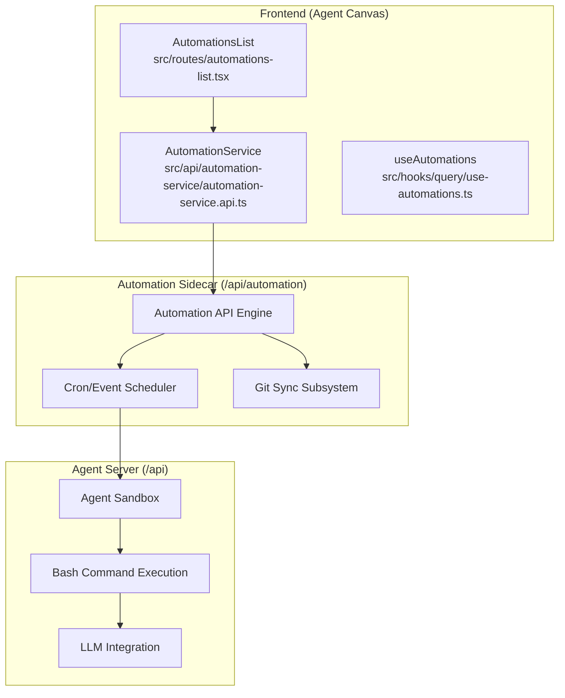
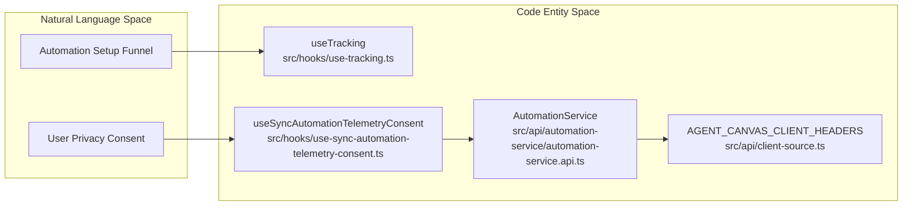

# Automations System

Relevant source files

The following files were used as context for generating this wiki page:

- [__tests__/api/automation-service.test.ts](__tests__/api/automation-service.test.ts)
- [__tests__/hooks/query/use-automations-backend-switch.test.tsx](__tests__/hooks/query/use-automations-backend-switch.test.tsx)
- [__tests__/routes/automation-detail.test.tsx](__tests__/routes/automation-detail.test.tsx)
- [__tests__/routes/automations-list-behavior.test.tsx](__tests__/routes/automations-list-behavior.test.tsx)
- [__tests__/routes/automations-list.test.tsx](__tests__/routes/automations-list.test.tsx)
- [src/api/automation-service/automation-service.api.ts](src/api/automation-service/automation-service.api.ts)
- [src/hooks/query/use-automations.ts](src/hooks/query/use-automations.ts)
- [src/hooks/use-automation-permissions.ts](src/hooks/use-automation-permissions.ts)
- [src/routes/automation-detail.tsx](src/routes/automation-detail.tsx)
- [src/routes/automations-list.tsx](src/routes/automations-list.tsx)
- [src/types/automation.ts](src/types/automation.ts)

The Automations System provides a robust framework for creating, managing, and monitoring automated agent workflows. Unlike standard interactive conversations, automations are designed to be triggered by external events (webhooks) or schedules (cron), allowing agents to perform repetitive tasks like PR reviews, security scanning, or daily status reports autonomously.

## System Architecture

The automations feature is implemented as a sidecar service that interfaces with the OpenHands agent-server [src/api/automation-service/automation-service.api.ts:118-122](). It uses a manifest-driven approach where automation capabilities and UI forms are defined by an interface specification [src/routes/automations-list.tsx:104-109]().

### Automation Topology

**Sources:**
- [src/api/automation-service/automation-service.api.ts:118-122]()
- [src/routes/automations-list.tsx:104-109]()
- [src/hooks/query/use-automations.ts:113-146]()

---

## Core Subsystems

### Automation Service and API
The `AutomationService` acts as the primary transport layer for automation management [src/api/automation-service/automation-service.api.ts:1-60](). It handles communication with both local sidecars and cloud-proxied backends via `callCloudProxy` [src/api/automation-service/automation-service.api.ts:53-53](). It manages multi-step creation flows, drafts listing via `useAutomationDrafts` [src/hooks/query/use-automations.ts:75-105](), and request header building with session keys [src/api/automation-service/automation-service.api.ts:124-135]().

For details, see [Automation Service and API](#9.1).

**Sources:**
- [src/api/automation-service/automation-service.api.ts:1-60]()
- [src/api/automation-service/automation-service.api.ts:124-135]()
- [src/hooks/query/use-automations.ts:75-105]()

### Automation Types and Manifests
Automations are defined by `AutomationSpec` and `Automation` entities [src/types/automation.ts:37-140](). The system uses interface manifests to dynamically generate setup dialogs and validate attributes like timeouts, execution states (`ACTIVE`, `INACTIVE`, `DRAFT`) [src/types/automation.ts:35-35](), and triggers (`AutomationTrigger`) [src/types/automation.ts:1-22]().

For details, see [Automation Types and Manifests](#9.2).

**Sources:**
- [src/types/automation.ts:1-35]()
- [src/types/automation.ts:37-140]()

### Automation UI: List, Detail, and Activity
The UI provides a comprehensive management interface via `AutomationsList` [src/routes/automations-list.tsx:104-109]() and `AutomationDetail` [src/routes/automation-detail.tsx:81-81](). Users can monitor execution history, check run statuses (`AutomationRunStatus`) [src/types/automation.ts:161-168](), toggle automation states using `useToggleAutomation` [src/hooks/query/use-automations.ts:156-174](), and evaluate user permissions via `useAutomationPermissions` [src/hooks/use-automation-permissions.ts:40-80]().

For details, see [Automation UI: List, Detail, and Activity](#9.3).

**Sources:**
- [src/routes/automations-list.tsx:104-109]()
- [src/routes/automation-detail.tsx:81-81]()
- [src/types/automation.ts:161-168]()
- [src/hooks/query/use-automations.ts:156-174]()
- [src/hooks/use-automation-permissions.ts:40-80]()

### Automation Git Sync
The Git Sync subsystem allows automations to be synchronized with remote repositories [src/api/automation-service/automation-service.api.ts:19-23](). It tracks git synchronization status, remote URLs, and updates configuration settings via dedicated service hooks.

For details, see [Automation Git Sync](#9.4).

**Sources:**
- [src/api/automation-service/automation-service.api.ts:19-23]()

---

## Telemetry and Monitoring

The automations system integrates with telemetry services to track user interactions, setup funnels, and sync consent across the automation sidecar [src/api/automation-service/automation-service.api.ts:2-8]().

### Telemetry Mapping

| Event Name / Action | Trigger Point | Code Location |
|---|---|---|
| `getTelemetryDistinctId` | Request header enrichment | [src/api/automation-service/automation-service.api.ts:127-135]() |
| `useAutomationDrafts` | Draft queries and error handling | [src/hooks/query/use-automations.ts:75-105]() |
| `useToggleAutomation` | Mutation and state invalidation | [src/hooks/query/use-automations.ts:156-174]() |

**Sources:**
- [src/api/automation-service/automation-service.api.ts:127-135]()
- [src/hooks/query/use-automations.ts:75-105]()
- [src/hooks/query/use-automations.ts:156-174]()