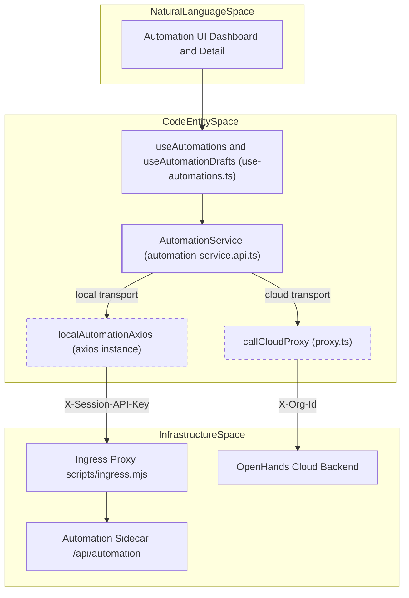
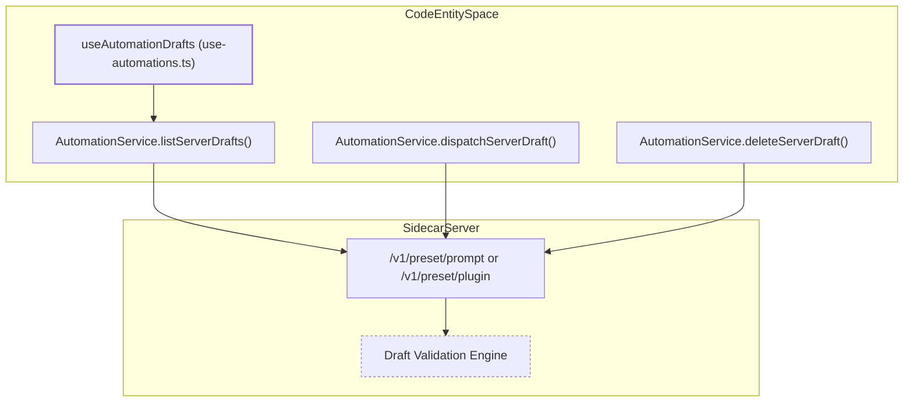

# Automation Service and API

Relevant source files

The following files were used as context for generating this wiki page:

- [.github/pr-assets/pr-16982-validation.png](.github/pr-assets/pr-16982-validation.png)
- [__tests__/api/automation-service.test.ts](__tests__/api/automation-service.test.ts)
- [__tests__/hooks/query/use-automation-sdk-version.test.tsx](__tests__/hooks/query/use-automation-sdk-version.test.tsx)
- [__tests__/hooks/query/use-automations-backend-switch.test.tsx](__tests__/hooks/query/use-automations-backend-switch.test.tsx)
- [__tests__/hooks/query/use-git-sync.test.tsx](__tests__/hooks/query/use-git-sync.test.tsx)
- [__tests__/hooks/use-sync-automation-telemetry-consent.test.ts](__tests__/hooks/use-sync-automation-telemetry-consent.test.ts)
- [__tests__/routes/automation-detail.test.tsx](__tests__/routes/automation-detail.test.tsx)
- [__tests__/routes/automation-git-sync.test.tsx](__tests__/routes/automation-git-sync.test.tsx)
- [__tests__/routes/automations-list-behavior.test.tsx](__tests__/routes/automations-list-behavior.test.tsx)
- [__tests__/routes/automations-list.test.tsx](__tests__/routes/automations-list.test.tsx)
- [src/api/automation-service/automation-service.api.test.ts](src/api/automation-service/automation-service.api.test.ts)
- [src/api/automation-service/automation-service.api.ts](src/api/automation-service/automation-service.api.ts)
- [src/components/features/automations/git-sync/git-sync-config-form.test.tsx](src/components/features/automations/git-sync/git-sync-config-form.test.tsx)
- [src/components/features/automations/git-sync/git-sync-config-form.tsx](src/components/features/automations/git-sync/git-sync-config-form.tsx)
- [src/hooks/query/use-automation-sdk-version.ts](src/hooks/query/use-automation-sdk-version.ts)
- [src/hooks/query/use-automations.ts](src/hooks/query/use-automations.ts)
- [src/hooks/query/use-git-sync.ts](src/hooks/query/use-git-sync.ts)
- [src/hooks/use-automation-permissions.ts](src/hooks/use-automation-permissions.ts)
- [src/hooks/use-sync-automation-telemetry-consent.ts](src/hooks/use-sync-automation-telemetry-consent.ts)
- [src/routes/automation-detail.tsx](src/routes/automation-detail.tsx)
- [src/routes/automation-git-sync.tsx](src/routes/automation-git-sync.tsx)
- [src/routes/automations-list.tsx](src/routes/automations-list.tsx)
- [src/types/automation.ts](src/types/automation.ts)

The Automation System provides a multi-service architecture for creating, managing, and monitoring automated agent workflows. It bridges the **Agent Canvas** frontend with the **Automation Sidecar** (a dedicated backend service) to handle repository-linked agent tasks, scheduled runs, event-based triggers, drafts, tarball uploads, and git synchronization.

## Automation Service Architecture

The `AutomationService` class [src/api/automation-service/automation-service.api.ts:225-225]() acts as the primary interface for all automation-related operations. It supports two transport mechanisms:

1. **Local Transport**: Communicates with the automation sidecar mounted by `scripts/dev-with-automation.mjs` behind the local agent-server. It uses a specialized `localAutomationAxios` instance that resolves the active local backend and session API key at runtime [src/api/automation-service/automation-service.api.ts:122-165]().
2. **Cloud Transport**: Routes requests through the `callCloudProxy` [src/api/cloud/proxy.ts:18-20]() to target remote OpenHands Cloud environments, injecting organization-level scoping via the `X-Org-Id` header.

### Data Flow and Service Boundaries

Diagram: Automation Service Transport and Code Routing Architecture

Sources: [src/api/automation-service/automation-service.api.ts:122-165](), [src/hooks/query/use-automations.ts:75-146]()

## Core API Operations

### Automation Lifecycle Management
The service provides standard CRUD operations for automations, interacting with the `/api/automation/v1` base path [src/api/automation-service/automation-service.api.ts:60-60]().

| Function | Endpoint | Description |
| :--- | :--- | :--- |
| `getAutomations` | `GET /v1` | Fetches a paginated list of automations with `limit`, `offset`, and optional `created_by` filters [src/api/automation-service/automation-service.api.ts:189-201](). |
| `getAutomation` | `GET /v1/{id}` | Retrieves detailed configuration for a specific automation. |
| `updateAutomation` | `PATCH /v1/{id}` | Updates automation fields (name, prompt, model, etc.). |
| `deleteAutomation` | `DELETE /v1/{id}` | Removes the automation record. |
| `toggleAutomation` | `PATCH /v1/{id}` | Enables or disables the automation [src/hooks/query/use-automations.ts:156-175](). |

Sources: [src/api/automation-service/automation-service.api.ts:60-60](), [src/hooks/query/use-automations.ts:113-146](), [src/hooks/query/use-automations.ts:156-175]()

### Multi-Step Import and Trigger Safety
`createAutomation` implements a safety mechanism to prevent new automations from triggering immediately upon import before they are fully configured.

1. **Trigger Generation**: The service generates a unique pending event trigger to keep the record inert during creation.
2. **Initial POST**: Calls the creation endpoint with the inert trigger and `enabled: false`.
3. **Final PATCH**: Updates the record with the real user-defined trigger and final enabled state.

Sources: [src/api/automation-service/automation-service.api.ts:225-225](), [src/types/automation.ts:1-22]()

## Draft Management and Validation

The automation service supports server-side drafts via specialized endpoints, allowing users to save work-in-progress automation configurations before final dispatch or materialization [src/hooks/query/use-automations.ts:75-105]().

Diagram: Automation Draft Lifecycle and Validation

Sources: [src/hooks/query/use-automations.ts:75-105](), [src/hooks/query/use-automations.ts:177-194]()

*   **`listServerDrafts` / `useAutomationDrafts`**: Queries server-side drafts, returning empty arrays gracefully if capabilities lack draft support or return `404`/`405` SDK HTTP status errors [src/hooks/query/use-automations.ts:75-105]().
*   **`deleteServerDraft` / `useDeleteAutomationDraft`**: Removes a draft record [src/hooks/query/use-automations.ts:177-186]().
*   **`dispatchServerDraft` / `useDispatchAutomationDraft`**: Triggers a run or materialization from a saved draft [src/hooks/query/use-automations.ts:188-194]().

Sources: [src/hooks/query/use-automations.ts:75-105](), [src/hooks/query/use-automations.ts:177-194]()

## SDK Version Checks and Telemetry

### SDK Version Interrogation
`AutomationService.getSdkVersion()` queries the automation sidecar or cloud proxy for version compatibility. It normalizes version responses, handling string values or structured objects containing `sdk_version` or `version` keys [src/api/automation-service/automation-service.api.ts:111-184]().

### Consent Synchronization
*   **`syncTelemetryConsent`**: Propagates local telemetry consent preferences (`granted` or `denied`) to the automation sidecar via `POST /v1/telemetry/consent` along with the frontend PostHog distinct ID [src/api/automation-service/automation-service.api.ts:1-8]() (see unit test validation in `__tests__/api/automation-service.test.ts:142-206]()).
*   **Identity Reconciliation**: Uses `getTelemetryDistinctId` to guarantee session correlation between the browser and Python sidecar [src/api/automation-service/automation-service.api.ts:124-135]().

Sources: [src/api/automation-service/automation-service.api.ts:111-184](), [__tests__/api/automation-service.test.ts:142-206]()

## Tarball Upload and Git Sync Interface

### Tarball Upload
For automations packaged without a Git repository remote, `uploadAutomationTarball` transmits a `multipart/form-data` payload directly to the automation sidecar to unpack execution files [src/api/automation-service/automation-service.api.ts:25-27]().

### Git Sync Subsystem
The automation service interfaces with Git repositories to keep automation scripts and manifests synchronized.

*   **`getGitSyncStatus`**: Fetches repository revision state, commit hash, and drift detection.
*   **`updateGitSyncConfig`**: Modifies target git remote URLs, branches, and authentication bindings.
*   **`triggerGitSync`**: Forces an immediate synchronization pull from the remote repository.

Sources: [src/api/automation-service/automation-service.api.ts:19-23](), [src/types/git-sync.ts]()

## Capabilities Discovery

`AutomationService.getCapabilities()` interacts with `/v1/capabilities` to inspect backend feature flags (such as `automationDrafts`), supported trigger kinds (`cron`, `event`), event sources, and event types [__tests__/hooks/query/use-automations-backend-switch.test.tsx:136-144](). The `useAutomationDrafts` and dependent hooks condition their execution flows on whether `supportsAutomationDrafts(capabilities)` evaluates to true [src/hooks/query/use-automations.ts:75-105]().

Sources: [src/hooks/query/use-automations.ts:75-105](), [__tests__/hooks/query/use-automations-backend-switch.test.tsx:136-144]()