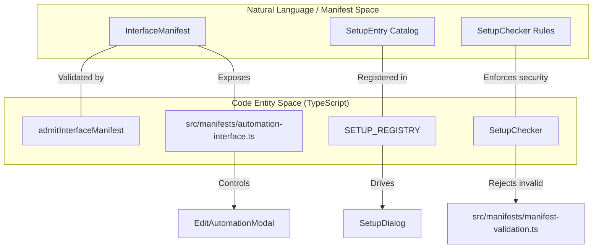
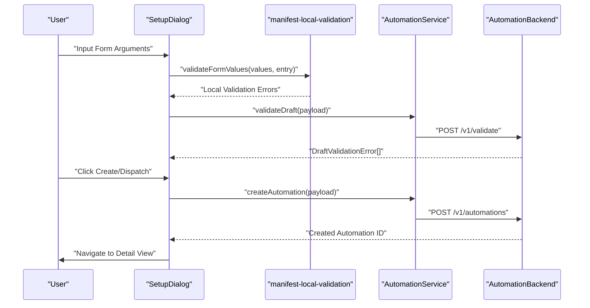
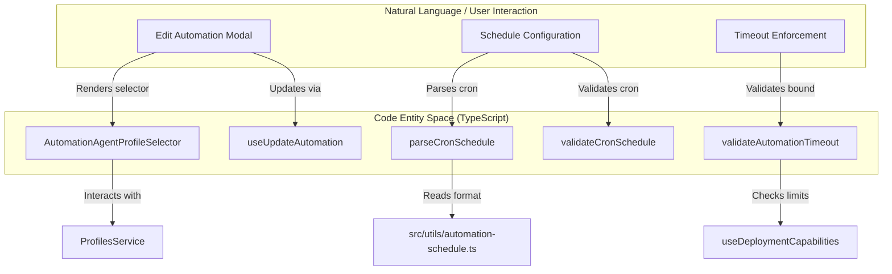

# Automation Types and Manifests

Relevant source files

The following files were used as context for generating this wiki page:

- [__tests__/api/automation-handlers.test.ts](__tests__/api/automation-handlers.test.ts)
- [__tests__/components/automations/automation-card.test.tsx](__tests__/components/automations/automation-card.test.tsx)
- [__tests__/components/automations/automation-list-row.test.tsx](__tests__/components/automations/automation-list-row.test.tsx)
- [__tests__/components/automations/automation-setup-draft-service.test.ts](__tests__/components/automations/automation-setup-draft-service.test.ts)
- [__tests__/components/automations/automation-setup-panel.test.tsx](__tests__/components/automations/automation-setup-panel.test.tsx)
- [__tests__/components/automations/detail/edit-automation-modal.test.tsx](__tests__/components/automations/detail/edit-automation-modal.test.tsx)
- [__tests__/components/features/conversation/conversation-main.test.tsx](__tests__/components/features/conversation/conversation-main.test.tsx)
- [__tests__/components/manifest/manifest-setup-dialog.test.tsx](__tests__/components/manifest/manifest-setup-dialog.test.tsx)
- [__tests__/hooks/use-home-automation-actions.test.tsx](__tests__/hooks/use-home-automation-actions.test.tsx)
- [__tests__/manifests/automation-interface.test.ts](__tests__/manifests/automation-interface.test.ts)
- [__tests__/manifests/automation-setup.test.ts](__tests__/manifests/automation-setup.test.ts)
- [__tests__/manifests/manifest-bundle.test.ts](__tests__/manifests/manifest-bundle.test.ts)
- [__tests__/manifests/manifest-validation.test.ts](__tests__/manifests/manifest-validation.test.ts)
- [__tests__/routes/automations-dashboard.test.tsx](__tests__/routes/automations-dashboard.test.tsx)
- [__tests__/tools/automation-form-tool.test.ts](__tests__/tools/automation-form-tool.test.ts)
- [__tests__/utils/automation-schedule.test.ts](__tests__/utils/automation-schedule.test.ts)
- [__tests__/utils/automation-timeout.test.ts](__tests__/utils/automation-timeout.test.ts)
- [__tests__/utils/responder-deployment.test.ts](__tests__/utils/responder-deployment.test.ts)
- [src/api/automation-form-client-tool.ts](src/api/automation-form-client-tool.ts)
- [src/api/automation-form-session.ts](src/api/automation-form-session.ts)
- [src/api/automation-setup-types.ts](src/api/automation-setup-types.ts)
- [src/components/features/automations/agent-profile-selector.test.tsx](src/components/features/automations/agent-profile-selector.test.tsx)
- [src/components/features/automations/agent-profile-selector.tsx](src/components/features/automations/agent-profile-selector.tsx)
- [src/components/features/automations/automation-card.tsx](src/components/features/automations/automation-card.tsx)
- [src/components/features/automations/automation-list-row.tsx](src/components/features/automations/automation-list-row.tsx)
- [src/components/features/automations/detail/detail-header.tsx](src/components/features/automations/detail/detail-header.tsx)
- [src/components/features/automations/detail/edit-automation-modal.tsx](src/components/features/automations/detail/edit-automation-modal.tsx)
- [src/components/features/automations/setup/automation-setup-draft-service.ts](src/components/features/automations/setup/automation-setup-draft-service.ts)
- [src/components/features/automations/setup/automation-setup-panel.tsx](src/components/features/automations/setup/automation-setup-panel.tsx)
- [src/components/features/conversation/conversation-main/conversation-main.tsx](src/components/features/conversation/conversation-main/conversation-main.tsx)
- [src/components/features/manifest/manifest-setup-dialog.tsx](src/components/features/manifest/manifest-setup-dialog.tsx)
- [src/manifests/automation-interface.ts](src/manifests/automation-interface.ts)
- [src/manifests/automation-setup.test.ts](src/manifests/automation-setup.test.ts)
- [src/manifests/automation-setup.ts](src/manifests/automation-setup.ts)
- [src/manifests/manifest-local-validation.ts](src/manifests/manifest-local-validation.ts)
- [src/manifests/manifest-validation.ts](src/manifests/manifest-validation.ts)
- [src/manifests/types.ts](src/manifests/types.ts)
- [src/mocks/automation-handlers.ts](src/mocks/automation-handlers.ts)
- [src/mocks/automations.mock.ts](src/mocks/automations.mock.ts)
- [src/routes/automation-setup-new.tsx](src/routes/automation-setup-new.tsx)
- [src/utils/automation-schedule.ts](src/utils/automation-schedule.ts)
- [src/utils/automation-timeout.ts](src/utils/automation-timeout.ts)

The Automations subsystem in OpenHands orchestrates scheduled and event-driven background agent workflows. It uses a declarative, manifest-driven architecture where extension-authored configurations define UI components, validation policies, and execution payloads. The `@openhands/agent-canvas` frontend consumes these manifests to render dynamic setup dialogs, form validation wrappers, and management interfaces.

---

## 1. Automation Core Types and Data Models

The system enforces strict type boundaries between abstract templates, persisted automation records, and execution instances. These are defined primarily in `src/types/automation.ts`.

### Core Data Structures

| Type | Role | Key Fields | Source Code Pointer |
|:---|:---|:---|:---|
| `AutomationTrigger` | Dictates execution initiation (cron or webhook event). | `type` (cron/event), `schedule`, `source`, `on`, `filter` | `[src/types/automation.ts:1-22]()` |
| `Automation` | Persisted configuration and metadata record. | `id`, `name`, `trigger`, `enabled`, `prompt`, `repository`, `model`, `timeout` | `[src/types/automation.ts:24-53]()` |
| `AutomationSpec` | Template or draft representation used during creation. | Mirrors `Automation` without system-assigned identifiers (`id`, `created_at`) | `[src/types/automation.ts:55-58]()` |
| `AutomationRun` | Tracks a discrete execution run instance. | `id`, `status`, `conversation_id`, `bash_command_id`, `cost`, `error` | `[src/types/automation.ts:82-120]()` |

### Execution Status Phases
Automations transition through specific run phases managed by `AutomationRunStatus`: `PENDING`, `RUNNING`, `COMPLETED`, `FAILED`, `CANCELLED`, and `SKIPPED` `[src/types/automation.ts:73-80]()`.

Sources:
- `[src/types/automation.ts:1-120]()`

---

## 2. Manifest Architecture and Validation

OpenHands leverages two primary manifest contracts published by `@openhands/extensions` to decouple core application routing from automation features.

### Interface Manifest (`InterfaceManifest`)
Controls global automation management surfaces, routing permissions, page titles, and attribute constraints (`[src/manifests/automation-interface.ts:1-155]()`).
*   **Admission Control**: The host validates candidates using `admitInterfaceManifest` `[src/manifests/automation-interface.ts:65-82]()`. If validation fails, navigation routes are unmounted.
*   **Attribute Specs**: Declarative boundaries for fields like `timeout` or `prompt` (`[src/manifests/automation-interface.ts:201-212]()`).

### Setup Manifest (`SetupEntry`)
Defines installable automation templates/skills supporting `direct` (pre-defined prompt/bundle) or `assisted` (guided conversation) modes (`[src/manifests/types.ts:15-113]()`).

Title: Natural Language Space to Code Entity Mapping: Manifest Admission

Sources:
- `[src/manifests/automation-interface.ts:1-155]()`
- `[src/manifests/types.ts:1-215]()`
- `[src/manifests/manifest-validation.ts:1-170]()`

---

## 3. Automation Setup Panel, Dialog, and Draft Service

The setup process is coordinated via `SetupDialog` (`[src/components/features/manifest/manifest-setup-dialog.tsx:101-115]()`) and `AutomationSetupPanel`, supporting server-backed automation drafts.

### Setup Workflow
1.  **Prerequisites**: Validates required platform integrations via `useSetupPrerequisites` (`[src/components/features/manifest/manifest-setup-dialog.tsx:106-106]()`).
2.  **Form & Field Validation**: Executes local field validation (`validateFormValues`) combined with debounced preflight checks via `AutomationService.validateDraft` (`[src/components/features/manifest/manifest-setup-dialog.tsx:144-148]()`, `[src/manifests/manifest-local-validation.ts:16-16]()`).
3.  **Action Dispatch**: Resolves creation payloads through `buildCreatePayload` before committing via `useSetupAction` (`[src/manifests/automation-setup.ts:8-8]()`, `[src/manifests/manifest-actions.ts]()`).

Title: Automation Creation and Preflight Sequence

Sources:
- `[src/components/features/manifest/manifest-setup-dialog.tsx:1-210]()`
- `[src/manifests/automation-setup.ts:1-115]()`
- `[src/manifests/manifest-local-validation.ts:1-50]()`

---

## 4. Agent Profile Selector and Schedule/Timeout Utilities

Automations rely on specialized helpers to manage LLM profiles, cron expressions, and execution limits.

*   **Agent Profile Selector**: `AutomationAgentProfileSelector` allows linking automations to specific agent behaviors and profiles (`[src/components/features/automations/agent-profile-selector.tsx:1-47]()`).
*   **Schedule Utilities**: `parseCronSchedule`, `buildCronSchedule`, and `validateCronSchedule` manage schedule presets (`daily`, `weekdays`, `weekly`, or custom cron strings) (`[src/utils/automation-schedule.ts:1-45]()`).
*   **Timeout Boundaries**: `validateAutomationTimeout` enforces deployment maximum constraints (`[src/utils/automation-timeout.ts:1-30]()`).

Title: Natural Language Space to Code Entity Mapping: Edit and Utility Seams

Sources:
- `[src/components/features/automations/detail/edit-automation-modal.tsx:1-160]()`
- `[src/utils/automation-schedule.ts:1-50]()`
- `[src/utils/automation-timeout.ts:1-35]()`

---

## 5. Automation UI Components and Rendering

Automations are rendered using specialized card layouts, list rows, and detail headers.

*   **`AutomationCard`**: Displays featured summaries, trigger descriptions, run insights, and action buttons (`[src/components/features/automations/automation-card.tsx:59-137]()`).
*   **`AutomationListRow`**: Compact list view integrating health indicators (`AutomationHealthIndicator`) and hover cards (`HomeAutomationRunTooltip`) (`[src/components/features/automations/automation-list-row.tsx:55-145]()`).
*   **`DetailHeader`**: Manages toggling, manual triggers (`onRunNow`), and export options for individual automations (`[src/components/features/automations/detail/detail-header.tsx:33-130]()`).

Sources:
- `[src/components/features/automations/automation-card.tsx:1-173]()`
- `[src/components/features/automations/automation-list-row.tsx:1-167]()`
- `[src/components/features/automations/detail/detail-header.tsx:1-130]()`