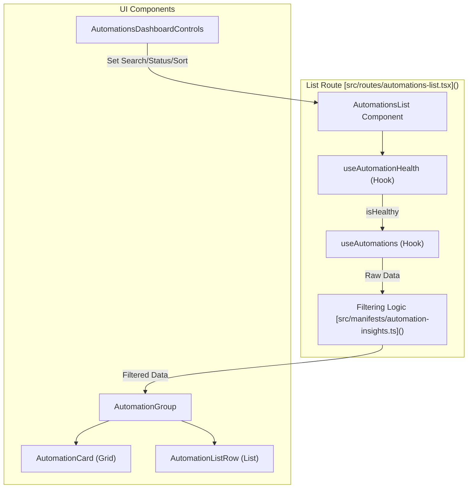
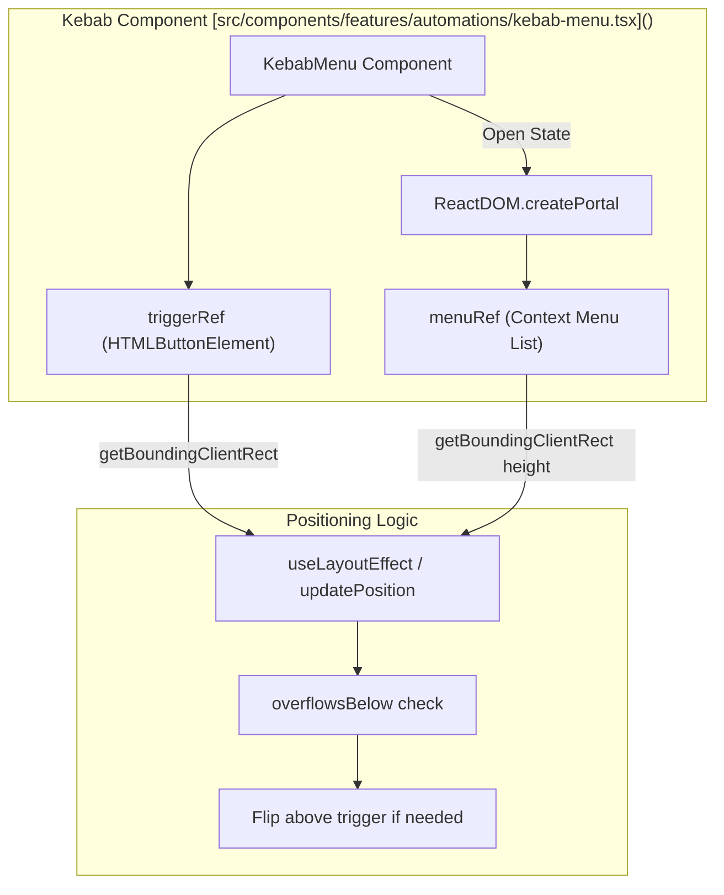
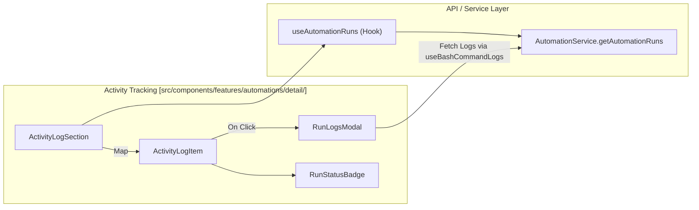
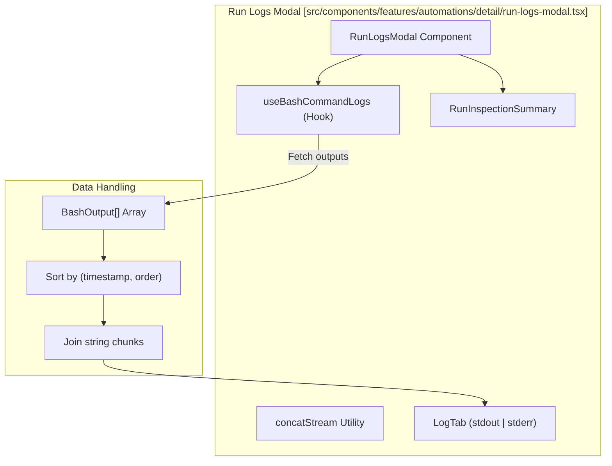

# Automation UI: List, Detail, and Activity

Relevant source files

The following files were used as context for generating this wiki page:

- [__tests__/api/cloud/organization-service.test.ts](__tests__/api/cloud/organization-service.test.ts)
- [__tests__/components/automations/automation-view-toggle.test.tsx](__tests__/components/automations/automation-view-toggle.test.tsx)
- [__tests__/components/automations/detail/activity-log-item.test.tsx](__tests__/components/automations/detail/activity-log-item.test.tsx)
- [__tests__/components/automations/detail/configuration-section.test.tsx](__tests__/components/automations/detail/configuration-section.test.tsx)
- [__tests__/components/automations/detail/run-logs-modal-script-run.test.tsx](__tests__/components/automations/detail/run-logs-modal-script-run.test.tsx)
- [__tests__/components/automations/detail/run-logs-modal.test.tsx](__tests__/components/automations/detail/run-logs-modal.test.tsx)
- [__tests__/components/automations/detail/run-status-badge.test.tsx](__tests__/components/automations/detail/run-status-badge.test.tsx)
- [__tests__/components/automations/detail/script-section.test.tsx](__tests__/components/automations/detail/script-section.test.tsx)
- [__tests__/components/automations/kebab-menu.test.tsx](__tests__/components/automations/kebab-menu.test.tsx)
- [__tests__/components/features/home/automation-run-health.test.ts](__tests__/components/features/home/automation-run-health.test.ts)
- [__tests__/components/features/home/build-pinned-automation-menu-items.test.ts](__tests__/components/features/home/build-pinned-automation-menu-items.test.ts)
- [__tests__/components/features/home/featured-automations-section.test.tsx](__tests__/components/features/home/featured-automations-section.test.tsx)
- [__tests__/hooks/query/use-bash-command-logs.test.tsx](__tests__/hooks/query/use-bash-command-logs.test.tsx)
- [__tests__/manifests/automation-insights.test.ts](__tests__/manifests/automation-insights.test.ts)
- [__tests__/manifests/interface-validation.test.ts](__tests__/manifests/interface-validation.test.ts)
- [__tests__/manifests/manifest-test-data.ts](__tests__/manifests/manifest-test-data.ts)
- [__tests__/utils/automation-run-display.test.ts](__tests__/utils/automation-run-display.test.ts)
- [__tests__/utils/base-path.test.ts](__tests__/utils/base-path.test.ts)
- [__tests__/utils/tar-unpack.test.ts](__tests__/utils/tar-unpack.test.ts)
- [src/api/cloud/organization-service.api.ts](src/api/cloud/organization-service.api.ts)
- [src/components/features/automations/automation-view-toggle.tsx](src/components/features/automations/automation-view-toggle.tsx)
- [src/components/features/automations/dashboard/automations-dashboard-controls.tsx](src/components/features/automations/dashboard/automations-dashboard-controls.tsx)
- [src/components/features/automations/dashboard/automations-filtered-empty-state.tsx](src/components/features/automations/dashboard/automations-filtered-empty-state.tsx)
- [src/components/features/automations/detail/activity-log-item.tsx](src/components/features/automations/detail/activity-log-item.tsx)
- [src/components/features/automations/detail/activity-log-section.tsx](src/components/features/automations/detail/activity-log-section.tsx)
- [src/components/features/automations/detail/configuration-section.tsx](src/components/features/automations/detail/configuration-section.tsx)
- [src/components/features/automations/detail/detail-skeleton.tsx](src/components/features/automations/detail/detail-skeleton.tsx)
- [src/components/features/automations/detail/run-logs-modal.tsx](src/components/features/automations/detail/run-logs-modal.tsx)
- [src/components/features/automations/detail/run-status-badge.tsx](src/components/features/automations/detail/run-status-badge.tsx)
- [src/components/features/automations/detail/script-section.tsx](src/components/features/automations/detail/script-section.tsx)
- [src/components/features/automations/kebab-menu-item-content.tsx](src/components/features/automations/kebab-menu-item-content.tsx)
- [src/components/features/automations/kebab-menu.tsx](src/components/features/automations/kebab-menu.tsx)
- [src/components/features/automations/toggle-switch.tsx](src/components/features/automations/toggle-switch.tsx)
- [src/components/features/automations/view-menu-item-content.tsx](src/components/features/automations/view-menu-item-content.tsx)
- [src/components/features/chat/chat-messages-skeleton.tsx](src/components/features/chat/chat-messages-skeleton.tsx)
- [src/components/features/conversation-panel/budget-progress-bar.tsx](src/components/features/conversation-panel/budget-progress-bar.tsx)
- [src/components/features/home/featured-automations/build-home-automation-menu-items.tsx](src/components/features/home/featured-automations/build-home-automation-menu-items.tsx)
- [src/components/features/home/featured-automations/build-pinned-automation-menu-items.tsx](src/components/features/home/featured-automations/build-pinned-automation-menu-items.tsx)
- [src/components/features/home/featured-automations/home-automation-activity.ts](src/components/features/home/featured-automations/home-automation-activity.ts)
- [src/components/features/home/featured-automations/pinned-automation-card.tsx](src/components/features/home/featured-automations/pinned-automation-card.tsx)
- [src/components/features/home/featured-automations/running-automations-list.tsx](src/components/features/home/featured-automations/running-automations-list.tsx)
- [src/hooks/query/use-automation-detail.ts](src/hooks/query/use-automation-detail.ts)
- [src/hooks/query/use-automation-run-summaries.ts](src/hooks/query/use-automation-run-summaries.ts)
- [src/hooks/query/use-cloud-org-member.ts](src/hooks/query/use-cloud-org-member.ts)
- [src/hooks/use-home-automation-actions.ts](src/hooks/use-home-automation-actions.ts)
- [src/manifests/automation-insights.ts](src/manifests/automation-insights.ts)
- [src/mocks/automation-runs.mock.ts](src/mocks/automation-runs.mock.ts)
- [src/utils/automation-export.test.ts](src/utils/automation-export.test.ts)
- [src/utils/automation-export.ts](src/utils/automation-export.ts)
- [src/utils/automation-preset-sources.ts](src/utils/automation-preset-sources.ts)
- [src/utils/automation-run-display.ts](src/utils/automation-run-display.ts)
- [src/utils/base-path.ts](src/utils/base-path.ts)

## Purpose and Scope

This document details the frontend implementation of the Automations management interface within OpenHands (`@openhands/agent-canvas`). It covers the routing, component architecture, and data flow for listing automations, viewing specific automation details, managing them through kebab menus, monitoring execution history through activity logs and run logs modals, rendering run status badges, and featuring automations on the home dashboard.

**Sources:** [src/routes/automations-list.tsx:87-98](), [src/routes/automation-detail.tsx:57-65]()

## Automations List View and Dashboard

The `AutomationsList` route ([src/routes/automations-list.tsx]()) serves as the primary dashboard for managing automated agent workflows. It supports two primary layout modes: a grid of `AutomationCard` components and a tabular `AutomationListRow` view.

### List Architecture and Filtering

**Key Implementation Details:**
- **Health Guard**: The page first checks the automation backend health via `useAutomationHealth` before attempting to fetch the list [src/routes/automations-list.tsx:125-138]().
- **View Persistence**: The user's preference for Grid vs. List view is persisted in `localStorage` using `readStoredAutomationViewMode` and `writeStoredAutomationViewMode` [src/routes/automations-list.tsx:106-108]().
- **Filtering and Search**: The `applyDashboardView` utility handles multi-dimensional filtering (status, trigger type, and text search) and sorting (last-run, name, created) [src/routes/automations-list.tsx:150-166](), [__tests__/manifests/automation-insights.test.ts:3-12]().
- **Run Summaries**: In dashboard mode, the list fetches execution summaries for each automation to display status indicators and last-run timestamps [src/routes/automations-list.tsx:140-142]().

**Sources:** [src/routes/automations-list.tsx:87-166](), [src/manifests/automation-insights.ts:54-58](), [__tests__/manifests/automation-insights.test.ts:3-12]()

## AutomationCard, ListRow, and Kebab Menus

Automations are represented across list and dashboard views using compact card containers (`AutomationCard`) or streamlined tabular rows (`AutomationListRow`), both integrated with action dropdowns via `KebabMenu` [src/components/features/automations/kebab-menu.tsx:24-143]().

### Kebab Menu Positioning and Architecture

**Key Implementation Details:**
- **Portal Rendering**: `KebabMenu` renders items into a fixed portal positioned relative to the trigger button using `getBoundingClientRect()` to prevent clipping inside scrollable containers [src/components/features/automations/kebab-menu.tsx:31-67](), [src/components/features/automations/kebab-menu.tsx:135-140]().
- **Bounding & Viewport Collision**: It measures menu height dynamically, flipping upwards (`bottom` positioning) if `rect.bottom + gap + menuHeight > window.innerHeight` [src/components/features/automations/kebab-menu.tsx:38-55]().
- **Keyboard & Click-Outside Handling**: Listens to global `mousedown` and `Escape` key events to dismiss the menu securely [src/components/features/automations/kebab-menu.tsx:69-95]().

**Sources:** [src/components/features/automations/kebab-menu.tsx:24-143]()

## Detail Header and Configuration Section

The `AutomationDetail` route ([src/routes/automation-detail.tsx]()) hosts the main inspection header (`DetailHeader`) and the configuration panel (`ConfigurationSection`) [src/components/features/automations/detail/configuration-section.tsx:61-177]().

### Configuration Section Mapping

| Field | Icon / Component | Description |
|:---|:---|:---|
| **Repositories** | `GitBranchIcon`, `BranchBadge` | Lists configured remote repositories and target git references/branches [src/components/features/automations/detail/configuration-section.tsx:85-105]() |
| **Trigger Type** | `CheckCircleIcon` | Displays whether the automation runs via schedule (`cron`) or webhook/event source [src/components/features/automations/detail/configuration-section.tsx:107-112]() |
| **Schedule / Source** | `CalendarIcon` / `Zap` | Human-readable schedule string with timezone suffix or event provider name [src/components/features/automations/detail/configuration-section.tsx:114-130]() |
| **Event Filter** | `CodeTagIcon`, `FilterExpression` | Collapsible syntax block for filtering event payloads with expand/collapse toggle [src/components/features/automations/detail/configuration-section.tsx:33-59](), [src/components/features/automations/detail/configuration-section.tsx:141-148]() |
| **Runs As** | `UserIcon` | Resolved creator email or user ID identity executing the run [src/components/features/automations/detail/configuration-section.tsx:150-157]() |
| **Model Profile** | `SparkleIcon` | Active LLM profile or model override string [src/components/features/automations/detail/configuration-section.tsx:159-164]() |

**Sources:** [src/components/features/automations/detail/configuration-section.tsx:61-177](), [__tests__/components/automations/detail/configuration-section.test.tsx:52-191]()

## Activity Log and Execution Monitoring

The `ActivityLogSection` manages historical execution records, streaming runs, and formatting attributes such as LLM run cost and phase tracking [src/components/features/automations/detail/activity-log-section.tsx:30-181]().

### Run Status and Log Flow

**Key Features:**
- **Activity Log Section**: Supports pagination, deep-link run highlighting via `?run=`, and export utilities for JSON and CSV activity logs [src/components/features/automations/detail/activity-log-section.tsx:30-181]().
- **Activity Log Items**: Renders execution timestamps, fallback validation for pending runs lacking start times (`isInvalidTimestamp`), run cost formatting (`formatRunCost`), and conversation deep-links [src/components/features/automations/detail/activity-log-item.tsx:22-174]().

**Sources:** [src/components/features/automations/detail/activity-log-section.tsx:30-181](), [src/components/features/automations/detail/activity-log-item.tsx:22-189]()

## Run Logs Modal and Output Streaming

When an execution includes a `bash_command_id`, users can inspect raw execution output via `RunLogsModal` [src/components/features/automations/detail/run-logs-modal.tsx:38-54]().

### Run Logs Architecture

**Key Implementation Details:**
- **Stream Concatenation**: `concatStream` sorts raw `BashOutput[]` items by timestamp and order index to ensure chronological stream integrity across paginated chunks [src/components/features/automations/detail/run-logs-modal.tsx:56-68]().
- **Sandbox Issue Handling**: Centralizes empty-state messaging for sandbox provisioning states (`missing`, `paused`, `starting`, `errored`, `unreachable`) using `SANDBOX_ISSUE_I18N` [src/components/features/automations/detail/run-logs-modal.tsx:28-34]().
- **Run Inspection Summary**: Displays run status badge, task outcome summaries, metadata blocks, and system error strings [src/components/features/automations/detail/run-logs-modal.tsx:102-163]().

**Sources:** [src/components/features/automations/detail/run-logs-modal.tsx:1-181](), [__tests__/components/automations/detail/run-logs-modal.test.tsx:58-234]()

## Run Status Badges

Run statuses are visualized consistently across dashboard widgets, detail headers, and activity logs via `RunStatusBadge` [src/components/features/automations/detail/run-status-badge.tsx]().

- **Status Mapping**: Translates `AutomationRunStatus` enum values (`PENDING`, `RUNNING`, `COMPLETED`, `FAILED`, `CANCELLED`, `SKIPPED`) into distinct styling variants.
- **Compact Mode**: Supports a compact chip layout (`compact` prop) used within table rows and inline status summaries.

**Sources:** [src/components/features/automations/detail/run-status-badge.tsx](), [src/types/automation.ts:1-35]()

## Home Featured Automations and Dashboard Widgets

Automations are surfaced on the home screen via `RunningAutomationsList` and pinned dashboard sections [src/components/features/home/featured-automations/running-automations-list.tsx:48-170]().

- **Activity Sparklines**: Displays recent run health history via `AutomationRunActivitySparkline` [src/components/features/home/featured-automations/running-automations-list.tsx:23]().
- **Interactive Tooltips**: Hovering over running items activates `HomeAutomationRunTooltip` to reveal real-time task progress and run metrics [src/components/features/home/featured-automations/running-automations-list.tsx:100-111]().
- **Action Bindings**: Wires quick actions (Run Now, View Details, Edit, Cancel Run, Turn Off, and Pin/Unpin) using `useHomeAutomationActions` [src/components/features/home/featured-automations/running-automations-list.tsx:61](), [src/hooks/use-home-automation-actions.ts:40-151]().

**Sources:** [src/components/features/home/featured-automations/running-automations-list.tsx:48-170](), [src/hooks/use-home-automation-actions.ts:40-151]()