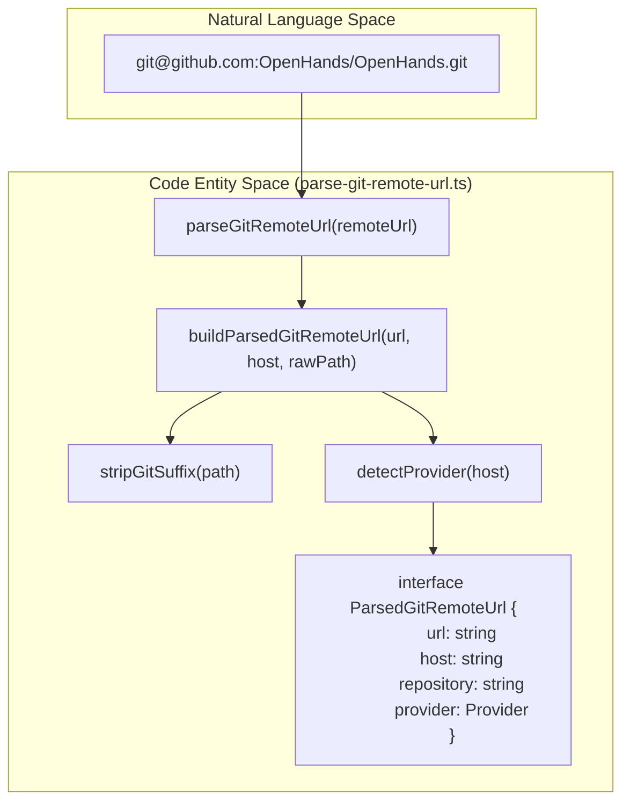
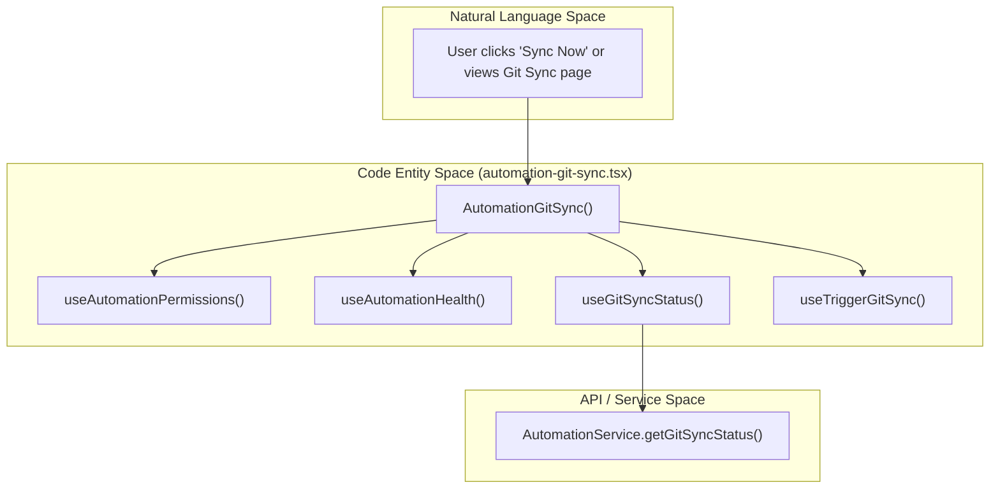

# Automation Git Sync

Relevant source files

The following files were used as context for generating this wiki page:

- [.github/pr-assets/pr-16982-validation.png](.github/pr-assets/pr-16982-validation.png)
- [__tests__/hooks/query/use-automation-sdk-version.test.tsx](__tests__/hooks/query/use-automation-sdk-version.test.tsx)
- [__tests__/hooks/query/use-git-sync.test.tsx](__tests__/hooks/query/use-git-sync.test.tsx)
- [__tests__/hooks/use-sync-automation-telemetry-consent.test.ts](__tests__/hooks/use-sync-automation-telemetry-consent.test.ts)
- [__tests__/routes/automation-git-sync.test.tsx](__tests__/routes/automation-git-sync.test.tsx)
- [__tests__/utils/azure-devops-remote-links.test.ts](__tests__/utils/azure-devops-remote-links.test.ts)
- [__tests__/utils/parse-git-remote-url.test.ts](__tests__/utils/parse-git-remote-url.test.ts)
- [src/api/automation-service/automation-service.api.test.ts](src/api/automation-service/automation-service.api.test.ts)
- [src/components/features/automations/git-sync/git-sync-config-form.test.tsx](src/components/features/automations/git-sync/git-sync-config-form.test.tsx)
- [src/components/features/automations/git-sync/git-sync-config-form.tsx](src/components/features/automations/git-sync/git-sync-config-form.tsx)
- [src/components/features/automations/git-sync/git-sync-overview-section.test.tsx](src/components/features/automations/git-sync/git-sync-overview-section.test.tsx)
- [src/components/features/automations/git-sync/git-sync-overview-section.tsx](src/components/features/automations/git-sync/git-sync-overview-section.tsx)
- [src/components/features/chat/git-control-bar-branch-button.tsx](src/components/features/chat/git-control-bar-branch-button.tsx)
- [src/hooks/query/use-automation-sdk-version.ts](src/hooks/query/use-automation-sdk-version.ts)
- [src/hooks/query/use-git-sync.ts](src/hooks/query/use-git-sync.ts)
- [src/hooks/use-sync-automation-telemetry-consent.ts](src/hooks/use-sync-automation-telemetry-consent.ts)
- [src/routes/automation-git-sync.tsx](src/routes/automation-git-sync.tsx)
- [src/utils/parse-git-remote-url.ts](src/utils/parse-git-remote-url.ts)

The Automation Git Sync subsystem provides the infrastructure for synchronizing automation definitions between the OpenHands backend and remote Git repositories. This allows users to manage their automated agent workflows using version control, facilitating collaborative development, configuration management, and automated deployments.

---

## Git Sync Overview

The Git Sync feature allows an automation backend to be linked to a specific repository, branch, and path. The system tracks synchronization status, including the last synced commit, timestamps, encryption states, and dirty local file counts.

### Implementation Details
Synchronization data is fetched and managed via `AutomationService` and consumed through dedicated UI components such as `GitSyncOverviewSection` and `GitSyncConfigForm`. The system processes various Git remote URL formats—including HTTPS, SSH, and SCP-style shorthands—to generate safe, clean web browse links while stripping sensitive credentials.

### Key Data Structures
- **`GitSyncStatus`**: Tracks synchronization state, including `enabled`, `repo_url`, `branch`, `path`, `encryption_enabled`, `last_synced_commit`, `last_synced_at`, `last_error`, `dirty_count`, and `sync_in_progress` [src/api/automation-service/automation-service.api:8-9](), [src/components/features/automations/git-sync/git-sync-overview-section.test.tsx:6-18]().
- **`ParsedGitRemoteUrl`**: An interface representing parsed components of a git remote URL: `url`, `host`, `repository` (`owner/repo`), and `provider` [src/utils/parse-git-remote-url.ts:3-16]().

### Natural Language to Code Entity Space: Git URL Parsing
This diagram illustrates how a natural language string representing a Git remote URL is transformed into structured data used by the sync subsystem.

Sources: [src/utils/parse-git-remote-url.ts:3-16](), [src/utils/parse-git-remote-url.ts:67-95]()

---

## Git Remote URL Utility

The `parse-git-remote-url` utility (`[src/utils/parse-git-remote-url.ts]()`) parses and normalizes Git URLs into structured metadata.

### Supported Formats & Normalization
- **HTTPS & HTTP**: `https://github.com/owner/repo.git` [src/utils/parse-git-remote-url.ts:93-110]()
- **SSH**: `ssh://git@github.com:owner/repo.git` [src/utils/parse-git-remote-url.ts:93-110]()
- **SCP Shorthand**: `git@github.com:owner/repo.git` [src/utils/parse-git-remote-url.ts:113-118]()
- **Azure DevOps**: Normalizes paths by removing `_git` segments and stripping `v3` prefixes from SSH URIs [src/utils/parse-git-remote-url.ts:50-65]()

### Provider Detection
The utility maps known hostnames to internal `Provider` enums:
- `github.com` → `github` [src/utils/parse-git-remote-url.ts:18-23]()
- `gitlab.com` → `gitlab` [src/utils/parse-git-remote-url.ts:18-23]()
- `bitbucket.org` → `bitbucket` [src/utils/parse-git-remote-url.ts:18-23]()
- `dev.azure.com` → `azure_devops` [src/utils/parse-git-remote-url.ts:18-23]()

Sources: [src/utils/parse-git-remote-url.ts:18-65](), [src/utils/parse-git-remote-url.ts:93-121]()

---

## Git Sync UI Components

### GitSyncOverviewSection
The `GitSyncOverviewSection` component renders the current status of Git synchronization [src/components/features/automations/git-sync/git-sync-overview-section.tsx:81-88](). It features:
- **Status Pills**: Indicate whether Git sync and payload encryption are enabled or disabled [src/components/features/automations/git-sync/git-sync-overview-section.tsx:100-117]().
- **Sync Now Action**: Triggers an immediate synchronization run via `onSyncNow` [src/components/features/automations/git-sync/git-sync-overview-section.tsx:119-137]().
- **Credential Stripping & Safe Links**: Uses `browseUrlFor` and `displayUrlFor` helpers to strip tokens or passwords from UI displays and anchor hrefs [src/components/features/automations/git-sync/git-sync-overview-section.tsx:32-70]().

Sources: [src/components/features/automations/git-sync/git-sync-overview-section.tsx:32-188](), [src/components/features/automations/git-sync/git-sync-overview-section.test.tsx:34-114]()

---

## Automation Git Sync Route & Polling Loop

The `AutomationGitSync` route (`[src/routes/automation-git-sync.tsx]()`) manages the full page view for Git synchronization configuration and monitoring.

### Polling Cadence and Activity States
The route manages background polling depending on whether a sync is actively running:
- **Active Polling (`POLL_INTERVAL_MS`)**: Set to `3,000ms` when a sync cycle is in progress [src/routes/automation-git-sync.tsx:27-32]().
- **Idle Polling (`IDLE_POLL_INTERVAL_MS`)**: Set to `15,000ms` during steady state [src/routes/automation-git-sync.tsx:27-32]().
- **Sync Activity State Machine**: Tracks `idle`, `running`, `succeeded`, and `failed` states by monitoring changes to `last_synced_at` and `last_error_at` timestamps [src/routes/automation-git-sync.tsx:34-50]().

### Natural Language to Code Entity Space: Automation Git Sync Route
This diagram bridges the frontend route state management with the underlying hooks and API services.

Sources: [src/routes/automation-git-sync.tsx:52-117](), [src/hooks/query/use-git-sync.ts]()

### Error Handling & Unsupported Backends
- **Unsupported APIs**: If an automation backend predates the Git Sync API and returns a `404 Not Found`, the route renders `GitSyncUnsupportedState` rather than a generic error panel [src/routes/automation-git-sync.tsx:162-174]().
- **Permissions Check**: Enforces organization-level permissions via `useAutomationPermissions()` to ensure only authorized admins can view or manage sync settings [src/routes/automation-git-sync.tsx:58-60]().

Sources: [src/routes/automation-git-sync.tsx:52-190](), [__tests__/routes/automation-git-sync.test.tsx:134-176]()

---

## Key Functions and Classes

| Entity | Location | Role |
| :--- | :--- | :--- |
| `parseGitRemoteUrl` | `[src/utils/parse-git-remote-url.ts]()` | Parses and normalizes Git remote URLs into host, repository, and provider info. |
| `GitSyncOverviewSection` | `[src/components/features/automations/git-sync/git-sync-overview-section.tsx]()` | UI component showing sync status, repository links, and sync controls. |
| `GitSyncConfigForm` | `[src/components/features/automations/git-sync/git-sync-config-form.tsx]()` | Form for editing repository URL, branch, path, and credentials. |
| `AutomationGitSync` | `[src/routes/automation-git-sync.tsx]()` | Page route managing polling, activity state, permissions, and error boundaries. |
| `AutomationService` | `[src/api/automation-service/automation-service.api.ts]()` | API client handling `getGitSyncStatus`, `updateGitSyncConfig`, and `triggerGitSync`. |

Sources: [src/utils/parse-git-remote-url.ts:93-121](), [src/components/features/automations/git-sync/git-sync-overview-section.tsx:81-88](), [src/routes/automation-git-sync.tsx:52-60]()