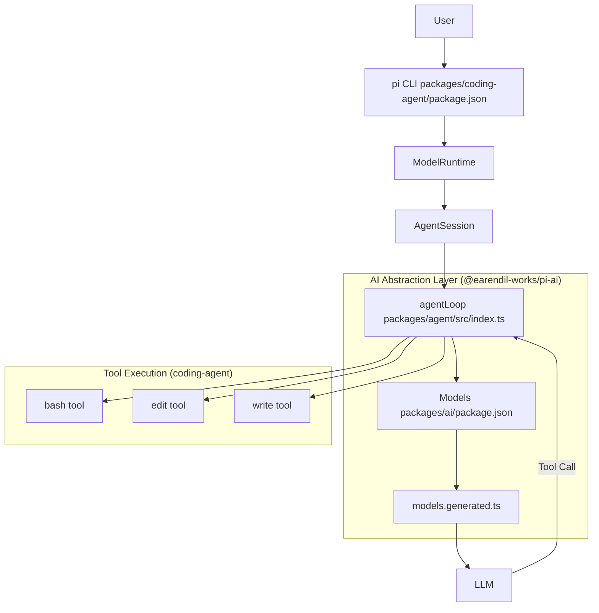
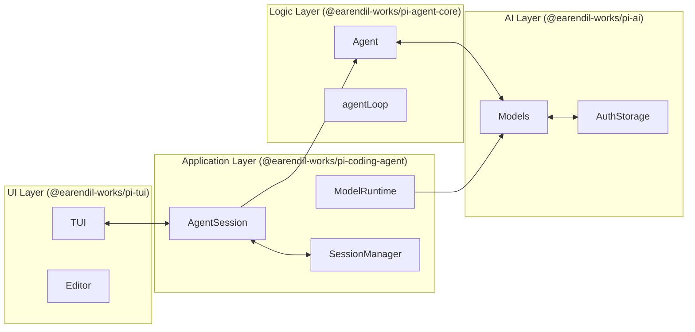

# Overview

Relevant source files

The following files were used as context for generating this wiki page:

- [.github/workflows/build-binaries.yml](.github/workflows/build-binaries.yml)
- [AGENTS.md](AGENTS.md)
- [README.md](README.md)
- [package-lock.json](package-lock.json)
- [package.json](package.json)
- [packages/agent/CHANGELOG.md](packages/agent/CHANGELOG.md)
- [packages/agent/package.json](packages/agent/package.json)
- [packages/ai/CHANGELOG.md](packages/ai/CHANGELOG.md)
- [packages/ai/package.json](packages/ai/package.json)
- [packages/ai/src/providers/model-schema.ts](packages/ai/src/providers/model-schema.ts)
- [packages/coding-agent/CHANGELOG.md](packages/coding-agent/CHANGELOG.md)
- [packages/coding-agent/docs/containerization.md](packages/coding-agent/docs/containerization.md)
- [packages/coding-agent/docs/docs.json](packages/coding-agent/docs/docs.json)
- [packages/coding-agent/docs/index.md](packages/coding-agent/docs/index.md)
- [packages/coding-agent/docs/nvidia-rtx-llama-cpp.md](packages/coding-agent/docs/nvidia-rtx-llama-cpp.md)
- [packages/coding-agent/docs/quickstart.md](packages/coding-agent/docs/quickstart.md)
- [packages/coding-agent/docs/security.md](packages/coding-agent/docs/security.md)
- [packages/coding-agent/docs/termux.md](packages/coding-agent/docs/termux.md)
- [packages/coding-agent/package.json](packages/coding-agent/package.json)
- [packages/coding-agent/scripts/generate-references.ts](packages/coding-agent/scripts/generate-references.ts)
- [packages/coding-agent/test/references.test.ts](packages/coding-agent/test/references.test.ts)
- [packages/tui/CHANGELOG.md](packages/tui/CHANGELOG.md)
- [packages/tui/package.json](packages/tui/package.json)
- [scripts/build-binaries.sh](scripts/build-binaries.sh)
- [scripts/check-pinned-deps.mjs](scripts/check-pinned-deps.mjs)
- [scripts/create-source-archive.sh](scripts/create-source-archive.sh)
- [scripts/local-release.mjs](scripts/local-release.mjs)
- [scripts/publish-release-announcement.mjs](scripts/publish-release-announcement.mjs)
- [scripts/publish-release-announcement.test.mjs](scripts/publish-release-announcement.test.mjs)
- [scripts/publish.mjs](scripts/publish.mjs)
- [scripts/release-packages.mjs](scripts/release-packages.mjs)
- [tsconfig.json](tsconfig.json)

The `pi` monorepo is a minimal terminal coding harness and AI agent framework designed for high extensibility, allowing developers to build, run, and embed autonomous agents that interact with local file systems and execute shell commands [packages/coding-agent/package.json:2-4](), [README.md:13-16](). 

The project follows a modular architecture, separating core agent logic, LLM provider abstractions, terminal UI components, and transport/durable primitives into distinct, reusable packages [README.md:26-37](). It is adapted to specific workflows via TypeScript extensions, skills, prompt templates, and themes [packages/coding-agent/CHANGELOG.md:18-22]().

For installation, first-run setup, authentication, and running the CLI, see [Getting Started](#1.1). For details on the monorepo workspaces layout, packages, dependency graph, and build pipeline, see [Monorepo Structure and Build System](#1.2).

Sources: [packages/coding-agent/package.json:2-4](), [packages/coding-agent/CHANGELOG.md:18-22](), [README.md:13-37]()

---

### Package Architecture

The monorepo is organized into several primary packages managed via npm workspaces [package-lock.json:10-18](). Each package serves a specific layer of the system:

| Package | Purpose | Key Code Entities |
|:---|:---|:---|
| `@earendil-works/pi-ai` | Unified LLM provider abstraction layer with automatic model discovery and provider configuration. | `AssistantMessageEventStream`, `Models`, `streamSimple`, `MODELS`, `CredentialStore` [packages/ai/package.json:2-4]() |
| `@earendil-works/pi-agent-core` | General-purpose agent loop, transport abstraction, state management, and event streams. | `Agent`, `agentLoop`, `AgentState`, `prepareRequest`, `finishTurn` [packages/agent/package.json:2-6]() |
| `@earendil-works/pi-tui` | Differential terminal rendering engine, UI components, and terminal abstraction. | `TUI`, `Terminal`, `Editor`, `ProcessTerminal`, `KeybindingsManager` [packages/tui/package.json:2-4]() |
| `@earendil-works/pi-durable` | Durable conversation, task, and document runtime. | `SessionRepo`, `JsonlSessionRepo`, Durable harness APIs [README.md:33-35]() |
| `@earendil-works/pi-coding-agent` | The main CLI application, coding-specific tools, SDK, and interactive modes. | `AgentSession`, `SessionManager`, `createAgentSession`, `ModelRuntime` [packages/coding-agent/package.json:2-5]() |
| `@earendil-works/chord` | Application-composition runtime for services, replicated state, RPC, and plugins. | Facets, services, delta sync [README.md:28-30]() |
| `@earendil-works/pi-telemetry` | Vendor-neutral telemetry contracts, reference adapter, and typed schemas. | Telemetry schemas and callbacks [README.md:31-31]() |

Sources: [package-lock.json:10-18](), [packages/coding-agent/package.json:2-5](), [packages/agent/package.json:2-6](), [packages/ai/package.json:2-4](), [packages/tui/package.json:2-4](), [README.md:26-37]()

---

### System Concept Map

The following diagram illustrates how natural language requests move from the user through the various code entities to reach an LLM and execute system tools, bridging natural language input to exact codebase entities.

**Request Flow: User Input to Tool Execution**

Sources: [packages/coding-agent/package.json:9-11](), [packages/agent/package.json:2-6](), [packages/ai/package.json:2-4](), [README.md:13-20]()

---

### Core Components and Relationships

The `pi` ecosystem relies on the interaction between the **Agent Loop**, **Provider Abstraction**, and **Terminal UI**.

#### 1. The Agent Loop (`pi-agent-core`)
The core logic resides in `@earendil-works/pi-agent-core`, managing conversation state (`AgentState`) and orchestrating the turn lifecycle: sending messages to an LLM, parsing tool calls, and executing tools [packages/agent/package.json:2-6](). It supports turn lifecycle hooks like `prepareRequest` and `finishTurn` [packages/agent/CHANGELOG.md:46-47]().

#### 2. LLM Abstraction (`pi-ai`)
This package provides a unified interface across multiple LLM providers [packages/ai/package.json:2-4](). It uses a `Models` runtime for isolated provider collections and explicit credential resolution, handling streaming responses, thinking blocks, and dynamic model catalogs [packages/ai/CHANGELOG.md:32-48]().

#### 3. Terminal UI (`pi-tui`)
A custom TUI library using differential rendering for efficient terminal updates [packages/tui/package.json:2-4](). It provides the interactive experience in the `pi` CLI, including a multi-line `Editor` with grapheme-aware cursor movement and a fullscreen UI mode [packages/tui/CHANGELOG.md:5-10]().

#### 4. The Coding Agent (`pi-coding-agent`)
The primary CLI application and SDK [packages/coding-agent/package.json:2-5](). It bundles the core loop with coding tools (`read`, `write`, `edit`, `bash`) [packages/coding-agent/package.json:2-4]() and manages persistent sessions using JSONL structures.

Sources: [packages/agent/package.json:2-6](), [packages/ai/package.json:2-4](), [packages/tui/package.json:2-4](), [packages/coding-agent/package.json:2-5](), [packages/agent/CHANGELOG.md:46-47](), [packages/ai/CHANGELOG.md:32-48](), [packages/tui/CHANGELOG.md:5-10]()

**System Component Interaction**

Sources: [packages/coding-agent/package.json:2-5](), [packages/ai/package.json:2-4](), [README.md:26-37]()

---

### Key Features and Extensibility

* **Multi-mode Execution**: Runs in interactive mode (TUI), print mode (single-shot stdout), and RPC mode (JSON-RPC 2.0 over stdin/stdout) [packages/coding-agent/package.json:2-4](), [README.md:13-20]().
* **Session Management**: Supports branching, forking, and automatic context compaction backed by JSONL repositories [packages/agent/CHANGELOG.md:111-112](), [README.md:33-35]().
* **Extension System**: Users register custom tools, slash commands, and providers loaded via `jiti` utilizing `ExtensionAPI` lifecycle events [packages/coding-agent/package.json:66-73]().
* **Resource Discovery**: Automatically discovers context files like `AGENTS.md` or `SYSTEM.md` to shape agent behavior [AGENTS.md:1-25]().

Sources: [packages/coding-agent/package.json:2-74](), [AGENTS.md:1-25](), [packages/agent/CHANGELOG.md:111-112](), [packages/ai/CHANGELOG.md:47-48](), [README.md:13-37]()