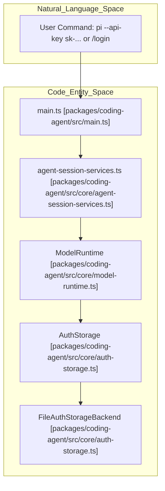
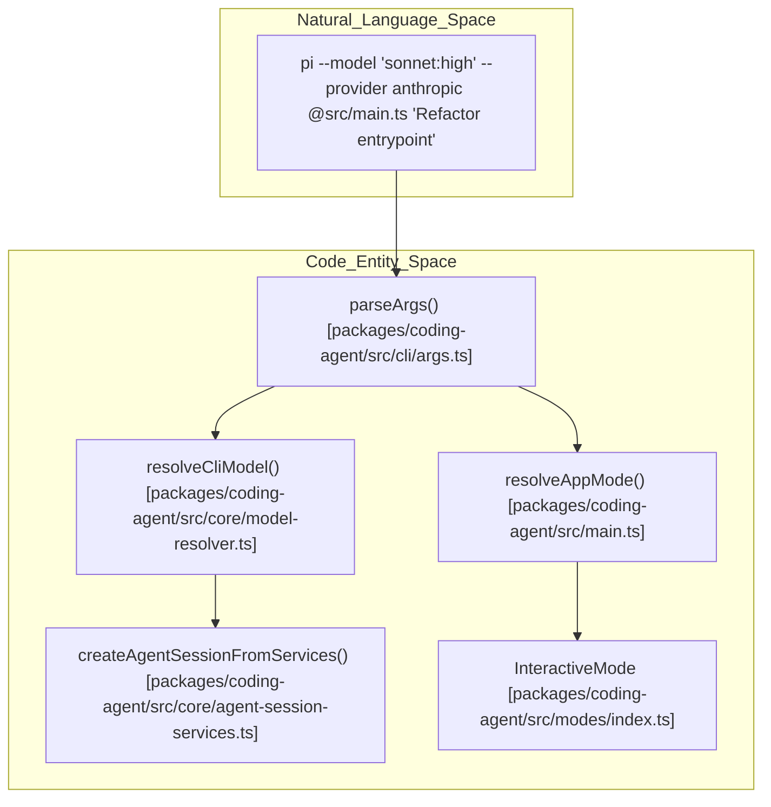

# Getting Started

<details>
<summary>Relevant source files</summary>

The following files were used as context for generating this wiki page:

- [packages/coding-agent/README.md](packages/coding-agent/README.md)
- [packages/coding-agent/docs/cli.md](packages/coding-agent/docs/cli.md)
- [packages/coding-agent/docs/mcp.md](packages/coding-agent/docs/mcp.md)
- [packages/coding-agent/docs/settings.md](packages/coding-agent/docs/settings.md)
- [packages/coding-agent/docs/usage.md](packages/coding-agent/docs/usage.md)
- [packages/coding-agent/src/bun/cli.ts](packages/coding-agent/src/bun/cli.ts)
- [packages/coding-agent/src/bun/restore-sandbox-env.ts](packages/coding-agent/src/bun/restore-sandbox-env.ts)
- [packages/coding-agent/src/cli.ts](packages/coding-agent/src/cli.ts)
- [packages/coding-agent/src/cli/args.ts](packages/coding-agent/src/cli/args.ts)
- [packages/coding-agent/src/core/auth-storage.ts](packages/coding-agent/src/core/auth-storage.ts)
- [packages/coding-agent/src/core/mcp-servers.ts](packages/coding-agent/src/core/mcp-servers.ts)
- [packages/coding-agent/src/core/models-store.ts](packages/coding-agent/src/core/models-store.ts)
- [packages/coding-agent/src/core/resolve-config-value.ts](packages/coding-agent/src/core/resolve-config-value.ts)
- [packages/coding-agent/src/core/settings-manager.ts](packages/coding-agent/src/core/settings-manager.ts)
- [packages/coding-agent/src/extensions/mcp/cli.ts](packages/coding-agent/src/extensions/mcp/cli.ts)
- [packages/coding-agent/src/extensions/mcp/config.ts](packages/coding-agent/src/extensions/mcp/config.ts)
- [packages/coding-agent/src/extensions/mcp/index.ts](packages/coding-agent/src/extensions/mcp/index.ts)
- [packages/coding-agent/src/extensions/mcp/oauth.ts](packages/coding-agent/src/extensions/mcp/oauth.ts)
- [packages/coding-agent/src/extensions/mcp/runtime.ts](packages/coding-agent/src/extensions/mcp/runtime.ts)
- [packages/coding-agent/src/extensions/mcp/tools.ts](packages/coding-agent/src/extensions/mcp/tools.ts)
- [packages/coding-agent/src/main.ts](packages/coding-agent/src/main.ts)
- [packages/coding-agent/src/migrations.ts](packages/coding-agent/src/migrations.ts)
- [packages/coding-agent/src/modes/interactive/components/settings-selector.ts](packages/coding-agent/src/modes/interactive/components/settings-selector.ts)
- [packages/coding-agent/test/args.test.ts](packages/coding-agent/test/args.test.ts)
- [packages/coding-agent/test/auth-storage.test.ts](packages/coding-agent/test/auth-storage.test.ts)
- [packages/coding-agent/test/config-value-migration.test.ts](packages/coding-agent/test/config-value-migration.test.ts)
- [packages/coding-agent/test/mcp-extension.test.ts](packages/coding-agent/test/mcp-extension.test.ts)
- [packages/coding-agent/test/mcp-oauth-refresh.test.ts](packages/coding-agent/test/mcp-oauth-refresh.test.ts)
- [packages/coding-agent/test/models-store.test.ts](packages/coding-agent/test/models-store.test.ts)
- [packages/coding-agent/test/restore-sandbox-env.test.ts](packages/coding-agent/test/restore-sandbox-env.test.ts)
- [packages/coding-agent/test/settings-manager.test.ts](packages/coding-agent/test/settings-manager.test.ts)
- [packages/coding-agent/test/suite/agent-session-mcp.test.ts](packages/coding-agent/test/suite/agent-session-mcp.test.ts)
- [packages/coding-agent/test/suite/regressions/5661-uppercase-header-values.test.ts](packages/coding-agent/test/suite/regressions/5661-uppercase-header-values.test.ts)

</details>


This page covers the installation, platform detection, authentication architecture, argument parsing, model resolution, and first-run initialization of the `@earendil-works/pi-coding-agent` CLI and SDK. It details the transition from initial setup to running the terminal environment, examining credential management via `AuthStorage`, argument translation in `parseArgs()`, and project trust verification.

Sources: [packages/coding-agent/README.md:1-45](), [packages/coding-agent/src/main.ts:1-6]()

## Installation and Platform Detection

The coding agent is distributed as an npm package and can be installed globally or via a standalone shell installation script [packages/coding-agent/README.md:21-33]().

```bash
# Standalone installation script
curl -fsSL https://pi.dev/install.sh | sh

# Global installation via npm
npm install -g --ignore-scripts @earendil-works/pi-coding-agent
```

The `--ignore-scripts` flag disables dependency lifecycle scripts during installation, as the package does not require postinstall scripts for standard operation [packages/coding-agent/README.md:37-41](). Runtime version checks require Node.js 22.19 or newer [packages/coding-agent/README.md:43-43]().

External tool dependencies such as `fd` and `rg` (ripgrep) are managed dynamically. The function `getToolPath()` checks local storage directories via `getBinDir()` before falling back to system environment paths. If unavailable, version routines query GitHub releases to fetch platform-specific binaries.

Sources: [packages/coding-agent/README.md:21-45]()

## Authentication Architecture and Credential Resolution

Pi supports two primary authentication pathways: **API Keys** (via environment variables or configuration) and **OAuth Subscriptions** (via interactive login) [packages/coding-agent/README.md:54-54]().

### Credential Storage and Migration
Credential persistence is managed by `AuthStorage` and `FileAuthStorageBackend` located in `packages/coding-agent/src/core/auth-storage.ts`. Credentials are serialized into `auth.json` within the agent directory with strict permission modes (`0o600`) [packages/coding-agent/src/core/auth-storage.ts:37-64](). 

Startup migrations (`runMigrations()` in `packages/coding-agent/src/migrations.ts`) automatically translate legacy credential files and settings into the unified `auth.json` structure [packages/coding-agent/src/main.ts:66-66]().

Sources: [packages/coding-agent/src/main.ts:66-66](), [packages/coding-agent/src/core/auth-storage.ts:37-64]()

### Natural Language Space to Code Entity Space: Authentication Flow

Title: "Authentication Resolution Data Flow"

Sources: [packages/coding-agent/src/main.ts:16-18](), [packages/coding-agent/src/core/agent-session-services.ts:39-42](), [packages/coding-agent/src/core/auth-storage.ts:49-114]()

## CLI Arguments and Invocation Modes

The entry point `main.ts` passes raw command-line arguments to `parseArgs()` defined in `packages/coding-agent/src/cli/args.ts` [packages/coding-agent/src/main.ts:12-12](), [packages/coding-agent/src/cli/args.ts:72-78]().

### Argument Parsing and Mode Resolution
The parser constructs an `Args` object containing explicit flags, positional messages, file references (`fileArgs`), and `unknownFlags` [packages/coding-agent/src/cli/args.ts:13-59](). Execution modes are evaluated via `resolveAppMode()` [packages/coding-agent/src/main.ts:112-123]() into three primary runtime targets: `interactive` (TUI), `print` (single-shot stdout), `json` (event stream), or `rpc` (JSON-RPC framing) [packages/coding-agent/src/cli/args.ts:11-11](), [packages/coding-agent/src/main.ts:113-122]().

| Flag / Option | Description | Code Reference |
|---|---|---|
| `--provider` | Target LLM provider namespace | [packages/coding-agent/src/cli/args.ts:14-14]() |
| `--model` | Target model specifier and thinking level | [packages/coding-agent/src/cli/args.ts:15-15]() |
| `--api-key` | Explicit provider API key override | [packages/coding-agent/src/cli/args.ts:16-16]() |
| `--mode` | Execution mode (`text`, `json`, `rpc`) | [packages/coding-agent/src/cli/args.ts:24-24]() |
| `--session` | Path or ID of session repository to resume | [packages/coding-agent/src/cli/args.ts:27-27]() |
| `--print` / `-p` | Single-shot output mode (`print`) | [packages/coding-agent/src/cli/args.ts:39-39]() |
| `--extension` / `-e` | Load custom extension path or package | [packages/coding-agent/src/cli/args.ts:186-188]() |

Sources: [packages/coding-agent/src/cli/args.ts:13-59](), [packages/coding-agent/src/main.ts:112-123]()

### Natural Language Space to Code Entity Space: CLI Invocation

Title: "CLI Invocation to Runtime Mapping"

Sources: [packages/coding-agent/src/main.ts:112-123](), [packages/coding-agent/src/cli/args.ts:72-198](), [packages/coding-agent/src/core/model-resolver.ts:48-48]()

## Model Resolution and Capabilities

Model parsing and selection logic resides in `packages/coding-agent/src/core/model-resolver.ts`. When a user specifies a model pattern, parsing utilities extract the target model reference and the optional reasoning tier.

Thinking levels are strictly validated against `VALID_THINKING_LEVELS` (`off`, `minimal`, `low`, `medium`, `high`, `xhigh`, `max`) [packages/coding-agent/src/cli/args.ts:61-65](). Unrecognized providers resolve to their defaults via configuration layers.

Sources: [packages/coding-agent/src/cli/args.ts:61-65](), [packages/coding-agent/src/core/sdk.ts:58-62]()

## Interactive Session Initialization and Project Trust

Upon startup in interactive mode, `InteractiveMode` initializes the TUI component tree [packages/coding-agent/src/main.ts:67-67](). Before loading local project configurations, prompt templates, or extensions, the agent executes project trust verification via `resolveProjectTrusted()` and `ProjectTrustStore` [packages/coding-agent/src/main.ts:33-51](), [packages/coding-agent/src/main.ts:63-63]().

Unverified project paths trigger startup prompts (`showFirstTimeSetup()` / `selectSession()`) to establish safe boundaries before tool execution begins [packages/coding-agent/src/main.ts:34-35]().

Sources: [packages/coding-agent/src/main.ts:33-67](), [packages/coding-agent/README.md:70-80]()

## Basic Terminal Usage

Once inside the interactive terminal environment, users interact via prompts, slash commands, and hotkeys [packages/coding-agent/docs/usage.md:1-10](). 

- **Prompts**: Type text directly into the editor. Use `Shift+Enter` for multi-line inputs, `Ctrl+G` to open an external editor, or `@` to attach files [packages/coding-agent/docs/usage.md:13-19]().
- **Commands**: Type `/` to access slash commands such as `/model`, `/thinking`, `/login`, and `/settings` [packages/coding-agent/docs/usage.md:46-51]().
- **Session Control**: Sessions are auto-saved and can be resumed with `pi --continue` or managed via `/new`, `/resume`, and `/tree` [packages/coding-agent/docs/usage.md:57-66]().

Sources: [packages/coding-agent/docs/usage.md:1-94]()