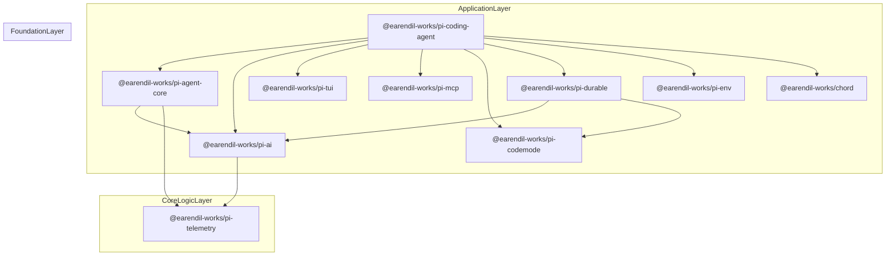
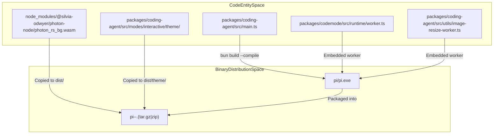

# Monorepo Structure and Build System

Relevant source files

The following files were used as context for generating this wiki page:

- [.github/workflows/build-binaries.yml](.github/workflows/build-binaries.yml)
- [AGENTS.md](AGENTS.md)
- [README.md](README.md)
- [package.json](package.json)
- [packages/chord/package.json](packages/chord/package.json)
- [packages/codemode/package.json](packages/codemode/package.json)
- [packages/coding-agent/install-lock/package-lock.json](packages/coding-agent/install-lock/package-lock.json)
- [packages/coding-agent/install-lock/package.json](packages/coding-agent/install-lock/package.json)
- [packages/durable/package.json](packages/durable/package.json)
- [packages/env/package.json](packages/env/package.json)
- [packages/evals/package.json](packages/evals/package.json)
- [packages/mcp/package.json](packages/mcp/package.json)
- [packages/telemetry/package.json](packages/telemetry/package.json)
- [scripts/build-binaries.sh](scripts/build-binaries.sh)
- [scripts/check-pinned-deps.mjs](scripts/check-pinned-deps.mjs)
- [scripts/create-source-archive.sh](scripts/create-source-archive.sh)
- [scripts/local-release.mjs](scripts/local-release.mjs)
- [scripts/publish-release-announcement.mjs](scripts/publish-release-announcement.mjs)
- [scripts/publish-release-announcement.test.mjs](scripts/publish-release-announcement.test.mjs)
- [scripts/publish.mjs](scripts/publish.mjs)
- [scripts/release-packages.mjs](scripts/release-packages.mjs)
- [tsconfig.json](tsconfig.json)

The purpose of this page is to detail the npm workspaces layout, package architecture, dependency graph, build pipeline, and binary distribution scripts of the `pi` monorepo (`pi-monorepo`) [package.json:1-13]().

---

## npm Workspaces Layout and Monorepo Packages

The monorepo structure is defined via root workspace glob patterns in `package.json`, encompassing core runtimes, protocol definitions, session storage backends, extension examples, and evaluation frameworks [package.json:5-13](). Path mapping rules in `tsconfig.json` resolve package entry points and internal module aliases during type-checking and compilation [tsconfig.json:7-50]().

### Packages Overview

| Package Directory | Package Name | Description |
| :--- | :--- | :--- |
| `packages/chord` | `@earendil-works/chord` | Application composition runtime for services, replicated state, RPC, and plugins [packages/chord/package.json:1-5]() |
| `packages/telemetry` | `@earendil-works/pi-telemetry` | Vendor-neutral telemetry contracts and typed schema utilities [packages/telemetry/package.json:1-5]() |
| `packages/codemode` | `@earendil-works/pi-codemode` | QuickJS/WASI sandbox host and worker runtime for executing model-generated code [tsconfig.json:20-25]() |
| `packages/mcp` | `@earendil-works/pi-mcp` | Model Context Protocol client library, OAuth flows, and stdio/HTTP transports [tsconfig.json:26-28]() |
| `packages/ai` | `@earendil-works/pi-ai` | Unified multi-provider LLM API, model registry generation, and credential resolution [tsconfig.json:29-32]() |
| `packages/durable` | `@earendil-works/pi-durable` | Durable conversation, task, and document runtime [packages/durable/package.json:1-5]() |
| `packages/env` | `@earendil-works/pi-env` | Execution environment abstraction (Node and remote SSH daemons) [tsconfig.json:40-40]() |
| `packages/agent` | `@earendil-works/pi-agent-core` | Agent runtime encompassing tool calling, state management, and the execution harness [tsconfig.json:41-41]() |
| `packages/tui` | `@earendil-works/pi-tui` | Terminal UI engine featuring differential rendering, layout engines, and ANSI synchronization [tsconfig.json:46-47]() |
| `packages/coding-agent` | `@earendil-works/pi-coding-agent` | Interactive coding agent CLI, built-in tools, extension loaders, and session managers [tsconfig.json:42-44]() |
| `packages/evals` | `@earendil-works/pi-evals` | Behavioral evaluation framework and benchmark suites [packages/evals/package.json:1-6]() |

Sources: [package.json:5-13](), [tsconfig.json:7-50](), [packages/chord/package.json:1-5](), [packages/durable/package.json:1-5](), [packages/telemetry/package.json:1-5](), [packages/evals/package.json:1-6]()

---

## Dependency Graph and Code Entity Mapping

Packages depend on each other hierarchically. The coding agent (`@earendil-works/pi-coding-agent`) acts as the top-level orchestrator, consuming foundational AI providers, execution harnesses, TUI components, and transport protocols. Path mapping rules in `tsconfig.json` map import specifiers directly to source entry points [tsconfig.json:7-50]().

Title: Package Dependency Flow and Code Entities

Sources: [package.json:5-13](), [tsconfig.json:7-50]()

---

## Build Pipeline

The build workflow compiles TypeScript packages and packages standalone distributions using `esbuild` and Bun compilation tools [package.json:15-17](), [scripts/build-binaries.sh:1-24]().

### TypeScript Compilation and Bundling
Workspace packages execute local clean and build scripts via root orchestration scripts [package.json:15-17](). 
- **Model Generation**: The `ai` package executes metadata generation to build `models.generated.ts` before type checking and compilation [package.json:28-30]().
- **Type Checking**: Root type checking runs via `tsc --noEmit` using `tsconfig.json` path mappings [package.json:21](), [tsconfig.json:1-54]().

Sources: [package.json:15-30](), [tsconfig.json:1-54]()

---

## Binary Distribution and Asset Packaging

Binary distribution and release management are coordinated via GitHub Actions workflows and local packaging scripts [.github/workflows/build-binaries.yml:1-5](), [scripts/build-binaries.sh:1-24](). 

### Versioning and Release Workflow
The monorepo enforces lockstep versioning across workspace packages [package.json:43-46]() managed by release scripts [package.json:53-55](). Standalone release builds compile CLI outputs alongside static assets and native modules using `scripts/build-binaries.sh` [.github/workflows/build-binaries.yml:66-77](), [scripts/build-binaries.sh:103-137]().

Title: Code-to-Binary Asset Mapping

Sources: [.github/workflows/build-binaries.yml:66-77](), [scripts/build-binaries.sh:103-160]()

---

## Scripting Utilities

The root `scripts/` directory provides operational helpers for development, verification, and packaging [package.json:21-57]():
- **`release.mjs`**: Manages version synchronization, changelog entry generation, and git tagging [package.json:53-55]().
- **`build-binaries.sh`**: Compiles standalone binaries for multiple platforms (darwin, linux, windows) using Bun [scripts/build-binaries.sh:1-137]().
- **`check-ts-relative-imports.mjs`**: Validates boundary rules for relative TypeScript imports across package roots [package.json:27]().
- **`check-entry-graphs.mjs`**: Validates workspace entry graphs and import boundaries [package.json:28]().

Sources: [package.json:21-57](), [scripts/build-binaries.sh:1-137]()