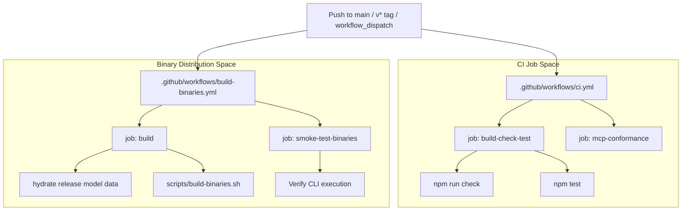
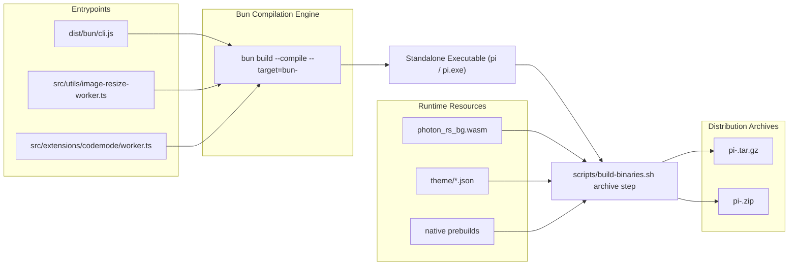

# CI/CD and Binary Distribution

Relevant source files

The following files were used as context for generating this wiki page:

- [.github/workflows/build-binaries.yml](.github/workflows/build-binaries.yml)
- [.github/workflows/ci.yml](.github/workflows/ci.yml)
- [.github/workflows/nix.yml](.github/workflows/nix.yml)
- [.github/workflows/preview-packages.yml](.github/workflows/preview-packages.yml)
- [.pi/skills/release.md](.pi/skills/release.md)
- [AGENTS.md](AGENTS.md)
- [README.md](README.md)
- [flake.lock](flake.lock)
- [flake.nix](flake.nix)
- [nix/model-catalog.json](nix/model-catalog.json)
- [nix/package.nix](nix/package.nix)
- [package.json](package.json)
- [packages/ai/scripts/hydrate-model-catalog.ts](packages/ai/scripts/hydrate-model-catalog.ts)
- [packages/coding-agent/install-lock/package-lock.json](packages/coding-agent/install-lock/package-lock.json)
- [packages/coding-agent/install-lock/package.json](packages/coding-agent/install-lock/package.json)
- [scripts/build-binaries.sh](scripts/build-binaries.sh)
- [scripts/check-pinned-deps.mjs](scripts/check-pinned-deps.mjs)
- [scripts/create-source-archive.sh](scripts/create-source-archive.sh)
- [scripts/local-release.mjs](scripts/local-release.mjs)
- [scripts/preview-packages.mjs](scripts/preview-packages.mjs)
- [scripts/preview-packages.test.mjs](scripts/preview-packages.test.mjs)
- [scripts/publish-release-announcement.mjs](scripts/publish-release-announcement.mjs)
- [scripts/publish-release-announcement.test.mjs](scripts/publish-release-announcement.test.mjs)
- [scripts/publish.mjs](scripts/publish.mjs)
- [scripts/release-packages.mjs](scripts/release-packages.mjs)
- [scripts/release.mjs](scripts/release.mjs)
- [scripts/update-model-catalog-pin.mjs](scripts/update-model-catalog-pin.mjs)
- [scripts/update-model-catalog-pin.test.mjs](scripts/update-model-catalog-pin.test.mjs)
- [tsconfig.json](tsconfig.json)

This page documents the automated infrastructure and scripts used for continuous integration (CI), continuous delivery (CD), and distribution of the `pi` CLI binaries. It details the GitHub Actions workflows (`ci.yml`, `build-binaries.yml`, publish workflows, and environment daemons), the cross-platform build process using `bun compile`, platform release archives, key utility scripts in `scripts/`, lockstep versioning, and the Nix flake integration.

---

## Overview of CI/CD Workflows

The project uses GitHub Actions to maintain code quality, execute tests, and handle production binary releases.

### Continuous Integration (`ci.yml`)

- **Triggers:** Executes on every push or pull request targeting the `main` branch [/.github/workflows/ci.yml:3-7]().
- **Concurrency:** Automatically cancels in-progress runs for the same ref [/.github/workflows/ci.yml:9-11]().
- **Jobs:**
  - `build-check-test`: Sets up Node.js v22 [/.github/workflows/ci.yml:20-24](), installs Linux system dependencies (`libcairo2-dev`, `libpango1.0-dev`, `libjpeg-dev`, `fd-find`, `ripgrep`) [/.github/workflows/ci.yml:26-30](), runs `npm ci --ignore-scripts` [/.github/workflows/ci.yml:33](), executes monorepo builds (`npm run build`) [/.github/workflows/ci.yml:35](), packs preview packages [/.github/workflows/ci.yml:39-44](), runs `npm run check` [/.github/workflows/ci.yml:55-56](), builds the `pi-env` daemon [/.github/workflows/ci.yml:58-59](), and executes tests (`npm test`) [/.github/workflows/ci.yml:61-62]().
  - `mcp-conformance`: Runs the MCP client against the official conformance suite using `packages/coding-agent/test/mcp-conformance/baseline.json` [/.github/workflows/ci.yml:64-82]().

Sources: [/.github/workflows/ci.yml:1-82]()

### Binary Distribution (`build-binaries.yml`)

- **Triggers:** Triggered by pushing a version tag matching `v*` or via manual `workflow_dispatch` [/.github/workflows/build-binaries.yml:1-16]().
- **Build Job:** Sets up Bun v1.4.4 and Node.js v22 [/.github/workflows/build-binaries.yml:41-51](), hydrates release model data [/.github/workflows/build-binaries.yml:52-54](), creates a source archive [/.github/workflows/build-binaries.yml:55-65](), and invokes `scripts/build-binaries.sh` [/.github/workflows/build-binaries.yml:66-77]().
- **Payload Preparation:** Extracts release notes, checks the installation lockfile, packages lock files, and computes SHA256 checksums for all binary archives and source tarballs [/.github/workflows/build-binaries.yml:78-122]().
- **Smoke Tests:** The `smoke-test-binaries` job runs on matrix runners (`ubuntu-latest`, `macos-latest`, `windows-latest`), downloading the platform artifact and validating CLI execution (`pi --help`) [/.github/workflows/build-binaries.yml:131-199]().

Sources: [/.github/workflows/build-binaries.yml:1-199]()

---

### CI/CD Workflow Entity Mapping

Sources: [/.github/workflows/ci.yml:1-82](), [/.github/workflows/build-binaries.yml:1-199]()

---

## Binary Build Process and Packaging (`scripts/build-binaries.sh`)

The `scripts/build-binaries.sh` script orchestrates cross-platform binary generation using Bun [scripts/build-binaries.sh:1-200]().

### Compilation Details

- **Bun Targets:** Compiles standalone executables targeting `darwin-arm64`, `darwin-x64`, `linux-x64`, `linux-arm64`, `windows-x64`, and `windows-arm64` using `bun build --compile` [scripts/build-binaries.sh:111-136]().
- **Entrypoints:** Bundles multiple explicit entrypoints into the standalone executable to ensure workers resolve correctly:
  - Main CLI: `./dist/bun/cli.js` [scripts/build-binaries.sh:133-135]()
  - Image resize worker: `./src/utils/image-resize-worker.ts` [scripts/build-binaries.sh:133-135]()
  - Codemode worker: `./src/extensions/codemode/worker.ts` [scripts/build-binaries.sh:133-135]()
- **Isolation Flags:** Passes `--no-compile-autoload-bunfig` and `--no-compile-autoload-dotenv` to prevent project-local configuration files from leaking into or crashing standalone binaries [scripts/build-binaries.sh:132-136]().
- **Packaging Assets:** Copies package metadata, README, CHANGELOG, Photon WASM binaries (`photon_rs_bg.wasm`), theme JSON files, UI assets, HTML export templates, documentation, examples, and TUI native prebuilds into platform directories before compression [scripts/build-binaries.sh:141-160]().
- **Archives:** Compresses Unix targets into `.tar.gz` archives (wrapped in a `pi/` directory) and Windows targets into `.zip` archives [scripts/build-binaries.sh:162-175]().

Sources: [scripts/build-binaries.sh:1-200]()

---

### Binary Compilation Pipeline

Sources: [scripts/build-binaries.sh:124-176]()

---

## Lockstep Versioning and Release Management (`scripts/release.mjs`)

The monorepo enforces lockstep versioning where all publishable packages share an identical version number [package.json:43-46](), [scripts/release.mjs:1-55]().

### Release Lifecycle Steps

1. **Working Directory Check:** Verifies that there are no uncommitted changes [scripts/release.mjs:22-50]().
2. **Npm Registration Verification:** Asserts that all public workspace packages are registered on npm [scripts/release.mjs:57-87]().
3. **Model Catalog Pinning & Build Validation:** Pins the newest model catalog revision (`nix/model-catalog.json`), hydrates bytes, and runs `npm run build:offline` to guarantee build compatibility before tagging [scripts/release.mjs:97-130]().
4. **Version Bumping & Pruning:** Updates workspace versions via `scripts/sync-versions.js` and removes stale workspace lockfile entries [scripts/release.mjs:149-174]().
5. **Git Operations:** Stages changed files, creates commits and tags, and pushes upstream to trigger publication [scripts/release.mjs:1-186]().

Sources: [package.json:43-56](), [scripts/release.mjs:1-186]()

---

## Local Release Testing (`local-release.mjs`)

Maintainers execute `scripts/local-release.mjs` to validate release packing, tarball installs, and binary builds locally [scripts/local-release.mjs:1-162]().

- **Artifact Production:** Produces packaged tarballs for all workspace packages [scripts/local-release.mjs:100-106]().
- **Bun Binary Compilation:** Builds local platform binaries through `build-binaries.sh` [scripts/local-release.mjs:37-53]().
- **Isolated Validation:** Installs packaged modules into temporary validation directories, creates shim scripts (`pi`, `pi.cmd`, `pi.ps1`), and executes smoke tests [scripts/local-release.mjs:114-162]().

Sources: [scripts/local-release.mjs:1-162]()

---

## Nix Flake Integration and Model Catalog Pinning

The repository includes `flake.nix` and `nix/package.nix` for reproducible builds on Nix-enabled systems [README.md:56-71]().

- **Stable Profile Installation:** Users install via `nix profile add github:earendil-works/pi/stable` [README.md:59]().
- **Offline Model Catalog Pin:** Because Nix builds execute offline, the model catalog revision is pinned in `nix/model-catalog.json` [nix/model-catalog.json:1-3]() and refreshed via `npm run update:model-catalog-pin` [README.md:66-70]().

Sources: [README.md:56-71](), [nix/model-catalog.json:1-3]()

---

## Scripts and Utilities Summary

| Script Path | Code Entity / Script Role |
|-------------|---------------------------|
| `scripts/build-binaries.sh` | Compiles self-contained cross-platform binaries using `bun build --compile` [scripts/build-binaries.sh:1-200]() |
| `scripts/release.mjs` | Orchestrates the release pipeline (version bumps, registry checks, pinning, tagging) [scripts/release.mjs:1-186]() |
| `scripts/local-release.mjs` | Runs local packing, isolated consumer installations, and binary smoke tests [scripts/local-release.mjs:1-162]() |
| `scripts/sync-versions.js` | Synchronizes lockstep version numbers across monorepo workspace packages [package.json:43-46]() |
| `scripts/generate-coding-agent-install-lock.mjs` | Generates and checks locked dependency manifests for `pi update` [package.json:26, 52]() |
| `scripts/update-model-catalog-pin.mjs` | Updates the pinned model catalog revision for Nix builds and offline packaging [README.md:66-70]() |

Sources: [package.json:21-58](), [scripts/build-binaries.sh:1-200](), [scripts/release.mjs:1-186](), [scripts/local-release.mjs:1-162]()

# End of 10.1 — CI/CD and Binary Distribution