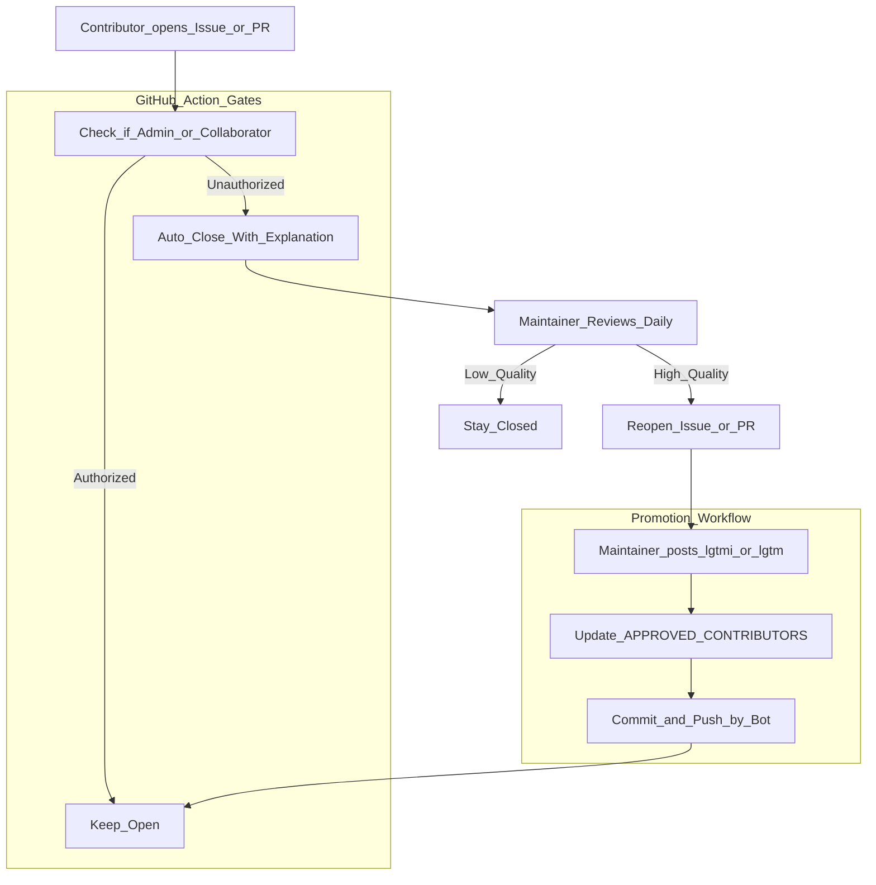
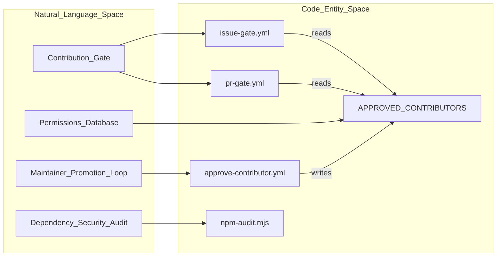
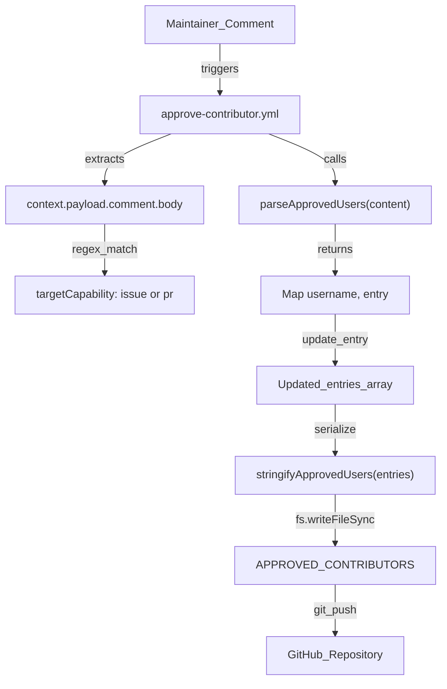

# Contribution Gate and Community Workflow

<details>
<summary>Relevant source files</summary>

The following files were used as context for generating this wiki page:

- [.github/APPROVED_CONTRIBUTORS](.github/APPROVED_CONTRIBUTORS)
- [.github/workflows/approve-contributor.yml](.github/workflows/approve-contributor.yml)
- [.github/workflows/issue-gate.yml](.github/workflows/issue-gate.yml)
- [.github/workflows/issue-triage-labels.yml](.github/workflows/issue-triage-labels.yml)
- [.github/workflows/npm-audit.yml](.github/workflows/npm-audit.yml)
- [.github/workflows/pr-gate.yml](.github/workflows/pr-gate.yml)
- [.github/workflows/remove-inprogress-on-close.yml](.github/workflows/remove-inprogress-on-close.yml)
- [.gitignore](.gitignore)
- [CONTRIBUTING.md](CONTRIBUTING.md)
- [scripts/npm-audit.mjs](scripts/npm-audit.mjs)

</details>


This page documents the automated governance, contribution management, validation, and local/CI quality gates used in the `pi` monorepo. The project employs a "closed-by-default" strategy for new contributors to manage maintainer load, alongside rigorous pre-commit validation and automated dependency auditing.

Sources: [`.github/workflows/issue-gate.yml:1-130`](), [`.github/workflows/pr-gate.yml:1-129`](), [`CONTRIBUTING.md:1-103`]()

---

## Overview of the Contribution Gate

The contribution gate is a security and quality-control mechanism implemented via GitHub Actions and local hooks. It restricts who can maintain open issues and Pull Requests (PRs) based on a flat-file permission system and maintainer commands.

### Key Components

- **`APPROVED_CONTRIBUTORS`**: A flat-file database of GitHub handles and their granted capabilities [`.github/APPROVED_CONTRIBUTORS:1-5`]().
- **Issue/PR Gates**: Automated workflows intercept new issues and PRs to enforce gating [`.github/workflows/issue-gate.yml:3-5`](), [`.github/workflows/pr-gate.yml:3-5`]().
- **Maintainer Commands**: Comment keywords `lgtm` and `lgtmi` used by maintainers to promote contributors [`.github/workflows/approve-contributor.yml:33-35`]().
- **Triage Automation**: Workflows that manage issue labels and state transitions based on maintainer activity [`.github/workflows/issue-triage-labels.yml:3-5`]().

### Contribution Lifecycle Diagram



Sources: [`.github/workflows/issue-gate.yml:82-129`](), [`.github/workflows/approve-contributor.yml:24-145`](), [`CONTRIBUTING.md:21-34`]()

---

## Permission System: APPROVED_CONTRIBUTORS

The project uses a flat text file `.github/APPROVED_CONTRIBUTORS` to manage contributor rights [`.github/APPROVED_CONTRIBUTORS:1-5`](). It acts as the definitive source for gating workflows and is controlled exclusively by maintainer commands via GitHub Actions.

### Capability Levels

| Capability | Description |
|------------|-------------|
| `issue` | Future issues from the user stay open; PRs still require approval [`.github/APPROVED_CONTRIBUTORS:4`](). |
| `pr` | Both future issues and PRs from the user stay open [`.github/APPROVED_CONTRIBUTORS:5`](). |

Each line in the file follows the format `<username> <capability>` [`.github/APPROVED_CONTRIBUTORS:2`](). Lines starting with `#` are comments and ignored [`.github/APPROVED_CONTRIBUTORS:1`]().

### Parsing Logic

The workflows share logic for loading and parsing the `APPROVED_CONTRIBUTORS` file. The function `parseApprovedUsers` processes the raw content into a Map keyed by lowercase usernames and valued by capabilities:

```javascript
function parseApprovedUsers(content) {
  const users = new Map();
  for (const rawLine of content.split('\n')) {
    const line = rawLine.trim();
    if (!line || line.startsWith('#')) continue;
    const parts = line.split(/\s+/);
    if (parts.length !== 2) continue;
    const [username, capability] = parts;
    users.set(username.toLowerCase(), capability.toLowerCase());
  }
  return users;
}
```

This parsing logic exists in `issue-gate.yml` and `pr-gate.yml` [`.github/workflows/issue-gate.yml:58-82`](), [`.github/workflows/pr-gate.yml:59-83`](), and is enhanced in `approve-contributor.yml` [`.github/workflows/approve-contributor.yml:81-115`]().

Sources: [`.github/APPROVED_CONTRIBUTORS:1-5`](), [`.github/workflows/issue-gate.yml:58-82`](), [`.github/workflows/pr-gate.yml:59-83`](), [`.github/workflows/approve-contributor.yml:81-115`]()

---

## Automated Gate Workflows

The project enforces gate checks on new issues and PRs via specialized GitHub Actions workflows.

### Issue Gate (`issue-gate.yml`)
- **Trigger:** Runs on every new issue opened [`.github/workflows/issue-gate.yml:3-5`]().
- **Bot Exclusion:** Known bots (`dependabot[bot]`, `sentry[bot]`, `claude[bot]`) bypass the gate [`.github/workflows/issue-gate.yml:20-28`]().
- **Collaborator Check:** Users with `admin`, `maintain`, or `write` repository permissions automatically pass [`.github/workflows/issue-gate.yml:30-41`](), [`.github/workflows/issue-gate.yml:84-88`]().
- **Approved Contributor Check:** The issue author is cross-checked against `APPROVED_CONTRIBUTORS` [`.github/workflows/issue-gate.yml:43-82`](), [`.github/workflows/issue-gate.yml:90-97`]().
- **Enforcement:** Unapproved issues receive an explanation comment, an `untriaged` label, and are closed with `not_planned` status [`.github/workflows/issue-gate.yml:99-129`]().

### PR Gate (`pr-gate.yml`)
- **Trigger:** Runs on every new pull request opened [`.github/workflows/pr-gate.yml:3-5`]().
- **Strict Enforcement:** PR authors must specifically have `pr` capability in `APPROVED_CONTRIBUTORS` [`.github/workflows/pr-gate.yml:107-114`]().
- **Enforcement:** Unapproved PRs are closed with a comment directing the contributor to open an issue for approval first [`.github/workflows/pr-gate.yml:85-99`](), [`.github/workflows/pr-gate.yml:116-128`]().

### Issue Triage Labels (`issue-triage-labels.yml`)
- **Labels Managed:** `untriaged`, `no-action`, `last-read`, `to-discuss`, and `inprogress` [`.github/workflows/issue-triage-labels.yml:17-22`]().
- **Reopen Behavior:** Reopening an issue automatically strips `untriaged` and `no-action` labels [`.github/workflows/issue-triage-labels.yml:50-54`]().
- **Bulk Closing on `last-read`:** Adding `last-read` to a new issue triggers bulk closing of all `untriaged` issues between this and the previous `last-read` issue, labelling them `no-action` and closing them as `not_planned` [`.github/workflows/issue-triage-labels.yml:61-142`]().

Sources: [`.github/workflows/issue-gate.yml:1-130`](), [`.github/workflows/pr-gate.yml:1-129`](), [`.github/workflows/issue-triage-labels.yml:1-143`]()

---

## Maintainer Workflow: The Promotion Loop

Maintainers can upgrade contributor permissions via comment commands.

### Promotion Commands

| Command | Effect |
|---------|--------|
| `lgtmi` | Grants `issue` capability [`.github/workflows/approve-contributor.yml:33-43`](). |
| `lgtm`  | Grants `pr` capability [`.github/workflows/approve-contributor.yml:33-43`](). |

### Promotion Logic (`approve-contributor.yml`)
1. **Command Detection:** Regex matches `lgtm` or `lgtmi` at the start or end of a comment body [`.github/workflows/approve-contributor.yml:33-42`]().
2. **Permission Check:** Validates that the commenter is a collaborator with `admin`, `maintain`, or `write` access [`.github/workflows/approve-contributor.yml:45-60`]().
3. **File Update & Commit:** Updates `.github/APPROVED_CONTRIBUTORS` and commits the changes using the GitHub Actions bot [`.github/workflows/approve-contributor.yml:15-19`](), [`.github/workflows/approve-contributor.yml:81-173`]().

Sources: [`.github/workflows/approve-contributor.yml:1-185`]()

---

## Pre-Commit Hooks, Linting, and Dependency Security

Local development and staging enforce strict quality controls via Husky hooks, Biome configuration, and dependency audits.

### Dependency Auditing (`scripts/npm-audit.mjs`)
Production vulnerabilities are audited via `.github/workflows/npm-audit.yml` and `scripts/npm-audit.mjs` [`.github/workflows/npm-audit.yml:1-32`](), [`scripts/npm-audit.mjs:1-84`](). The script runs `npm audit --omit=dev --json` and enforces a moderate severity threshold [`scripts/npm-audit.mjs:9-23`](), failing on unaccepted advisories while supporting an explicit exception map (`acceptedAdvisories`) for unfixable transitive issues (e.g., `GHSA-86w9-cpqp-85rv` in `node-forge`) [`scripts/npm-audit.mjs:12-21`]().

Sources: [`.github/workflows/npm-audit.yml:1-32`](), [`scripts/npm-audit.mjs:1-84`]()

---

## Natural Language Space to Code Entity Mapping



Sources: [`.github/workflows/issue-gate.yml:1-130`](), [`.github/workflows/pr-gate.yml:1-129`](), [`.github/workflows/approve-contributor.yml:1-185`](), [`.github/APPROVED_CONTRIBUTORS:1-150`](), [`scripts/npm-audit.mjs:1-84`]()

---

## Permissions Flow and Data Transformations



Sources: [`.github/workflows/approve-contributor.yml:24-133`](), [`.github/APPROVED_CONTRIBUTORS:1-5`]()