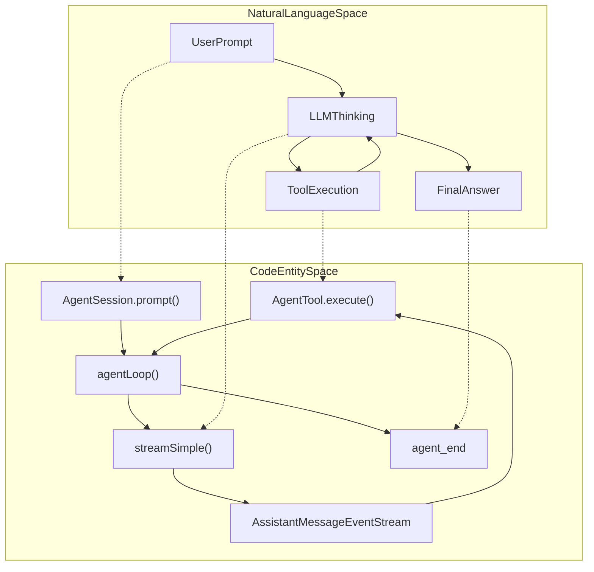
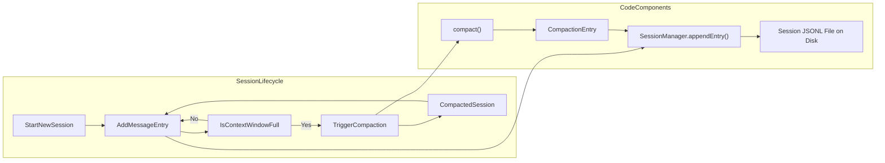

# Glossary

Relevant source files

The following files were used as context for generating this wiki page:

- [package-lock.json](package-lock.json)
- [packages/agent/CHANGELOG.md](packages/agent/CHANGELOG.md)
- [packages/agent/package.json](packages/agent/package.json)
- [packages/ai/CHANGELOG.md](packages/ai/CHANGELOG.md)
- [packages/ai/README.md](packages/ai/README.md)
- [packages/ai/package.json](packages/ai/package.json)
- [packages/ai/scripts/generate-models.ts](packages/ai/scripts/generate-models.ts)
- [packages/ai/src/index.ts](packages/ai/src/index.ts)
- [packages/ai/src/models.generated.ts](packages/ai/src/models.generated.ts)
- [packages/ai/src/providers/anthropic.ts](packages/ai/src/providers/anthropic.ts)
- [packages/ai/src/providers/google-vertex.ts](packages/ai/src/providers/google-vertex.ts)
- [packages/ai/src/providers/google.ts](packages/ai/src/providers/google.ts)
- [packages/ai/src/types.ts](packages/ai/src/types.ts)
- [packages/ai/test/google-vertex-api-key-resolution.test.ts](packages/ai/test/google-vertex-api-key-resolution.test.ts)
- [packages/coding-agent/CHANGELOG.md](packages/coding-agent/CHANGELOG.md)
- [packages/coding-agent/docs/tui.md](packages/coding-agent/docs/tui.md)
- [packages/coding-agent/package.json](packages/coding-agent/package.json)
- [packages/coding-agent/test/interactive-tui.test.ts](packages/coding-agent/test/interactive-tui.test.ts)
- [packages/durable/CHANGELOG.md](packages/durable/CHANGELOG.md)
- [packages/durable/README.md](packages/durable/README.md)
- [packages/durable/docs/spec.md](packages/durable/docs/spec.md)
- [packages/durable/src/harness/generation.ts](packages/durable/src/harness/generation.ts)
- [packages/durable/src/harness/harness.ts](packages/durable/src/harness/harness.ts)
- [packages/durable/src/harness/scheduler.ts](packages/durable/src/harness/scheduler.ts)
- [packages/durable/src/harness/tool.ts](packages/durable/src/harness/tool.ts)
- [packages/durable/src/harness/types.ts](packages/durable/src/harness/types.ts)
- [packages/durable/src/index.ts](packages/durable/src/index.ts)
- [packages/durable/src/session/session.ts](packages/durable/src/session/session.ts)
- [packages/durable/src/types.ts](packages/durable/src/types.ts)
- [packages/tui/CHANGELOG.md](packages/tui/CHANGELOG.md)
- [packages/tui/README.md](packages/tui/README.md)
- [packages/tui/package.json](packages/tui/package.json)
- [packages/tui/src/index.ts](packages/tui/src/index.ts)
- [packages/tui/src/tui-alt-screen.ts](packages/tui/src/tui-alt-screen.ts)
- [packages/tui/src/tui-main-screen.ts](packages/tui/src/tui-main-screen.ts)
- [packages/tui/src/tui.ts](packages/tui/src/tui.ts)
- [packages/tui/test/tui-alt-screen.test.ts](packages/tui/test/tui-alt-screen.test.ts)
- [packages/tui/test/tui-render.test.ts](packages/tui/test/tui-render.test.ts)

This page provides definitions for codebase-specific terms, abbreviations, and domain concepts used throughout the `pi` monorepo. It serves as a technical reference for onboarding engineers to understand the relationship between natural language concepts and their implementation in code.

---

## Core Domain Concepts

### Agent Loop
The fundamental execution cycle where the LLM (Large Language Model) is polled for responses and tool calls. The loop manages the conversation turn, alternating between assistant thinking and invoking external tools to complete tasks.

- **Implementation Details:**  
  The core function `agentLoop()` drives this lifecycle by advancing the conversation state with each iteration, streaming messages, invoking tools in parallel or sequentially, and handling events. It integrates with the agent's state machine (`AgentState`) to produce new assistant messages or detect terminations.  
  [packages/agent/src/index.ts:5]()  

- **Key Classes & Functions:**  
  - `Agent`: Core LLM agent class encapsulating the conversation state and turn lifecycle logic.  
    [packages/agent/src/index.ts:5]()  
  - Lifecycle events such as `agent_end`, `tool_execution_start`, `tool_execution_end` provide hooks into various stages.  
    [packages/coding-agent/src/core/agent-session.ts:180-192]()

- **Graceful Exits:**  
  The loop supports hook-based controls like `finishTurn` allowing external handlers to stop the loop gracefully after the current turn is completed.  
  [packages/agent/CHANGELOG.md:67-67]()

Sources:  
- [packages/agent/src/index.ts:5]()  
- [packages/coding-agent/src/core/agent-session.ts:180-192]()  
- [packages/agent/CHANGELOG.md:67-67]()

---

### AgentSession
The high-level abstraction managing an interactive session's lifecycle, including message handling, session persistence, model management, and extension integrations.

- **Role and Scope:**  
  `AgentSession` orchestrates interaction with the LLM agent, manages the session tree structure (messages, branches, and compaction), handles thinking levels, and exposes public APIs for user prompts, steering actions, and bash execution. It automates persistence and event subscription integration.  
  [packages/coding-agent/src/core/agent-session.ts:1-14]()  
  [packages/coding-agent/src/core/agent-session.ts:201-230]()

- **Key Features:**  
  - Maintains session branching and parent-child relationships in message history.  
    [packages/coding-agent/src/core/session-manager.ts:233-257]()  
  - Supports manual and auto-compaction of conversation history.  
  - Handles bash command execution within session context.  
    [packages/coding-agent/src/core/agent-session.ts:64-64]()  
  - Maintains and updates the current thinking level affecting response detail and latency.  
    [packages/coding-agent/src/core/agent-session.ts:160-170]()

- **Public APIs:**  
  - `prompt()` - submit user input to the agent and receive streamed assistant messages.  
  - `steer()` - send steering instructions mid-session.  
  - `followUp()` - continue conversation context with follow-up messages.  
  - `subscribe()` - event listener for session lifecycle and tool execution events.

Sources:  
- [packages/coding-agent/src/core/agent-session.ts:1-14]()  
- [packages/coding-agent/src/core/agent-session.ts:201-230]()  
- [packages/coding-agent/src/core/session-manager.ts:233-257]()  
- [packages/coding-agent/src/core/agent-session.ts:64-64]()  
- [packages/coding-agent/src/core/agent-session.ts:160-170]()

---

### AgentHarness
The durable execution and orchestration layer designed for crash-recoverable runs with parallelism and lane isolation.

- **Concept:**  
  Implements a v4 lane-based durable session model with operation records, global facts, and concurrency controls supporting robust session persistence and execution locking.  
  [packages/agent/CHANGELOG.md:55-58]()

- **Use Cases:**  
  Leveraged internally by `@earendil-works/pi-durable` for durable session management and execution, replacing older monolithic session models.

Sources:  
- [packages/agent/CHANGELOG.md:55-58]()

---

### Compaction
Compaction is the process of summarizing or pruning older conversation parts to keep the session within the LLM context window constraints and optimize cost.

- **Implementation:**  
  The system detects when context token limits are exceeded and triggers compaction asynchronously, which may produce a summarized branch entry replacing multiple older messages.  
  [packages/coding-agent/src/core/agent-session.ts:157-168]()  

- **Key Components:**  
  - `compact()` function manages summarization and creates a `CompactionEntry`.  
  - `SessionManager` integrates compaction entries into session persistence files.  
  [packages/coding-agent/src/core/session-manager.ts:233-257]()

Sources:  
- [packages/coding-agent/src/core/agent-session.ts:157-168]()  
- [packages/coding-agent/src/core/session-manager.ts:233-257]()

---

### Extension System
The extension system enables runtime customization with pluggable event handlers, tools, commands, UI components, and providers.

- **Lifecycle & API:**  
  Extensions declare event subscriptions (`pi.on()`), register tools and commands, and interoperate via contexts (`ExtensionContext`, `ExtensionCommandContext`).  
  [packages/coding-agent/src/core/extensions/index.ts:50-155]()  

- **Loading & Discovery:**  
  Supports three-tier extension discovery: global (~/.pi/extensions), project-local (.pi/extensions), and user-configured paths.  
  Extensions are loaded dynamically via `jiti` with hot-reload support (`/reload` command).  
  [package.json:58-58]()

Sources:  
- [packages/coding-agent/src/core/extensions/index.ts:50-155]()  
- [package.json:58-58]()

---

### Session Persistence and JSONL Format
Session history is persisted as JSON Lines (JSONL) in append-only files to allow replay, branching, and compaction.

- **File Format:**  
  Each JSONL line represents a session event or entry with mandatory fields like `id`, `parentId`, and metadata describing the branching and compaction state.  
  [packages/coding-agent/src/core/session-manager.ts:233-257]()

- **SessionManager:**  
  Responsible for managing the JSONL session file lifecycle: appending entries, reading, querying branches, and managing compacted summaries.  
  [packages/coding-agent/src/core/session-manager.ts:252-252]()

Sources:  
- [packages/coding-agent/src/core/session-manager.ts:233-257]()  
- [packages/coding-agent/src/core/session-manager.ts:252-252]()

---

### Thinking Level
An abstraction controlling the amount and type of reasoning effort the LLM expends during generation, impacting output detail and response latency.

- **Levels:**  
  Defined semantic values: `minimal`, `low`, `medium`, `high`, `xhigh`, and `max`. Models and providers map these to specific API parameters.  

- **Provider-Specific Maps:**  
  Providers have mappings such as the Together provider's fixed and toggle reasoning effort maps (e.g., DeepSeek V4 model).  
  [packages/ai/scripts/generate-models.ts:210-218]()

- **Usage:**  
  Thinking levels influence prompt construction and request parameters at the `AgentSession` layer.  

Sources:  
- [packages/ai/scripts/generate-models.ts:210-218]()  
- [packages/coding-agent/src/core/agent-session.ts:159-170]()

---

## Technical Abbreviations & Terms

| Term | Definition | Primary Code Location |
|---|---|---|
| **Agent** | Core LLM interface managing conversation state and turn lifecycle | [packages/agent/src/index.ts:5]() |
| **AgentSession** | High-level session lifecycle manager wrapping Agent, persistence, compaction, and extensions | [packages/coding-agent/src/core/agent-session.ts:1-230]() |
| **AgentHarness** | Durable execution layer—manages lanes, operation locking, and crash recovery | [packages/agent/CHANGELOG.md:55-58]() |
| **TUI** | Terminal User Interface supporting differential rendering and interactive components | [packages/tui/package.json:2-5]() |
| **JSONL** | JSON Lines format used for session persistence and branching | [packages/coding-agent/src/core/session-manager.ts:233-257]() |
| **Slash Command** | Interactive CLI commands starting with `/` for model selection, compaction, etc. | [packages/coding-agent/package.json:1-10]() |
| **Thinking Level** | Semantic abstraction of LLM reasoning effort applied across models and providers | [packages/ai/scripts/generate-models.ts:210-218]() |
| **Project Trust** | Security gating mechanism restricting project settings and resource loading | [packages/coding-agent/src/core/trust-manager.ts:100-105]() |
| **ExtensionAPI** | API exposed to extensions for event subscription and registration of tools and commands | [packages/coding-agent/src/core/extensions/index.ts:70-100]() |
| **CompactionEntry** | Data structure representing a compaction summary entry in the session JSONL file | [packages/coding-agent/src/core/session-manager.ts:230-240]() |
| **OSC 7501** | An ANSI escape code sequence used for program status reporting in supporting terminals. | [packages/coding-agent/CHANGELOG.md:22-23]() |
| **durationMs** | A metric indicating the execution time of a tool or the response time of an LLM. | [packages/coding-agent/CHANGELOG.md:31-31]() |

Sources:  
- [packages/agent/src/index.ts:5]()  
- [packages/coding-agent/src/core/agent-session.ts:1-230]()  
- [packages/agent/CHANGELOG.md:55-58]()  
- [packages/tui/package.json:2-5]()  
- [packages/coding-agent/src/core/session-manager.ts:233-257]()  
- [packages/coding-agent/package.json:1-10]()  
- [packages/ai/scripts/generate-models.ts:210-218]()  
- [packages/coding-agent/src/core/trust-manager.ts:100-105]()  
- [packages/coding-agent/src/core/extensions/index.ts:70-100]()  
- [packages/coding-agent/src/core/session-manager.ts:230-240]()  
- [packages/coding-agent/CHANGELOG.md:22-23]()  
- [packages/coding-agent/CHANGELOG.md:31-31]()

---

## Architecture Diagrams

### Diagram: From Concept to Code: The Agent Loop
Bridging the natural language agent interaction cycle to core code entities.

Sources:  
- [packages/agent/src/index.ts:5]()  
- [packages/coding-agent/src/core/agent-session.ts:180-192]()

---

### Diagram: Session Persistence and Compaction Flow
Depiction of session data flow from new messages through compaction to persistent storage.

Sources:  
- [packages/coding-agent/src/core/session-manager.ts:233-257]()  
- [packages/coding-agent/src/core/agent-session.ts:157-168]()

---

## System Symbols Glossary

### `AgentSession`
Central manager of an agent session lifecycle including state, persistence, tools, and extensions.

- **Methods:**  
  - `prompt(options)`: Issues a prompt to the LLM and streams output.  
  - `steer(text)`: Sends steering-only prompts modifying assistant behavior.  
  - `compact(reason)`: Triggers manual compaction of session history.

- **Code Reference:**  
  [packages/coding-agent/src/core/agent-session.ts:1-230]()

---

### `ModelRuntime`
Manages model metadata, authentication, and provider interaction dynamically.

- **Function:**  
  Acts as the canonical SDK entry point for resolving models, credentials, and OAuth flows.

- **Code Reference:**  
  [packages/coding-agent/src/core/model-resolver.ts:1-50]()

---

### `ResourceLoader`
Discovers, loads and parses resources such as Skills, prompt templates, and context files from configured paths.

- **Functionality:**  
  - Enumerates projects' context files and skill directories.  
  - Parses frontmatter and content for agent context.

- **Code Reference:**  
  [packages/coding-agent/package.json:1-10]()

---

### `TUI` Class
Terminal User Interface rendering engine that supports differential updates, alternate screen buffers, and input handling.

- **Features:**  
  - Efficient terminal rendering with minimal redraw latency.  
  - Supports mouse and key handling, overlays, and inline image protocols.

- **Code Reference:**  
  [packages/tui/package.json:2-5]()  
  [packages/tui/CHANGELOG.md:20-50]()

---

### `ExtensionAPI`
The runtime interface exposed to extensions for registering tools, commands, and subscribing to lifecycle events.

- **Features:**  
  - Methods like `registerTool()`, `registerCommand()`.  
  - Event subscription with `pi.on()`.  
  - Access to UI dialogs and notifications via extension contexts.

- **Code Reference:**  
  [packages/coding-agent/src/core/extensions/index.ts:70-100]()  

Sources:  
- [packages/agent/src/index.ts:5]()  
- [packages/coding-agent/src/core/agent-session.ts:1-230]()  
- [packages/coding-agent/src/core/session-manager.ts:233-257]()  
- [packages/coding-agent/src/core/extensions/index.ts:50-155]()  
- [packages/tui/package.json:2-5]()  
- [packages/tui/CHANGELOG.md:20-50]()  
- [packages/agent/CHANGELOG.md:55-58]()