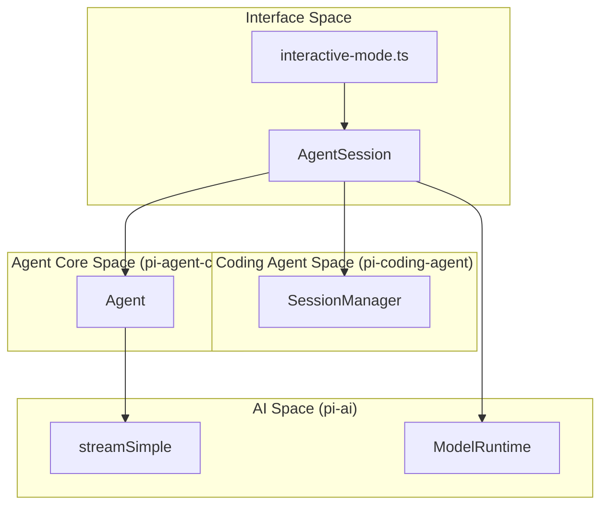
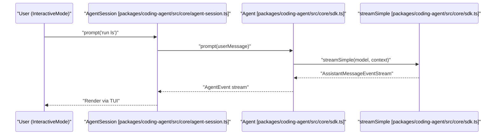

# Core Architecture

Relevant source files

The following files were used as context for generating this wiki page:

- [packages/coding-agent/docs/extensions.md](packages/coding-agent/docs/extensions.md)
- [packages/coding-agent/examples/extensions/README.md](packages/coding-agent/examples/extensions/README.md)
- [packages/coding-agent/src/core/agent-session.ts](packages/coding-agent/src/core/agent-session.ts)
- [packages/coding-agent/src/core/extensions/index.ts](packages/coding-agent/src/core/extensions/index.ts)
- [packages/coding-agent/src/core/extensions/loader.ts](packages/coding-agent/src/core/extensions/loader.ts)
- [packages/coding-agent/src/core/extensions/runner.ts](packages/coding-agent/src/core/extensions/runner.ts)
- [packages/coding-agent/src/core/extensions/types.ts](packages/coding-agent/src/core/extensions/types.ts)
- [packages/coding-agent/src/core/index.ts](packages/coding-agent/src/core/index.ts)
- [packages/coding-agent/src/core/sdk.ts](packages/coding-agent/src/core/sdk.ts)
- [packages/coding-agent/src/index.ts](packages/coding-agent/src/index.ts)
- [packages/coding-agent/src/modes/interactive/interactive-mode.ts](packages/coding-agent/src/modes/interactive/interactive-mode.ts)
- [packages/coding-agent/src/modes/print-mode.ts](packages/coding-agent/src/modes/print-mode.ts)
- [packages/coding-agent/src/modes/rpc/rpc-mode.ts](packages/coding-agent/src/modes/rpc/rpc-mode.ts)
- [packages/coding-agent/test/extensions-discovery.test.ts](packages/coding-agent/test/extensions-discovery.test.ts)
- [packages/coding-agent/test/extensions-runner.test.ts](packages/coding-agent/test/extensions-runner.test.ts)

This page provides an overview of the layered architecture in `pi`, covering the core subsystems: AI provider abstraction, agent loops, session management, and tool execution. 

The codebase follows a strict separation of concerns across packages, allowing lower-level agentic and AI layers to remain decoupled from user interface and application-specific logic [packages/coding-agent/src/core/agent-session.ts:1-14](), [packages/coding-agent/src/core/sdk.ts:1-46]().

### Layered Architecture Overview

The system is organized into several distinct layers, each building upon the previous one:

1.  **AI Abstraction Layer (`pi-ai`)**: Provides a unified streaming API for multiple LLM providers, handling model registries, credential resolution, and cross-provider context normalization.
2.  **Agent Core Layer (`pi-agent-core`)**: Implements the fundamental `Agent` class and low-level agent loops [packages/coding-agent/src/core/sdk.ts:1-46](). This layer manages turn lifecycles and tool execution.
3.  **Coding Agent Layer (`pi-coding-agent`)**: Extends the core agent with domain-specific logic, implementing `AgentSession` [packages/coding-agent/src/core/agent-session.ts:1-14](), persistent session management, and built-in tools.
4.  **Interface Layer**: Provides terminal UI (`pi-tui`), RPC mode [packages/coding-agent/src/modes/rpc/rpc-mode.ts:50-57](), and print mode [packages/coding-agent/src/modes/print-mode.ts:33-40]() for user interaction.

Sources: [packages/coding-agent/src/core/agent-session.ts:1-14](), [packages/coding-agent/src/core/sdk.ts:1-46](), [packages/coding-agent/src/modes/rpc/rpc-mode.ts:50-57](), [packages/coding-agent/src/modes/print-mode.ts:33-40]()

### System Component Diagram

The following diagram illustrates how core entities across packages interact during execution, mapping natural language responsibilities to code elements.

System Component Overview

Sources: [packages/coding-agent/src/core/agent-session.ts:1-14](), [packages/coding-agent/src/core/sdk.ts:1-46](), [packages/coding-agent/src/modes/rpc/rpc-mode.ts:50-57]()

---

### Core Subsystems

#### 2.1 Agent Loop and Agent Core (pi-agent-core)
The `@earendil-works/pi-agent-core` package defines the stateful `Agent` class and the low-level agent loop [packages/coding-agent/src/core/sdk.ts:1-46](). It handles message conversion, parallel tool execution, queueing for steering versus follow-up inputs, event streams, and stream-fn/proxy layers.

For details, see [Agent Loop and Agent Core (pi-agent-core)](#2.1).

Sources: [packages/coding-agent/src/core/sdk.ts:1-46]()

#### 2.2 AgentSession and Session Lifecycle
The `AgentSession` class in `pi-coding-agent` acts as the high-level coordinator [packages/coding-agent/src/core/agent-session.ts:1-14](). It manages `prompt()`, `steer()`, `followUp()`, `subscribe()`, `compact()`, `executeBash()`, and an event-driven lifecycle powered by `AgentSessionRuntime`.

For details, see [AgentSession and Session Lifecycle](#2.2).

Sources: [packages/coding-agent/src/core/agent-session.ts:1-14]()

#### 2.3 Session Management and Compaction
Manages JSONL session storage formats, session tree hierarchies with `id` and `parentId`, branching/forking/cloning operations, and automatic compaction rules via the `SessionManager` API [packages/coding-agent/src/core/agent-session.ts:124-132](). Also covers branch summarization and the `CompactionEntry` format.

For details, see [Session Management and Compaction](#2.3).

Sources: [packages/coding-agent/src/core/agent-session.ts:124-132]()

#### 2.4 Built-in Tools
Covers core coding agent tools (`read`, `bash`, `edit`, `write`, `find`, `grep`, `ls`). Details tool schemas, bash-executor implementations [packages/coding-agent/src/core/agent-session.ts:148-148](), edit-diff utilities, output-accumulators, path-utils, and tool renderers.

For details, see [Built-in Tools](#2.4).

Sources: [packages/coding-agent/src/core/agent-session.ts:148-148]()

---

### Data Flow: Natural Language to Tool Execution

This sequence diagram traces a prompt through code entities from the user interface down to the AI abstraction layer, bridging natural language spaces to concrete code functions.

Data Flow: Natural Language to Tool Execution

Sources: [packages/coding-agent/src/core/agent-session.ts:1-14](), [packages/coding-agent/src/core/sdk.ts:1-46]()

### Key Interfaces and Types

| Entity | Package | Description |
| :--- | :--- | :--- |
| `Agent` | `pi-agent-core` | Stateful wrapper managing transcripts and event emission [packages/coding-agent/src/core/sdk.ts:1-5](). |
| `StreamFn` | `pi-agent-core` | Contract for LLM streaming; satisfied by `streamSimple` [packages/coding-agent/src/core/sdk.ts:40-47](). |
| `AgentSession` | `pi-coding-agent` | High-level session coordinator and event broker [packages/coding-agent/src/core/agent-session.ts:1-14](). |
| `SessionManager` | `pi-coding-agent` | Persistence manager for JSONL logs and session trees [packages/coding-agent/src/core/agent-session.ts:124-132](). |

Sources: [packages/coding-agent/src/core/sdk.ts:1-47](), [packages/coding-agent/src/core/agent-session.ts:1-14,124-132]()