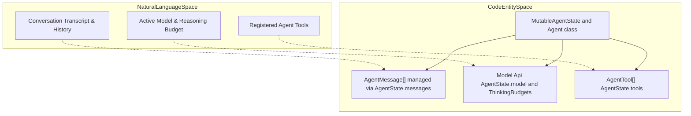
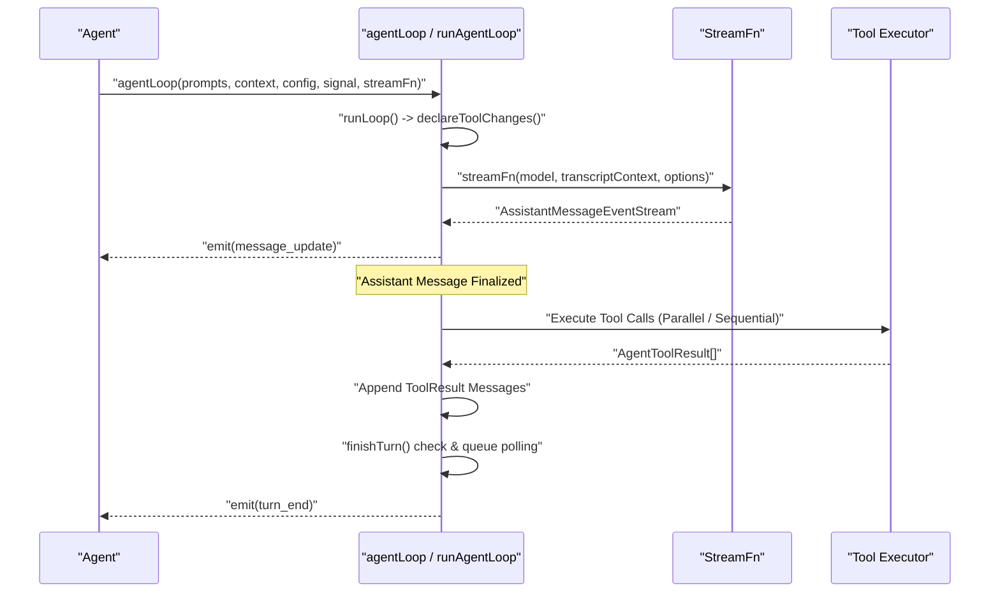
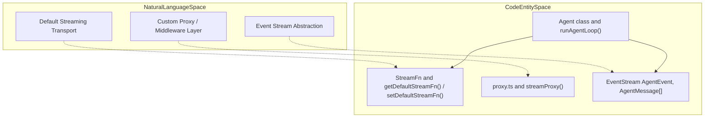

# Agent Loop and Agent Core (pi-agent-core)

Relevant source files

The following files were used as context for generating this wiki page:

- [packages/agent/README.md](packages/agent/README.md)
- [packages/agent/src/agent-loop.ts](packages/agent/src/agent-loop.ts)
- [packages/agent/src/agent.ts](packages/agent/src/agent.ts)
- [packages/agent/src/index.ts](packages/agent/src/index.ts)
- [packages/agent/src/types.ts](packages/agent/src/types.ts)
- [packages/agent/test/agent-loop.test.ts](packages/agent/test/agent-loop.test.ts)
- [packages/agent/test/agent.test.ts](packages/agent/test/agent.test.ts)

## Purpose and Scope

This page provides a deep technical dive into `@earendil-works/pi-agent-core`, examining the stateful `Agent` class, the low-level coroutine agent loops (`agentLoop` and `agentLoopContinue`), `AgentState` management, the turn lifecycle, parallel vs. sequential tool execution modes, steering and follow-up message queues, and the underlying stream function (`StreamFn`) and proxy abstractions.

Sources: [packages/agent/README.md:1-122](), [packages/agent/src/agent.ts:1-213](), [packages/agent/src/agent-loop.ts:1-158]()

---

## The Agent Class and AgentState

The `Agent` class acts as a stateful wrapper around the low-level agent loop. It owns the current conversation transcript, manages active model configurations, tracks execution flags (such as `isStreaming` and `pendingToolCalls`), and coordinates steering and follow-up queues.

### AgentState Structure

`AgentState` exposes a snapshot of the current agent instance:

| Property            | Description                                                          |
|---------------------|----------------------------------------------------------------------|
| `systemPrompt`      | Current system prompt extracted from the message transcript [packages/agent/src/agent.ts:89-91]() |
| `model`             | Active model configuration (`Model<Api>`) [packages/agent/src/agent.ts:92]() |
| `thinkingLevel`     | Reasoning/thinking level (`"off"`, `"low"`, `"medium"`, `"high"`, etc.) [packages/agent/src/agent.ts:93]() |
| `tools`             | Registered array of `AgentTool` definitions [packages/agent/src/agent.ts:94-99]() |
| `messages`          | Full conversation transcript as `AgentMessage[]` [packages/agent/src/agent.ts:100-105]() |
| `isStreaming`       | Boolean flag indicating if an active completion stream is running [packages/agent/src/agent.ts:106]() |
| `streamingMessage`  | Optional partial `AgentMessage` being streamed [packages/agent/src/agent.ts:107]() |
| `pendingToolCalls`  | `Set<string>` of currently executing tool call IDs [packages/agent/src/agent.ts:108]() |
| `errorMessage`      | Optional string containing the last recorded error [packages/agent/src/agent.ts:109]() |

The factory function `createMutableAgentState` initializes the agent state, prepending initial system messages and tool declarations when absent.

Sources: [packages/agent/src/agent.ts:70-111](), [packages/agent/src/types.ts:1-165]()

### Natural Language to Code Entity Mapping: Agent State & Transcript

Sources: [packages/agent/src/agent.ts:70-111](), [packages/agent/src/types.ts:1-165]()

---

## Agent Loop and Turn Lifecycle

The low-level execution engine is defined in `packages/agent/src/agent-loop.ts`. It exposes `agentLoop` (for starting runs with new prompts) and `agentLoopContinue` (for resuming without appending a new prompt).

### Transcript-to-LLM Bridging

The agent loop operates exclusively on `AgentMessage` structures throughout its internal iterations. Right before invoking the LLM provider via `StreamFn`, the transcript messages are translated into standard provider `Message[]` via `convertToLlm`.

Sources: [packages/agent/src/agent-loop.ts:1-17](), [packages/agent/README.md:43-56]()

### Turn Lifecycle Sequence

Sources: [packages/agent/src/agent-loop.ts:38-218](), [packages/agent/README.md:65-107]()

---

## Parallel Tool Execution and Interception Hooks

Tool execution is governed by `ToolExecutionMode` and intercepted by lifecycle hooks.

### Tool Execution Modes

- `"parallel"` (default): Tool call arguments are prepared sequentially (including validation and `beforeToolCall` hooks), after which allowed tools execute concurrently. `tool_execution_end` events are emitted in completion order, while persisted `toolResult` messages are appended in assistant source order.
- `"sequential"`: Tool calls are prepared, executed, and finalized one-by-one.

Sources: [packages/agent/src/types.ts:33-47](), [packages/agent/README.md:109-115]()

### Interception Hooks: `beforeToolCall` and `afterToolCall`

- `beforeToolCall` receives `BeforeToolCallContext` (`assistantMessage`, `toolCall`, `args`, `context`). It can return a `BeforeToolCallResult` with `{ block: true, reason }` or `{ terminate: true }`.
- `afterToolCall` receives `AfterToolCallContext` and permits overriding content, details, error flags, or setting termination hints.

Sources: [packages/agent/src/types.ts:66-104](), [packages/agent/README.md:118]()

### Early Loop Termination

Tools or hooks can return `terminate: true`. The loop halts early only when **every** finalized tool result in the batch sets `terminate: true`.

Sources: [packages/agent/src/types.ts:66-104](), [packages/agent/README.md:119-122]()

---

## Steering vs. Follow-up Message Queues

`Agent` manages asynchronous input injection using `PendingMessageQueue` instances.

| Queue Name    | Injection Point                                | Purpose                                           | QueueMode Options                |
|---------------|------------------------------------------------|---------------------------------------------------|---------------------------------|
| **Steering**  | Immediately before the next assistant request  | Urgent inputs interrupting current execution      | `"all"` or `"one-at-a-time"` [packages/agent/src/types.ts:50-55](), [packages/agent/src/agent.ts:143-174]() |
| **Follow-up** | After completion of the current processing cycle | Non-urgent messages queued while the agent was busy | `"all"` or `"one-at-a-time"` [packages/agent/src/types.ts:50-55](), [packages/agent/src/agent.ts:135]() |

Sources: [packages/agent/src/agent.ts:143-174](), [packages/agent/src/types.ts:50-55]()

---

## Stream-fn and Proxy Layers

The execution pipeline interacts with providers through configurable stream function signatures (`StreamFn`) and proxy wrappers.

Sources: [packages/agent/src/index.ts:1-5](), [packages/agent/src/types.ts:33-37]()

### Natural Language to Code Entity Mapping: Stream and Proxy Abstractions

Sources: [packages/agent/src/index.ts:1-5](), [packages/agent/src/types.ts:33-37](), [packages/agent/src/agent-loop.ts:38-61](), [packages/agent/src/proxy.ts:1-120]()