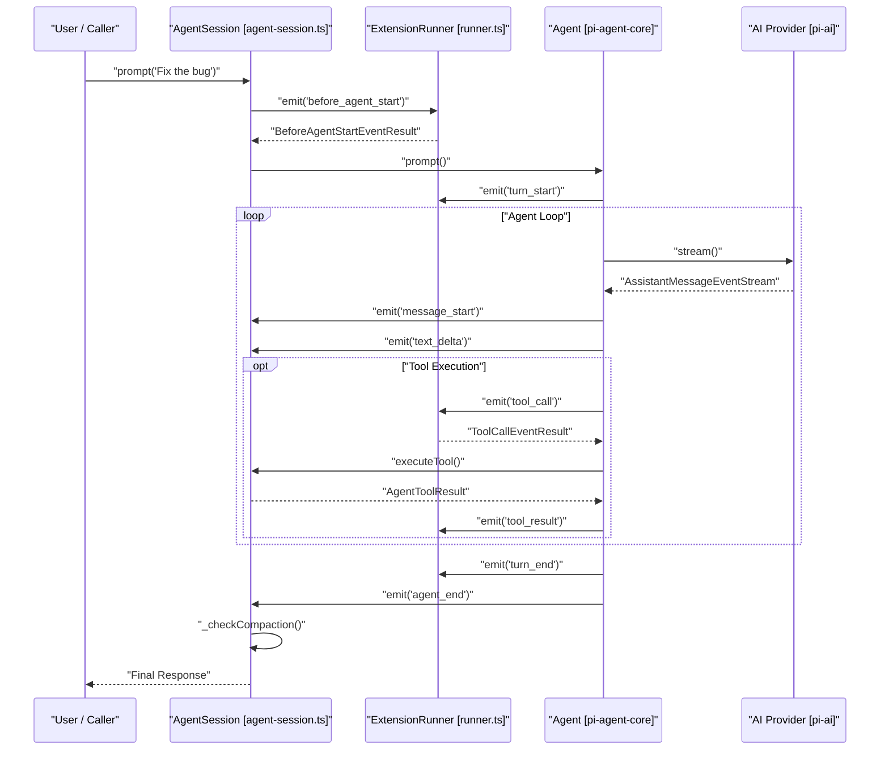
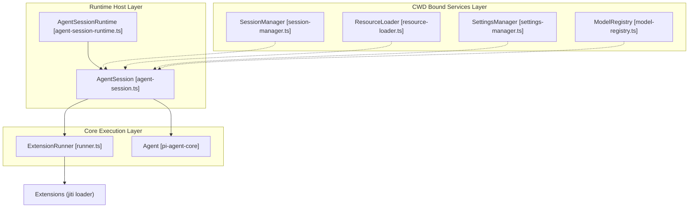

# AgentSession and Session Lifecycle

Relevant source files

The following files were used as context for generating this wiki page:

- [packages/coding-agent/docs/extensions.md](packages/coding-agent/docs/extensions.md)
- [packages/coding-agent/examples/extensions/README.md](packages/coding-agent/examples/extensions/README.md)
- [packages/coding-agent/src/core/agent-session-runtime.ts](packages/coding-agent/src/core/agent-session-runtime.ts)
- [packages/coding-agent/src/core/agent-session.ts](packages/coding-agent/src/core/agent-session.ts)
- [packages/coding-agent/src/core/bash-executor.ts](packages/coding-agent/src/core/bash-executor.ts)
- [packages/coding-agent/src/core/extensions/index.ts](packages/coding-agent/src/core/extensions/index.ts)
- [packages/coding-agent/src/core/extensions/loader.ts](packages/coding-agent/src/core/extensions/loader.ts)
- [packages/coding-agent/src/core/extensions/runner.ts](packages/coding-agent/src/core/extensions/runner.ts)
- [packages/coding-agent/src/core/extensions/types.ts](packages/coding-agent/src/core/extensions/types.ts)
- [packages/coding-agent/src/core/output-guard.ts](packages/coding-agent/src/core/output-guard.ts)
- [packages/coding-agent/src/core/sdk.ts](packages/coding-agent/src/core/sdk.ts)
- [packages/coding-agent/src/index.ts](packages/coding-agent/src/index.ts)
- [packages/coding-agent/src/modes/interactive/interactive-mode.ts](packages/coding-agent/src/modes/interactive/interactive-mode.ts)
- [packages/coding-agent/src/modes/print-mode.ts](packages/coding-agent/src/modes/print-mode.ts)
- [packages/coding-agent/src/modes/rpc/rpc-mode.ts](packages/coding-agent/src/modes/rpc/rpc-mode.ts)
- [packages/coding-agent/src/utils/ansi.ts](packages/coding-agent/src/utils/ansi.ts)
- [packages/coding-agent/test/agent-session-auto-compaction-queue.test.ts](packages/coding-agent/test/agent-session-auto-compaction-queue.test.ts)
- [packages/coding-agent/test/agent-session-concurrent.test.ts](packages/coding-agent/test/agent-session-concurrent.test.ts)
- [packages/coding-agent/test/agent-session-runtime-events.test.ts](packages/coding-agent/test/agent-session-runtime-events.test.ts)
- [packages/coding-agent/test/ansi-utils.test.ts](packages/coding-agent/test/ansi-utils.test.ts)
- [packages/coding-agent/test/extensions-discovery.test.ts](packages/coding-agent/test/extensions-discovery.test.ts)
- [packages/coding-agent/test/extensions-runner.test.ts](packages/coding-agent/test/extensions-runner.test.ts)
- [packages/coding-agent/test/rpc-prompt-response-semantics.test.ts](packages/coding-agent/test/rpc-prompt-response-semantics.test.ts)
- [packages/coding-agent/test/suite/README.md](packages/coding-agent/test/suite/README.md)
- [packages/coding-agent/test/suite/agent-session-bash-persistence.test.ts](packages/coding-agent/test/suite/agent-session-bash-persistence.test.ts)
- [packages/coding-agent/test/suite/agent-session-queue.test.ts](packages/coding-agent/test/suite/agent-session-queue.test.ts)
- [packages/coding-agent/test/suite/agent-session-retry-events.test.ts](packages/coding-agent/test/suite/agent-session-retry-events.test.ts)
- [packages/coding-agent/test/suite/agent-session-runtime.test.ts](packages/coding-agent/test/suite/agent-session-runtime.test.ts)
- [packages/coding-agent/test/suite/regressions/2023-queued-slash-command-followup.test.ts](packages/coding-agent/test/suite/regressions/2023-queued-slash-command-followup.test.ts)

The purpose and scope of this document is to provide a complete technical deep dive into the `AgentSession` class, the `AgentSessionRuntime` host, the `createAgentSession` SDK factory, and the event-driven session lifecycle within the `@earendil-works/pi-coding-agent` package [packages/coding-agent/src/core/agent-session.ts:2-14]().

---

## Core Abstraction: AgentSession

The `AgentSession` class is the central orchestrator for the `coding-agent` package. It bridges the low-level `Agent` loop from `@earendil-works/pi-agent-core` with high-level session management, tool execution, and the extension system [packages/coding-agent/src/core/agent-session.ts:2-14]().

`AgentSession` encapsulates the state and lifecycle of a single conversation thread across all execution modes: Interactive, RPC, and Print [packages/coding-agent/src/core/agent-session.ts:13-14](). It manages model selection, thinking levels, and provides the interface for persistence via the `SessionManager` [packages/coding-agent/src/core/agent-session.ts:5-12]().

### Key Functions
- `prompt(text, options)`: The primary entry point for user input. It handles prompt template expansion via `expandPromptTemplate`, skill block parsing with `parseSkillBlock`, and initiates the agent loop [packages/coding-agent/src/core/agent-session.ts:310-348](), [packages/coding-agent/src/core/agent-session.ts:120-141]().
- `steer(text)`: Injects a message into the current turn without waiting for the agent to finish, allowing the user to "steer" the model during long outputs [packages/coding-agent/src/core/agent-session.ts:400-410]().
- `followUp(text)`: Queues a message to be processed immediately after the current turn completes [packages/coding-agent/src/core/agent-session.ts:412-422]().
- `subscribe(listener)`: Allows external components to listen to a unified stream of events, including core agent events and session-specific events like compaction, queue updates, or auto-retries [packages/coding-agent/src/core/agent-session.ts:144-189]().
- `executeBash(command)`: Provides a direct interface for running shell commands within the session's context and working directory using `executeBashWithOperations` [packages/coding-agent/src/core/agent-session.ts:1003-1011]().
- `compact(options)`: Manually triggers the compaction process to reduce context window usage by invoking the `compact` utility [packages/coding-agent/src/core/agent-session.ts:741-755](), [packages/coding-agent/src/core/agent-session.ts:56-67]().

Sources: [packages/coding-agent/src/core/agent-session.ts:1-189](), [packages/coding-agent/src/core/agent-session.ts:310-348](), [packages/coding-agent/src/core/agent-session.ts:1003-1011](), [packages/coding-agent/src/core/agent-session.ts:120-141]()

---

## Session Lifecycle and Event Flow

The lifecycle of a session turn is event-driven. When `prompt()` is called, it triggers a sequence of events that flow from the `AgentSession` to subscribers (like the TUI or RPC host).

### Natural Language to Code Entity Space: Lifecycle Mapping

The following diagram maps high-level user actions to the specific code entities and events triggered during a turn, bridging natural language space to concrete code symbols.

Title: "Agent Session Turn Lifecycle"

Sources: [packages/coding-agent/src/core/agent-session.ts:144-189](), [packages/coding-agent/src/core/agent-session.ts:310-348](), [packages/coding-agent/src/core/extensions/runner.ts:116-120]()

---

## AgentSessionRuntime and Services

The `AgentSessionRuntime` owns the current `AgentSession` plus its cwd-bound services. It is responsible for session replacement operations like switching branches, forking, or resuming sessions [packages/coding-agent/src/core/agent-session-runtime.ts:68-77](). It ensures that when a session is replaced, the old session is disposed of and `session_shutdown` events are emitted [packages/coding-agent/src/core/agent-session-runtime.ts:167-175]().

### Runtime Architecture
- **AgentSessionServices**: A container for objects bound to the current Working Directory (CWD), such as the `ResourceLoader`, `SettingsManager`, and `ModelRegistry` [packages/coding-agent/src/core/sdk.ts:203-218]().
- **Session Replacement**: Methods like `switchSession`, `newSession`, and `fork` in the runtime host trigger a teardown of the current session, then create and apply the next session using a factory pattern [packages/coding-agent/src/core/agent-session-runtime.ts:193-210]().
- **Shutdown Hooks**: `setBeforeSessionInvalidate` allows host-owned UI teardown (like detaching TUI components) to run after `session_shutdown` handlers but before the session object becomes stale [packages/coding-agent/src/core/agent-session-runtime.ts:129-131]().

Title: "Runtime and Service Association"

Sources: [packages/coding-agent/src/core/agent-session-runtime.ts:74-95](), [packages/coding-agent/src/core/sdk.ts:173-218](), [packages/coding-agent/src/core/agent-session-runtime.ts:193-210](), [packages/coding-agent/src/core/agent-session-runtime.ts:129-131]()

---

## Creating a Session (SDK)

The `createAgentSession` factory is the primary way to instantiate the system. It resolves credentials via `ModelRuntime`, loads settings with `SettingsManager`, discovers extensions using the `ResourceLoader`, and wires up the `AgentSession` [packages/coding-agent/src/core/sdk.ts:173-212]().

### Configuration Options
The `CreateAgentSessionOptions` interface allows customizing the session [packages/coding-agent/src/core/sdk.ts:39-88]():
- `cwd`: The project directory for file discovery and tool execution [packages/coding-agent/src/core/sdk.ts:41-41]().
- `model`: The specific LLM to use, often resolved via `findInitialModel` or `modelRuntime.getModel()` [packages/coding-agent/src/core/sdk.ts:49-49](), [packages/coding-agent/src/core/sdk.ts:199-201]().
- `tools`: An allowlist of tool names to enable [packages/coding-agent/src/core/sdk.ts:72-72]().
- `noTools`: Suppression mode for built-in tools ("all" or "builtin") [packages/coding-agent/src/core/sdk.ts:56-62]().
- `resourceLoader`: Custom loader for skills, prompts, and themes [packages/coding-agent/src/core/sdk.ts:79-79]().

Sources: [packages/coding-agent/src/core/sdk.ts:39-88](), [packages/coding-agent/src/core/sdk.ts:173-212]()

---

## Mode Integration

Execution modes interact with the `AgentSession` lifecycle through specialized implementations of `ExtensionUIContext`.

1. **Interactive Mode**: Handles TUI rendering and user interaction, delegating logic to `AgentSession`. It manages component lifecycle and state updates based on session events [packages/coding-agent/src/modes/interactive/interactive-mode.ts:1-4]().
2. **RPC Mode**: Implements a headless JSON-RPC protocol. It maps extension UI requests (like `select`, `confirm`, or `input`) to `RpcExtensionUIRequest` objects sent over stdout via `createDialogPromise` [packages/coding-agent/src/modes/rpc/rpc-mode.ts:54-62](), [packages/coding-agent/src/modes/rpc/rpc-mode.ts:91-131](), [packages/coding-agent/src/modes/rpc/rpc-mode.ts:136-150]().
3. **Print Mode**: A single-shot execution mode that sends a prompt, waits for the final assistant response, and outputs it to stdout before exiting [packages/coding-agent/src/modes/print-mode.ts:2-7](), [packages/coding-agent/src/modes/print-mode.ts:129-156]().
4. **Extension UI Context**: Each mode provides its own implementation of `ExtensionUIContext` to handle interactions requested by extensions, such as `notify`, `setStatus`, and `setWidget` [packages/coding-agent/src/modes/rpc/rpc-mode.ts:136-136](), [packages/coding-agent/src/core/extensions/types.ts:133-200]().

Sources: [packages/coding-agent/src/modes/interactive/interactive-mode.ts:1-4](), [packages/coding-agent/src/modes/rpc/rpc-mode.ts:1-12](), [packages/coding-agent/src/modes/rpc/rpc-mode.ts:136-150](), [packages/coding-agent/src/modes/print-mode.ts:1-7](), [packages/coding-agent/src/modes/print-mode.ts:129-156](), [packages/coding-agent/src/core/extensions/types.ts:133-200]()