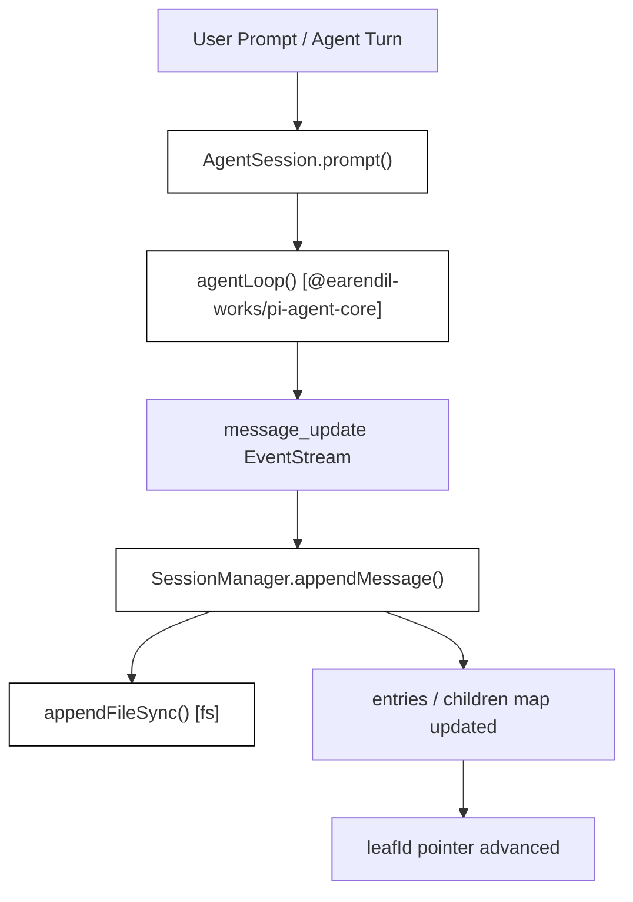
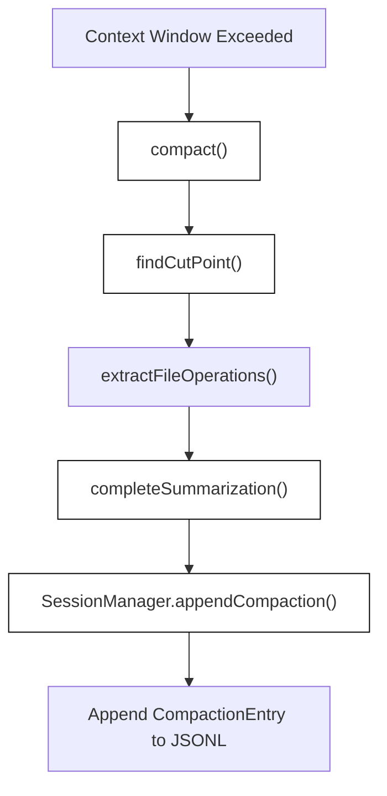

# Session Management and Compaction

<details>
<summary>Relevant source files</summary>

The following files were used as context for generating this wiki page:

- [packages/coding-agent/docs/compaction.md](packages/coding-agent/docs/compaction.md)
- [packages/coding-agent/src/core/compaction/branch-summarization.ts](packages/coding-agent/src/core/compaction/branch-summarization.ts)
- [packages/coding-agent/src/core/compaction/compaction.ts](packages/coding-agent/src/core/compaction/compaction.ts)
- [packages/coding-agent/src/core/session-manager.ts](packages/coding-agent/src/core/session-manager.ts)
- [packages/coding-agent/src/utils/tool-result-images.ts](packages/coding-agent/src/utils/tool-result-images.ts)
- [packages/coding-agent/test/branch-summarization.test.ts](packages/coding-agent/test/branch-summarization.test.ts)
- [packages/coding-agent/test/branch-summary-extensions.test.ts](packages/coding-agent/test/branch-summary-extensions.test.ts)
- [packages/coding-agent/test/compaction-summary-reasoning.test.ts](packages/coding-agent/test/compaction-summary-reasoning.test.ts)
- [packages/coding-agent/test/compaction.test.ts](packages/coding-agent/test/compaction.test.ts)
- [packages/coding-agent/test/session-file-invalid.test.ts](packages/coding-agent/test/session-file-invalid.test.ts)
- [packages/coding-agent/test/session-id-readonly.test.ts](packages/coding-agent/test/session-id-readonly.test.ts)
- [packages/coding-agent/test/session-manager/custom-session-id.test.ts](packages/coding-agent/test/session-manager/custom-session-id.test.ts)
- [packages/coding-agent/test/session-manager/file-operations.test.ts](packages/coding-agent/test/session-manager/file-operations.test.ts)
- [packages/coding-agent/test/session-manager/tree-traversal.test.ts](packages/coding-agent/test/session-manager/tree-traversal.test.ts)
- [packages/coding-agent/test/startup-session-name.test.ts](packages/coding-agent/test/startup-session-name.test.ts)
- [packages/coding-agent/test/stdout-cleanliness.test.ts](packages/coding-agent/test/stdout-cleanliness.test.ts)
- [packages/coding-agent/test/suite/agent-session-compaction-model-overrides.test.ts](packages/coding-agent/test/suite/agent-session-compaction-model-overrides.test.ts)
- [packages/coding-agent/test/suite/agent-session-compaction.test.ts](packages/coding-agent/test/suite/agent-session-compaction.test.ts)
- [packages/coding-agent/test/suite/agent-session-tool-result-images.test.ts](packages/coding-agent/test/suite/agent-session-tool-result-images.test.ts)
- [packages/coding-agent/test/suite/virtual-models.test.ts](packages/coding-agent/test/suite/virtual-models.test.ts)
- [packages/coding-agent/test/tool-result-images.test.ts](packages/coding-agent/test/tool-result-images.test.ts)

</details>


## Purpose and Scope

This wiki page covers the technical implementation of session persistence, session tree structures, the `SessionManager` API, branching, forking, cloning, automatic context compaction, and branch summarization within `packages/coding-agent`.

Sources: [`packages/coding-agent/src/core/session-manager.ts:1-222`](), [`packages/coding-agent/docs/compaction.md:1-11`](), [`packages/coding-agent/src/core/compaction/compaction.ts:1-46`]()

---

## JSONL Session File Format and Versioning

Sessions are stored as JSON Lines (`.jsonl`) files under `~/.pi/agent/sessions/--<path>--/`. Each line represents an independent JSON object (`FileEntry`) tagged with a `type` field. This append-only design allows highly efficient writes without rewriting historical records, while `id` and `parentId` fields establish a directed acyclic graph (DAG) session tree supporting in-place branching, forking, and cloning.

The file begins with a `SessionHeader` as the first line (`[packages/coding-agent/src/core/session-manager.ts:43-50]()`), capturing high-level metadata such as session version (`CURRENT_SESSION_VERSION = 3`), unique identifier (`id`), creation timestamp, current working directory (`cwd`), and an optional `parentSession` reference. Subsequent lines contain `SessionEntry` records (`[packages/coding-agent/src/core/session-manager.ts:183-194]()`).

### Entry Types

The codebase defines multiple entry types extending `SessionEntryBase` (`[packages/coding-agent/src/core/session-manager.ts:57-62]()`):

| Entry Type | Description | Key Fields |
|------------|-------------|------------|
| `session` | Session header line marking the start of a file | `version`, `id`, `timestamp`, `cwd`, `parentSession` |
| `message` | Conversation messages (user, assistant, tool, system) | `message` (an `AgentMessage`) |
| `compaction` | Summarized conversation history replacing older context | `summary`, `firstKeptEntryId`, `tokensBefore`, `details?`, `usage?`, `systemMessage?` |
| `branch_summary` | Summary of an abandoned branch during tree navigation | `summary`, `fromId`, `details?`, `usage?`, `fromHook?` |
| `model_change` | User-initiated changes in LLM provider or model ID | `provider`, `modelId` |
| `thinking_level_change` | User-initiated changes in reasoning / thinking level | `thinkingLevel` |
| `usage` | Non-conversation model-attributed usage (e.g. cache warming) | `kind`, `provider`, `model`, `usage`, `note?` |
| `custom` | Extension-specific state persisted across session reloads | `customType`, `data?` |
| `custom_message` | Extension-provided messages injected into LLM context | `customType`, `content`, `display`, `details?` |
| `context_edit` | Append-only modification to an earlier entry's context | `targetId`, `replacement` |
| `label` | User-defined bookmarks or markers on entries | `targetId`, `label` |
| `session_info` | Metadata such as user-defined session display names | `name?` |

Sources: [`packages/coding-agent/src/core/session-manager.ts:41-194`](), [`packages/coding-agent/docs/compaction.md:1-11`]()

---

## Session Tree Structure and DAG Navigation

The `SessionManager` class manages in-memory tree nodes and provides methods to traverse, inspect, and project conversation state:
- `getBranch(entryId)`: Reconstructs the linear chronological path from a leaf entry back to the root (`SessionManager.getBranch`) [packages/coding-agent/src/core/session-manager.ts:511-523]().
- `getTree()`: Builds a recursive forest of `SessionTreeNode` objects (`SessionManager.getTree`) [packages/coding-agent/src/core/session-manager.ts:575-602]().

### Diagram: Session Persistence and Flow Architecture
This diagram bridges natural language operations to the exact code entities responsible for appending and persisting session entries in `SessionManager`.


Sources: [`packages/coding-agent/src/core/session-manager.ts:431-490`](), [`packages/coding-agent/test/session-manager/tree-traversal.test.ts:10-132`]()

---

## SessionManager API and Lifecycle

The `SessionManager` class provides the primary programmatic API for loading, inspecting, and appending entries to session files or in-memory buffers.

### Key `SessionManager` Methods

| Method | Role & Implementation Pointer |
|--------|------------------------------|
| `SessionManager.open(filePath, cwd, cwdOverride)` | Parses file lines, validates headers, and populates entry graphs [packages/coding-agent/src/core/session-manager.ts:240-310]() |
| `SessionManager.create(cwd, sessionsDir, options)` | Initializes a new session file with a `SessionHeader` [packages/coding-agent/src/core/session-manager.ts:312-350]() |
| `appendMessage(message)` | Appends a `message` entry, linking it to current leaf and advancing leaf pointer [packages/coding-agent/src/core/session-manager.ts:431-434]() |
| `appendCompaction(...)` | Appends a `compaction` entry [packages/coding-agent/src/core/session-manager.ts:447-456]() |
| `appendBranchSummary(...)` | Appends a `branch_summary` entry [packages/coding-agent/src/core/session-manager.ts:458-466]() |
| `appendCustomEntry(...)` | Appends a `custom` entry for extension state [packages/coding-agent/src/core/session-manager.ts:478-482]() |
| `fork(entryId)` | Creates a forked session file referencing parent history [packages/coding-agent/src/core/session-manager.ts:778-797]() |
| `getBranch(entryId)` | Returns chronological path from root to entry [packages/coding-agent/src/core/session-manager.ts:511-523]() |
| `getTree()` | Returns recursive `SessionTreeNode[]` forest [packages/coding-agent/src/core/session-manager.ts:575-602]() |

Sources: [`packages/coding-agent/src/core/session-manager.ts:240-797`](), [`packages/coding-agent/test/session-manager/file-operations.test.ts:34-190`]()

---

## Compaction System

When sessions grow long, auto-compaction runs to stay within LLM context windows by summarizing older conversation turns while keeping recent context intact.

### Triggers and Thresholds

Auto-compaction is evaluated when:
```text
contextTokens > contextWindow - reserveTokens
```
- `reserveTokens`: Defaults to `16384` tokens, leaving room for assistant completion responses (`DEFAULT_COMPACTION_SETTINGS`) [packages/coding-agent/src/core/compaction/compaction.ts:120-130]().
- `keepRecentTokens`: Defaults to `20000` tokens, ensuring recent prompt turns remain verbatim [packages/coding-agent/src/core/compaction/compaction.ts:120-130]().

Users can also manually trigger compaction via the `/compact [instructions]` slash command.

### Compaction Workflow

1. **Cut Point Selection**: `findCutPoint()` walks backward through session projection entries, accumulating token estimates until `keepRecentTokens` is reached [packages/coding-agent/src/core/compaction/compaction.ts:221-260]().
2. **Message Extraction**: Collects projected messages from the previous kept boundary up to the cut point.
3. **LLM Summarization**: Calls `completeSummarization()` using `SUMMARIZATION_SYSTEM_PROMPT` with prompt caching disabled (`cacheRetention: "none"`) [packages/coding-agent/src/core/compaction/compaction.ts:1-46](), [`packages/coding-agent/test/compaction-summary-reasoning.test.ts:105-115`]().
4. **File Operations Tracking**: Extracts file reads and modifications from tool calls across summarized messages via `extractFileOperations()`, storing them in `CompactionEntry.details` [packages/coding-agent/src/core/compaction/compaction.ts:50-88]().
5. **Entry Persistence**: Appends a `CompactionEntry` containing the generated summary, `firstKeptEntryId`, token metrics, and system prompt checkpoint (`systemMessage`) [packages/coding-agent/src/core/session-manager.ts:91-104]().

### CompactionEntry Format

```typescript
export interface CompactionEntry<T = unknown> extends SessionEntryBase {
	type: "compaction";
	summary: string;
	firstKeptEntryId: string;
	tokensBefore: number;
	details?: T;
	usage?: Usage;
	fromHook?: boolean;
	systemMessage?: SystemMessage;
}
```

### Diagram: Compaction and Summarization Pipeline
This diagram bridges natural language summarization concepts to code entities in `@earendil-works/pi-coding-agent`.


Sources: [`packages/coding-agent/src/core/compaction/compaction.ts:1-213`](), [`packages/coding-agent/docs/compaction.md:25-84`](), [`packages/coding-agent/src/core/session-manager.ts:91-104`]()

---

## Branch Summarization

When navigating across branches in the session tree (for example, via `/tree` commands or programmatic branch switches), `collectEntriesForBranchSummary()` gathers historical context from the abandoned branch [packages/coding-agent/src/core/compaction/branch-summarization.ts:108-146]().

1. **Common Ancestor Discovery**: Finds the deepest common ancestor between the old leaf position and the target entry (`collectEntriesForBranchSummary`) [packages/coding-agent/src/core/compaction/branch-summarization.ts:118-129]().
2. **Collection**: Walks backward from the old leaf to the common ancestor, gathering entries [packages/coding-agent/src/core/compaction/branch-summarization.ts:131-146]().
3. **Summarization & Entry Append**: Summarizes the abandoned branch and appends a `BranchSummaryEntry`.

### BranchSummaryEntry Format

```typescript
export interface BranchSummaryEntry<T = unknown> extends SessionEntryBase {
	type: "branch_summary";
	fromId: string;
	summary: string;
	details?: T;
	usage?: Usage;
	fromHook?: boolean;
}
```

Sources: [`packages/coding-agent/src/core/compaction/branch-summarization.ts:1-194`](), [`packages/coding-agent/src/core/session-manager.ts:106-116`]()

---

## Session Branching, Forking, and Cloning

Because session entries form a directed acyclic graph linked by `parentId`, multiple children can branch from any parent entry without corrupting historical paths.

- **Forking**: `SessionManager.fork(entryId)` creates a new session file inheriting all history up to the specified `entryId` and setting `parentSession` in the header [packages/coding-agent/src/core/session-manager.ts:778-797]().
- **Cloning & Navigation**: Interactive commands like `/fork`, `/clone`, and `/tree` let users explore alternative execution paths safely.

Sources: [`packages/coding-agent/src/core/session-manager.ts:778-797`]()