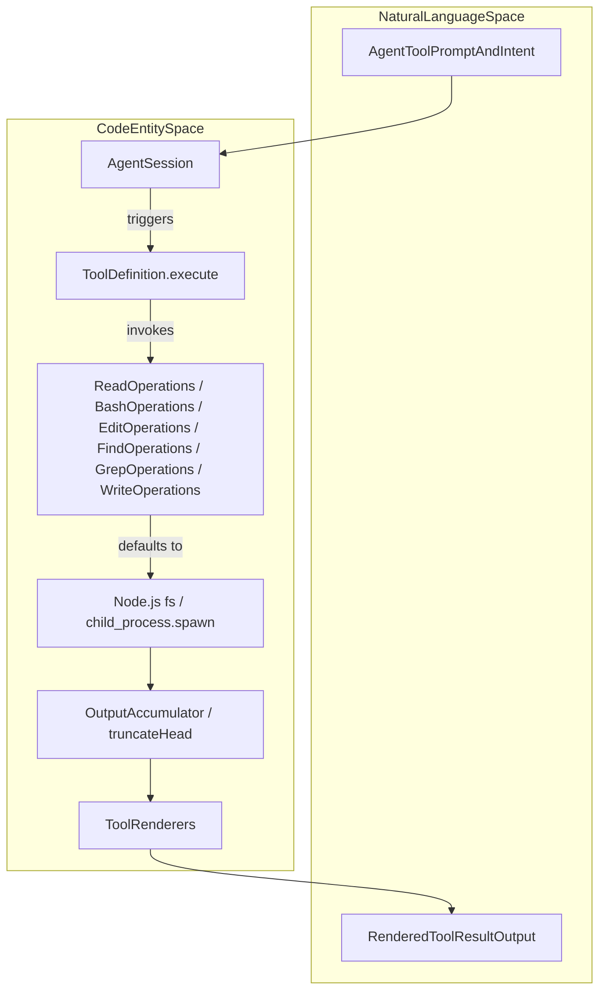
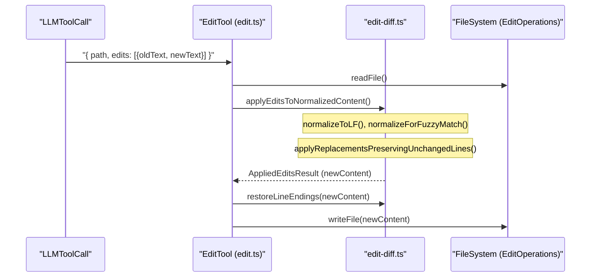
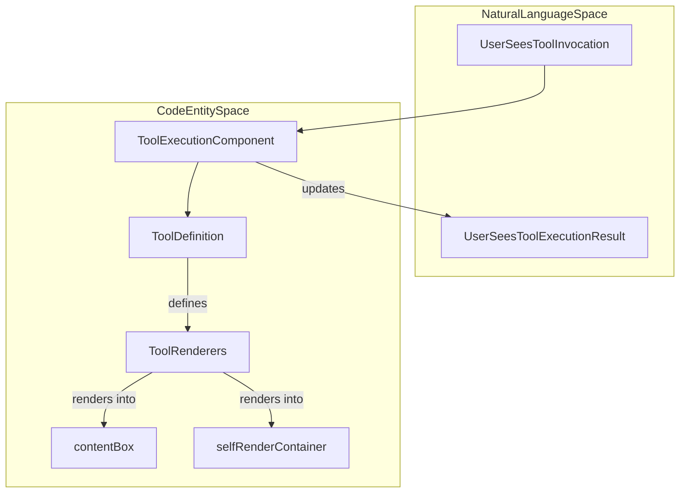

# Built-in Tools

Relevant source files

The following files were used as context for generating this wiki page:

- [packages/coding-agent/docs/shell-aliases.md](packages/coding-agent/docs/shell-aliases.md)
- [packages/coding-agent/docs/windows.md](packages/coding-agent/docs/windows.md)
- [packages/coding-agent/src/core/tools/bash.ts](packages/coding-agent/src/core/tools/bash.ts)
- [packages/coding-agent/src/core/tools/edit-diff.ts](packages/coding-agent/src/core/tools/edit-diff.ts)
- [packages/coding-agent/src/core/tools/edit.ts](packages/coding-agent/src/core/tools/edit.ts)
- [packages/coding-agent/src/core/tools/find.ts](packages/coding-agent/src/core/tools/find.ts)
- [packages/coding-agent/src/core/tools/grep.ts](packages/coding-agent/src/core/tools/grep.ts)
- [packages/coding-agent/src/core/tools/index.ts](packages/coding-agent/src/core/tools/index.ts)
- [packages/coding-agent/src/core/tools/ls.ts](packages/coding-agent/src/core/tools/ls.ts)
- [packages/coding-agent/src/core/tools/path-utils.ts](packages/coding-agent/src/core/tools/path-utils.ts)
- [packages/coding-agent/src/core/tools/read.ts](packages/coding-agent/src/core/tools/read.ts)
- [packages/coding-agent/src/core/tools/write.ts](packages/coding-agent/src/core/tools/write.ts)
- [packages/coding-agent/src/utils/shell.ts](packages/coding-agent/src/utils/shell.ts)
- [packages/coding-agent/src/utils/tools-manager.ts](packages/coding-agent/src/utils/tools-manager.ts)
- [packages/coding-agent/test/interactive-mode-startup-input.test.ts](packages/coding-agent/test/interactive-mode-startup-input.test.ts)
- [packages/coding-agent/test/path-utils.test.ts](packages/coding-agent/test/path-utils.test.ts)
- [packages/coding-agent/test/powershell-config.test.ts](packages/coding-agent/test/powershell-config.test.ts)
- [packages/coding-agent/test/session-info-modified-timestamp.test.ts](packages/coding-agent/test/session-info-modified-timestamp.test.ts)
- [packages/coding-agent/test/shell-kill-process-tree.test.ts](packages/coding-agent/test/shell-kill-process-tree.test.ts)
- [packages/coding-agent/test/shell-path-exists.test.ts](packages/coding-agent/test/shell-path-exists.test.ts)
- [packages/coding-agent/test/suite/regressions/6596-taskkill-enoent.test.ts](packages/coding-agent/test/suite/regressions/6596-taskkill-enoent.test.ts)
- [packages/coding-agent/test/tools-manager.test.ts](packages/coding-agent/test/tools-manager.test.ts)
- [packages/coding-agent/test/tools.test.ts](packages/coding-agent/test/tools.test.ts)
- [packages/coding-agent/test/windows-shell-config.test.ts](packages/coding-agent/test/windows-shell-config.test.ts)
- [packages/durable/src/env/node.ts](packages/durable/src/env/node.ts)
- [packages/durable/test/env-node.test.ts](packages/durable/test/env-node.test.ts)

This page covers the core coding-agent built-in tools (`read`, `bash`, `edit`, `write`, `find`, `grep`, `ls`, and optional shell variants) implemented in `@earendil-works/pi-coding-agent`. It details tool schemas, the bash execution and output accumulator subsystems, the edit-diff algorithm, file mutation serialization, path utilities, truncation rules, harness tool implementations, and automatic tool binary management.

Sources: [packages/coding-agent/test/tools.test.ts:19-28](), [packages/coding-agent/src/core/tools/index.ts:93-105]()

---

## Overview and Tool Registry

The `pi` coding agent provides a suite of core tools designed for filesystem interaction, search, and command execution. These tools are instantiated via factories such as `createReadTool`, `createBashTool`, and `createEditTool` [packages/coding-agent/test/tools.test.ts:19-28](). They are managed via `ToolDefinition` objects which encapsulate the JSON schema for the LLM, execution logic, and custom rendering definitions [packages/coding-agent/src/core/tools/edit.ts:32-53](), [packages/coding-agent/src/core/tools/find.ts:26-32]().

### Core Tool Set
| Tool | Purpose | Key Implementation File |
| :--- | :--- | :--- |
| `read` | Reads file content with auto-truncation and image support. | [packages/coding-agent/src/core/tools/read.ts:14-23]() |
| `bash` | Executes shell commands with streaming output. | [packages/coding-agent/src/core/tools/bash.ts:40-43]() |
| `edit` | Applies precise search-and-replace edits to files. | [packages/coding-agent/src/core/tools/edit.ts:32-41]() |
| `write` | Creates or overwrites files entirely. | [packages/coding-agent/src/core/tools/write.ts:11-14]() |
| `find` | Locates files using glob patterns (via `fd` if available). | [packages/coding-agent/src/core/tools/find.ts:26-32]() |
| `grep` | Searches for text patterns within files (via `ripgrep`). | [packages/coding-agent/src/core/tools/grep.ts:21-33]() |
| `ls` | Lists directory contents with metadata. | [packages/coding-agent/src/core/tools/ls.ts:11-14]() |

Sources: [packages/coding-agent/test/tools.test.ts:19-28](), [packages/coding-agent/src/core/tools/read.ts:14-23](), [packages/coding-agent/src/core/tools/bash.ts:40-43](), [packages/coding-agent/src/core/tools/edit.ts:32-41](), [packages/coding-agent/src/core/tools/write.ts:11-14](), [packages/coding-agent/src/core/tools/find.ts:26-32](), [packages/coding-agent/src/core/tools/grep.ts:21-33](), [packages/coding-agent/src/core/tools/ls.ts:11-14]()

---

## Tool Execution Architecture

The execution of built-in tools follows a standardized flow from the `AgentSession` through the `ToolDefinition.execute` method. Each tool supports pluggable operations (`ReadOperations`, `BashOperations`, `EditOperations`, `FindOperations`, `GrepOperations`, `WriteOperations`), allowing logic to be delegated to remote systems such as SSH or virtual containers [packages/coding-agent/src/core/tools/read.ts:48-55](), [packages/coding-agent/src/core/tools/bash.ts:75-94](), [packages/coding-agent/src/core/tools/edit.ts:83-90](), [packages/coding-agent/src/core/tools/find.ts:52-57](), [packages/coding-agent/src/core/tools/grep.ts:53-58](), [packages/coding-agent/src/core/tools/write.ts:27-32]().

### Tool Execution Data Flow
This diagram bridges the Natural Language space (agent instructions and tool outputs) to the underlying Code Entity space, showing how execution flows through operational wrappers and execution methods.

Title: "Tool Execution Lifecycle"

Sources: [packages/coding-agent/src/core/tools/read.ts:48-108](), [packages/coding-agent/src/core/tools/bash.ts:75-164](), [packages/coding-agent/src/core/tools/edit.ts:83-165](), [packages/coding-agent/src/core/tools/find.ts:52-130](), [packages/coding-agent/src/core/tools/grep.ts:53-168](), [packages/coding-agent/src/core/tools/write.ts:27-90]()

---

## The Bash Executor and Output Accumulator

The `bash` tool utilizes `createLocalShellOperations` and `createLocalBashOperations` along with shell utilities to handle long-running processes, real-time streaming updates, and output size thresholds [packages/coding-agent/src/core/tools/bash.ts:96-176]().

### Implementation Details
- **Process Spawning & Tracking:** Spawns shell processes via Node.js `spawn`, tracking detached PIDs to enable proper cleanup using `trackDetachedChildPid` and `untrackDetachedChildPid` [packages/coding-agent/src/core/tools/bash.ts:112-123](), [packages/coding-agent/src/utils/shell.ts:167-175]().
- **Timeouts & Aborts:** Enforces configurable timeouts and abort signals by terminating the entire process tree with `killProcessTree` upon abort or timeout events [packages/coding-agent/src/core/tools/bash.ts:27-38](), [packages/coding-agent/src/core/tools/bash.ts:126-137](), [packages/coding-agent/src/utils/shell.ts:187-209]().
- **Output Accumulation:** Standard output and error streams are collected and throttled through execution wrappers and output accumulators, enforcing size limits and streaming chunks for execution feedback [packages/coding-agent/src/core/tools/bash.ts:139-140]().

Sources: [packages/coding-agent/src/core/tools/bash.ts:27-176](), [packages/coding-agent/src/utils/shell.ts:167-209]()

---

## Edit-Diff Algorithm

The `edit` tool implements a robust search-and-replace mechanism designed to handle precise multi-location edits without requiring full-file rewrites [packages/coding-agent/src/core/tools/edit.ts:32-51]().

### Fuzzy Matching & Normalization
The algorithm in `edit-diff.ts` accommodates minor formatting variances introduced by LLMs:
1. **Normalization:** Content is normalized to LF line endings using `normalizeToLF` to unify line ending styles before matching [packages/coding-agent/src/core/tools/edit-diff.ts:19-21]().
2. **Fuzzy Search:** If an exact string match for `oldText` fails, fuzzy find routines normalize Unicode smart quotes, dashes, and spacing equivalents via `normalizeForFuzzyMatch` to improve matching robustness [packages/coding-agent/src/core/tools/edit-diff.ts:34-55]().
3. **Preservation:** `applyReplacementsPreservingUnchangedLines` maps edits back onto original line boundaries to maintain unrelated line formatting intact, preventing unnecessary rewrites during file editing [packages/coding-agent/src/core/tools/edit-diff.ts:132-173]().

### Edit Execution Flow
This diagram illustrates the search-and-replace pipeline from natural language tool calls down to core diff and file operations, bridging natural language intents to code entities.

Title: "Edit-Diff Algorithm Flow"

Sources: [packages/coding-agent/src/core/tools/edit.ts:143-165](), [packages/coding-agent/src/core/tools/edit-diff.ts:19-55](), [packages/coding-agent/src/core/tools/edit-diff.ts:132-214]()

---

## File Mutation Queue

To prevent race conditions during parallel tool invocations, file modifications are governed by `withFileMutationQueue` [packages/coding-agent/src/core/tools/file-mutation-queue.ts:1-25](). This helper serializes access per absolute file path, locking concurrent write or edit operations to maintain filesystem integrity. Calls to `withFileMutationQueue` wrap asynchronous file operations for `edit` and `write` tools, holding a per-file mutation lock until I/O settles [packages/coding-agent/src/core/tools/edit.ts:163-167](), [packages/coding-agent/src/core/tools/write.ts:67-70]().

Sources: [packages/coding-agent/src/core/tools/edit.ts:163-167](), [packages/coding-agent/src/core/tools/write.ts:67-70]()

---

## Truncation and Path Utilities

To protect LLM context windows against overflow, execution tools enforce strict limits. This applies especially to reading and search results.

### Truncation Logic
- **Byte and Line Limits:** Constants such as `DEFAULT_MAX_BYTES` (50 KB) and `DEFAULT_MAX_LINES` (2,000 lines) define upper bounds for output from reading or searching file contents to keep responses manageable [packages/coding-agent/src/core/tools/read.ts:12](), [packages/coding-agent/src/core/tools/find.ts:11](), [packages/coding-agent/src/core/tools/grep.ts:12-19]().
- **Truncation Strategies:** The `read` tool uses `truncateHead` truncation preserving content from the start with offset-based continuation hints, while tools like `find`, `grep`, and `ls` truncate output to limits and append actionable notices about truncated results [packages/coding-agent/src/core/tools/read.ts:12](), [packages/coding-agent/src/core/tools/find.ts:146-161](), [packages/coding-agent/src/core/tools/ls.ts:141-156]().

Sources: [packages/coding-agent/src/core/tools/read.ts:12](), [packages/coding-agent/src/core/tools/find.ts:146-161](), [packages/coding-agent/src/core/tools/ls.ts:141-156]()

---

## Tool Binary Management (`tools-manager.ts`)

Search tools such as `fd` and `rg` (ripgrep) rely on binary management utilities [packages/coding-agent/src/utils/tools-manager.ts:29-69](). The `ensureTool` function checks local tool directories (`getBinDir()`) and system PATH, falling back to downloading precompiled platform-specific binaries from GitHub releases when necessary [packages/coding-agent/src/utils/tools-manager.ts:83-102](), [packages/coding-agent/src/utils/tools-manager.ts:110-154]().

Sources: [packages/coding-agent/src/utils/tools-manager.ts:29-154]()

---

## Tool Rendering in TUI

Built-in tools supply custom renderers for displaying arguments and execution results within the Terminal UI.

- **Syntax Highlighting and Summaries:** Tools like `read` and `write` render code blocks with syntax highlighting inferred from file extensions. Directory listings or special files get custom summary renderers for concise output [packages/coding-agent/src/core/tools/read.ts:10-11](), [packages/coding-agent/src/core/tools/write.ts:8-9]().
- **Image Support:** The `read` tool detects if the target file is an image (jpeg, png, webp, gif, bmp), processes it (auto-resizing if enabled), and returns content blocks including `image` type payloads for vision-capable models. If the current model does not support images, a fallback textual note is included instead [packages/coding-agent/src/core/tools/read.ts:63-84](), [packages/coding-agent/src/core/tools/read.ts:133-152]().

### UI Component Hierarchy
This diagram maps the TUI component structures responsible for visualizing tool interactions, connecting the natural language presentation layer to internal code entities.

Title: "TUI Component Hierarchy for Tool Rendering"

Sources: [packages/coding-agent/src/core/tools/read.ts:63-152](), [packages/coding-agent/src/core/tools/edit.ts:143-160](), [packages/coding-agent/src/core/tools/write.ts:44-93]()

# Summary

The built-in tools of the `pi` coding agent provide a comprehensive, pluggable, and extensible foundation for working with files, executing shell commands, searching codebases, and editing content precisely under AI-assisted workflows. Their modular design with pluggable operation implementations and tight integration with the agent lifecycle makes them adaptable to diverse execution environments.

Sources: [packages/coding-agent/src/core/tools/index.ts:93-162]()

# END of 2.4 Built-in Tools