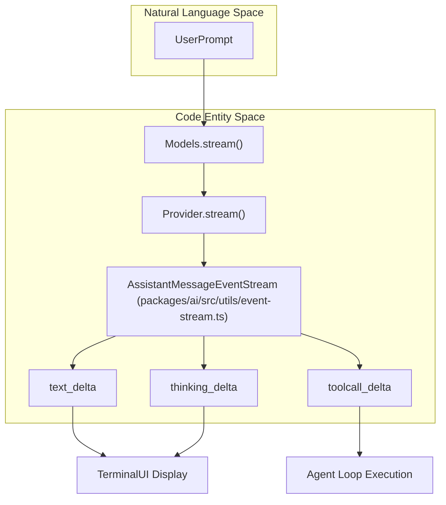
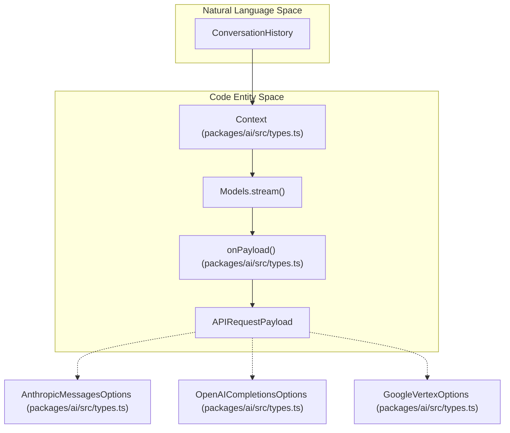

# LLM Provider Abstraction (pi-ai)

Relevant source files

The following files were used as context for generating this wiki page:

- [packages/ai/README.md](packages/ai/README.md)
- [packages/ai/scripts/generate-models.ts](packages/ai/scripts/generate-models.ts)
- [packages/ai/src/index.ts](packages/ai/src/index.ts)
- [packages/ai/src/models.generated.ts](packages/ai/src/models.generated.ts)
- [packages/ai/src/providers/anthropic.ts](packages/ai/src/providers/anthropic.ts)
- [packages/ai/src/providers/google-vertex.ts](packages/ai/src/providers/google-vertex.ts)
- [packages/ai/src/providers/google.ts](packages/ai/src/providers/google.ts)
- [packages/ai/src/types.ts](packages/ai/src/types.ts)
- [packages/ai/test/google-vertex-api-key-resolution.test.ts](packages/ai/test/google-vertex-api-key-resolution.test.ts)

The `@earendil-works/pi-ai` package provides a unified, streaming interface for interacting with diverse Large Language Model (LLM) providers [packages/ai/src/index.ts:4-8](). It abstracts away provider-specific SDK complexities, offering a consistent API for text generation, tool calling, and advanced features like reasoning ("thinking"), adaptive effort levels, and prompt caching [packages/ai/README.md:1-5]().

## Purpose and Scope

The core goal of `pi-ai` is to enable agentic workflows that are model-agnostic. It achieves this through:
- **Unified Streaming API**: A single protocol for handling real-time model output across all supported providers, including OpenAI, Anthropic, Google (Generative AI/Vertex), Amazon Bedrock, and Mistral [packages/ai/src/types.ts:64-74]().
- **Automatic Model Discovery**: A registry of model metadata including pricing tiers, context limits, and capability flags, generated via automated scripts [packages/ai/src/models.generated.ts:47-83]().
- **Context Persistence**: A standardized `Context` format that allows seamless hand-off of conversation history between different models and providers [packages/ai/README.md:131-137]().
- **Auth Resolution**: Automatic resolution of credentials from environment variables, stored `auth.json` files, or OAuth flows [packages/ai/README.md:18-23]().

Sources: [packages/ai/src/index.ts:4-8](), [packages/ai/README.md:1-23](), [packages/ai/src/types.ts:64-74](), [packages/ai/src/models.generated.ts:47-83]().

## Unified Streaming API

The abstraction layer exposes interaction patterns via the `Models` interface, primarily `stream()` and `complete()`. Both operate on a standardized `AssistantMessageEventStream`, which emits events for text deltas, tool call updates, and thinking/reasoning blocks [packages/ai/src/types.ts:31]().

### Diagram: Stream Event Lifecycle

Sources: [packages/ai/src/types.ts:31](), [packages/ai/README.md:136-173]().

For details on the event protocol and specific provider logic (OpenAI, Anthropic, Google, Azure, Bedrock, etc.), see **[Streaming API and Provider Implementations](#3.1)**.

Sources: [packages/ai/src/types.ts:31](), [packages/ai/README.md:136-173]().

## Model Registry and Credential Resolution

The package includes a comprehensive registry of known models (`MODELS`) [packages/ai/src/models.generated.ts:47-83](). This metadata allows the system to automatically handle features like vision support, tool calling constraints, and pricing calculations [packages/ai/scripts/generate-models.ts:98-133](). The `generate-models.ts` script is responsible for maintaining this catalog [packages/ai/scripts/generate-models.ts:1-96](). Credential resolution dynamically discovers API keys, OAuth tokens, or Application Default Credentials (ADC) via providers like `anthropicProvider()` [packages/ai/src/providers/anthropic.ts:19-72]() and `googleVertexProvider()` [packages/ai/src/providers/google-vertex.ts:13-90]().

| Feature | Description | Code Reference |
| :--- | :--- | :--- |
| **Model Registry** | Auto-generated collection of model metadata across providers. | `MODELS` [packages/ai/src/models.generated.ts:47-83]() |
| **Generation Script** | Script that fetches and normalizes model data into the registry. | `generate-models.ts` [packages/ai/scripts/generate-models.ts:1-96]() |
| **Anthropic Auth** | Resolves API keys, environment variables, or workload identity federation. | `anthropicApiKeyAuth` [packages/ai/src/providers/anthropic.ts:19-72]() |
| **Vertex Auth** | Resolves explicit API keys, service accounts, or ADC paths. | `vertexAuth` [packages/ai/src/providers/google-vertex.ts:13-90]() |

Sources: [packages/ai/src/models.generated.ts:47-83](), [packages/ai/scripts/generate-models.ts:1-96](), [packages/ai/src/providers/anthropic.ts:19-72](), [packages/ai/src/providers/google-vertex.ts:13-90]().

For details on how models are resolved and how API keys are managed, see **[Model Registry and Credential Resolution](#3.2)**.

Sources: [packages/ai/src/models.generated.ts:47-83](), [packages/ai/scripts/generate-models.ts:1-96](), [packages/ai/src/providers/anthropic.ts:19-72](), [packages/ai/src/providers/google-vertex.ts:13-90]().

## Prompt Caching, Thinking, and Cross-Provider Handoff

`pi-ai` handles message transformation and standardized feature mapping to maintain session continuity when switching providers.

### Feature Mapping: Thinking and Caching

The system maps high-level intents to provider-specific parameters:
- **Thinking Levels**: Maps semantic levels (`minimal`, `low`, `medium`, `high`) using `ThinkingLevelMap` and token budget definitions [packages/ai/src/types.ts:26-29](), [packages/ai/src/types.ts:139-144]().
- **Prompt Caching**: Normalizes cache retention preferences (`CacheRetention`) and session affinity across providers [packages/ai/src/types.ts:20-25]().

### Diagram: Context Migration and Payload Dispatch

Sources: [packages/ai/src/types.ts:1-29](), [packages/ai/src/types.ts:160-181](), [packages/ai/README.md:131-137]().

For details on message transformation, thinking configurations, and prompt caching strategies, see **[Prompt Caching, Thinking, and Cross-Provider Handoff](#3.3)**.

Sources: [packages/ai/src/types.ts:1-29](), [packages/ai/src/types.ts:160-181](), [packages/ai/README.md:131-137]().

***

**Child Pages:**
- [Streaming API and Provider Implementations](#3.1)
- [Model Registry and Credential Resolution](#3.2)
- [Prompt Caching, Thinking, and Cross-Provider Handoff](#3.3)