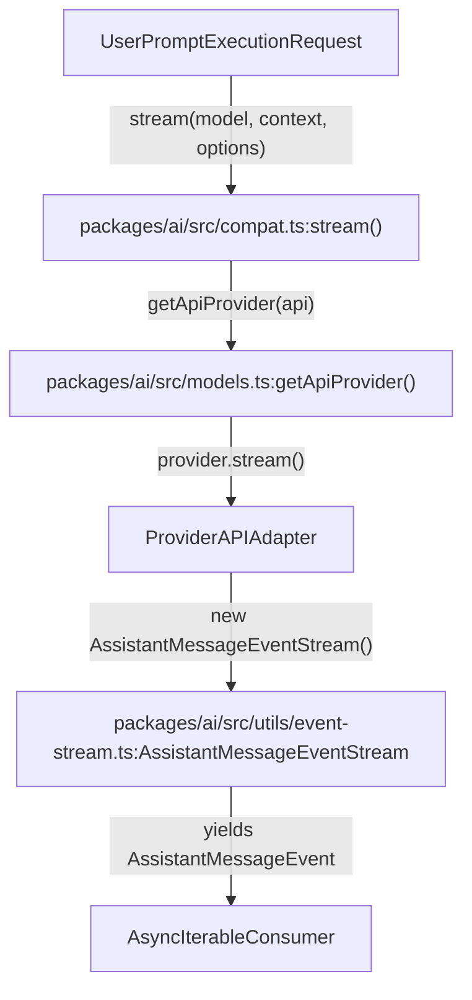
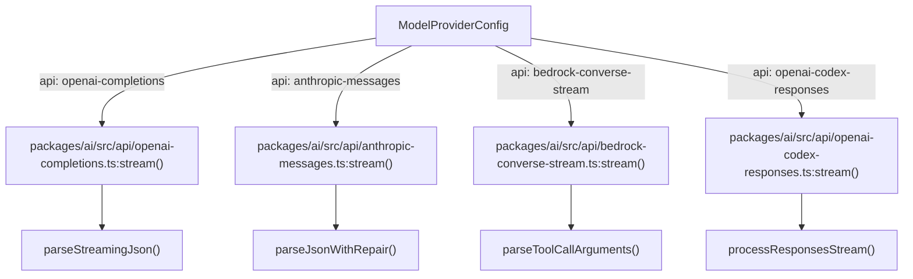
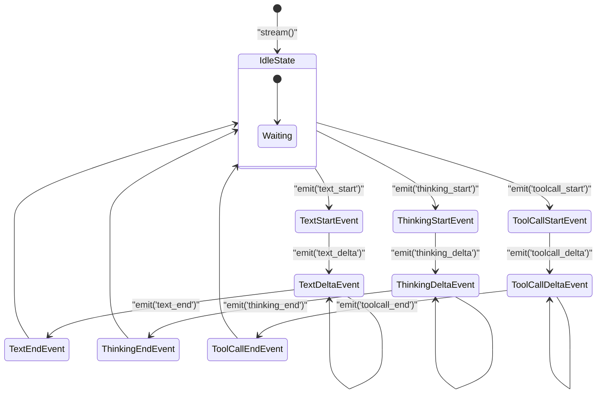

# Streaming API and Provider Implementations

Relevant source files

The following files were used as context for generating this wiki page:

- [packages/ai/src/api/anthropic-messages.ts](packages/ai/src/api/anthropic-messages.ts)
- [packages/ai/src/api/azure-openai-responses.ts](packages/ai/src/api/azure-openai-responses.ts)
- [packages/ai/src/api/bedrock-converse-stream.ts](packages/ai/src/api/bedrock-converse-stream.ts)
- [packages/ai/src/api/google-generative-ai.ts](packages/ai/src/api/google-generative-ai.ts)
- [packages/ai/src/api/google-shared.ts](packages/ai/src/api/google-shared.ts)
- [packages/ai/src/api/google-vertex.ts](packages/ai/src/api/google-vertex.ts)
- [packages/ai/src/api/lazy.ts](packages/ai/src/api/lazy.ts)
- [packages/ai/src/api/mistral-conversations.ts](packages/ai/src/api/mistral-conversations.ts)
- [packages/ai/src/api/openai-codex-responses.ts](packages/ai/src/api/openai-codex-responses.ts)
- [packages/ai/src/api/openai-completions.ts](packages/ai/src/api/openai-completions.ts)
- [packages/ai/src/api/openai-responses-shared.ts](packages/ai/src/api/openai-responses-shared.ts)
- [packages/ai/src/api/openai-responses.ts](packages/ai/src/api/openai-responses.ts)
- [packages/ai/src/api/pi-messages.lazy.ts](packages/ai/src/api/pi-messages.lazy.ts)
- [packages/ai/src/compat.ts](packages/ai/src/compat.ts)
- [packages/ai/src/legacy-api-aliases.ts](packages/ai/src/legacy-api-aliases.ts)
- [packages/ai/src/providers/amazon-bedrock.ts](packages/ai/src/providers/amazon-bedrock.ts)
- [packages/ai/src/providers/mistral.ts](packages/ai/src/providers/mistral.ts)
- [packages/ai/src/utils/event-stream.ts](packages/ai/src/utils/event-stream.ts)
- [packages/ai/src/utils/overflow.ts](packages/ai/src/utils/overflow.ts)
- [packages/ai/src/utils/retry.ts](packages/ai/src/utils/retry.ts)
- [packages/ai/test/abort.test.ts](packages/ai/test/abort.test.ts)
- [packages/ai/test/anthropic-eager-tool-input-compat.test.ts](packages/ai/test/anthropic-eager-tool-input-compat.test.ts)
- [packages/ai/test/anthropic-opus-4-8-smoke.test.ts](packages/ai/test/anthropic-opus-4-8-smoke.test.ts)
- [packages/ai/test/anthropic-sse-parsing.test.ts](packages/ai/test/anthropic-sse-parsing.test.ts)
- [packages/ai/test/anthropic-thinking-disable.test.ts](packages/ai/test/anthropic-thinking-disable.test.ts)
- [packages/ai/test/anthropic-tool-name-normalization.test.ts](packages/ai/test/anthropic-tool-name-normalization.test.ts)
- [packages/ai/test/bedrock-endpoint-resolution.test.ts](packages/ai/test/bedrock-endpoint-resolution.test.ts)
- [packages/ai/test/bedrock-thinking-payload.test.ts](packages/ai/test/bedrock-thinking-payload.test.ts)
- [packages/ai/test/compat-env.test.ts](packages/ai/test/compat-env.test.ts)
- [packages/ai/test/context-overflow.test.ts](packages/ai/test/context-overflow.test.ts)
- [packages/ai/test/cross-provider-handoff.test.ts](packages/ai/test/cross-provider-handoff.test.ts)
- [packages/ai/test/empty.test.ts](packages/ai/test/empty.test.ts)
- [packages/ai/test/event-stream.test.ts](packages/ai/test/event-stream.test.ts)
- [packages/ai/test/github-copilot-request-size-overflow.test.ts](packages/ai/test/github-copilot-request-size-overflow.test.ts)
- [packages/ai/test/google-raw-stop-reason.test.ts](packages/ai/test/google-raw-stop-reason.test.ts)
- [packages/ai/test/google-shared-convert-tools.test.ts](packages/ai/test/google-shared-convert-tools.test.ts)
- [packages/ai/test/google-shared-image-tool-result-routing.test.ts](packages/ai/test/google-shared-image-tool-result-routing.test.ts)
- [packages/ai/test/google-thinking-level-map.test.ts](packages/ai/test/google-thinking-level-map.test.ts)
- [packages/ai/test/image-tool-result.test.ts](packages/ai/test/image-tool-result.test.ts)
- [packages/ai/test/lazy-module-load.test.ts](packages/ai/test/lazy-module-load.test.ts)
- [packages/ai/test/mistral-http-transport.test.ts](packages/ai/test/mistral-http-transport.test.ts)
- [packages/ai/test/mistral-reasoning-mode.test.ts](packages/ai/test/mistral-reasoning-mode.test.ts)
- [packages/ai/test/openai-codex-stream.test.ts](packages/ai/test/openai-codex-stream.test.ts)
- [packages/ai/test/openai-completions-response-model.test.ts](packages/ai/test/openai-completions-response-model.test.ts)
- [packages/ai/test/openai-completions-tool-choice.test.ts](packages/ai/test/openai-completions-tool-choice.test.ts)
- [packages/ai/test/openai-responses-empty-tool-result.test.ts](packages/ai/test/openai-responses-empty-tool-result.test.ts)
- [packages/ai/test/openai-responses-terminal-event.test.ts](packages/ai/test/openai-responses-terminal-event.test.ts)
- [packages/ai/test/overflow.test.ts](packages/ai/test/overflow.test.ts)
- [packages/ai/test/retry.test.ts](packages/ai/test/retry.test.ts)
- [packages/ai/test/scratch.ts](packages/ai/test/scratch.ts)
- [packages/ai/test/stream.test.ts](packages/ai/test/stream.test.ts)
- [packages/ai/test/tokens.test.ts](packages/ai/test/tokens.test.ts)
- [packages/ai/test/tool-call-without-result.test.ts](packages/ai/test/tool-call-without-result.test.ts)
- [packages/ai/test/total-tokens.test.ts](packages/ai/test/total-tokens.test.ts)
- [packages/ai/test/unicode-surrogate.test.ts](packages/ai/test/unicode-surrogate.test.ts)
- [packages/coding-agent/test/default-tools-setting.test.ts](packages/coding-agent/test/default-tools-setting.test.ts)
- [packages/coding-agent/test/suite/harness.ts](packages/coding-agent/test/suite/harness.ts)
- [packages/coding-agent/test/suite/regressions/6647-compaction-retries-transient-stream-drop.test.ts](packages/coding-agent/test/suite/regressions/6647-compaction-retries-transient-stream-drop.test.ts)
- [packages/coding-agent/test/suite/regressions/6904-dns-transport-retry.test.ts](packages/coding-agent/test/suite/regressions/6904-dns-transport-retry.test.ts)
- [packages/coding-agent/test/suite/regressions/copilot-request-size-overflow.test.ts](packages/coding-agent/test/suite/regressions/copilot-request-size-overflow.test.ts)

This page details the unified streaming interface provided by the `@earendil-works/pi-ai` package and the specific implementations for various LLM providers. The architecture abstracts provider-specific SDK differences while maintaining high-fidelity access to advanced features like streaming tokens, tool calls, adaptive reasoning ("thinking"), prompt caching, retry logic, overflow handling, and image inputs.

Sources: `[packages/ai/src/compat.ts:1-160]()`, `[packages/ai/src/utils/event-stream.ts:1-88]()`

---

## Unified Streaming API

The core of the `pi-ai` package is a set of functions that provide a consistent interface for interacting with different LLM APIs by resolving providers from a central registry.

### Core Functions

- **`stream(model, context, options)`**: The primary entry point for streaming responses. It resolves the appropriate provider via the registry and initiates a stream of `AssistantMessageEvent` objects. The returned stream is an async iterable emitting granular events describing the assistant's response generation progress, including text chunks, reasoning (thinking) blocks, and tool call invocations. `[packages/ai/src/compat.ts:88-100]()`
- **`complete(model, context, options)`**: A convenience wrapper around `stream()` that collects all events into a single `AssistantMessage`. It returns a promise that resolves once streaming finishes or errors out. `[packages/ai/src/compat.ts:114-123]()`
- **`streamSimple(model, context, options)`**: A variant of `stream()` which accepts simplified options, including a unified `reasoning` level (mapped internally to provider-specific reasoning efforts). It returns an `AssistantMessageEventStream`. `[packages/ai/src/compat.ts:125-137]()`
- **`completeSimple(model, context, options)`**: Non-streaming version of `streamSimple()` that returns a completed assistant message after a single request. `[packages/ai/src/compat.ts:151-160]()`

Sources: `[packages/ai/src/compat.ts:88-160]()`

---

## AssistantMessageEventStream and Event Types

All streaming functions return an instance of `AssistantMessageEventStream`. This class implements an async iterable interface and emits fine-grained event objects representing incremental updates to the assistant message.

Key event types include:

| Event Type       | Description                                | Key Data                         |
| :--------------- | :-----------------------------------------| :-------------------------------|
| `start`          | Emitted when the request begins.          | `partial`: Initial `AssistantMessage` |
| `text_start`     | Start of a text output block.              | `contentIndex`: Content array index |
| `text_delta`     | Incremental text chunk generated.          | `delta`: Text string             |
| `text_end`       | Text block completion.                      | `content`: Final text string     |
| `thinking_start` | Start of a reasoning ("thinking") block.   | `contentIndex`: Content index    |
| `thinking_delta` | Incremental reasoning output.               | `delta`: Reasoning fragment      |
| `thinking_end`   | Completion of reasoning block.              | `content`: Final reasoning text |
| `toolcall_start` | Beginning of a tool call block.             | `contentIndex`: Content index    |
| `toolcall_delta` | Partial tool argument JSON fragment.        | `delta`: JSON fragment           |
| `toolcall_end`   | Fully parsed tool call block.                | Complete `ToolCall` object       |
| `done`           | Finished successfully with complete message | The final `AssistantMessage`     |
| `error`          | Terminal error occurred.                     | `error`: Error info message      |

Internally, the stream tracks lifecycle transitions per content block (text, thinking, tool call), detecting block boundaries and emitting corresponding events as tokens arrive.

Sources: `[packages/ai/src/compat.ts:88-160]`, `[packages/ai/src/utils/event-stream.ts:32-88]()`

---

## Natural Language Space to Code Entity Space: API Routing and Provider Dispatch

This diagram bridges high-level user generation requests in natural language space to specific code entities and modules within `packages/ai`.

### Diagram: API Routing & Provider Dispatch

Sources: `[packages/ai/src/compat.ts:88-100]()`, `[packages/ai/src/utils/event-stream.ts:32-40]()`, `[packages/ai/src/models.ts:1-50]()`

---

## Per-Provider API Adapters

The package includes per-provider adapters for numerous LLM APIs, each implementing streaming behavior and provider-specific authentication, request construction, event parsing, and error/retry handling.

### OpenAI Family

- **`openai-completions`**: Implements the classic OpenAI Chat Completions API using the official `openai` SDK. Tracks text and tool call blocks using indexed content arrays and parses partial JSON in streaming chunks. Supports the `tool_choice` parameter and advanced reasoning effort parameter mappings for adaptive thinking. `[packages/ai/src/api/openai-completions.ts:68-180]()`
- **`openai-responses`**: Adapts the newer OpenAI Responses chat API with improved response-mode streaming. Uses shared logic to convert raw events (`response.output_text.delta`, etc.) into normalized assistant message events. `[packages/ai/src/api/openai-responses.ts:120-172]()`
- **`openai-codex-responses`**: Special adapter for ChatGPT backend Codex response streams. Supports WebSocket and SSE transports with zstd request body compression for large payloads (`REQUEST_COMPRESSION_ZSTD_LEVEL = 3`). Handles retry and backoff with connection limit awareness. `[packages/ai/src/api/openai-codex-responses.ts:1-65]()`
- **Shared Logic**: Shared helper methods normalize tool schema, ID provenance, and reasoning metadata across OpenAI-related APIs, enforcing consistent event shapes. `[packages/ai/src/api/openai-responses-shared.ts:30-90]()`

Sources: `[packages/ai/src/api/openai-completions.ts:68-180]()`, `[packages/ai/src/api/openai-responses.ts:120-172]()`, `[packages/ai/src/api/openai-codex-responses.ts:1-191]()`, `[packages/ai/src/api/openai-responses-shared.ts:30-90]()`

### Anthropic

Provides comprehensive handling for Claude-style models with:
- Flexible authentication resolving API keys, tokens, and workload identity federation (`ANTHROPIC_FEDERATION_RULE_ID_ENV`, etc.). `[packages/ai/src/providers/anthropic.ts:19-72]()`
- Adaptive effort mapping for "thinking" using `adjustMaxTokensForThinking`. `[packages/ai/src/api/anthropic-messages.ts:62-64]()`
- Cache retention policies supporting ephemeral caching with TTL. `[packages/ai/src/api/anthropic-messages.ts:69-93]()`
- Content blocks converted either as plain text or text+image arrays to support vision. `[packages/ai/src/api/anthropic-messages.ts:137-184]()`
- Event stream assembly mapping raw streaming JSON messages into assistant events via `anthropicMessagesApi()`. `[packages/ai/src/api/anthropic-messages.ts:41-42]()`
- Stealth mode support mimicking Claude Code tool naming conventions (`toClaudeCodeName`, `claudeCodeTools`). `[packages/ai/src/api/anthropic-messages.ts:95-132]()`

Sources: `[packages/ai/src/providers/anthropic.ts:19-90]()`, `[packages/ai/src/api/anthropic-messages.ts:41-206]()`

### Google Generative AI and Vertex

- **`googleProvider`**: Integrates Google's public generative AI with API key auth (`GEMINI_API_KEY`). `[packages/ai/src/providers/google.ts:6-15]()`
- **`googleVertexProvider`**: Supports Application Default Credentials (ADC) based auth including service accounts and environment variables. `[packages/ai/src/providers/google-vertex.ts:72-84]()`
- Supports tool call IDs, reasoning blocks, and typical conversation management via shared utilities. `[packages/ai/src/api/google-shared.ts:1-50]()`

Sources: `[packages/ai/src/providers/google.ts:6-15]()`, `[packages/ai/src/providers/google-vertex.ts:72-84]()`, `[packages/ai/src/api/google-shared.ts:1-50]()`

### Amazon Bedrock

- Bedrock provider supports ambient AWS authentication via credential chains (`AWS_ACCESS_KEY_ID`, `AWS_SECRET_ACCESS_KEY`), profiles (`AWS_PROFILE`), or bearer tokens (`AWS_BEARER_TOKEN_BEDROCK`), prompting users interactively when needed. `[packages/ai/src/providers/amazon-bedrock.ts:11-80]()`
- Implements the `bedrockConverseStreamApi()` for streaming responses. `[packages/ai/src/api/bedrock-converse-stream.ts:125-131]()`
- Handles reasoning blocks via content block typing, thinking display options (`summarized` vs `omitted`), and region configuration. `[packages/ai/src/api/bedrock-converse-stream.ts:77-118]()`

Sources: `[packages/ai/src/providers/amazon-bedrock.ts:11-80]()`, `[packages/ai/src/api/bedrock-converse-stream.ts:1-131]()`

---

## Natural Language Space to Code Entity Space: Provider-Specific Streaming Adapters

This diagram maps provider selection criteria and raw API responses to specific implementation functions in code.

### Diagram: Provider Streaming Adapters

Sources: `[packages/ai/src/api/openai-completions.ts:1-50]()`, `[packages/ai/src/api/anthropic-messages.ts:40-60]()`, `[packages/ai/src/api/bedrock-converse-stream.ts:50-70]()`, `[packages/ai/src/api/openai-codex-responses.ts:40-50]()`

---

## Block Lifecycle and Event Mapping

Providers internally parse streaming data from their respective APIs, emitting events corresponding to content block lifecycle states managed by `AssistantMessageEventStream`.

### Diagram: Block Lifecycle (Event Stream)

Each block starts with a `*_start` event, streams incremental deltas (`*_delta`), and ends with a `*_end` event signaling completion. This event model allows clients to track partial information for text outputs, reasoning, and tool usage as tokens arrive.

Sources: `[packages/ai/src/utils/event-stream.ts:32-88]()`

---

## Retry, Overflow Handling, and Image APIs

### Retry Logic

Provider request functions wrap calls with `retryProviderRequest`, implementing exponential backoff with jitter on transient failures (HTTP 429, 500-series errors, network issues). They respect server-suggested `retry-after` headers and validate retry delays not to exceed configured maximums (`maxRetryDelayMs`). If retry limits are exceeded, a `RetryDelayExceededError` is thrown. `[packages/ai/src/utils/retry.ts:123-146]()`

Sources: `[packages/ai/src/api/openai-codex-responses.ts:120-190]()`, `[packages/ai/src/utils/provider-retry.ts:1-60]()`, `[packages/ai/src/utils/retry.ts:123-146]()`

### Overflow Handling

Context overflow is detected by parsing error messages and usage metadata using regexes defined in the utility `isContextOverflow()`. Overflow patterns detect when input token counts exceed model maximum contexts, or when providers respond with specific messages or error codes (e.g., Anthropic's "prompt is too long", OpenAI's "exceeds the context window"). Some providers silently accept overflow, which is detectable by usage tokens exceeding context windows. `[packages/ai/src/utils/overflow.ts:1-115]()`

Sources: `[packages/ai/src/utils/overflow.ts:1-115]()`

### Image APIs

The streaming API supports input and output of image blocks including base64-encoded JPEG/PNG/GIF/WebP images. Helper utilities manage image MIME type validation, resizing, and conversion. Providers expose these via content blocks with types `image` and `text` in the message's content array. `[packages/ai/src/api/anthropic-messages.ts:137-184]()`

Sources: `[packages/ai/src/api/anthropic-messages.ts:137-184]()`, `[packages/ai/src/api/openai-completions.ts:1-50]()`

---

## Summary of Provider Features

| Provider       | API Key Env(s)                               | Thinking Support           | Tool Support                     | Caching Support                  |
| -------------- | ------------------------------------------- | ------------------------- | ------------------------------- | ------------------------------- |
| **OpenAI**     | `OPENAI_API_KEY`                            | Yes (Reasoning Effort)    | Yes                            | Yes (Metadata, Session)          |
| **Anthropic**  | `ANTHROPIC_API_KEY`, `ANTHROPIC_AUTH_TOKEN_ENV`, `ANTHROPIC_OAUTH_TOKEN_ENV` | Yes (Adaptive Effort)     | Yes                            | Yes (Ephemeral TTL)              |
| **Google**     | `GEMINI_API_KEY`                            | Yes (Thinking blocks)     | Yes                            | Yes (Context-level)              |
| **Amazon Bedrock** | Ambient AWS credentials or Bearer Token | Yes (Claude 3.7+ reasoning)| Yes                           | No                              |
| **Azure OpenAI**| `AZURE_OPENAI_API_KEY`                      | Yes                       | Yes                            | Yes                             |
| **Mistral**    | `MISTRAL_API_KEY`                           | Yes                       | Yes                            | No                              |
| **Cloudflare** | Cloudflare AI Gateway creds                 | Limited                   | Yes                            | No                              |
| **xAI**        | None / token-based                          | Yes                       | Yes                            | No                              |

Sources: `[packages/ai/src/compat.ts:1-160]()`, `[packages/ai/src/providers/anthropic.ts:1-90]()`, `[packages/ai/src/providers/amazon-bedrock.ts:1-80]()`, `[packages/ai/src/providers/google.ts:1-15]()`