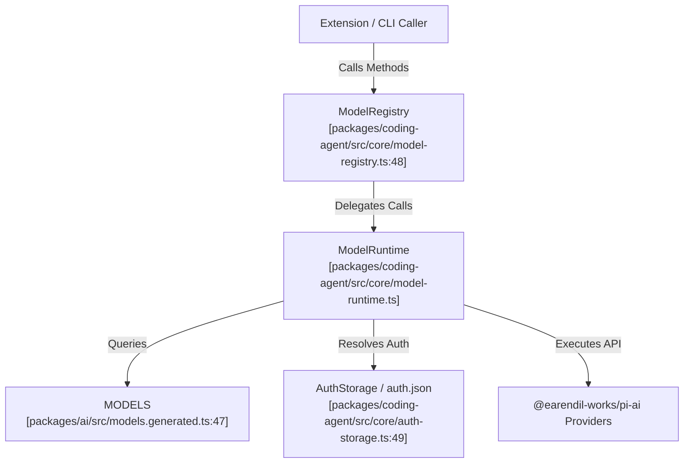
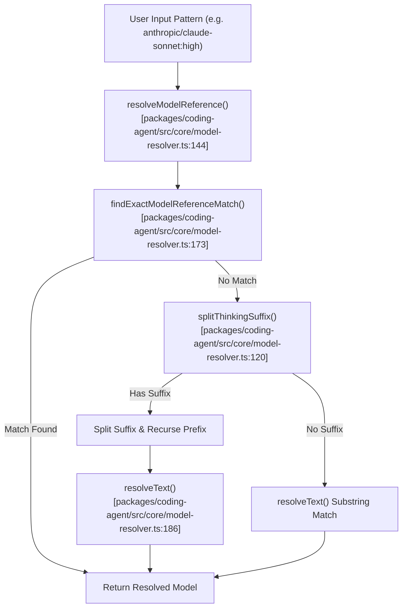
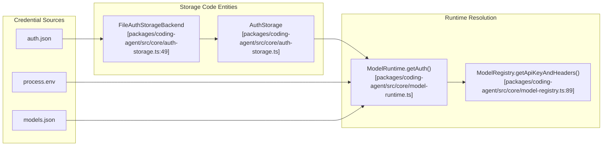

# Model Registry and Credential Resolution

<details>
<summary>Relevant source files</summary>

The following files were used as context for generating this wiki page:

- [packages/ai/src/api/openrouter-images.ts](packages/ai/src/api/openrouter-images.ts)
- [packages/ai/src/auth/oauth/anthropic.ts](packages/ai/src/auth/oauth/anthropic.ts)
- [packages/ai/src/auth/oauth/callback-server.ts](packages/ai/src/auth/oauth/callback-server.ts)
- [packages/ai/src/auth/oauth/device-code.ts](packages/ai/src/auth/oauth/device-code.ts)
- [packages/ai/src/auth/oauth/github-copilot.ts](packages/ai/src/auth/oauth/github-copilot.ts)
- [packages/ai/src/auth/oauth/kimi-coding.ts](packages/ai/src/auth/oauth/kimi-coding.ts)
- [packages/ai/src/auth/oauth/load.ts](packages/ai/src/auth/oauth/load.ts)
- [packages/ai/src/auth/oauth/openai-chatgpt.ts](packages/ai/src/auth/oauth/openai-chatgpt.ts)
- [packages/ai/src/auth/oauth/openai-codex.ts](packages/ai/src/auth/oauth/openai-codex.ts)
- [packages/ai/src/auth/oauth/openrouter.ts](packages/ai/src/auth/oauth/openrouter.ts)
- [packages/ai/src/auth/oauth/radius.ts](packages/ai/src/auth/oauth/radius.ts)
- [packages/ai/src/auth/resolve.ts](packages/ai/src/auth/resolve.ts)
- [packages/ai/src/bun-oauth.ts](packages/ai/src/bun-oauth.ts)
- [packages/ai/src/env-api-keys.ts](packages/ai/src/env-api-keys.ts)
- [packages/ai/src/models-store.ts](packages/ai/src/models-store.ts)
- [packages/ai/src/models.ts](packages/ai/src/models.ts)
- [packages/ai/src/providers/all.ts](packages/ai/src/providers/all.ts)
- [packages/ai/src/providers/cerebras.models.ts](packages/ai/src/providers/cerebras.models.ts)
- [packages/ai/src/providers/cloudflare-ai-gateway.models.ts](packages/ai/src/providers/cloudflare-ai-gateway.models.ts)
- [packages/ai/src/providers/github-copilot.models.ts](packages/ai/src/providers/github-copilot.models.ts)
- [packages/ai/src/providers/google.models.ts](packages/ai/src/providers/google.models.ts)
- [packages/ai/src/providers/nvidia.models.ts](packages/ai/src/providers/nvidia.models.ts)
- [packages/ai/src/providers/opencode-go.models.ts](packages/ai/src/providers/opencode-go.models.ts)
- [packages/ai/src/providers/opencode.models.ts](packages/ai/src/providers/opencode.models.ts)
- [packages/ai/src/providers/openrouter.models.ts](packages/ai/src/providers/openrouter.models.ts)
- [packages/ai/src/providers/radius.models.ts](packages/ai/src/providers/radius.models.ts)
- [packages/ai/src/providers/radius.ts](packages/ai/src/providers/radius.ts)
- [packages/ai/src/providers/together.models.ts](packages/ai/src/providers/together.models.ts)
- [packages/ai/src/providers/vercel-ai-gateway.models.ts](packages/ai/src/providers/vercel-ai-gateway.models.ts)
- [packages/ai/src/utils/oauth-page.ts](packages/ai/src/utils/oauth-page.ts)
- [packages/ai/src/utils/sleep.ts](packages/ai/src/utils/sleep.ts)
- [packages/ai/test/anthropic-oauth.test.ts](packages/ai/test/anthropic-oauth.test.ts)
- [packages/ai/test/github-copilot-oauth.test.ts](packages/ai/test/github-copilot-oauth.test.ts)
- [packages/ai/test/kimi-coding-oauth.test.ts](packages/ai/test/kimi-coding-oauth.test.ts)
- [packages/ai/test/models-runtime.test.ts](packages/ai/test/models-runtime.test.ts)
- [packages/ai/test/oauth-auth.test.ts](packages/ai/test/oauth-auth.test.ts)
- [packages/ai/test/oauth-callback-server.test.ts](packages/ai/test/oauth-callback-server.test.ts)
- [packages/ai/test/oauth-device-code.test.ts](packages/ai/test/oauth-device-code.test.ts)
- [packages/ai/test/openai-chatgpt-oauth.test.ts](packages/ai/test/openai-chatgpt-oauth.test.ts)
- [packages/ai/test/openai-codex-oauth.test.ts](packages/ai/test/openai-codex-oauth.test.ts)
- [packages/ai/test/openai-completions-thinking-as-text.test.ts](packages/ai/test/openai-completions-thinking-as-text.test.ts)
- [packages/ai/test/openai-completions-tool-result-images.test.ts](packages/ai/test/openai-completions-tool-result-images.test.ts)
- [packages/ai/test/openrouter-oauth.test.ts](packages/ai/test/openrouter-oauth.test.ts)
- [packages/ai/test/providers.test.ts](packages/ai/test/providers.test.ts)
- [packages/ai/test/radius-oauth.test.ts](packages/ai/test/radius-oauth.test.ts)
- [packages/ai/test/radius-provider.test.ts](packages/ai/test/radius-provider.test.ts)
- [packages/coding-agent/docs/custom-provider.md](packages/coding-agent/docs/custom-provider.md)
- [packages/coding-agent/docs/llama-cpp.md](packages/coding-agent/docs/llama-cpp.md)
- [packages/coding-agent/docs/models.md](packages/coding-agent/docs/models.md)
- [packages/coding-agent/docs/providers.md](packages/coding-agent/docs/providers.md)
- [packages/coding-agent/src/core/model-config.ts](packages/coding-agent/src/core/model-config.ts)
- [packages/coding-agent/src/core/model-registry.ts](packages/coding-agent/src/core/model-registry.ts)
- [packages/coding-agent/src/core/model-resolver.ts](packages/coding-agent/src/core/model-resolver.ts)
- [packages/coding-agent/src/core/model-runtime.ts](packages/coding-agent/src/core/model-runtime.ts)
- [packages/coding-agent/src/core/remote-catalog-provider.ts](packages/coding-agent/src/core/remote-catalog-provider.ts)
- [packages/coding-agent/src/core/usage-totals.ts](packages/coding-agent/src/core/usage-totals.ts)
- [packages/coding-agent/src/extensions/llama/client.ts](packages/coding-agent/src/extensions/llama/client.ts)
- [packages/coding-agent/src/extensions/llama/huggingface.ts](packages/coding-agent/src/extensions/llama/huggingface.ts)
- [packages/coding-agent/src/extensions/llama/index.ts](packages/coding-agent/src/extensions/llama/index.ts)
- [packages/coding-agent/src/extensions/llama/provider.ts](packages/coding-agent/src/extensions/llama/provider.ts)
- [packages/coding-agent/src/extensions/llama/ui.ts](packages/coding-agent/src/extensions/llama/ui.ts)
- [packages/coding-agent/test/llama-extension.test.ts](packages/coding-agent/test/llama-extension.test.ts)
- [packages/coding-agent/test/model-registry.test.ts](packages/coding-agent/test/model-registry.test.ts)
- [packages/coding-agent/test/model-resolver.test.ts](packages/coding-agent/test/model-resolver.test.ts)
- [packages/coding-agent/test/model-runtime-auth-options.test.ts](packages/coding-agent/test/model-runtime-auth-options.test.ts)
- [packages/coding-agent/test/model-runtime-modify-models-compat.test.ts](packages/coding-agent/test/model-runtime-modify-models-compat.test.ts)
- [packages/coding-agent/test/radius.test.ts](packages/coding-agent/test/radius.test.ts)
- [packages/coding-agent/test/remote-catalog-provider.test.ts](packages/coding-agent/test/remote-catalog-provider.test.ts)
- [packages/coding-agent/test/usage-totals.test.ts](packages/coding-agent/test/usage-totals.test.ts)

</details>


## Purpose and Scope

This page details the model registry architecture in `@earendil-works/pi-ai` and `@earendil-works/pi-coding-agent`. It covers static model metadata generation (`models.generated.ts` and `generate-models.ts`), the runtime registry abstraction (`ModelRegistry` and `ModelRuntime`), remote catalog synchronization, the model resolution and initial model selection algorithm (`model-resolver.ts`), credential discovery via `auth.json` (`auth-storage.ts`) and environment mappings (`env-api-keys.ts`), OAuth workflows, and integration with the local `llama.cpp` router.

Sources: `[packages/ai/src/models.generated.ts:1-83]`, `[packages/ai/scripts/generate-models.ts:1-100]`, `[packages/coding-agent/src/core/model-registry.ts:1-215]`, `[packages/coding-agent/src/core/model-resolver.ts:1-62]`

---

## Model Registry and Metadata Generation

The model registry manages the lifecycle of model metadata, bridging build-time schema compilation with runtime capability lookups, pricing tracking, and provider integrations.

### Build-time Generation (`generate-models.ts`)

Model metadata across all supported upstream providers is aggregated and compiled via the build script `[packages/ai/scripts/generate-models.ts:1-100]()`. This script queries or consolidates provider catalogs, normalizing:
- Canonical model identifiers (`id`) and display names (`name`).
- Capability flags such as tool calls, structured output, and reasoning.
- Context windows and output token limits.
- Token pricing tiers for input, output, and cache read/write operations.
- Input and output modalities.

The build process generates auto-compiled static registry structures, grouping exported model arrays by provider key (`MODELS`), such as individual provider modules (`[packages/ai/src/providers/openrouter.models.ts:1-14]()`).

```typescript
export const MODELS: {
	readonly "amazon-bedrock": typeof AMAZON_BEDROCK_MODELS;
	readonly "anthropic": typeof ANTHROPIC_MODELS;
	readonly "openai": typeof OPENAI_MODELS;
	// ...
}
```

Sources: `[packages/ai/scripts/generate-models.ts:1-100]`, `[packages/ai/src/models.generated.ts:1-83]`, `[packages/ai/src/providers/openrouter.models.ts:1-15]`

---

## Runtime Registry (`ModelRegistry` and `ModelRuntime`)

Runtime model management is divided into a low-level engine and a synchronous compatibility facade:

- **`ModelRuntime`**: The core execution engine responsible for model state management, provider registration, catalog refreshing, dynamic model merging, and fine-grained credential resolution.
- **`ModelRegistry`**: A synchronous facade exposed to extensions and SDK consumers that delegates execution calls directly to the underlying `ModelRuntime` instance `[packages/coding-agent/src/core/model-registry.ts:48-53]()`.

Key methods on `ModelRegistry` include:
- `getAll()`: Returns all active models across all loaded providers `[packages/coding-agent/src/core/model-registry.ts:64-66]()`.
- `find(provider, modelId)`: Resolves an exact model instance `[packages/coding-agent/src/core/model-registry.ts:72-74]()`.
- `getApiKeyAndHeaders(model)`: Resolves request-time authentication credentials and headers `[packages/coding-agent/src/core/model-registry.ts:89-118]()`.
- `stream()` / `complete()`: Executes streaming or complete AI completions `[packages/coding-agent/src/core/model-registry.ts:129-148]()`.

### Code Entity Space: Registry and Runtime Architecture

Title: "ModelRegistry to ModelRuntime Entity Relationship"



Sources: `[packages/coding-agent/src/core/model-registry.ts:1-215]`, `[packages/ai/src/models.generated.ts:47-83]`

---

## Remote Catalog Provider

The remote catalog subsystem fetches updated model metadata and pricing configurations from the central registry hosted at `pi.dev/models` `[packages/coding-agent/docs/models.md:15-16]()`. It caches payloads locally for offline fallback and overlays runtime updates onto the static builtin catalog at startup or when explicitly triggered via CLI updates (`pi update --models`) `[packages/coding-agent/docs/models.md:15-16]()`.

Sources: `[packages/coding-agent/docs/models.md:1-25]`, `[packages/coding-agent/src/core/remote-catalog-provider.ts:1-45]`

---

## Model Resolution Algorithm and `findInitialModel()`

Model resolution maps raw user strings (from CLI arguments, configuration settings, or slash commands) to concrete model objects and optional reasoning thinking levels `[packages/coding-agent/src/core/model-resolver.ts:64-130]()`.

### Resolution Algorithm

1. **Exact Reference Matching**: `findExactModelReferenceMatch()` evaluates whether the input matches a canonical `provider/modelId` or exact bare model ID `[packages/coding-agent/src/core/model-resolver.ts:173-184]()`.
2. **Thinking Level Suffix Parsing**: `splitThinkingSuffix()` strips trailing colons (e.g., `model:high`) to extract requested thinking levels (`off`, `minimal`, `low`, `medium`, `high`, `xhigh`, `max`) while recursively evaluating the model identifier prefix `[packages/coding-agent/src/core/model-resolver.ts:120-125]()`.
3. **Fuzzy Partial Matching**: If exact matching fails, case-insensitive substring matches are evaluated across IDs and names, prioritizing general aliases over dated snapshot variants `[packages/coding-agent/src/core/model-resolver.ts:136-165]()`.
4. **Default Provider Fallbacks**: `defaultModelPerProvider` supplies baseline models for providers when a naked provider or default scope is requested `[packages/coding-agent/src/core/model-resolver.ts:20-62]()`.

### Natural Language Space to Code Entity Space: Model Resolution Flow

Title: "Model Pattern Resolution Control Flow"



Sources: `[packages/coding-agent/src/core/model-resolver.ts:1-220]`, `[packages/coding-agent/src/core/model-resolver.ts:120-186]`

---

## Credential Discovery and Resolution

Pi resolves credentials across several priority tiers, merging environment variables, configuration files, and credential stores.

### Credential Resolution Priority

1. **Runtime Overrides**: Programmatic options or request-time API key parameters `[packages/coding-agent/docs/models.md:23]()`.
2. **Persistent Credentials (`auth.json`)**: Managed via `AuthStorage` and backed by `FileAuthStorageBackend` with file locking and secure permissions `[packages/coding-agent/src/core/auth-storage.ts:25-114]()`.
3. **`models.json` Overrides**: Explicit API keys, headers, or request-time shell commands (`!command`) defined in user or project configuration `[packages/coding-agent/docs/models.md:23-65]()`.
4. **Environment Variables**: Mapped provider environment variables (e.g., `OPENAI_API_KEY`, `ANTHROPIC_API_KEY`) resolved via `findEnvKeys()` and `getEnvApiKey()` `[packages/ai/src/env-api-keys.ts:84-158]`.
5. **Ambient Cloud Credentials**: Provider-native fallback credentials (e.g., AWS IAM instance profiles / SigV4, Google ADC via `hasVertexAdcCredentials()`) `[packages/coding-agent/docs/models.md:23]`, `[packages/ai/src/env-api-keys.ts:40-71]`.

### Natural Language Space to Code Entity Space: Credential Resolution Pipeline

Title: "Credential Discovery and Storage Architecture"



Sources: `[packages/coding-agent/src/core/auth-storage.ts:49-201]`, `[packages/coding-agent/src/core/model-registry.ts:89-118]`, `[packages/ai/src/env-api-keys.ts:40-158]`, `[packages/coding-agent/docs/models.md:20-25]`

---

## OAuth Flows

Providers requiring subscription-based or interactive authentication (such as GitHub Copilot, Anthropic, OpenAI Codex, and Radius) implement automated OAuth authentication flows. These flows handle secure token generation, local callback listeners, token refreshing, and persistence inside the secure `auth.json` credential store.

Sources: `[packages/ai/src/auth/resolve.ts:1-30]`, `[packages/ai/src/auth/oauth/github-copilot.ts:1-40]`

---

## llama.cpp Router Extension

Pi features first-class integration with the `llama.cpp` router via the coding agent extension mechanism `[packages/coding-agent/src/extensions/llama/index.ts:1-30]()`. 

- **Local Server Management**: The `/llama` command manages the local router lifecycle, model scanning, and GGUF binary execution `[packages/coding-agent/docs/models.md:37-41]()`.
- **Dynamic Proxying**: Requests targeting local GGUF models are dispatched seamlessly through the router endpoint without requiring external API keys `[packages/coding-agent/docs/llama-cpp.md:1-20]()`.

Sources: `[packages/coding-agent/docs/models.md:37-41]`, `[packages/coding-agent/src/extensions/llama/index.ts:1-30]`, `[packages/coding-agent/docs/llama-cpp.md:1-20]`