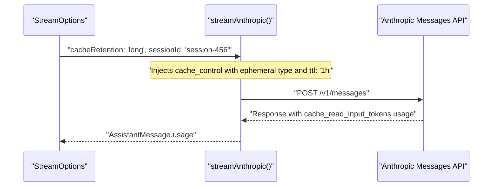
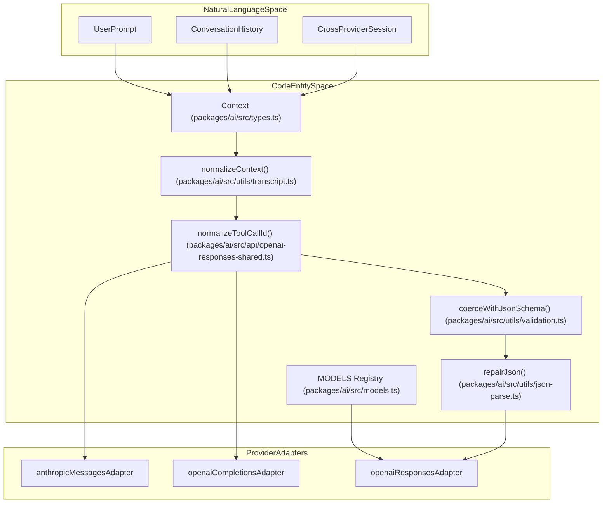

# Prompt Caching, Thinking, and Cross-Provider Handoff

Relevant source files

The following files were used as context for generating this wiki page:

- [packages/ai/scripts/openrouter-catalog.ts](packages/ai/scripts/openrouter-catalog.ts)
- [packages/ai/src/api/cloudflare-workers-ai-system-one.ts](packages/ai/src/api/cloudflare-workers-ai-system-one.ts)
- [packages/ai/src/api/pi-messages.ts](packages/ai/src/api/pi-messages.ts)
- [packages/ai/src/api/system-one-shared.ts](packages/ai/src/api/system-one-shared.ts)
- [packages/ai/src/api/transform-messages.ts](packages/ai/src/api/transform-messages.ts)
- [packages/ai/src/api/typesafe-system-one.ts](packages/ai/src/api/typesafe-system-one.ts)
- [packages/ai/src/providers/kimi-coding.models.ts](packages/ai/src/providers/kimi-coding.models.ts)
- [packages/ai/src/providers/kimi-coding.ts](packages/ai/src/providers/kimi-coding.ts)
- [packages/ai/src/utils/json-parse.ts](packages/ai/src/utils/json-parse.ts)
- [packages/ai/src/utils/transcript.ts](packages/ai/src/utils/transcript.ts)
- [packages/ai/src/utils/validation.ts](packages/ai/src/utils/validation.ts)
- [packages/ai/test/anthropic-adaptive-thinking-models.test.ts](packages/ai/test/anthropic-adaptive-thinking-models.test.ts)
- [packages/ai/test/anthropic-empty-thinking-signature-compat.test.ts](packages/ai/test/anthropic-empty-thinking-signature-compat.test.ts)
- [packages/ai/test/anthropic-error-tool-result-images.test.ts](packages/ai/test/anthropic-error-tool-result-images.test.ts)
- [packages/ai/test/anthropic-force-adaptive-thinking.test.ts](packages/ai/test/anthropic-force-adaptive-thinking.test.ts)
- [packages/ai/test/baseten-models.test.ts](packages/ai/test/baseten-models.test.ts)
- [packages/ai/test/bedrock-convert-messages.test.ts](packages/ai/test/bedrock-convert-messages.test.ts)
- [packages/ai/test/cache-retention.test.ts](packages/ai/test/cache-retention.test.ts)
- [packages/ai/test/classifier-models.test.ts](packages/ai/test/classifier-models.test.ts)
- [packages/ai/test/cloudflare-workers-ai-system-one.test.ts](packages/ai/test/cloudflare-workers-ai-system-one.test.ts)
- [packages/ai/test/fireworks-models.test.ts](packages/ai/test/fireworks-models.test.ts)
- [packages/ai/test/json-parse.test.ts](packages/ai/test/json-parse.test.ts)
- [packages/ai/test/openai-completions-prompt-cache.test.ts](packages/ai/test/openai-completions-prompt-cache.test.ts)
- [packages/ai/test/openai-responses-compat.test.ts](packages/ai/test/openai-responses-compat.test.ts)
- [packages/ai/test/openai-responses-message-id.test.ts](packages/ai/test/openai-responses-message-id.test.ts)
- [packages/ai/test/openai-responses-partial-json-cleanup.test.ts](packages/ai/test/openai-responses-partial-json-cleanup.test.ts)
- [packages/ai/test/openai-responses-reasoning-replay-e2e.test.ts](packages/ai/test/openai-responses-reasoning-replay-e2e.test.ts)
- [packages/ai/test/openai-responses-tool-result-images.test.ts](packages/ai/test/openai-responses-tool-result-images.test.ts)
- [packages/ai/test/pi-messages.test.ts](packages/ai/test/pi-messages.test.ts)
- [packages/ai/test/supports-xhigh.test.ts](packages/ai/test/supports-xhigh.test.ts)
- [packages/ai/test/together-models.test.ts](packages/ai/test/together-models.test.ts)
- [packages/ai/test/tool-call-id-normalization.test.ts](packages/ai/test/tool-call-id-normalization.test.ts)
- [packages/ai/test/transcript-tool-changes.test.ts](packages/ai/test/transcript-tool-changes.test.ts)
- [packages/ai/test/transform-messages-copilot-openai-to-anthropic.test.ts](packages/ai/test/transform-messages-copilot-openai-to-anthropic.test.ts)
- [packages/ai/test/transform-messages-cross-model-thinking.test.ts](packages/ai/test/transform-messages-cross-model-thinking.test.ts)
- [packages/ai/test/typesafe-system-one.test.ts](packages/ai/test/typesafe-system-one.test.ts)
- [packages/ai/test/validation.test.ts](packages/ai/test/validation.test.ts)
- [packages/ai/test/xhigh.test.ts](packages/ai/test/xhigh.test.ts)
- [packages/coding-agent/docs/message-types.md](packages/coding-agent/docs/message-types.md)

This page details the advanced capabilities of the `@earendil-works/pi-ai` package, focusing on stateful LLM features like prompt caching and internal reasoning (`thinking`), model categories (classifier, image, constrained sampling), validation and JSON repair utilities, and how the runtime facilitates context migration, ID normalization, overflow handling, and payload validation across different model providers mid-session.

Sources: [packages/ai/README.md:1-57](), [packages/ai/src/index.ts:1-47]()

---

## Prompt Caching

Prompt caching reduces latency and token cost by reusing prefix computations for long contexts. The system implements a unified interface for caching across provider adapters.

### Cache Retention and Control

The `CacheRetention` type defines the preferred persistence level for a cached prompt (`none`, `short`, or `long`). This behavior is configured via stream options or globally using the `PI_CACHE_RETENTION` environment variable and influences how the prompt cache key and retention settings are injected into API payloads [packages/ai/test/cache-retention.test.ts:32-46]().

- **Anthropic:** Injects `cache_control` ephemeral markers into system prompts and specific message blocks to control prompt cache lifetime. When `PI_CACHE_RETENTION="long"` is specified or a custom proxy is used, a `ttl: "1h"` parameter is added where supported, enabling longer-lived caching [packages/ai/test/cache-retention.test.ts:77-136]().
- **OpenAI (Completions/Responses):** Supports prompt caching using special fields like `prompt_cache_key` and `prompt_cache_retention` set in the request payload [packages/ai/test/openai-completions-prompt-cache.test.ts:115-141]().
- **Session Affinity:** Providers with session-based routing accept session identifiers through `StreamOptions` (`sessionId`) to maintain affinity for better caching and routing decisions [packages/ai/test/openai-responses-compat.test.ts:31-68]().

#### Key code elements:
- `CacheRetention` type controls caching mode in streaming options [packages/ai/src/types.ts:108-116]().
- Cache control injection occurs in provider API adapters during payload construction [packages/ai/test/cache-retention.test.ts:52-136]().

Sources: [packages/ai/test/cache-retention.test.ts:32-136](), [packages/ai/test/openai-completions-prompt-cache.test.ts:115-141]()

---

### Data Flow: Caching Request

The following sequence diagram outlines how a cache retention preference requested by the user is resolved and embedded into the provider payload:

Sources: [packages/ai/test/cache-retention.test.ts:77-136]()

---

## Thinking and Reasoning

"Thinking" captures the internal chain-of-thought or reasoning that models perform, represented as intermediate content blocks during generation before producing the final textual output. `@earendil-works/pi-ai` consolidates this functionality into standardized model metadata, option flags, and streaming event types.

### Thinking Levels, Budgets, and Signatures

- `ThinkingLevel` enumerates reasoning intensity tiers: `off`, `minimal`, `low`, `medium`, `high`, `xhigh`, and `max`.
- Models include `ModelThinkingLevel` mappings translating provider-specific flags to these tiers [packages/ai/src/types.ts:83-106](). Extended support includes `xhigh` across advanced Anthropic Opus/Sonnet releases and OpenAI Codex models [packages/ai/test/supports-xhigh.test.ts:5-125]().

Notable behaviors:
- **Adaptive Thinking:** Models like Claude 3.7+ and specific vendor integrations dynamically select reasoning depth via `compat.forceAdaptiveThinking`, issuing adaptive thinking structures with native effort configurations [packages/ai/test/anthropic-force-adaptive-thinking.test.ts:70-109]().
- **Empty Signature Compatibility:** Some providers (such as Vercel AI Gateway and certain Fireworks endpoints) emit unsigned thinking blocks during conversation replay. The `compat.allowEmptySignature` configuration prevents these blocks from being converted into plain text prematurely [packages/ai/test/anthropic-empty-thinking-signature-compat.test.ts:81-125]().

Sources: [packages/ai/test/supports-xhigh.test.ts:1-174](), [packages/ai/test/anthropic-adaptive-thinking-models.test.ts:1-45](), [packages/ai/test/anthropic-empty-thinking-signature-compat.test.ts:1-125](), [packages/ai/test/anthropic-force-adaptive-thinking.test.ts:1-109]()

---

## Constrained Sampling, Classifier, and Image Models

In addition to standard chat models, `@earendil-works/pi-ai` supports auxiliary model categories and constrained generation parameters:

- **Image Models (`ImageModel`):** Handled via specialized image generation APIs (`generateImages()`), routing requests to underlying providers which return multimodal assistant outputs containing image base64 blocks or URLs [packages/ai/src/images.ts:19-26]().
- **Classifier Models (`ClassifierModel`):** Lightweight metadata structures defined in model catalogs dedicated to fast routing, classification, or embedding tasks via REST endpoints.
- **Constrained Sampling:** Tool declarations include optional parameters that dictate syntax, grammar, or strict mode restrictions (e.g., JSON schema strict validation) enforced during token generation [packages/ai/test/bedrock-convert-messages.test.ts:100-126](), [packages/ai/test/openai-responses-compat.test.ts:159-208]().

Sources: [packages/ai/src/images.ts:1-26](), [packages/ai/test/bedrock-convert-messages.test.ts:100-126](), [packages/ai/test/openai-responses-compat.test.ts:159-208]()

---

## Cross-Provider Context Migration, ID Normalization, and Validation Utilities

The runtime implements rigorous transformations to migrate chat contexts across different LLM providers while ensuring upstream API compliance.

### Message Transformation, ID Normalization, and Parsing Repair

- **Tool Call ID Normalization:** Tool identifiers and foreign Responses item IDs are normalized via `normalizeToolCallId()` to adhere to strict regex requirements [packages/ai/test/tool-call-id-normalization.test.ts:1-40]().
- **JSON Parsing & Repair:** The `repairJson()` utility fixes malformed JSON string literals by escaping raw control characters inside strings and doubling backslashes before invalid escape characters, supporting robust tool argument extraction via `parseJsonWithRepair()` and `parseStreamingJson()` [packages/ai/src/utils/json-parse.ts:33-149]().
- **Validation & Coercion:** TypeBox-based schema validation and coercion utilities (`packages/ai/src/utils/validation.ts`) normalize primitives, objects, and arrays when model-generated tool inputs deviate slightly from declared schemas [packages/ai/src/utils/validation.ts:1-238]().

Sources: [packages/ai/src/utils/json-parse.ts:33-149](), [packages/ai/src/utils/validation.ts:1-238](), [packages/ai/test/transform-messages-copilot-openai-to-anthropic.test.ts:49-151]()

---

### Context Handoff Architecture (Natural Language to Code Entity Space)

The following diagram bridges natural language concepts (user prompts, session handoffs) to the precise code entities responsible for executing them across provider adapters.

Sources: [packages/ai/src/types.ts:1-200](), [packages/ai/src/utils/validation.ts:1-238](), [packages/ai/src/utils/json-parse.ts:33-149]()

---

## Appendix: Key Classes and Functions

| Name | Description | File & Lines |
|------|-------------|--------------|
| `CacheRetention` | Type for prompt cache retention policy (`none`, `short`, `long`) | [packages/ai/src/types.ts:108-116]() |
| `generateImages()` | Global image generation dispatcher via model registry | [packages/ai/src/images.ts:19-26]() |
| `repairJson()` | Repairs malformed JSON string literals and control characters | [packages/ai/src/utils/json-parse.ts:33-84]() |
| `parseJsonWithRepair()` | Parses JSON with automatic repair fallback | [packages/ai/src/utils/json-parse.ts:86-96]() |
| `coerceWithJsonSchema()` | Coerces and validates input values against JSON schema definitions | [packages/ai/src/utils/validation.ts:194-238]() |

Sources: Aggregated from referenced source files.