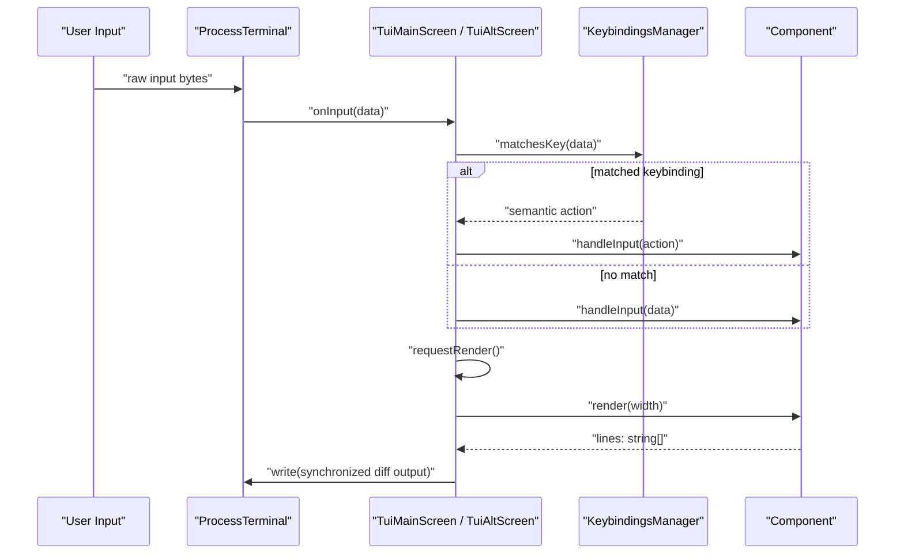

# Terminal UI (pi-tui)

<details>
<summary>Relevant source files</summary>

The following files were used as context for generating this wiki page:

- [packages/coding-agent/docs/tui.md](packages/coding-agent/docs/tui.md)
- [packages/coding-agent/test/interactive-tui.test.ts](packages/coding-agent/test/interactive-tui.test.ts)
- [packages/tui/README.md](packages/tui/README.md)
- [packages/tui/src/index.ts](packages/tui/src/index.ts)
- [packages/tui/src/tui-alt-screen.ts](packages/tui/src/tui-alt-screen.ts)
- [packages/tui/src/tui-main-screen.ts](packages/tui/src/tui-main-screen.ts)
- [packages/tui/src/tui.ts](packages/tui/src/tui.ts)
- [packages/tui/test/tui-alt-screen.test.ts](packages/tui/test/tui-alt-screen.test.ts)
- [packages/tui/test/tui-render.test.ts](packages/tui/test/tui-render.test.ts)

</details>


The `@earendil-works/pi-tui` package provides a minimal terminal user interface framework designed for flicker-free, interactive CLI applications through differential rendering, synchronized output via CSI 2026, and an explicit component model [packages/tui/src/tui.ts:2-3](), [packages/tui/README.md:1-15]().

This page serves as a high-level parent overview of the `pi-tui` package. For detailed technical specifications, refer to the child pages:
- [TUI Core: Rendering and Terminal Abstraction](#4.1)
- [Editor, Input, and Keybindings](#4.2)
- [TUI Components Library](#4.3)

---

## Overview and Architecture

The TUI architecture decouples physical terminal input and output from the rendering engine and component hierarchy. The core abstractions include the shared `TUI` interface [packages/tui/src/tui.ts:173](), concrete renderer implementations (`TuiMainScreen` and `TuiAltScreen`) [packages/tui/src/tui-main-screen.ts:124](), [packages/tui/src/tui-alt-screen.ts:202](), the `Component` interface [packages/tui/src/tui.ts:117](), and the `Terminal` abstraction (`ProcessTerminal`) [packages/tui/src/index.ts:119]().

```mermaid
graph TD
  ProcessTerminal["ProcessTerminal"] -->|"drives"| TuiMainScreen["TuiMainScreen"]
  ProcessTerminal -->|"drives"| TuiAltScreen["TuiAltScreen"]
  TuiMainScreen -->|"manages lifecycle"| Component["Component"]
  TuiAltScreen -->|"manages lifecycle"| Component
  Component <|-- Container["Container"]
  Component <|-- Editor["Editor"]
  TuiMainScreen -->|"routes input via"| KeybindingsManager["KeybindingsManager"]
  ProcessTerminal -->|"manages capabilities"| TerminalImage["terminal-image.ts"]
  KeybindingsManager -->|"parses keys via"| KeysModule["keys.ts"]
```
Sources: [packages/tui/src/tui.ts:117-142](), [packages/tui/src/index.ts:110-156](), [packages/tui/src/keybindings.ts:4-92]()

---

## Sub-Topics and Child Pages

### 4.1 TUI Core: Rendering and Terminal Abstraction
The rendering subsystem manages differential line updates, bounded buffer writes via `BoundedTerminalWriter` [packages/tui/src/tui-main-screen.ts:18-74](), and synchronized screen transactions [packages/tui/README.md:10](). The `Terminal` abstraction (`ProcessTerminal`) handles raw input streams, bracketed paste mode, capability detection, and inline image protocols (Kitty and iTerm2) [packages/tui/src/index.ts:119](), [packages/tui/README.md:15]().
*For details, see [TUI Core: Rendering and Terminal Abstraction](#4.1).*

Sources: [packages/tui/src/tui-main-screen.ts:18-74](), [packages/tui/src/index.ts:119](), [packages/tui/README.md:10-15]()

### 4.2 Editor, Input, and Keybindings
Text entry and editing are handled by the multi-line `Editor` and single-line `Input` components, supporting grapheme-aware cursor movement, an undo stack, kill ring operations, and autocomplete integration [packages/tui/src/index.ts:40-51](). Key events are parsed from raw terminal input bytes and mapped to semantic actions through `KeybindingsManager` [packages/tui/src/keybindings.ts:61-92]().
*For details, see [Editor, Input, and Keybindings](#4.2).*

Sources: [packages/tui/src/index.ts:40-51](), [packages/tui/src/keybindings.ts:61-92]()

### 4.3 TUI Components Library
A rich set of built-in components—including `Markdown`, `SelectList`, `SettingsList`, `ScrollView`, `Box`, `VStack`, `HStack`, and `Loader`—allows developers to construct complex, theme-aware terminal interfaces [packages/tui/src/index.ts:39-78](). Components implement the `Component` interface and optionally adhere to `Focusable` for hardware cursor placement [packages/tui/src/tui.ts:117-188]().
*For details, see [TUI Components Library](#4.3).*

Sources: [packages/tui/src/index.ts:39-78](), [packages/tui/src/tui.ts:117-188]()

---

## Rendering Flow and Input Handling Sequence

The following sequence illustrates how raw terminal input bytes are translated into key events, routed through `KeybindingsManager` or focused components, and rendered back to the terminal:


Sources: [packages/tui/src/tui.ts:117-136](), [packages/tui/src/tui-main-screen.ts:124-165](), [packages/tui/src/keybindings.ts:61-92]()

---
Sources:
- [packages/tui/src/tui.ts:1-188]()
- [packages/tui/src/index.ts:1-176]()
- [packages/tui/README.md:1-160]()
- [packages/tui/src/tui-main-screen.ts:18-184]()
- [packages/tui/src/keybindings.ts:61-92]()
- [packages/tui/src/keys.ts:91-102]()