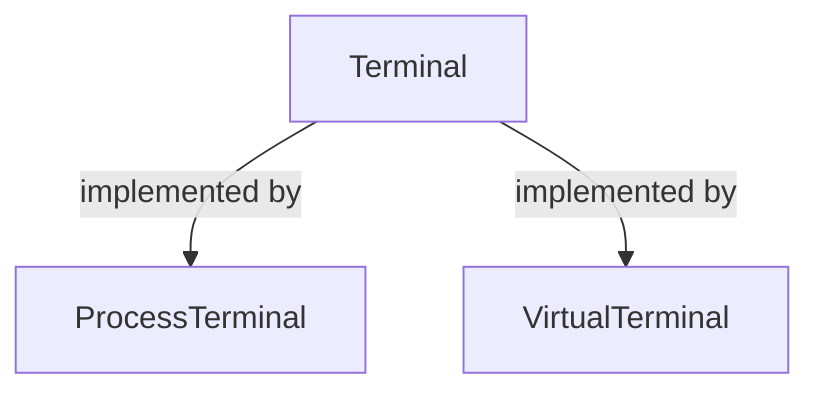
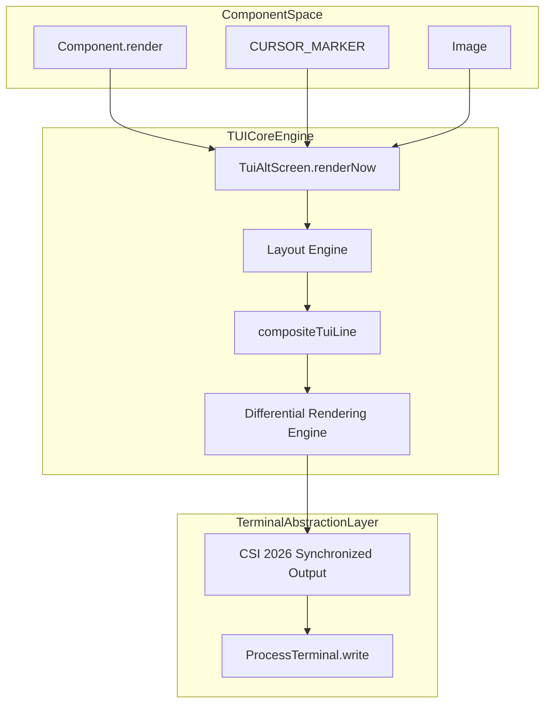
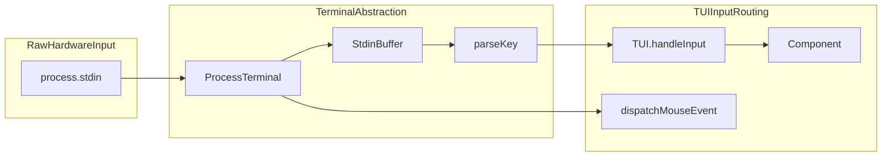

# TUI Core: Rendering and Terminal Abstraction

Relevant source files

The following files were used as context for generating this wiki page:

- [packages/coding-agent/docs/terminal-setup.md](packages/coding-agent/docs/terminal-setup.md)
- [packages/coding-agent/docs/tui.md](packages/coding-agent/docs/tui.md)
- [packages/coding-agent/test/edit-tool-no-full-redraw.test.ts](packages/coding-agent/test/edit-tool-no-full-redraw.test.ts)
- [packages/coding-agent/test/interactive-tui.test.ts](packages/coding-agent/test/interactive-tui.test.ts)
- [packages/coding-agent/test/theme-detection.test.ts](packages/coding-agent/test/theme-detection.test.ts)
- [packages/tui/README.md](packages/tui/README.md)
- [packages/tui/native/win32/README.md](packages/tui/native/win32/README.md)
- [packages/tui/native/win32/build.mjs](packages/tui/native/win32/build.mjs)
- [packages/tui/src/components/image.ts](packages/tui/src/components/image.ts)
- [packages/tui/src/components/scroll-view.ts](packages/tui/src/components/scroll-view.ts)
- [packages/tui/src/components/v-stack.ts](packages/tui/src/components/v-stack.ts)
- [packages/tui/src/index.ts](packages/tui/src/index.ts)
- [packages/tui/src/layout-node.ts](packages/tui/src/layout-node.ts)
- [packages/tui/src/layout.ts](packages/tui/src/layout.ts)
- [packages/tui/src/native-modifiers.ts](packages/tui/src/native-modifiers.ts)
- [packages/tui/src/stdin-buffer.ts](packages/tui/src/stdin-buffer.ts)
- [packages/tui/src/terminal-colors.ts](packages/tui/src/terminal-colors.ts)
- [packages/tui/src/terminal-image.ts](packages/tui/src/terminal-image.ts)
- [packages/tui/src/terminal.ts](packages/tui/src/terminal.ts)
- [packages/tui/src/tui-alt-screen.ts](packages/tui/src/tui-alt-screen.ts)
- [packages/tui/src/tui-main-screen.ts](packages/tui/src/tui-main-screen.ts)
- [packages/tui/src/tui.ts](packages/tui/src/tui.ts)
- [packages/tui/test/chat-simple.ts](packages/tui/test/chat-simple.ts)
- [packages/tui/test/layout.test.ts](packages/tui/test/layout.test.ts)
- [packages/tui/test/native-module-path.test.ts](packages/tui/test/native-module-path.test.ts)
- [packages/tui/test/render-churn-bench.ts](packages/tui/test/render-churn-bench.ts)
- [packages/tui/test/stdin-buffer.test.ts](packages/tui/test/stdin-buffer.test.ts)
- [packages/tui/test/terminal-colors.test.ts](packages/tui/test/terminal-colors.test.ts)
- [packages/tui/test/terminal-image.test.ts](packages/tui/test/terminal-image.test.ts)
- [packages/tui/test/terminal.test.ts](packages/tui/test/terminal.test.ts)
- [packages/tui/test/tui-alt-screen.test.ts](packages/tui/test/tui-alt-screen.test.ts)
- [packages/tui/test/tui-render.test.ts](packages/tui/test/tui-render.test.ts)
- [packages/tui/test/virtual-terminal.ts](packages/tui/test/virtual-terminal.ts)

## Purpose and Scope

This page documents the core architecture of the terminal user interface (TUI) in the `@earendil-works/pi-tui` package. It covers the core rendering abstractions including the `TUI` interface, `TuiMainScreen`, and `TuiAltScreen`; the differential rendering engine with flicker-free synchronized output; the layout engine (`VStack`, `HStack`) and scroll views; the `Terminal` abstraction with its primary implementation `ProcessTerminal`; input buffering with `StdinBuffer`; native modifier detection; the overlay compositing system; and inline image protocols supporting Kitty and iTerm2 graphics [packages/tui/README.md:1-16](), [packages/tui/src/index.ts:111-184](), [packages/tui/src/tui.ts:1-188]().

---

## Core UI Classes: `TUI`, `TuiMainScreen`, and `TuiAltScreen`

### Overview of Rendering Targets

The `TUI` interface acts as the central orchestrator for component management, keyboard/mouse input dispatch, focus tracking, overlays, and the rendering lifecycle [packages/tui/src/index.ts:164](). Concrete implementations provide two distinct terminal buffer strategies:

- **`TuiMainScreen`**: Renders inline directly into the main terminal buffer, preserving terminal scrollback history. It is suitable for lightweight inline CLI interactions and scripts where preserving output history is necessary.
- **`TuiAltScreen`**: Switches to the alternate screen buffer via the ANSI sequence `\x1b[?1049h`, creating a fixed-height fullscreen viewport with application-controlled scrolling, robust mouse tracking, and integrated prompt search [packages/tui/src/tui-alt-screen.ts:63-214](). When stopped, it restores the main screen buffer and prints the complete final document to the scrollback.

### Component Model and Focus Management

All UI elements implement the `Component` interface, defining contract methods for rendering and input handling [packages/tui/src/tui.ts:117-142]():

- `render(width: number): string[]`: Returns an array of terminal lines for the given viewport width. Each string must fit the requested width, taking into account ANSI escape sequences and character display widths [packages/coding-agent/docs/tui.md:20-26]().
- `handleInput?(data: string): void`: Optional handler for keyboard input targeted to the focused component.
- `handleMouse?(event: TuiMouseEvent): TuiMouseEventResult | undefined`: Optional normalized mouse event handler [packages/tui/src/tui.ts:25-58]().
- `invalidate(): void`: Invalidates any cached rendering state. Called when themes or internal properties change [packages/tui/src/tui.ts:137-141]().

Components that display a text input cursor implement the `Focusable` interface (`focused: boolean`) [packages/tui/src/tui.ts:180-188]() and emit the special zero-width application program command marker `CURSOR_MARKER` (`\x1b_pi:c\x07`) immediately preceding their logical cursor position in their rendered lines [packages/coding-agent/docs/tui.md:47-49](). The TUI engine scans rendered output for `CURSOR_MARKER`, strips it from the final text sent to the screen, and positions the terminal hardware cursor precisely at that cell coordinate. This ensures proper positioning for Input Method Editor (IME) candidate windows during East Asian text entry.

Sources:
- [packages/tui/README.md:1-16]()
- [packages/tui/src/index.ts:111-184]()
- [packages/tui/src/tui.ts:117-188]()
- [packages/tui/src/tui-alt-screen.ts:61-214]()
- [packages/coding-agent/docs/tui.md:20-49]()

---

## Differential Rendering and Synchronized Output

The TUI rendering engine minimizes terminal bandwidth and eliminates visual artifacts by employing a two-tier optimization strategy:

- **Virtual Framebuffer Differential Updates**: The engine maintains an in-memory representation of the previous frame. It compares new lines against the previous frame and issues cursor movement and line rewrite escape sequences only for lines that have actually changed.
- **CSI 2026 Synchronized Output**: When performing multi-line updates, the renderer wraps the output stream in **synchronized output escape sequences** (`\x1b[?2026h` to start synchronization and `\x1b[?2026l` to end) [packages/tui/src/tui-alt-screen.ts:72-73](). Terminal emulators supporting this protocol hold off rasterization until the end sequence arrives, guaranteeing atomic screen updates and completely eliminating tearing and flicker [packages/tui/README.md:8-10]().

Sources:
- [packages/tui/README.md:1-16]()
- [packages/tui/src/tui-alt-screen.ts:70-75]()
- [packages/tui/test/tui-render.test.ts:167-210]()

---

## Layout Engine and Scroll Views

`TuiAltScreen` supports explicit terminal-height layout trees using flexbox-style geometry containers and scrollable viewports [packages/tui/README.md:121-160]():

- **Flex Layout Containers (`VStack` and `HStack`)**: Allocate vertical and horizontal space among child components based on sizing constraints: `basis`, `grow`, `shrink`, `minSize`, `maxSize`, and responsive `visible` callbacks [packages/tui/README.md:141-158]().
- **`ScrollView`**: Manages a bounded scrollable viewport over arbitrarily tall content. It provides features such as auto-following output at the end (`follow: "end"`), dynamic scrollbar rendering, wheel event scroll chaining (`overscroll: "chain"`), and OSC 133 semantic prompt navigation shortcuts [packages/tui/README.md:143-160]().
- **Transcript Search Integration**: `TuiAltScreen` embeds a bordered search overlay triggered via shortcuts (e.g., `Ctrl+Shift+F`) that highlights search matches across the transcript and allows cycling through occurrences using match navigation actions [packages/tui/README.md:152-160]().

Sources:
- [packages/tui/README.md:121-160]()
- [packages/tui/src/index.ts:56-60]()
- [packages/tui/src/tui-alt-screen.ts:147-160]()

---

## Terminal Abstraction: `Terminal` and `ProcessTerminal`

### The `Terminal` Interface

The `Terminal` interface abstracts underlying terminal I/O streams, enabling headless testing via virtual terminal implementations alongside live rendering [packages/tui/src/terminal.ts:78-126]():

Sources:
- [packages/tui/src/terminal.ts:78-126]()
- [packages/tui/test/virtual-terminal.ts:1-27]()

### `ProcessTerminal` and Input Buffering

`ProcessTerminal` is the concrete implementation of `Terminal` using `process.stdin` and `process.stdout` [packages/tui/src/terminal.ts:150-180]():

- Puts `stdin` into raw mode and enables UTF-8 stream decoding.
- Enables **bracketed paste mode** (`\x1b[?2004h`) to safely capture multi-line clipboard pastes without misinterpreting carriage returns as command submissions.
- Manages an internal `StdinBuffer` instance to accumulate raw input chunks, handle escape sequence boundaries, and apply timeouts for packetized streams over high-latency SSH connections [packages/tui/src/terminal.ts:128-161](), [packages/tui/src/stdin-buffer.ts:1-135]().
- Negotiates the **Kitty keyboard protocol** to receive precise modifier states and key release events [packages/tui/src/terminal.ts:18-20]().

Sources:
- [packages/tui/src/terminal.ts:1-180]()
- [packages/tui/src/stdin-buffer.ts:1-135]()

---

## Native Modifiers and Overlay Compositing

### Native Modifier Detection

`ProcessTerminal` and key parsing utilities coordinate with native platform helpers to detect modifier keys (`Shift`, `Alt`, `Ctrl`, `Super`) reliably across different terminal environments, accounting for legacy escape prefix delays via `resolveEscapeTimeoutMs()` [packages/tui/src/terminal.ts:136-145](), [packages/tui/src/native-modifiers.ts:1-13]().

### Overlay Compositing System

The overlay system enables floating interface elements (such as dialogs, dropdowns, and model pickers) to render on top of the base component tree without modifying underlying layout dimensions [packages/coding-agent/docs/tui.md:13-15](). During final frame composition, `compositeTuiLine()` merges overlay lines onto base transcript lines while maintaining ANSI escape sequence boundaries and wide character cell alignments [packages/tui/src/index.ts:157-170]().

Sources:
- [packages/tui/src/terminal.ts:136-145]()
- [packages/tui/src/native-modifiers.ts:1-13]()
- [packages/tui/src/index.ts:157-170]()
- [packages/coding-agent/docs/tui.md:13-15]()

---

## Inline Image Rendering Protocols

### Capability Detection

`detectCapabilities()` inspects environment variables (`TERM_PROGRAM`, `KITTY_WINDOW_ID`, `ITERM_SESSION_ID`, `TMUX`, etc.) to determine whether the terminal emulator supports advanced graphics protocols or hyperlinks [packages/tui/src/terminal-image.ts:70-158]():

- **Kitty Graphics Protocol** (`\x1b_G` raster image transfer)
- **iTerm2 Inline Images** (`\x1b]1337;File=...` OSC sequences)
- **OSC 8 Hyperlinks**

Explicit overrides are supported via environment variables such as `PI_IMAGE_PROTOCOL`, `PI_HYPERLINKS`, and `PI_TRUE_COLOR` [packages/tui/src/terminal-image.ts:146-164]().

### Image Scaling and Rendering Workflow

The `Image` component renders inline graphics by querying cell pixel dimensions via `getCellDimensions()` and `setCellDimensions()`, allocating unique identifiers using `allocateImageId()`, encoding binary streams into protocol-specific base64 chunks, and falling back to a text placeholder on unsupported terminals [packages/tui/src/terminal-image.ts:38-47](), [packages/tui/src/components/image.ts:25-127]().

Sources:
- [packages/tui/src/terminal-image.ts:38-164]()
- [packages/tui/src/components/image.ts:25-127]()

---

## Data Flow Diagrams

### Rendering Pipeline Architecture

Sources:
- [packages/tui/src/tui.ts:117-168]()
- [packages/tui/src/tui-alt-screen.ts:70-75]()
- [packages/tui/src/index.ts:123-170]()
- [packages/tui/src/terminal.ts:137-190]()

---

### Input Routing and Event Pipeline

Sources:
- [packages/tui/src/terminal.ts:137-177]()
- [packages/tui/src/stdin-buffer.ts:1-135]()
- [packages/tui/src/tui.ts:81-152]()
- [packages/tui/src/keys.ts:106]()