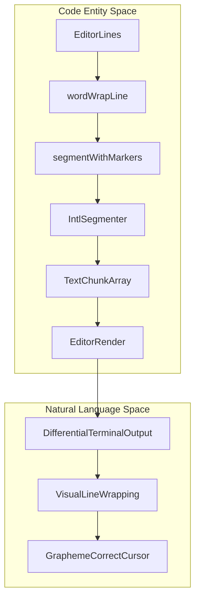
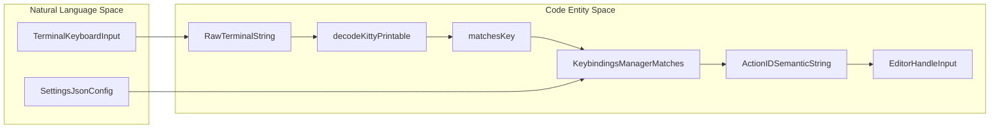

# Editor, Input, and Keybindings

Relevant source files

The following files were used as context for generating this wiki page:

- [packages/coding-agent/docs/keybindings.md](packages/coding-agent/docs/keybindings.md)
- [packages/coding-agent/src/cli/session-picker.ts](packages/coding-agent/src/cli/session-picker.ts)
- [packages/coding-agent/src/core/keybindings.ts](packages/coding-agent/src/core/keybindings.ts)
- [packages/coding-agent/src/modes/interactive/components/custom-editor.ts](packages/coding-agent/src/modes/interactive/components/custom-editor.ts)
- [packages/coding-agent/src/modes/interactive/components/session-selector-search.ts](packages/coding-agent/src/modes/interactive/components/session-selector-search.ts)
- [packages/coding-agent/src/modes/interactive/components/session-selector.ts](packages/coding-agent/src/modes/interactive/components/session-selector.ts)
- [packages/coding-agent/src/modes/interactive/components/tree-selector.ts](packages/coding-agent/src/modes/interactive/components/tree-selector.ts)
- [packages/coding-agent/src/modes/interactive/components/user-message-selector.ts](packages/coding-agent/src/modes/interactive/components/user-message-selector.ts)
- [packages/coding-agent/test/session-selector-path-delete.test.ts](packages/coding-agent/test/session-selector-path-delete.test.ts)
- [packages/coding-agent/test/session-selector-rename.test.ts](packages/coding-agent/test/session-selector-rename.test.ts)
- [packages/coding-agent/test/session-selector-search.test.ts](packages/coding-agent/test/session-selector-search.test.ts)
- [packages/coding-agent/test/tree-selector.test.ts](packages/coding-agent/test/tree-selector.test.ts)
- [packages/tui/src/autocomplete.ts](packages/tui/src/autocomplete.ts)
- [packages/tui/src/components/editor.ts](packages/tui/src/components/editor.ts)
- [packages/tui/src/components/input.ts](packages/tui/src/components/input.ts)
- [packages/tui/src/components/select-list.ts](packages/tui/src/components/select-list.ts)
- [packages/tui/src/components/settings-list.ts](packages/tui/src/components/settings-list.ts)
- [packages/tui/src/fuzzy.ts](packages/tui/src/fuzzy.ts)
- [packages/tui/src/keybindings.ts](packages/tui/src/keybindings.ts)
- [packages/tui/src/keys.ts](packages/tui/src/keys.ts)
- [packages/tui/src/utils.ts](packages/tui/src/utils.ts)
- [packages/tui/test/autocomplete-skill-slash.test.ts](packages/tui/test/autocomplete-skill-slash.test.ts)
- [packages/tui/test/autocomplete.test.ts](packages/tui/test/autocomplete.test.ts)
- [packages/tui/test/editor.test.ts](packages/tui/test/editor.test.ts)
- [packages/tui/test/fuzzy.test.ts](packages/tui/test/fuzzy.test.ts)
- [packages/tui/test/input.test.ts](packages/tui/test/input.test.ts)
- [packages/tui/test/keybindings.test.ts](packages/tui/test/keybindings.test.ts)
- [packages/tui/test/keys.test.ts](packages/tui/test/keys.test.ts)
- [packages/tui/test/mouse-components.test.ts](packages/tui/test/mouse-components.test.ts)
- [packages/tui/test/regression-regional-indicator-width.test.ts](packages/tui/test/regression-regional-indicator-width.test.ts)
- [packages/tui/test/settings-list.test.ts](packages/tui/test/settings-list.test.ts)
- [packages/tui/test/truncate-to-width.test.ts](packages/tui/test/truncate-to-width.test.ts)
- [packages/tui/test/wrap-ansi.test.ts](packages/tui/test/wrap-ansi.test.ts)

The terminal UI (`pi-tui`) package offers a comprehensive text input system, including a multi-line `Editor` for rich text editing and a single-line `Input` for simple inputs. These classes provide robust features like grapheme cluster-aware cursor movement, an undo stack for state management, an Emacs-style kill ring for advanced text kill/yank behavior, word-wrap handling, paste markers management, autocomplete integration, and a semantic keybinding system. The keybindings map raw terminal key sequences to named semantic actions, enabling flexible reconfiguration.

---

## Input Components

The architecture distinguishes between single-line and multi-line textual input, with both components implementing the `Focusable` interface for integration with TUI focus management [packages/tui/src/tui.ts:6-12](). 

### Single-line Input: `Input`

The [`Input` class](packages/tui/src/components/input.ts:32-234) supports single-line editing with horizontal scrolling and advanced input handling.

Key implementations:
- **Cursor Management**  
  The cursor tracks a position within `value: string` as a UTF-16 index, adjusted grapheme-cluster-wise for valid Unicode character navigation using `Intl.Segmenter` [packages/tui/src/utils.ts:4-19]() and [packages/tui/src/components/input.ts:16-191]().

- **Bracketed Paste Mode**  
  The component buffers bracketed paste input marked by `\x1b[200~` and `\x1b[201~`, ensuring pasted content is inserted atomically without interference from interleaved input [packages/tui/src/components/input.ts:71-106]().

- **Undo Stack**  
  An `UndoStack<InputState>` saves snapshots of editor state (`value` and `cursor`) enabling undo with coalescing to group contiguous insertions [packages/tui/src/components/input.ts:54-54]().

- **Kill Ring**  
  Includes a `KillRing` to store deleted text ("kills") for Emacs-style yanking and cycling via `yankPop()` after paste [packages/tui/src/components/input.ts:50-51,161-168]().

- **Keybindings and Actions**  
  Receives raw input events and handles them by matching against semantic keybindings (`tui.editor.*`, `tui.input.*`, etc.) through the global keybindings manager. Key handling covers cursor movement, deletion, and submission [packages/tui/src/components/input.ts:109-234]().

- **Horizontal Scrolling and Rendering**  
  When content extends beyond visible width, rendering clips to a horizontal window managed by `renderedStartColumn` [packages/tui/src/components/input.ts:38]() with clipping utilities from `sliceByColumn` [packages/tui/src/utils.ts:6-9]().

Sources:
- `[packages/tui/src/components/input.ts:32-234]()`
- `[packages/tui/src/utils.ts:4-19]()`
- `[packages/tui/src/tui.ts:6-12]()`

---

### Multi-line Editor: `Editor` and `CustomEditor`

The [`Editor` class](packages/tui/src/components/editor.ts:1-191) adds multi-line and complex editing features, built atop grapheme-aware cursor and text segmentation. The [`CustomEditor`](packages/coding-agent/src/modes/interactive/components/custom-editor.ts:13-148) extends `Editor` with codebase-specific keyhandlers and UI integrations for coding-agent interactive modes.

Key features and behavior:

- **Text Model**  
  Editor stores internal lines and cursor coordinates as `{ line: number, col: number }`. Cursor navigation respects grapheme clusters using `Intl.Segmenter` and special "paste markers" to maintain atomic editing units [packages/tui/src/components/editor.ts:28-101]().

- **Grapheme-aware Segmentation with Paste Markers**  
  The internal `segmentWithMarkers()` function wraps a base grapheme segmenter and merges paste markers (e.g., `[paste #123 +456 lines]`) as atomic segments via `PASTE_MARKER_REGEX` [packages/tui/src/components/editor.ts:31-101]().  
  This prevents the cursor from splitting these markers for deletion or word-wrap.

- **Word Wrap**  
  The editor uses `wordWrapLine()` which splits a single logical line into visible wrapped chunks (`TextChunk[]`) at word boundaries, gracefully falling back to character-level breaks on long words or wide graphemes [packages/tui/src/components/editor.ts:124-190]().

- **Custom Editor Extensions**  
  [`CustomEditor`](packages/coding-agent/src/modes/interactive/components/custom-editor.ts:13-148) overrides `renderTopBorder()` to embed working, compaction, and retry status indicators, and intercepts app-level keybindings (like `app.interrupt`, `app.exit`, and extension-registered shortcuts) before falling back to base editor input handling [packages/coding-agent/src/modes/interactive/components/custom-editor.ts:36-147]().

Sources:
- `[packages/tui/src/components/editor.ts:1-191]()`
- `[packages/coding-agent/src/modes/interactive/components/custom-editor.ts:13-148]()`

---

| Feature            | `Input` (Single-line)                  | `Editor` / `CustomEditor` (Multi-line)               |
| ------------------ | ------------------------------------ | ---------------------------------------------------- |
| Undo Stack         | `UndoStack<InputState>`               | `UndoStack<EditorState>`                              |
| Kill Ring          | `KillRing`                           | `KillRing`                                           |
| Paste Handling     | Bracketed Paste Mode buffering        | Grapheme Segmenter with Paste Marker merging         |
| Cursor Movement    | Horizontal, grapheme-aware            | Bidirectional across lines, grapheme-aware           |
| History Navigation | Single history line cycling           | Multi-line prompt history with navigation             |
| Autocomplete       | Basic single-line completion triggers | Integrated with multi-line overlay list for completion |

Sources:  
- `[packages/tui/src/components/input.ts:32-234]()`  
- `[packages/tui/src/components/editor.ts:1-191]()`  
- `[packages/coding-agent/src/modes/interactive/components/custom-editor.ts:13-148]()`  
- `[packages/tui/src/tui.ts:6-12]()`  

---

## Grapheme and Paste Marker Awareness

Correct cursor movement and editing in Unicode-rich text terminals is challenging. `pi-tui` leverages:

- **`Intl.Segmenter` Instances**  
  Shared grapheme and word segmenters are provided by the util functions `getGraphemeSegmenter()` and `getWordSegmenter()` [packages/tui/src/utils.ts:4-19](), ensuring reliable Unicode character cluster boundaries.

- **Paste Marker Segmentation**  
  The editor introduces a custom wrapper `segmentWithMarkers()` around the base grapheme segmenter. It merges recognized paste markers matching `\[paste #(\d+)( ...)?\]` into single atomic segments to prevent cursor intrusion or partial deletion inside multi-line paste annotations [packages/tui/src/components/editor.ts:48-101](). Only predefined valid IDs are merged, enabling dynamic marker support.

- **Word Wrap with Awareness**  
  The `wordWrapLine()` function uses these segments for splitting lines to visually fit terminal width. It prefers wrapping at word boundaries but falls back to per-character breaks for words or markers wider than the allowed column width [packages/tui/src/components/editor.ts:124-190]().

### Diagram: Editor Rendering and Grapheme Segmentation Pipeline

Title: "Editor Rendering and Grapheme Segmentation Pipeline"

Sources:  
- `[packages/tui/src/components/editor.ts:28-101]()`  
- `[packages/tui/src/components/editor.ts:124-190]()`  
- `[packages/tui/src/utils.ts:4-19]()`  

---

## Keybindings and Semantic Actions

The system abstracts raw terminal input into semantic keybinding actions represented by unique string IDs. This enables user configuration, multi-platform key normalization (including Kitty keyboard protocol), and flexible TUI input handling.

### Key Parsing and Matching

- The `keys.ts` module handles parsing raw terminal input sequences (including CSI, SS3, and Kitty CSI-u sequences) into structured, normalized `KeyId` strings [packages/tui/src/keys.ts:1-248]().  
- Supports advanced modifier combinations (`ctrl`, `shift`, `alt`, `super`) with symbols, letters, digits, special keys, and function keys using type-safe helpers [packages/tui/src/keys.ts:143-248]().  
- Handles quirks of different terminals and Kitty-specific protocol flags (for non-Latin layouts and modifier disambiguation) via `matchesKey()` and `parseKey()` [packages/tui/src/keys.ts:31-40]().

### KeybindingsManager and Downstream Usage

- The `KeybindingsManager` wraps keybinding maps and provides `.matches()` to test if an input corresponds to a semantic action [packages/tui/src/keybindings.ts:7-8]().  
- Editor and input components consume this API to match input sequences and execute corresponding commands [packages/tui/src/components/input.ts:109-234]().

### Diagram: Input Sequence to Semantic Action Mapping

Title: "Input Sequence to Semantic Action Mapping"

Sources:  
- `[packages/tui/src/keybindings.ts:7-210]()`  
- `[packages/tui/src/keys.ts:1-248]()`  
- `[packages/tui/test/keys.test.ts:1-166]()`  

---

## Autocomplete Integration

The `Editor` implements autocomplete overlay UI via the `AutocompleteProvider` interface [packages/tui/src/components/editor.ts:1-1]() and the `SelectList` component [packages/tui/src/components/select-list.ts:26-26]().

- Completion requests arise on explicit keys (e.g., tab) or trigger characters (like `@` or `/`).  
- The `CombinedAutocompleteProvider` aggregates several sources:
  - **Slash Command completions**, parsing and matching command prefixes [packages/tui/src/autocomplete.ts:5-6](), [packages/tui/src/autocomplete.ts:21-47]().  
  - **File path completions** backed by `fd`-based directory traversal for performance and `.gitignore` compliance [packages/tui/src/autocomplete.ts:149-243]().  
- The provider supplies suggestions asynchronously, displayed in a popup select list where navigation keys (`up`, `down`, `enter`) allow selection or confirmation [packages/tui/src/components/select-list.ts:26-26]().

Sources:  
- `[packages/tui/src/components/editor.ts:1-1]()`  
- `[packages/tui/src/autocomplete.ts:1-243]()`  
- `[packages/tui/src/components/select-list.ts:26-26]()`  

---

## Undo Stack and Kill Ring

Both `Editor` and `Input` maintain:

- An `UndoStack` generic class instancing a snapshot history (`UndoStack<InputState>` or `UndoStack<EditorState>`) with time-based coalescing to collapse many rapid edits into a single undo step [packages/tui/src/components/input.ts:54-54](), [packages/tui/src/components/editor.ts:14-14]().  

- A `KillRing` implementing Emacs-style cut/paste functionality: kills (deletions) push text onto the ring; yank pastes the most recent kill; yank-pop cycles older kills [packages/tui/src/components/input.ts:50-51,161-168](), [packages/tui/src/components/editor.ts:4-4]().

Sources:  
- `[packages/tui/src/components/input.ts:50-54,161-168]()`  
- `[packages/tui/src/components/editor.ts:4-14]()`