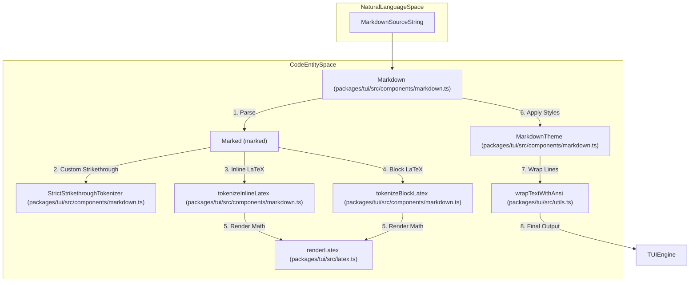
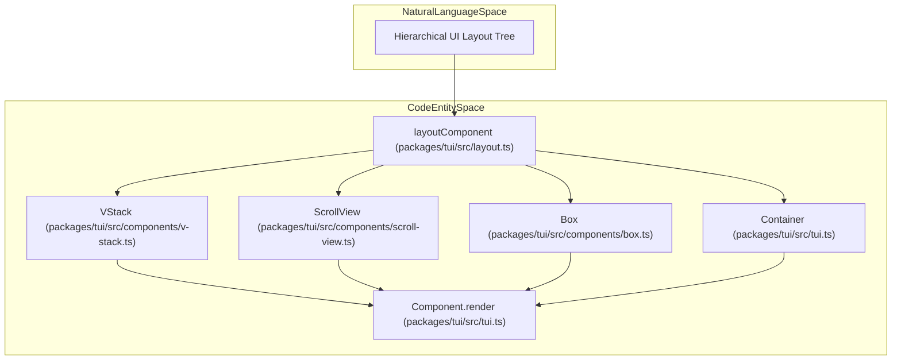

# TUI Components Library

Relevant source files

The following files were used as context for generating this wiki page:

- [packages/coding-agent/src/core/cache-stats.ts](packages/coding-agent/src/core/cache-stats.ts)
- [packages/coding-agent/test/cache-stats.test.ts](packages/coding-agent/test/cache-stats.test.ts)
- [packages/coding-agent/test/suite/regressions/4167-thinking-toggle-pending-tool-render.test.ts](packages/coding-agent/test/suite/regressions/4167-thinking-toggle-pending-tool-render.test.ts)
- [packages/tui/src/components/image.ts](packages/tui/src/components/image.ts)
- [packages/tui/src/components/markdown.ts](packages/tui/src/components/markdown.ts)
- [packages/tui/src/components/scroll-view.ts](packages/tui/src/components/scroll-view.ts)
- [packages/tui/src/components/text.ts](packages/tui/src/components/text.ts)
- [packages/tui/src/components/v-stack.ts](packages/tui/src/components/v-stack.ts)
- [packages/tui/src/latex.ts](packages/tui/src/latex.ts)
- [packages/tui/src/layout-node.ts](packages/tui/src/layout-node.ts)
- [packages/tui/src/layout.ts](packages/tui/src/layout.ts)
- [packages/tui/src/terminal-image.ts](packages/tui/src/terminal-image.ts)
- [packages/tui/test/latex.test.ts](packages/tui/test/latex.test.ts)
- [packages/tui/test/layout.test.ts](packages/tui/test/layout.test.ts)
- [packages/tui/test/markdown.test.ts](packages/tui/test/markdown.test.ts)
- [packages/tui/test/render-churn-bench.ts](packages/tui/test/render-churn-bench.ts)
- [packages/tui/test/terminal-image.test.ts](packages/tui/test/terminal-image.test.ts)

The `@earendil-works/pi-tui` package provides a comprehensive library of Terminal User Interface (TUI) components optimized for differential rendering performance. These components abstract over terminal-specific constraints such as ANSI styling sequences, Unicode grapheme cluster widths (accounting for emojis and East Asian double-width characters), and terminal image protocols including Kitty and iTerm2 graphics.

Sources: [packages/tui/src/tui.ts:21-80](), [packages/tui/src/components/markdown.ts:1-230](), [packages/tui/src/components/select-list.ts:40-170](), [packages/tui/src/components/settings-list.ts:38-103]()

---

## Core Interfaces

All TUI components implement foundational interfaces declared in `packages/tui/src/tui.ts`.

### `Component`

The base interface representing a renderable UI element:

- `render(width: number): string[]` — Renders the component at a given width, returning an array of strings representing terminal lines with inline ANSI styling [packages/tui/src/tui.ts:23-29]().
- `invalidate(): void` — Clears internal layout/render caches when state changes [packages/tui/src/tui.ts:43-47]().
- `handleInput?(data: string): void` — Optional handler for keyboard events when holding focus [packages/tui/src/tui.ts:31-34]().

### `Focusable`

Extends `Component` for interactive widgets that require the hardware cursor:

- `focused: boolean` — Indicates whether the component holds active focus [packages/tui/src/tui.ts:63-66]().
- `CURSOR_MARKER` — A zero-width APC escape sequence (`\x1b_pi:c\x07`) marking the IME candidate cursor position [packages/tui/src/tui.ts:79]().

Sources: [packages/tui/src/tui.ts:21-80]()

---

## Layout and Structure Components

The layout system computes component geometry frame-by-frame via a hierarchical box model. Stateful instances retain layout state across renders.

### Container & Box

- **Container**: A vertical stack container that renders child components sequentially and flattens their output lines [packages/tui/src/tui.ts:211-218]().
- **Box**: Wraps a single child component with padding, margins, and optional background color functions [packages/tui/src/components/box.ts:1-15]().

### Text & TruncatedText

- **Text**: Displays multi-line text with word wrapping, ANSI color persistence, margins, and custom background styling [packages/tui/src/components/text.ts:7-107]().
- **TruncatedText**: Clips single-line text to a maximum terminal width, appending ellipsis and ensuring correct ANSI reset codes [packages/tui/src/utils.ts:75-175]().

### ScrollView & VStack

- **ScrollView**: Provides a scrollable viewport for a single child component, handling mouse wheel events, trackpad gestures, and keyboard navigation [packages/tui/src/components/scroll-view.ts:15-30]().
- **VStack**: A vertical stack layout manager dividing vertical space among children with weighted sizing and spacing gaps [packages/tui/src/components/v-stack.ts:1-33]().

Sources: [packages/tui/src/tui.ts:211-218](), [packages/tui/src/components/text.ts:7-107](), [packages/tui/src/utils.ts:75-175](), [packages/tui/src/components/scroll-view.ts:15-30](), [packages/tui/src/components/v-stack.ts:1-33]()

---

## Content Components

### Markdown Renderer

The `Markdown` component transforms Markdown into ANSI-styled terminal lines with LaTeX support using a customized `marked` parser instance.

- **LaTeX Math**: Inline (`$…$`, `\(...\)`) and block (`$$…$$`, `\[...\]`) delimiters are tokenized and rendered into Unicode glyphs via `renderLatex`. Unfinished expressions are marked as `pending` for streaming contexts [packages/tui/src/components/markdown.ts:52-144](), [packages/tui/src/latex.ts:3-221]().
- **Strict Strikethrough Tokenizer**: Uses `StrictStrikethroughTokenizer` to avoid parsing ambiguity for `~~strikethrough~~` syntax [packages/tui/src/components/markdown.ts:9-24]().
- **Theming**: Uses `MarkdownTheme` to apply ANSI styles to headings, code blocks, blockquotes, and links [packages/tui/src/components/markdown.ts:200-218]().
- **Flicker Mitigation**: `trimPartialClosingFences` strips incomplete closing code fences during streaming inputs [packages/tui/src/components/markdown.ts:146-169]().

### Image Component

The `Image` component renders raster images inside the terminal using detected graphics protocols (Kitty graphics protocol or iTerm2 inline image sequences), handling geometry scaling and fallback ANSI representation [packages/tui/src/terminal-image.ts:1-60]().

Diagram: Markdown Rendering Pipeline (`Natural Language Space` to `Code Entity Space`)

Sources: [packages/tui/src/components/markdown.ts:1-176](), [packages/tui/src/latex.ts:3-221](), [packages/tui/src/utils.ts:68](), [packages/tui/src/terminal-image.ts:1-60]()

---

## Interactive and Feedback Components

### SelectList

`SelectList` renders a vertically scrollable selection menu:
- Manages items, filtered subsets via `setFilter`, and selected indices [packages/tui/src/components/select-list.ts:40-65]().
- Handles mouse click, press, wheel scrolling, and keyboard navigation (`tui.select.up`, `down`, `confirm`, `cancel`) [packages/tui/src/components/select-list.ts:109-170]().

### SettingsList

`SettingsList` provides configuration menu navigation:
- Supports fuzzy searching and submenu components that temporarily replace the main list view [packages/tui/src/components/settings-list.ts:38-100]().
- Tracks setting item states, descriptions, and current values with `onChange` callbacks [packages/tui/src/components/settings-list.ts:7-59]().

### Loader

`Loader` displays an animated spinner with status text during asynchronous operations.

Sources: [packages/tui/src/components/select-list.ts:40-170](), [packages/tui/src/components/settings-list.ts:38-103]()

---

## Theme and ANSI Utilities

- **`visibleWidth`**: Calculates terminal column width respecting East Asian width tables and grapheme clusters [packages/tui/src/utils.ts:182-219]().
- **`wrapTextWithAnsi`**: Wraps text while preserving active ANSI styles and background colors across line breaks [packages/tui/src/utils.ts:68]().
- **Keyboard Handling**: `keys.ts` parses legacy sequences and Kitty protocol events, providing typed key identifiers via `Key` and `matchesKey` / `parseKey` [packages/tui/src/keys.ts:21-252]().

Diagram: Layout and Rendering Hierarchy (`Natural Language Space` to `Code Entity Space`)

Sources: [packages/tui/src/utils.ts:1-219](), [packages/tui/src/keys.ts:21-252](), [packages/tui/src/layout.ts:100-198]()