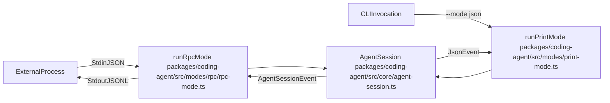

# Interactive Mode (CLI)

<details>
<summary>Relevant source files</summary>

The following files were used as context for generating this wiki page:

- [packages/coding-agent/docs/extensions.md](packages/coding-agent/docs/extensions.md)
- [packages/coding-agent/examples/extensions/README.md](packages/coding-agent/examples/extensions/README.md)
- [packages/coding-agent/src/core/agent-session.ts](packages/coding-agent/src/core/agent-session.ts)
- [packages/coding-agent/src/core/extensions/index.ts](packages/coding-agent/src/core/extensions/index.ts)
- [packages/coding-agent/src/core/extensions/loader.ts](packages/coding-agent/src/core/extensions/loader.ts)
- [packages/coding-agent/src/core/extensions/runner.ts](packages/coding-agent/src/core/extensions/runner.ts)
- [packages/coding-agent/src/core/extensions/types.ts](packages/coding-agent/src/core/extensions/types.ts)
- [packages/coding-agent/src/core/sdk.ts](packages/coding-agent/src/core/sdk.ts)
- [packages/coding-agent/src/core/slash-commands.ts](packages/coding-agent/src/core/slash-commands.ts)
- [packages/coding-agent/src/index.ts](packages/coding-agent/src/index.ts)
- [packages/coding-agent/src/modes/interactive/interactive-mode.ts](packages/coding-agent/src/modes/interactive/interactive-mode.ts)
- [packages/coding-agent/src/modes/print-mode.ts](packages/coding-agent/src/modes/print-mode.ts)
- [packages/coding-agent/src/modes/rpc/rpc-mode.ts](packages/coding-agent/src/modes/rpc/rpc-mode.ts)
- [packages/coding-agent/test/extensions-discovery.test.ts](packages/coding-agent/test/extensions-discovery.test.ts)
- [packages/coding-agent/test/extensions-runner.test.ts](packages/coding-agent/test/extensions-runner.test.ts)
- [packages/coding-agent/test/interactive-mode-extension-dialogs.test.ts](packages/coding-agent/test/interactive-mode-extension-dialogs.test.ts)
- [packages/coding-agent/test/interactive-mode-status.test.ts](packages/coding-agent/test/interactive-mode-status.test.ts)
- [packages/coding-agent/test/settings-selector.test.ts](packages/coding-agent/test/settings-selector.test.ts)
- [packages/coding-agent/test/suite/regressions/5943-session-start-notify.test.ts](packages/coding-agent/test/suite/regressions/5943-session-start-notify.test.ts)

</details>


The **Interactive Mode** is the primary terminal interface for `pi`, providing a differential Terminal User Interface (TUI) built on `@earendil-works/pi-tui`. It manages real-time assistant streaming, tool execution feedback, session navigation, and user input via the `AgentSession` abstraction [packages/coding-agent/src/modes/interactive/interactive-mode.ts:2-4](), [packages/coding-agent/src/core/agent-session.ts:1-14](). Interactive mode orchestrates the full user experience within the terminal, connecting user actions to the underlying agent lifecycle and extension runtime.

This page serves as a high-level overview. For detailed child page references, see:
- [Interactive Mode Components](#5.1) — UI components like `ChatContainer`, `CustomEditor`, message renderers, and selection dialogs.
- [Settings, Themes, and Keybindings](#5.2) — `SettingsManager`, theme system, and semantic `KeybindingsManager`.
- [Slash Commands and Prompt Templates](#5.3) — Built-in slash command registry and prompt templates with frontmatter.
- [Alternative Execution Modes: Print, JSON, and RPC](#5.4) — Headless single-shot print, JSON streams, and JSON-RPC over stdin/stdout.

---

## TUI Layout and Component Hierarchy

Interactive mode arranges the terminal interface vertically, optimizing space for conversation history, tool outputs, editor input, and status indications. The primary layout includes resource metadata at the top, a scrollable chat viewport (`ChatContainer`), an interactive multi-line prompt editor (`CustomEditor`), and dynamic footers/status lines.

This structure is composed of nested components managed by the TUI engine from `@earendil-works/pi-tui`. Key UI components like `AssistantMessageComponent` and `BashExecutionComponent` render streaming and tool outputs asynchronously [packages/coding-agent/src/modes/interactive/interactive-mode.ts:139-140](). The editor receives user input and dispatches prompt submissions to `AgentSession` [packages/coding-agent/src/core/agent-session.ts:1-14]().

Title: "TUI Architecture and Component Flow"
```mermaid
graph TD
  UserInput["UserInput"] -->|SubmitPrompt| CustomEditor["CustomEditor packages/coding-agent/src/modes/interactive/components/custom-editor.ts"]
  CustomEditor -->|prompt()| AgentSession["AgentSession packages/coding-agent/src/core/agent-session.ts"]
  AgentSession -->|AssistantTextStream| AssistantMessageComponent["AssistantMessageComponent packages/coding-agent/src/modes/interactive/components/assistant-message.ts"]
  AgentSession -->|ToolExecution| BashExecutionComponent["BashExecutionComponent packages/coding-agent/src/modes/interactive/components/bash-execution.ts"]
  AssistantMessageComponent -->|RenderUpdates| TUIEngine["TUIEngine @earendil-works/pi-tui"]
  BashExecutionComponent -->|RenderUpdates| TUIEngine
  TUIEngine -->|DifferentialRender| ProcessTerminal["ProcessTerminal"]
```

Sources:  
[packages/coding-agent/src/modes/interactive/interactive-mode.ts:2-4](),  
[packages/coding-agent/src/core/agent-session.ts:1-14](),  
[packages/coding-agent/src/modes/interactive/interactive-mode.ts:139-140]()

For the implementation details of each interactive UI component, see [Interactive Mode Components](#5.1).

---

## Interactive Loop and Event Stream

At the core of interactive mode is the event-driven loop that connects the terminal UI to the agent's runtime state. The loop subscribes to `AgentSessionEvent`s, which represent changes in agent state such as new assistant message tokens, tool invocations, or thinking level updates [packages/coding-agent/src/core/agent-session.ts:196-202]().

When the user submits a prompt through the `CustomEditor`, `AgentSession.prompt()` initiates a new turn. Incoming events propagate asynchronously to update UI components without blocking rendering or input responsiveness. This mechanism allows incremental display of streaming assistant messages, visualization of tool execution progress, and real-time synchronization of model choices and session branches.

Sources:  
[packages/coding-agent/src/modes/interactive/interactive-mode.ts:2-4](),  
[packages/coding-agent/src/core/agent-session.ts:1-14](),  
[packages/coding-agent/src/core/agent-session.ts:196-202]()

---

## Settings, Themes, and Keybindings

Interactive mode depends on flexible external configuration systems to customize appearance and control mappings:

- **SettingsManager** manages hierarchical configuration sources including project-local and global `settings.json` files, schema validation, migrations, and settings locking.
- **Theme System** supports dark, light, and custom JSON themes defined by schemas and loaded dynamically [packages/coding-agent/src/core/agent-session.ts:58]().
- **KeybindingsManager** implements semantic keybinding namespaces, enabling remapping and conflict resolution for terminal input [packages/coding-agent/src/core/keybindings.ts:1-2](), [packages/coding-agent/src/core/extensions/types.ts:65]().

For details, see [Settings, Themes, and Keybindings](#5.2).

Sources:  
[packages/coding-agent/src/core/agent-session.ts:58](),  
[packages/coding-agent/src/core/extensions/types.ts:65](),  
[packages/coding-agent/src/core/keybindings.ts:1-2]()

---

## Slash Commands and Prompt Templates

Interactive mode offers a rich command interface triggered by slash-prefixed inputs in the prompt editor, supporting efficient workflow control and agent guidance:

- **Slash Commands** include built-in commands like `/login`, `/model`, `/tree`, `/fork`, `/clone`, `/compact`, `/export`, `/share`, `/settings`, `/reload`, `/llama`, and `/thinking` [packages/coding-agent/src/modes/interactive/interactive-mode.ts:117](). These are registered via `BUILTIN_SLASH_COMMANDS` [packages/coding-agent/src/core/slash-commands.ts:1-2]().
- **Prompt Templates** utilize markdown files with optional YAML frontmatter to create reusable prompt snippets with argument interpolation and autocomplete expansion [packages/coding-agent/src/core/agent-session.ts:121]().

Sources:  
[packages/coding-agent/src/modes/interactive/interactive-mode.ts:117](),  
[packages/coding-agent/src/core/agent-session.ts:121](),  
[packages/coding-agent/src/core/slash-commands.ts:1-2]()

For a complete listing of commands and their implementations, see [Slash Commands and Prompt Templates](#5.3).

---

## Alternative Execution Modes: Print, JSON, and RPC

While interactive mode provides the main TUI experience, the codebase supports alternative CLI execution modes for automation and embedding:

- **Print Mode (`runPrintMode`)**: Runs a single-shot prompt, outputs only the final assistant text to stdout, and exits [packages/coding-agent/src/modes/print-mode.ts:33-169]().
- **JSON Event Stream Mode**: Outputs a line-delimited JSON stream of session events including partial assistant tokens, tool calls, and session metadata [packages/coding-agent/src/modes/print-mode.ts:109-112]().
- **RPC Mode (`runRpcMode`)**: Implements the JSON-RPC 2.0 protocol over standard input/output with JSONL framing for embedding the agent engine in external applications [packages/coding-agent/src/modes/rpc/rpc-mode.ts:54-62](). This mode also provides an `ExtensionUIContext` implementation that translates UI requests into RPC messages [packages/coding-agent/src/modes/rpc/rpc-mode.ts:136-203]().

Title: "Alternative Execution Routing and Protocol Flow"


Sources:  
[packages/coding-agent/src/modes/print-mode.ts:33-169](),  
[packages/coding-agent/src/modes/rpc/rpc-mode.ts:54-62](),  
[packages/coding-agent/src/modes/rpc/rpc-mode.ts:136-203](),  
[packages/coding-agent/src/modes/print-mode.ts:109-112]()

For technical details on these modes implementation and usage, see [Alternative Execution Modes: Print, JSON, and RPC](#5.4).

---

# References
- Interactive mode implementation: `packages/coding-agent/src/modes/interactive/interactive-mode.ts`  
- Agent session core: `packages/coding-agent/src/core/agent-session.ts`  
- Print execution mode: `packages/coding-agent/src/modes/print-mode.ts`  
- RPC execution mode: `packages/coding-agent/src/modes/rpc/rpc-mode.ts`  
- TUI core library: `@earendil-works/pi-tui`