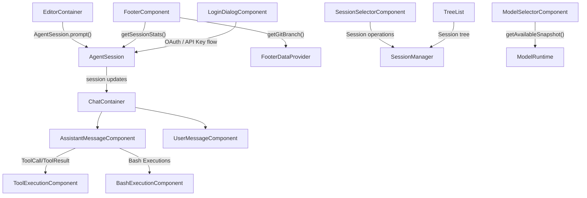
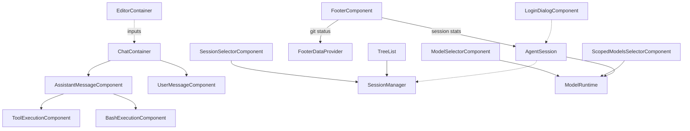

# Interactive Mode Components

Relevant source files

The following files were used as context for generating this wiki page:

- [packages/ai/src/auth/types.ts](packages/ai/src/auth/types.ts)
- [packages/ai/src/compat/extension-oauth-types.ts](packages/ai/src/compat/extension-oauth-types.ts)
- [packages/coding-agent/src/cli/config-selector.ts](packages/coding-agent/src/cli/config-selector.ts)
- [packages/coding-agent/src/core/export-html/tool-renderer.ts](packages/coding-agent/src/core/export-html/tool-renderer.ts)
- [packages/coding-agent/src/core/footer-data-provider.ts](packages/coding-agent/src/core/footer-data-provider.ts)
- [packages/coding-agent/src/core/messages.ts](packages/coding-agent/src/core/messages.ts)
- [packages/coding-agent/src/modes/interactive/components/assistant-message.ts](packages/coding-agent/src/modes/interactive/components/assistant-message.ts)
- [packages/coding-agent/src/modes/interactive/components/bash-execution.ts](packages/coding-agent/src/modes/interactive/components/bash-execution.ts)
- [packages/coding-agent/src/modes/interactive/components/branch-summary-message.ts](packages/coding-agent/src/modes/interactive/components/branch-summary-message.ts)
- [packages/coding-agent/src/modes/interactive/components/compaction-summary-message.ts](packages/coding-agent/src/modes/interactive/components/compaction-summary-message.ts)
- [packages/coding-agent/src/modes/interactive/components/config-selector.ts](packages/coding-agent/src/modes/interactive/components/config-selector.ts)
- [packages/coding-agent/src/modes/interactive/components/custom-message.ts](packages/coding-agent/src/modes/interactive/components/custom-message.ts)
- [packages/coding-agent/src/modes/interactive/components/footer.ts](packages/coding-agent/src/modes/interactive/components/footer.ts)
- [packages/coding-agent/src/modes/interactive/components/login-dialog.ts](packages/coding-agent/src/modes/interactive/components/login-dialog.ts)
- [packages/coding-agent/src/modes/interactive/components/markdown-transform.ts](packages/coding-agent/src/modes/interactive/components/markdown-transform.ts)
- [packages/coding-agent/src/modes/interactive/components/model-selector.ts](packages/coding-agent/src/modes/interactive/components/model-selector.ts)
- [packages/coding-agent/src/modes/interactive/components/oauth-selector.ts](packages/coding-agent/src/modes/interactive/components/oauth-selector.ts)
- [packages/coding-agent/src/modes/interactive/components/scoped-models-selector.ts](packages/coding-agent/src/modes/interactive/components/scoped-models-selector.ts)
- [packages/coding-agent/src/modes/interactive/components/skill-invocation-message.ts](packages/coding-agent/src/modes/interactive/components/skill-invocation-message.ts)
- [packages/coding-agent/src/modes/interactive/components/thinking-selector.ts](packages/coding-agent/src/modes/interactive/components/thinking-selector.ts)
- [packages/coding-agent/src/modes/interactive/components/tool-execution.ts](packages/coding-agent/src/modes/interactive/components/tool-execution.ts)
- [packages/coding-agent/src/modes/interactive/components/user-message.ts](packages/coding-agent/src/modes/interactive/components/user-message.ts)
- [packages/coding-agent/src/modes/interactive/model-search.ts](packages/coding-agent/src/modes/interactive/model-search.ts)
- [packages/coding-agent/src/utils/fs-watch.ts](packages/coding-agent/src/utils/fs-watch.ts)
- [packages/coding-agent/test/assistant-message.test.ts](packages/coding-agent/test/assistant-message.test.ts)
- [packages/coding-agent/test/bash-execution-width.test.ts](packages/coding-agent/test/bash-execution-width.test.ts)
- [packages/coding-agent/test/collapsible-message-components.test.ts](packages/coding-agent/test/collapsible-message-components.test.ts)
- [packages/coding-agent/test/footer-data-provider.test.ts](packages/coding-agent/test/footer-data-provider.test.ts)
- [packages/coding-agent/test/footer-width.test.ts](packages/coding-agent/test/footer-width.test.ts)
- [packages/coding-agent/test/interactive-mode-compaction.test.ts](packages/coding-agent/test/interactive-mode-compaction.test.ts)
- [packages/coding-agent/test/login-dialog-device-code.test.ts](packages/coding-agent/test/login-dialog-device-code.test.ts)
- [packages/coding-agent/test/model-search.test.ts](packages/coding-agent/test/model-search.test.ts)
- [packages/coding-agent/test/model-selector.test.ts](packages/coding-agent/test/model-selector.test.ts)
- [packages/coding-agent/test/oauth-selector.test.ts](packages/coding-agent/test/oauth-selector.test.ts)
- [packages/coding-agent/test/scoped-models-selector.test.ts](packages/coding-agent/test/scoped-models-selector.test.ts)
- [packages/coding-agent/test/suite/regressions/3217-scoped-model-order.test.ts](packages/coding-agent/test/suite/regressions/3217-scoped-model-order.test.ts)
- [packages/coding-agent/test/suite/regressions/6949-unavailable-scoped-model.test.ts](packages/coding-agent/test/suite/regressions/6949-unavailable-scoped-model.test.ts)
- [packages/coding-agent/test/suite/regressions/7209-model-selector-filter-resets-selection.test.ts](packages/coding-agent/test/suite/regressions/7209-model-selector-filter-resets-selection.test.ts)
- [packages/coding-agent/test/thinking-selector.test.ts](packages/coding-agent/test/thinking-selector.test.ts)
- [packages/coding-agent/test/tool-execution-component.test.ts](packages/coding-agent/test/tool-execution-component.test.ts)
- [packages/coding-agent/test/user-message.test.ts](packages/coding-agent/test/user-message.test.ts)

The Interactive Mode of the `pi` CLI orchestrates a rich terminal UI (TUI) experience integrating chat interaction, session navigation, tool execution, model selection, and authentication. This page presents the complete technical details of all primary interactive UI components, their implementation, internal data flow, and their interoperation within the system.

---

## Component Overview and Purpose

Interactive mode components are built primarily using the `@earendil-works/pi-tui` terminal UI framework [packages/coding-agent/src/modes/interactive/components/tool-execution.ts:1-13](). They encapsulate elements like the chat history, prompt editor, session and model selectors, tool output renderers, login dialogs, and a dynamic footer displaying token usage, context windows, and statuses.

| Component Name | Purpose | Key File / Definition Location |
| :------------- | :-------------------------------------------------------------------------------------------- | :---------------------------------------------------------- |
| `ChatContainer` | Scrollable chat message area, hosts user and assistant messages | `packages/coding-agent/src/modes/interactive/components/chat-container.ts` |
| `EditorContainer` | Holds the prompt input editor with autocomplete, slash commands, keybindings | `packages/coding-agent/src/modes/interactive/components/editor-container.ts` |
| `FooterComponent` | Single line footer showing current directory, git branch, token usage, costs, model info | [packages/coding-agent/src/modes/interactive/components/footer.ts:62-184]() |
| `AssistantMessageComponent` | Renders assistant messages with markdown, thinking blocks, errors, and images | [packages/coding-agent/src/modes/interactive/components/assistant-message.ts:14-50]() |
| `UserMessageComponent` | Renders user messages | [packages/coding-agent/src/modes/interactive/components/user-message.ts:13-37]() |
| `ToolExecutionComponent` | Dynamically renders tool call and tool result UI, including image handling | [packages/coding-agent/src/modes/interactive/components/tool-execution.ts:31-102]() |
| `BashExecutionComponent` | Specialized streaming output renderer for bash command executions | `packages/coding-agent/src/modes/interactive/components/bash-execution.ts:21-201` |
| `SessionSelectorComponent` | Interactive session browsing and management UI | [packages/coding-agent/src/modes/interactive/components/session-selector.ts:56-187]() |
| `ModelSelectorComponent` | Model catalog browsing, fuzzy search, and selection UI | [packages/coding-agent/src/modes/interactive/components/model-selector.ts:40-158]() |
| `TreeSelector` | Navigates and displays session tree with folding and filtering | [packages/coding-agent/src/modes/interactive/components/tree-selector.ts:107-148]() |
| `LoginDialogComponent` | Multi-modal OAuth and manual login dialog | [packages/coding-agent/src/modes/interactive/components/login-dialog.ts:22-86]() |
| `CustomEditor` | Editor with autocomplete, slash command support, and semantic keybindings | `packages/coding-agent/src/modes/interactive/components/custom-editor.ts` |
| `ExtensionEditorComponent` | Multi-line editor with external editor integration (`Ctrl+G`) | `packages/coding-agent/src/modes/interactive/components/extension-editor.ts:26-141` |

Sources:
- [packages/coding-agent/src/modes/interactive/components/tool-execution.ts:1-13]()
- [packages/coding-agent/src/modes/interactive/components/tool-execution.ts:31-102]()
- [packages/coding-agent/src/modes/interactive/components/model-selector.ts:40-158]()
- [packages/coding-agent/src/modes/interactive/components/footer.ts:62-184]()
- [packages/coding-agent/src/modes/interactive/components/login-dialog.ts:22-86]()
- [packages/coding-agent/src/modes/interactive/components/user-message.ts:13-37]()

---

## Component Hierarchy and Data Flow

These UI components connect deeply with core runtime services such as `AgentSession`, `SessionManager`, and `ModelRuntime`. User input flows from `EditorContainer` to `AgentSession`, updating the session tree. Session changes cause `ChatContainer` and its subcomponents to update. Tool results trigger rendering in `ToolExecutionComponent` or `BashExecutionComponent`. The footer consistently syncs with usage and git status through `FooterComponent` tied with `FooterDataProvider`.

### Interactive Components and Code Entity Map

Sources:
- [packages/coding-agent/src/modes/interactive/components/tool-execution.ts:31-102]()
- [packages/coding-agent/src/modes/interactive/components/model-selector.ts:40-158]()
- [packages/coding-agent/src/modes/interactive/components/footer.ts:62-120]()
- [packages/coding-agent/src/core/footer-data-provider.ts:99-132]()

---

## Core Message Rendering Components

### AssistantMessageComponent

The `AssistantMessageComponent` renders assistant agent messages with rich markdown styling and interactive thinking blocks [packages/coding-agent/src/modes/interactive/components/assistant-message.ts:14-50]():
- Supports toggling thinking blocks visibility and renders a placeholder label when hidden [packages/coding-agent/src/modes/interactive/components/assistant-message.ts:64-84]().
- Employs a customized Markdown renderer that supports GitHub-flavored markdown, LaTeX rendering, and terminal inline image protocols [packages/coding-agent/src/modes/interactive/components/assistant-message.ts:112-130]().
- Inserts OSC 133 shell escape sequences (`\x1b]133;A\x07`) to delimit messages, enabling terminal semantic scrollback integration [packages/coding-agent/src/modes/interactive/components/assistant-message.ts:7-9](), [packages/coding-agent/src/modes/interactive/components/assistant-message.ts:86-95]().
- Shows LLM provider errors or user-initiated abort messages inline [packages/coding-agent/src/modes/interactive/components/assistant-message.ts:196-215]().

Sources:
- [packages/coding-agent/src/modes/interactive/components/assistant-message.ts:7-50]()
- [packages/coding-agent/src/modes/interactive/components/assistant-message.ts:64-95]()
- [packages/coding-agent/src/modes/interactive/components/assistant-message.ts:112-130]()
- [packages/coding-agent/src/modes/interactive/components/assistant-message.ts:196-215]()

### ToolExecutionComponent

`ToolExecutionComponent` is a dynamic container that renders the lifecycle of tool calls executed by the agent [packages/coding-agent/src/modes/interactive/components/tool-execution.ts:31-104]():
- Accepts a tool name, unique call ID, arguments, and an optional tool definition implementing `renderCall` and `renderResult` methods [packages/coding-agent/src/modes/interactive/components/tool-execution.ts:67-86]().
- Supports two render shell modes [packages/coding-agent/src/modes/interactive/components/tool-execution.ts:118-120]():
  - `"default"`: wraps output in a styled `Box` container [packages/coding-agent/src/modes/interactive/components/tool-execution.ts:92-93]().
  - `"self"`: lets tools fully control their own UI using an internal container [packages/coding-agent/src/modes/interactive/components/tool-execution.ts:95-95]().
- Dynamically switches between call and result renderers, or falls back to generic text formatting if no tool definition exists [packages/coding-agent/src/modes/interactive/components/tool-execution.ts:97-101]().
- Manages image rendering by detecting image data in results and converting images to PNG using `ensurePngTranscoder` for Kitty protocol compatibility [packages/coding-agent/src/modes/interactive/components/tool-execution.ts:19-19](), [packages/coding-agent/test/tool-execution-component.test.ts:50-66]().
- Supports expansion/collapse of long textual tool output with a preview truncation [packages/coding-agent/src/modes/interactive/components/tool-execution.ts:148-170]().

Sources:
- [packages/coding-agent/src/modes/interactive/components/tool-execution.ts:19-104]()
- [packages/coding-agent/src/modes/interactive/components/tool-execution.ts:118-170]()
- [packages/coding-agent/test/tool-execution-component.test.ts:39-66]()

### BashExecutionComponent

`BashExecutionComponent` renders live output of bash tool executions (`packages/coding-agent/src/modes/interactive/components/bash-execution.ts:21-65`):
- Displays the executed command prefixed with `$`.
- Streams command stdout/stderr as cleaned, ANSI-stripped lines appended dynamically through `appendOutput()` (`packages/coding-agent/src/modes/interactive/components/bash-execution.ts:80-96`).
- Supports a loading spinner during active execution using `Loader`.
- Implements visual output truncation: keeps a fixed preview of last $N$ lines when collapsed, or shows full output when expanded (`packages/coding-agent/src/modes/interactive/components/bash-execution.ts:119-168`).
- Displays exit code on completion or cancellation status (`packages/coding-agent/src/modes/interactive/components/bash-execution.ts:98-117`).

Sources:
- [packages/coding-agent/src/modes/interactive/components/bash-execution.ts:21-117]()

### UserMessageComponent

The `UserMessageComponent` renders user prompts with customized styling [packages/coding-agent/src/modes/interactive/components/user-message.ts:13-37]():
- Renders text via Markdown with custom coloring for user message text and background [packages/coding-agent/src/modes/interactive/components/user-message.ts:48-70]().
- Supports OSC 133 semantic prompt demarcation matching assistant messages [packages/coding-agent/src/modes/interactive/components/user-message.ts:6-9](), [packages/coding-agent/src/modes/interactive/components/user-message.ts:73-82]().

Sources:
- [packages/coding-agent/src/modes/interactive/components/user-message.ts:13-37]()
- [packages/coding-agent/src/modes/interactive/components/user-message.ts:48-82]()

---

## Session and Model Navigation Components

### SessionSelectorComponent

The `SessionSelectorComponent` provides an interactive interface for browsing and managing sessions [packages/coding-agent/src/modes/interactive/components/session-selector.ts:56-187]():
- Displays sessions from the current folder or all sessions, with filtering by name and sorting by recency or threading [packages/coding-agent/src/modes/interactive/components/session-selector.ts:131-148]().
- Supports fuzzy search, regex search, and exact phrase matching for session names [packages/coding-agent/src/modes/interactive/components/session-selector.ts:169-171]().
- Allows renaming, deleting, and resuming sessions [packages/coding-agent/src/modes/interactive/components/session-selector.ts:172-179]().
- Handles confirmation for session deletion to prevent accidental data loss [packages/coding-agent/src/modes/interactive/components/session-selector.ts:158-161]().
- Provides visual feedback for loading progress during session scanning [packages/coding-agent/src/modes/interactive/components/session-selector.ts:94-96]().

Sources:
- [packages/coding-agent/src/modes/interactive/components/session-selector.ts:56-187]()

### TreeSelector

The `TreeList` component provides a navigable tree of session entries supporting folding, filtering modes (`default`, `no-tools`, `user-only`, `labeled-only`, `all`), and horizontal viewport clipping [packages/coding-agent/src/modes/interactive/components/tree-selector.ts:96](), [packages/coding-agent/src/modes/interactive/components/tree-selector.ts:107-123]():
- Flattens the session tree into `FlatNode` objects for display, including indentation and connector information [packages/coding-agent/src/modes/interactive/components/tree-selector.ts:28-40](), [packages/coding-agent/src/modes/interactive/components/tree-selector.ts:140]().
- Renders a horizontally clipped viewport via `renderHorizontalViewport()` to keep selected content visible, ensuring the tree gutter remains fixed [packages/coding-agent/src/modes/interactive/components/tree-selector.ts:63-93]().
- Supports filtering by various criteria, such as hiding tool results or showing only user messages [packages/coding-agent/src/modes/interactive/components/tree-selector.ts:96](), [packages/coding-agent/src/modes/interactive/components/tree-selector.ts:142]().
- Allows folding and unfolding of tree branches to manage complexity [packages/coding-agent/src/modes/interactive/components/tree-selector.ts:122]().

Sources:
- [packages/coding-agent/src/modes/interactive/components/tree-selector.ts:28-93]()
- [packages/coding-agent/src/modes/interactive/components/tree-selector.ts:96-148]()

### ModelSelectorComponent

`ModelSelectorComponent` presents an interactive modal for LLM model selection [packages/coding-agent/src/modes/interactive/components/model-selector.ts:40-86]():
- Search input supporting fuzzy filtering over all registered or scoped models.
- Filtering scope toggling between all available models and scoped configured models [packages/coding-agent/src/modes/interactive/components/model-selector.ts:90-95]().
- Background refresh of model catalogs with abort and timeout handling [packages/coding-agent/src/modes/interactive/components/model-selector.ts:184-201]().
- Keyboard navigation of filtered model list with selection and cancel callbacks.

Sources:
- [packages/coding-agent/src/modes/interactive/components/model-selector.ts:40-95]()
- [packages/coding-agent/src/modes/interactive/components/model-selector.ts:184-201]()

---

## Footer, Status, and Authentication Components

### FooterComponent

The `FooterComponent` is a single-line status bar displaying [packages/coding-agent/src/modes/interactive/components/footer.ts:62-71]():
- Current working directory (with `~` abbreviation) and current git branch if available [packages/coding-agent/src/modes/interactive/components/footer.ts:165-171]().
- Session name, if set [packages/coding-agent/src/modes/interactive/components/footer.ts:173-177]().
- Token counts and cost estimates aggregated from session entries [packages/coding-agent/src/modes/interactive/components/footer.ts:120-139]().
- Context window usage percentage [packages/coding-agent/src/modes/interactive/components/footer.ts:157-163]().

It depends on `FooterDataProvider` for git branch detection and extension statuses [packages/coding-agent/src/core/footer-data-provider.ts:99-124]():
- `FooterDataProvider` watches `.git/HEAD` and related files to asynchronously detect branch changes and notify subscribers [packages/coding-agent/src/core/footer-data-provider.ts:139-143]().
- Manages extension-provided status messages for display [packages/coding-agent/src/core/footer-data-provider.ts:134-157]().

Sources:
- [packages/coding-agent/src/modes/interactive/components/footer.ts:62-177]()
- [packages/coding-agent/src/core/footer-data-provider.ts:99-157]()

### LoginDialogComponent

The login dialog manages authentication flows for OAuth and API keys [packages/coding-agent/src/modes/interactive/components/login-dialog.ts:22-43]():
- Supports device code flow with periodic polling and status updates [packages/coding-agent/src/modes/interactive/components/login-dialog.ts:139-172]().
- Displays codes, URLs, and clickable terminal hyperlinks via OSC 8 sequences [packages/coding-agent/src/modes/interactive/components/login-dialog.ts:120-134]().
- Provides manual code entry fallback [packages/coding-agent/src/modes/interactive/components/login-dialog.ts:70-79]().

Sources:
- [packages/coding-agent/src/modes/interactive/components/login-dialog.ts:22-43]()
- [packages/coding-agent/src/modes/interactive/components/login-dialog.ts:70-79]()
- [packages/coding-agent/src/modes/interactive/components/login-dialog.ts:120-172]()

---

## Prompt Editor and Extension Editor

### CustomEditor (via EditorContainer)

The interactive prompt input editor extends the base TUI `Editor` with context-aware autocomplete, slash command support, and semantic keybindings configured through `KeybindingsManager` [packages/coding-agent/src/core/keybindings.ts:25-171]().

Sources:
- [packages/coding-agent/src/core/keybindings.ts:25-171]()

### ExtensionEditorComponent

This multiline editor component supports editing extension-related content (`packages/coding-agent/src/modes/interactive/components/extension-editor.ts:26-53`):
- Supports external editor launch on `Ctrl+G` or configured keybinding (`packages/coding-agent/src/modes/interactive/components/extension-editor.ts:115-120`).
- Passes content to external editor and resumes TUI on return (`packages/coding-agent/src/modes/interactive/components/extension-editor.ts:125-140`).
- Submits edited text on Enter and supports cancellation (`packages/coding-agent/src/modes/interactive/components/extension-editor.ts:83-87`, `packages/coding-agent/src/modes/interactive/components/extension-editor.ts:109-113`).

Sources:
- [packages/coding-agent/src/modes/interactive/components/extension-editor.ts:26-140]()

---

## Summary Component Interaction Diagram

Sources:
- [packages/coding-agent/src/modes/interactive/components/footer.ts:62-75]()
- [packages/coding-agent/src/modes/interactive/components/tool-execution.ts:31-102]()
- [packages/coding-agent/src/modes/interactive/components/login-dialog.ts:22-42]()
- [packages/coding-agent/src/core/footer-data-provider.ts:99-124]()

---

## References to Codebases and Core Classes

| System / Feature | Corresponding Code Entities |
| :--------------- | :------------------------------------------------------------ |
| Agent Session Lifecycles | `AgentSession` (`packages/coding-agent/src/core/agent-session.ts`) |
| Session Manager & Session Tree | `SessionManager` (`packages/coding-agent/src/core/session-manager.ts`) |
| Model Runtime and Catalogs | `ModelRuntime` (`@earendil-works/pi-ai`) |
| Tool Execution | `ToolExecutionComponent`, `BashExecutionComponent` |
| UI Component Base | `Container`, `Text`, `Input`, `Editor` (`@earendil-works/pi-tui`) |
| Footer Data Provider | `FooterDataProvider` (`packages/coding-agent/src/core/footer-data-provider.ts`) |
| Slash Commands | `BUILTIN_SLASH_COMMANDS` (`packages/coding-agent/src/core/slash-commands.ts`) |

---

## Conclusion

The interactive mode components form a modular, extensible, and richly-featured TUI frontend for conversational agent sessions. They leverage the underlying core runtime for session, model, and tool management while exposing navigable and interactive UI representations.