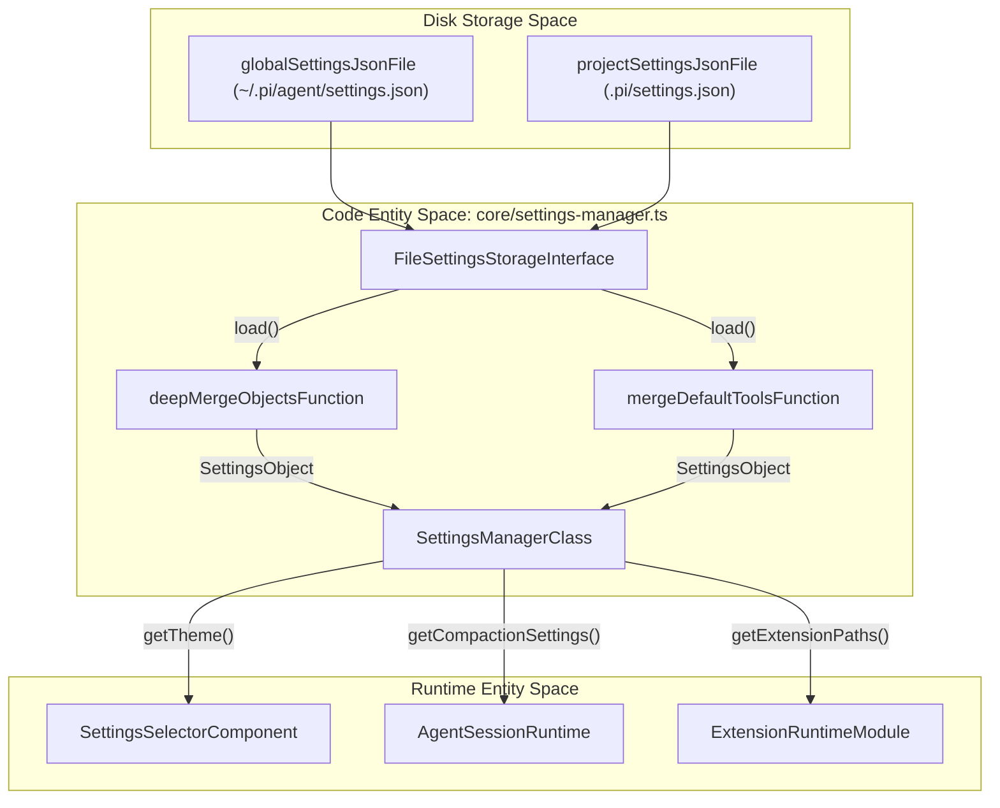
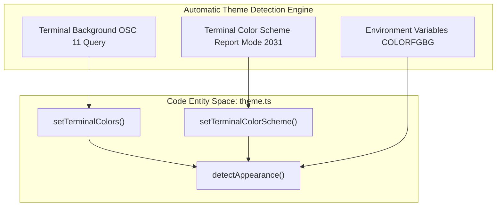

# Settings, Themes, and Keybindings

Relevant source files

The following files were used as context for generating this wiki page:

- [packages/coding-agent/README.md](packages/coding-agent/README.md)
- [packages/coding-agent/docs/keybindings.md](packages/coding-agent/docs/keybindings.md)
- [packages/coding-agent/docs/settings.md](packages/coding-agent/docs/settings.md)
- [packages/coding-agent/docs/themes.md](packages/coding-agent/docs/themes.md)
- [packages/coding-agent/docs/usage.md](packages/coding-agent/docs/usage.md)
- [packages/coding-agent/examples/extensions/dynamic-resources/dynamic.json](packages/coding-agent/examples/extensions/dynamic-resources/dynamic.json)
- [packages/coding-agent/schemas/keybindings.schema.json](packages/coding-agent/schemas/keybindings.schema.json)
- [packages/coding-agent/schemas/theme.schema.json](packages/coding-agent/schemas/theme.schema.json)
- [packages/coding-agent/scripts/generate-schemas.ts](packages/coding-agent/scripts/generate-schemas.ts)
- [packages/coding-agent/src/cli/args.ts](packages/coding-agent/src/cli/args.ts)
- [packages/coding-agent/src/core/keybindings.ts](packages/coding-agent/src/core/keybindings.ts)
- [packages/coding-agent/src/core/settings-manager.ts](packages/coding-agent/src/core/settings-manager.ts)
- [packages/coding-agent/src/main.ts](packages/coding-agent/src/main.ts)
- [packages/coding-agent/src/modes/interactive/components/settings-selector.ts](packages/coding-agent/src/modes/interactive/components/settings-selector.ts)
- [packages/coding-agent/src/modes/interactive/components/tree-selector.ts](packages/coding-agent/src/modes/interactive/components/tree-selector.ts)
- [packages/coding-agent/src/modes/interactive/theme/dark.json](packages/coding-agent/src/modes/interactive/theme/dark.json)
- [packages/coding-agent/src/modes/interactive/theme/light.json](packages/coding-agent/src/modes/interactive/theme/light.json)
- [packages/coding-agent/src/modes/interactive/theme/theme.ts](packages/coding-agent/src/modes/interactive/theme/theme.ts)
- [packages/coding-agent/test/args.test.ts](packages/coding-agent/test/args.test.ts)
- [packages/coding-agent/test/config-schemas.test.ts](packages/coding-agent/test/config-schemas.test.ts)
- [packages/coding-agent/test/session-selector-rename.test.ts](packages/coding-agent/test/session-selector-rename.test.ts)
- [packages/coding-agent/test/settings-manager.test.ts](packages/coding-agent/test/settings-manager.test.ts)
- [packages/coding-agent/test/test-theme-colors.ts](packages/coding-agent/test/test-theme-colors.ts)
- [packages/coding-agent/test/tree-selector.test.ts](packages/coding-agent/test/tree-selector.test.ts)
- [packages/tui/src/keybindings.ts](packages/tui/src/keybindings.ts)
- [packages/tui/test/keybindings.test.ts](packages/tui/test/keybindings.test.ts)

This page details the configuration systems of the `pi` CLI, covering how user preferences are managed via `SettingsManager` [packages/coding-agent/src/core/settings-manager.ts:1-185](), how the TUI settings-selector and JSON theme engine style the interface [packages/coding-agent/src/modes/interactive/components/settings-selector.ts:61-145](), [packages/coding-agent/src/modes/interactive/theme/theme.ts:1-73](), and how keyboard shortcuts are mapped via keybindings configuration.

---

## Settings Management

The `SettingsManager` class is the hub of configuration management for Pi, coordinating settings loading, merging, updating, and persisting across global and project scopes, while ensuring concurrency safety, migration, and external edit preservation.

### Configuration Scopes and Files

| Scope         | File Path                        | Description                                                        |
|---------------|---------------------------------|--------------------------------------------------------------------|
| **Global**    | `~/.pi/agent/settings.json`     | User-wide settings applying to all Pi usages globally              |
| **Project**   | `.pi/settings.json`              | Project-specific settings that override and extend global settings |

The per-project settings file is only loaded after a project trust check, preventing potentially unsafe automatic configuration application if the project is untrusted [packages/coding-agent/docs/settings.md:3-36]().

Sources: [packages/coding-agent/src/core/settings-manager.ts:160-185](), [packages/coding-agent/docs/settings.md:3-36]()

### Data Model and Settings Schema

Settings are represented by the `Settings` interface, covering a broad set of configuration variables:
- AI provider & model defaults (`defaultProvider`, `defaultModel`)
- Thinking level and per-model thinking overrides (`defaultThinkingLevel`, `modelThinkingLevels`)
- Networking/retry policies (`transport`, HTTP idle timeouts)
- Session compaction (`compaction`)
- UI and terminal preferences (`theme`, `hideThinkingBlock`, `tuiMode`, `fullscreenExitOutput`, etc.)
- Extensions, packages, themes, skills resource paths
- Telemetry/analytics options (`enableInstallTelemetry`)
- Shell environment overrides and more

Nested settings like `compaction`, `retry`, and `warnings` merge deeply when combining global and project settings, while arrays and primitives are replaced by the project level when defined [packages/coding-agent/src/core/settings-manager.ts:61-82](), [packages/coding-agent/docs/settings.md:3-95]().

Sources: [packages/coding-agent/src/core/settings-manager.ts:61-82](), [packages/coding-agent/docs/settings.md:3-95]()

### Implementation Details and Data Flow

- **Reading/Writing**: Uses atomic file writes with locking (`proper-lockfile`) to avoid concurrent race conditions on settings files [packages/coding-agent/src/core/settings-manager.ts:4-8](), [packages/coding-agent/src/core/settings-manager.ts:166-168]().
- **Merging Logic**: Internal helpers merge nested objects recursively, falling back to project overrides for arrays and primitive values. Specifically, `deepMergeObjects` handles general object merging, while `mergeDefaultTools` and `resolveDefaultTools` manage the special merging logic for the `defaultTools` array [packages/coding-agent/src/core/settings-manager.ts:61-147]().
- **Change Tracking and Flushing**: `SettingsManager` maintains in-memory overrides and reconciles them with on-disk state.

*Figure 1: Bridging settings storage file paths to `SettingsManager` and consumer classes.*

Sources: [packages/coding-agent/src/core/settings-manager.ts:1-185](), [packages/coding-agent/docs/settings.md:3-36]()

---

## TUI Settings Selector

Pi’s interactive mode provides a rich Terminal UI settings selector (`SettingsSelector` component) that lets users browse and adjust application configuration on the fly.

### Component Overview

- **`SettingsConfig` Interface**: Contains all configuration values currently in effect or available, including models, themes, UI options, toggle flags, etc. [packages/coding-agent/src/modes/interactive/components/settings-selector.ts:61-104]()
- **`SettingsCallbacks` Interface**: Callbacks triggered on user changes to propagate updates back to `SettingsManager` or other subsystems and handle cancellations gracefully [packages/coding-agent/src/modes/interactive/components/settings-selector.ts:106-145]().
- **Nested Submenus**: For hierarchical or grouped settings, such as warning flags, submenus like `WarningSettingsSubmenu` offer refined controls [packages/coding-agent/src/modes/interactive/components/settings-selector.ts:150-184]().

Sources: [packages/coding-agent/src/modes/interactive/components/settings-selector.ts:61-184]()

---

## Theme System and Detection

The theme system supports dark, light, and custom JSON themes to style the terminal UI and export HTML transcripts with meaningful semantics.

### Built-in and Custom Themes

- Pi ships with built-in `dark` and `light` themes expressed as JSON color schemes defining roles like `accent`, `error`, `mdHeading`, `syntaxKeyword`, etc.
- Custom themes are supported by placing JSON files in the agent directory's `themes` folder and validated against `theme-schema.ts`. Validation can be enabled via `setThemeJsonValidator()` for stricter safety [packages/coding-agent/src/modes/interactive/theme/theme.ts:61-73]().

Sources: [packages/coding-agent/src/modes/interactive/theme/theme.ts:61-73]()

### Automatic Theme Detection

Pi detects terminal light/dark appearance automatically through a combined strategy:
1. **Terminal Query**: Sends escape sequences to query the terminal background color.
2. **Terminal Color Scheme Report**: Fallback to color scheme reports via set terminal color scheme handlers.
3. **Environment Variables**: Checks environment variables like `COLORFGBG`.

These elements feed into appearance detection routines in the interactive theme module, choosing between `"dark"` or `"light"` for the `system` theme [packages/coding-agent/src/modes/interactive/theme/theme.ts:138-172]().

*Figure 2: Bridging environmental theme detection inputs to `detectAppearance()`.*

Sources: [packages/coding-agent/src/modes/interactive/theme/theme.ts:138-172]()

---

## Keybindings Configuration

Pi organizes keybindings by mapping terminal keystrokes to semantic actions grouped in namespaces.

### Namespaces and Actions

- **`tui.editor.*`**: Editing actions for multi-line editors, including cursor movement, selection, undo, kill ring, and clipboard.
- **`tui.input.*`**: Input submission, multi-line wrapping, buffer flushing, for single-line input widgets.
- **`app.*`**: Application-level actions such as opening settings, switching models, adjusting thinking levels, session navigation, and tool toggling.

Keybindings can be configured or overridden by extensions or configuration layers, facilitating adaptable workflows.

Sources: [packages/coding-agent/src/main.ts:1-100]()