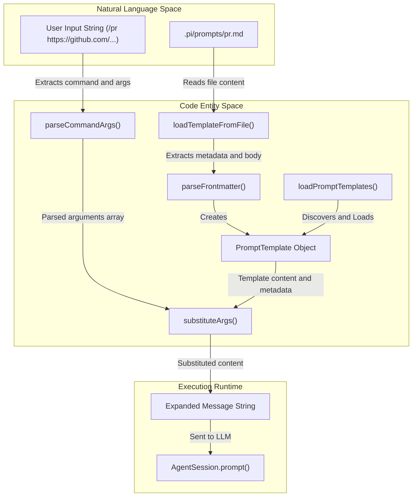
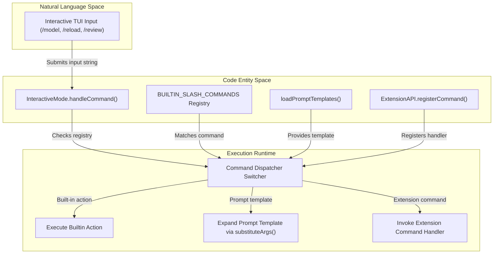

# Slash Commands and Prompt Templates

<details>
<summary>Relevant source files</summary>

The following files were used as context for generating this wiki page:

- [.github/workflows/issue-analysis.yml](.github/workflows/issue-analysis.yml)
- [.pi/extensions/import-repro.ts](.pi/extensions/import-repro.ts)
- [.pi/prompts/is.md](.pi/prompts/is.md)
- [.pi/prompts/pr.md](.pi/prompts/pr.md)
- [.pi/prompts/wr.md](.pi/prompts/wr.md)
- [packages/coding-agent/docs/prompt-templates.md](packages/coding-agent/docs/prompt-templates.md)
- [packages/coding-agent/src/core/prompt-templates.ts](packages/coding-agent/src/core/prompt-templates.ts)
- [packages/coding-agent/src/core/slash-commands.ts](packages/coding-agent/src/core/slash-commands.ts)
- [packages/coding-agent/test/interactive-mode-extension-dialogs.test.ts](packages/coding-agent/test/interactive-mode-extension-dialogs.test.ts)
- [packages/coding-agent/test/interactive-mode-status.test.ts](packages/coding-agent/test/interactive-mode-status.test.ts)
- [packages/coding-agent/test/prompt-templates.test.ts](packages/coding-agent/test/prompt-templates.test.ts)
- [packages/coding-agent/test/settings-selector.test.ts](packages/coding-agent/test/settings-selector.test.ts)
- [packages/coding-agent/test/suite/regressions/5943-session-start-notify.test.ts](packages/coding-agent/test/suite/regressions/5943-session-start-notify.test.ts)

</details>


This page documents the interactive command system in `pi`, covering both the built-in slash commands (`/login`, `/model`, `/tree`, `/fork`, `/clone`, `/compact`, `/export`, `/share`, `/settings`, `/reload`, `/llama`, `/thinking`, and more) and the dynamic prompt template system [packages/coding-agent/src/core/slash-commands.ts:1-44](), [packages/coding-agent/src/core/prompt-templates.ts:1-103](). These mechanisms provide flexible control over session state, navigation of the conversation tree, and expansion of complex prompt workflows from concise user input.

Sources: `packages/coding-agent/src/core/slash-commands.ts:1-44`, `packages/coding-agent/src/core/prompt-templates.ts:1-103`

---

## Slash Commands

Slash commands are special inputs starting with `/` that trigger internal behaviors rather than sending raw text to the LLM. Commands can be built-in, dynamically registered by extensions, or generated from prompt templates and skills. The central slash command registry manages these entries and their associated metadata [packages/coding-agent/src/core/slash-commands.ts:1-44]().

### Built-in Commands

The core of `pi` provides a predefined set of built-in commands with fixed names, descriptions, and optional argument hints. This registry is defined as the constant `BUILTIN_SLASH_COMMANDS` in `packages/coding-agent/src/core/slash-commands.ts` [packages/coding-agent/src/core/slash-commands.ts:19-44]().

| Command | Description | Argument Hint |
| :----- | :---------- | :------------ |
| `/settings` | Open settings menu | — |
| `/model` | Select model (opens selector UI) | `<provider/model>` |
| `/tree` | Navigate session tree (switch branches) | — |
| `/thinking` | Set thinking level | `<level>` |
| `/scoped-models` | Enable/disable models for Ctrl+P cycling | — |
| `/export` | Export session (HTML default, or specify path: `.html`/`.jsonl`) | — |
| `/import` | Import and resume a session from a JSONL file | — |
| `/share` | Share session via a Radius artifact or a GitHub gist | — |
| `/bug` | Report a bug to the Pi developers | `<description>` |
| `/copy` | Copy last agent message to clipboard | — |
| `/name` | Set session display name | — |
| `/session` | Show session info and stats | — |
| `/changelog` | Show changelog entries | — |
| `/hotkeys` | Show all keyboard shortcuts | — |
| `/fork` | Create a new fork from a previous user message | — |
| `/clone` | Duplicate the current session at the current position | — |
| `/trust` | Save project trust decision for future sessions | — |
| `/login` | Configure provider authentication | `<provider>` |
| `/logout` | Remove provider authentication | — |
| `/new` | Start a new session | — |
| `/compact` | Manually compact the session context | — |
| `/resume` | Resume a different session | — |
| `/reload` | Reload keybindings, extensions, skills, prompts, themes, and context files | — |
| `/quit` | Quit `pi` | — |

These built-ins provide essential interactive controls for session management, authentication, model selection, and UI configuration [packages/coding-agent/src/core/slash-commands.ts:19-44]().

### Command Registration and Sources

Slash commands originate from three distinct sources tracked by the `SlashCommandSource` type [packages/coding-agent/src/core/slash-commands.ts:4-11]():

1. **`extension`**: Commands dynamically registered via active extension API registrations.
2. **`prompt`**: Generated dynamically from prompt templates loaded from `.md` files.
3. **`skill`**: Created automatically for each loaded skill, exposed within the `/skill:name` namespace.

The command registry consolidates these sources so the Interactive Mode can dispatch user input to the correct handler [packages/coding-agent/src/core/slash-commands.ts:4-11]().

Sources: `packages/coding-agent/src/core/slash-commands.ts:1-44`

---

## Prompt Templates

Prompt templates define reusable prompt snippets stored as Markdown files with YAML frontmatter metadata. They expand to long multi-line prompts when invoked via matching slash commands, enabling users to perform complex workflows from simple commands [packages/coding-agent/docs/prompt-templates.md:3-5]().

### Template File Structure

A prompt template is a Markdown `.md` file typically stored in personal or project configuration directories. Its metadata is contained in YAML frontmatter, while the remainder of the file body is the template content [packages/coding-agent/src/core/prompt-templates.ts:105-154]().

- **Name**: Derived from the filename (e.g., `pr.md` becomes the slash command `/pr`) [packages/coding-agent/src/core/prompt-templates.ts:129-129]().
- **Description**: Shown during command completion. Taken from the frontmatter `description` field if present, otherwise from the first non-empty line of the body [packages/coding-agent/src/core/prompt-templates.ts:132-140]().
- **Argument Hint**: Optional user-friendly argument usage hint displayed in autocomplete, read from frontmatter `argument-hint` [packages/coding-agent/src/core/prompt-templates.ts:142-142]().

Example `pr.md`:

```markdown
---
description: Review PRs from URLs with structured issue and code analysis
argument-hint: "<PR-URL>"
---
You are given one or more GitHub PR URLs: $@
...
```

The `loadTemplateFromFile()` function reads the file, parses frontmatter and content, then creates a `PromptTemplate` object encapsulating these fields for runtime use [packages/coding-agent/src/core/prompt-templates.ts:105-154]().

### Argument Parsing and Placeholder Substitution

The system supports bash-style quoted argument parsing for the slash command input line using `parseCommandArgs()` [packages/coding-agent/src/core/prompt-templates.ts:25-56](). Arguments can be positional or quoted strings.

Templates contain placeholders for arguments that are replaced at runtime by `substituteArgs()` using a rich syntax [packages/coding-agent/src/core/prompt-templates.ts:71-103]():

| Syntax | Meaning |
| --- | --- |
| `$1`, `$2`, ... | Positional argument n |
| `$@`, `$ARGUMENTS` | All arguments joined by spaces |
| `${1:-default}` | Positional arg 1 or default if missing |
| `${@:-default}`, `${ARGUMENTS:-default}` | All args or default if empty |
| `${@:N}` | Arguments starting from Nth (1-based) |
| `${@:N:L}` | L arguments from Nth |

This allows flexible, context-sensitive expansion of arguments into the prompt templates without recursive substitution inside argument values [packages/coding-agent/src/core/prompt-templates.ts:25-103]().

### Prompt Template Loading and Discovery

The function `loadPromptTemplates()` orchestrates discovering and loading all prompt templates from three sources in priority order [packages/coding-agent/src/core/prompt-templates.ts:216-222]():

1. The global agent directory: `[agentDir]/prompts/`
2. The project local config directory: `[cwd]/.pi/prompts/`
3. Explicit paths set via user or extension configuration

Only direct `.md` files (non-recursive) are loaded from these directories. Broken symlinks are skipped [packages/coding-agent/src/core/prompt-templates.ts:157-198]().

Sources: `packages/coding-agent/src/core/prompt-templates.ts:1-222`, `packages/coding-agent/docs/prompt-templates.md:1-60`

---

### Natural Language Space to Code Entity Space: Prompt Template Expansion Flow

This diagram maps the flow from user input and stored Markdown template files (Natural Language space) into core code entities and runtime prompt expansion (Code Entity space):

Title: Prompt Template Expansion Flow


Sources: `packages/coding-agent/src/core/prompt-templates.ts:25-222`

---

### Slash Command Dispatch and Execution Flow

The Interactive Mode receives user input from the TUI, dispatching slash commands through a unified registry that includes built-in commands, prompt templates, and extension-registered commands.

Title: Slash Command Dispatch and Execution Flow


Sources: `packages/coding-agent/src/core/slash-commands.ts:1-44`, `packages/coding-agent/src/core/prompt-templates.ts:216-222`

---

## Configuration and Reloading

Prompt templates and other resources are loaded from multiple configured locations described above. The `/reload` slash command allows users to trigger a full reload of keybindings, extensions, skills, prompt templates, themes, and context files at runtime without restarting the program [packages/coding-agent/src/core/slash-commands.ts:42-42](). The `InteractiveMode.handleReloadCommand()` method orchestrates this process, ensuring that all relevant components, including the autocomplete provider, are updated [packages/coding-agent/test/suite/regressions/5943-session-start-notify.test.ts:102-102]().

Sources: `packages/coding-agent/src/core/slash-commands.ts:42-42`, `packages/coding-agent/test/suite/regressions/5943-session-start-notify.test.ts:102-102`

---

## Summary of Core Classes and Functions

| Symbol | Description | Source Location |
| :----- | :---------- | :------------- |
| `BUILTIN_SLASH_COMMANDS` | Registry array of all built-in slash commands and metadata | `packages/coding-agent/src/core/slash-commands.ts:19-44` |
| `SlashCommandInfo` | Interface describing slash command metadata | `packages/coding-agent/src/core/slash-commands.ts:6-11` |
| `loadPromptTemplates()` | Main function to load prompt templates from disk locations | `packages/coding-agent/src/core/prompt-templates.ts:216-222` |
| `loadTemplateFromFile()` | Reads a template Markdown file, parses frontmatter and content | `packages/coding-agent/src/core/prompt-templates.ts:105-154` |
| `parseCommandArgs()` | Parses slash command arguments with bash-style quoting | `packages/coding-agent/src/core/prompt-templates.ts:25-56` |
| `substituteArgs()` | Substitutes argument placeholders in the prompt template content | `packages/coding-agent/src/core/prompt-templates.ts:71-103` |
| `InteractiveMode.handleCommand()` | Entry point for slash command dispatch and execution | `packages/coding-agent/test/interactive-mode-status.test.ts:1-195` |
| `InteractiveMode.handleReloadCommand()` | Handles the `/reload` command, reloading resources and updating the UI | `packages/coding-agent/test/suite/regressions/5943-session-start-notify.test.ts:102-102` |

Sources: `packages/coding-agent/src/core/slash-commands.ts:1-44`, `packages/coding-agent/src/core/prompt-templates.ts:25-222`, `packages/coding-agent/test/interactive-mode-status.test.ts:1-195`, `packages/coding-agent/test/suite/regressions/5943-session-start-notify.test.ts:102-102`

---

# References

- Built-in commands and slash command types — [packages/coding-agent/src/core/slash-commands.ts:1-44]()
- Prompt template parsing and substitution — [packages/coding-agent/src/core/prompt-templates.ts:1-103]()
- Prompt template loading and discovery — [packages/coding-agent/src/core/prompt-templates.ts:216-222]()
- Prompt templates example files — [.pi/prompts/pr.md:1-6](), [.pi/prompts/is.md:1-28](), [.pi/prompts/wr.md:1-41]()
- Command dispatch architecture and InteractiveMode tests — [packages/coding-agent/test/interactive-mode-status.test.ts:1-195]()
- Reload command handling — [packages/coding-agent/test/suite/regressions/5943-session-start-notify.test.ts:102-102]()