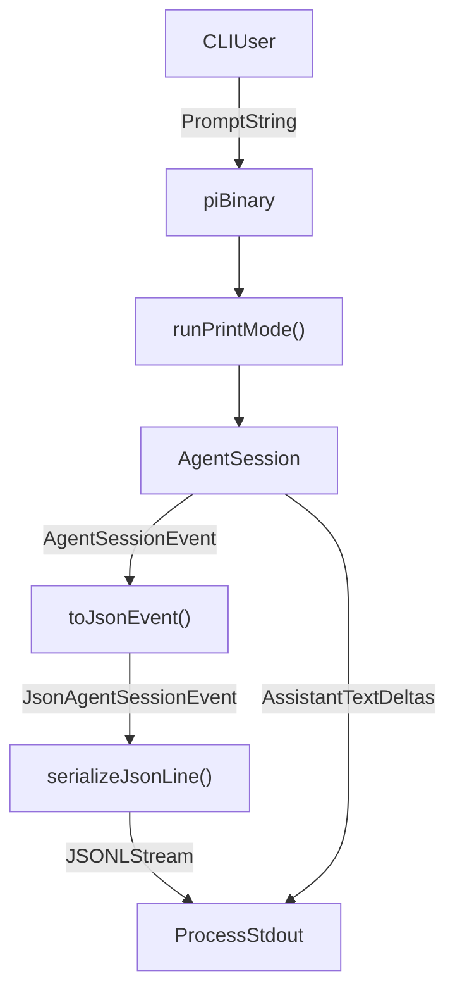
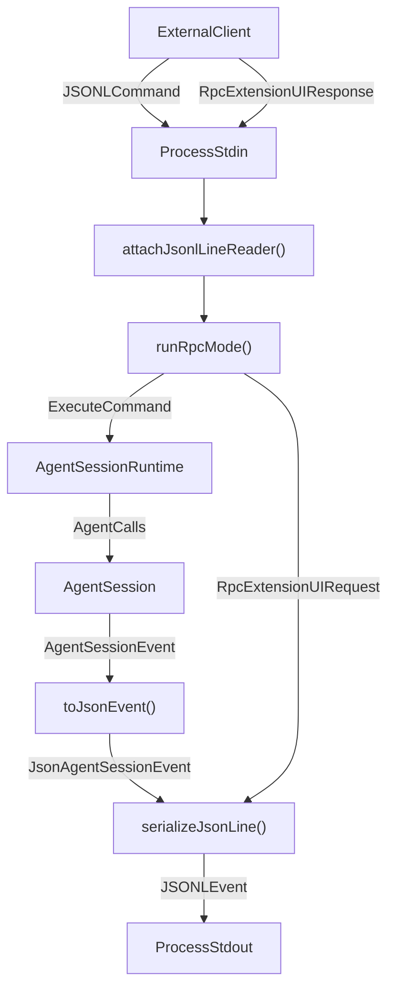
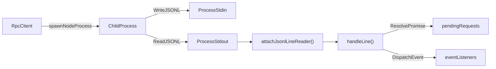

# Alternative Execution Modes: Print, JSON, and RPC

Relevant source files

The following files were used as context for generating this wiki page:

- [packages/coding-agent/docs/json.md](packages/coding-agent/docs/json.md)
- [packages/coding-agent/docs/rpc.md](packages/coding-agent/docs/rpc.md)
- [packages/coding-agent/docs/sdk.md](packages/coding-agent/docs/sdk.md)
- [packages/coding-agent/src/core/output-guard.ts](packages/coding-agent/src/core/output-guard.ts)
- [packages/coding-agent/src/modes/json-event.ts](packages/coding-agent/src/modes/json-event.ts)
- [packages/coding-agent/src/modes/rpc/rpc-client.ts](packages/coding-agent/src/modes/rpc/rpc-client.ts)
- [packages/coding-agent/src/modes/rpc/rpc-types.ts](packages/coding-agent/src/modes/rpc/rpc-types.ts)
- [packages/coding-agent/test/agent-session-concurrent.test.ts](packages/coding-agent/test/agent-session-concurrent.test.ts)
- [packages/coding-agent/test/rpc-prompt-response-semantics.test.ts](packages/coding-agent/test/rpc-prompt-response-semantics.test.ts)
- [packages/coding-agent/test/rpc.test.ts](packages/coding-agent/test/rpc.test.ts)
- [packages/coding-agent/test/suite/regressions/7911-json-stream-usage.test.ts](packages/coding-agent/test/suite/regressions/7911-json-stream-usage.test.ts)
- [packages/coding-agent/test/suite/regressions/7925-toolcall-start-metadata.test.ts](packages/coding-agent/test/suite/regressions/7925-toolcall-start-metadata.test.ts)

Beyond the standard interactive Terminal UI, the `pi` coding agent supports alternative execution modes designed for scripting, automation, CI/CD pipelines, and deep programmatic embedding into IDE extensions or custom dashboards. These modes leverage the underlying `AgentSession` logic [packages/coding-agent/src/core/agent-session.ts:1-14]() but expose tailored interfaces for input and output through different protocols and formats.

---

## 1. Overview and Purpose

When running `pi` without an interactive terminal or when integrating into another runtime, operators choose between three primary alternative execution modes:

- **Print Mode (`runPrintMode`)**: A single-shot execution mode that evaluates a user prompt and streams human-readable text output to standard output once. It is suitable for straightforward scripting where a prompt is answered once and the process terminates.

- **JSON Event Stream Mode**: A mode that outputs a stream of structured JSON events, representing a fine-grained view of the agent's lifecycle, messages, tool executions, retries, and more. It is useful for integrations that want to consume detailed session events to build custom clients or logs.

- **RPC Mode (`runRpcMode`)**: A bidirectional JSON-RPC 2.0 style protocol running over standard input and output with strict JSONL (JSON Lines) framing. It supports asynchronous long-lived control, command/response correlation, event subscriptions, and interactive extension UI message passing. This mode is targeted for deep programmatic embedding, language-independent clients, and IDE extensions.

Sources: [packages/coding-agent/docs/rpc.md:1-5](), [packages/coding-agent/docs/json.md:1-10]()

---

## 2. Print Mode and JSON Event Stream (`runPrintMode` and `toJsonEvent`)

### Implementation and Data Flow

Print mode is implemented in `packages/coding-agent/src/modes/print-mode.ts`. It creates an `AgentSession` via `createAgentSession()` [packages/coding-agent/src/index.ts:249-254]() and sends the prompt to the agent for a single run. The process completes when the agent reaches an idle state.

`runPrintMode` supports two output flavors controlled by CLI flags:

- **Text Mode:** The default print mode emits assistant text deltas and final output directly to `stdout`, streaming human-readable text continuously. It filters assistant message update events for text deltas and writes them in order.

- **JSON Event Stream Mode:** If the `--mode json` option is specified, the agent events are transformed into JSON event messages for structured consumption. Event objects are mapped to lightweight `JsonAgentSessionEvent` types using the `toJsonEvent()` converter function in `packages/coding-agent/src/modes/json-event.ts`. This converter strips cumulative assistant message snapshots and `partial` payloads to maintain a linear stream size optimized for parsers while preserving fixed-size metadata like `usage`, `contentIndex`, `id`, and `toolName` [packages/coding-agent/src/modes/json-event.ts:1-61]().

### Print Mode and JSON Event Stream Data Flow

Sources: [packages/coding-agent/src/modes/json-event.ts:1-61](), [packages/coding-agent/docs/json.md:1-20]()

---

## 3. RPC Mode (`runRpcMode` and Protocol Architecture)

### Protocol Design and Operation

RPC mode, initialized via `runRpcMode()` in `packages/coding-agent/src/modes/rpc/rpc-mode.ts`, is designed for headless, long-lived operation of the coding agent subprocess using a strict JSON Lines (JSONL) framed bidirectional protocol over `stdin` and `stdout`.

- **Framing:** Each record is a complete JSON object serialized on a single line. Only LF (`\n`) characters delimit records; no other special Unicode line separators are recognized [packages/coding-agent/docs/rpc.md:50-55](). Input streams are attached using `attachJsonlLineReader()`.
- **Commands (stdin):** Incoming commands are JSON objects with a required `type` field (such as `prompt`, `steer`, `abort`, `compact`, `set_model`, `bash`, etc.) and an optional `id` string used for request/response pairing [packages/coding-agent/src/modes/rpc/rpc-types.ts:20-74]().
- **Responses (stdout):** For each command, Pi emits a corresponding response with `type: "response"`, echoing the command name and `id`, and indicates success or failure [packages/coding-agent/docs/rpc.md:35-45]().
- **Events (stdout):** Agent runtime events unrelated to commands (like message updates, tool results, retries, etc.) are streamed asynchronously as JSON lines with no command `id`. These events use the same `JsonAgentSessionEvent` schema as in JSON Event Stream mode [packages/coding-agent/docs/rpc.md:25-32]().

### RPC Mode Protocol Flow and Subprocess Integration

Sources: [packages/coding-agent/docs/rpc.md:22-56](), [packages/coding-agent/src/modes/rpc/rpc-types.ts:20-74]()

---

## 4. `rpc-types` and Programmatic Client (`RpcClient`)

### `rpc-types.ts`

Located at `packages/coding-agent/src/modes/rpc/rpc-types.ts`, this module defines the entire RPC command and response TypeScript type hierarchy:

- `RpcCommand`: Union of commands covering prompting (`prompt`, `steer`, `follow_up`, `abort`, `clear_queue`, `new_session`), state inspection (`get_state`), model configuration (`set_model`, `cycle_model`, `get_available_models`), thinking configuration (`set_thinking_level`, `cycle_thinking_level`, `get_available_thinking_levels`), queue modes, compaction, retries, bash execution (`bash`, `abort_bash`), session management, and message retrieval [packages/coding-agent/src/modes/rpc/rpc-types.ts:20-74]().
- `RpcResponse`: Success and failure variants matching each command, carrying appropriate data payloads (such as `PromptDisposition`, `RpcSessionState`, `BashResult`, `CompactionResult`) [packages/coding-agent/src/modes/rpc/rpc-types.ts:116-193]().

### `RpcClient` class

The `RpcClient` class in `packages/coding-agent/src/modes/rpc/rpc-client.ts` is a programmatic wrapper for Node.js hosts to spawn and communicate with the Pi CLI in RPC mode:

- **Process Management:** `start()` spawns a Node.js child process running the CLI with `--mode rpc` using `spawn()` [packages/coding-agent/src/modes/rpc/rpc-client.ts:74-100]().
- **Command Sending:** Typed methods such as `prompt()`, `steer()`, `compact()`, and `bash()` construct and send commands, returning promises that resolve with typed response data [packages/coding-agent/src/modes/rpc/rpc-client.ts:190-210]().
- **Event Subscription:** `onEvent()` registers callbacks for streaming JSON events emitted from the agent [packages/coding-agent/src/modes/rpc/rpc-client.ts:172-180]().
- **Error Handling:** Collects `stderr` output and detects child process exit/error conditions, rejecting pending commands automatically [packages/coding-agent/src/modes/rpc/rpc-client.ts:102-126]().
- **Internal ID Correlation:** Automatically manages unique `id` strings for commands and correlates responses asynchronously via `pendingRequests` map [packages/coding-agent/src/modes/rpc/rpc-client.ts:60-62]().

### RpcClient and Subprocess Interaction

Sources: [packages/coding-agent/src/modes/rpc/rpc-types.ts:1-193](), [packages/coding-agent/src/modes/rpc/rpc-client.ts:1-140]()

---

## 5. Output Guarding and Stdout Cleanliness

### Importance of Output Guarding

In all alternative modes emitting JSONL streams (`print`, `json`, `rpc`), protocol integrity is critical. Any stray or unexpected output to standard output (e.g., `console.log` debug statements, tool output, third-party library warnings) can corrupt the JSON stream, breaking client parsers.

### Implementation

The guarding logic, found in `packages/coding-agent/src/core/output-guard.ts`, redirects ordinary console output and logs to `stderr` unless explicitly bypassed. It provides key functions:

- `takeOverStdout()`: Monkey-patches `process.stdout.write` to divert writes to `process.stderr` [packages/coding-agent/src/core/output-guard.ts:45-70]().
- `restoreStdout()`: Restores original standard output behavior [packages/coding-agent/src/core/output-guard.ts:72-79]().
- `writeRawStdout()`: Enqueues and writes raw data directly to actual `stdout` with backpressure retry handling (`ENOBUFS`, `EAGAIN`, `EWOULDBLOCK`) [packages/coding-agent/src/core/output-guard.ts:20-43]().
- `flushRawStdout()` / `waitForRawStdoutBackpressure()`: Ensures all buffered raw outputs drain completely before process termination [packages/coding-agent/src/core/output-guard.ts:95-108]().

This design guarantees that only valid protocol records or clean text output reach `stdout`, while all application logging and diagnostics flow safely through `stderr`.

Sources: [packages/coding-agent/src/core/output-guard.ts:1-108]()