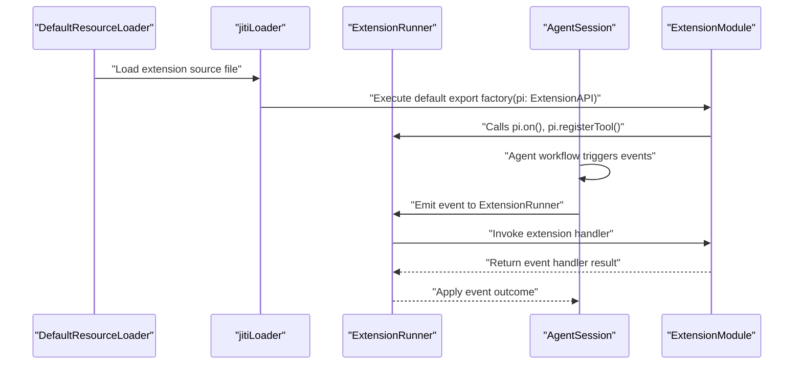

# Extension System

Relevant source files

The following files were used as context for generating this wiki page:

- [packages/coding-agent/docs/extensions.md](packages/coding-agent/docs/extensions.md)
- [packages/coding-agent/examples/extensions/README.md](packages/coding-agent/examples/extensions/README.md)
- [packages/coding-agent/src/core/agent-session.ts](packages/coding-agent/src/core/agent-session.ts)
- [packages/coding-agent/src/core/extensions/index.ts](packages/coding-agent/src/core/extensions/index.ts)
- [packages/coding-agent/src/core/extensions/loader.ts](packages/coding-agent/src/core/extensions/loader.ts)
- [packages/coding-agent/src/core/extensions/runner.ts](packages/coding-agent/src/core/extensions/runner.ts)
- [packages/coding-agent/src/core/extensions/types.ts](packages/coding-agent/src/core/extensions/types.ts)
- [packages/coding-agent/src/core/sdk.ts](packages/coding-agent/src/core/sdk.ts)
- [packages/coding-agent/src/index.ts](packages/coding-agent/src/index.ts)
- [packages/coding-agent/src/modes/interactive/interactive-mode.ts](packages/coding-agent/src/modes/interactive/interactive-mode.ts)
- [packages/coding-agent/src/modes/print-mode.ts](packages/coding-agent/src/modes/print-mode.ts)
- [packages/coding-agent/src/modes/rpc/rpc-mode.ts](packages/coding-agent/src/modes/rpc/rpc-mode.ts)
- [packages/coding-agent/test/extensions-discovery.test.ts](packages/coding-agent/test/extensions-discovery.test.ts)
- [packages/coding-agent/test/extensions-runner.test.ts](packages/coding-agent/test/extensions-runner.test.ts)

The purpose of this page is to provide a high-level overview of the `pi` extension architecture, focusing on discovery, loading, and binding extensions to an agent session, alongside built-in capabilities such as MCP and codemode. Extensions enable developers to extend the agent's functionality by subscribing to lifecycle events, registering custom tools, adding slash commands, and creating interactive terminal UI components.

For detailed technical coverage and API references, consult the child pages:
- [Extension API and Lifecycle Events](#6.1) — The ExtensionAPI interface: `pi.on()`, `registerTool`/`Command`/`Provider`/`Shortcut`/`Flag`/`VirtualModel`, `appendEntry`, the full event catalog, `ExtensionContext`/`ExtensionCommandContext` objects.
- [Extension Loading, Packages, and Resource Discovery](#6.2) — Three-tier discovery (global, project-local, configured), `jiti`-based loading, `ExtensionRuntime` bind pattern, `DefaultResourceLoader` and `DefaultPackageManager` (npm/git/local sources, pi manifest, pinned refs), project trust, hot-reload via `/reload`, pi config selector.
- [Extension Examples and Patterns](#6.3) — Canonical extension examples: `hello`, `todo`, `question`/`questionnaire`, `permission-gate`, `git-checkpoint`, `custom-compaction`, `summarize`, `handoff`, `subagent`, `sandbox`, `gondolin`, `custom-provider-anthropic`/`gitlab-duo`, dynamic tools, tool-override, `with-deps`, and the built-in `llama.cpp` extension.
- [MCP Integration (Model Context Protocol)](#6.4) — The `packages/mcp` client library and the `builtin:mcp` extension: `mcp.json` configuration, stdio and streamable HTTP transports, OAuth discovery/flow for MCP servers, tool registration and namespacing, the `pi mcp` CLI commands, conformance tests.
- [Codemode Sandbox](#6.5) — `packages/codemode` and the builtin `codemode` extension: QuickJS/WASI sandbox host and worker runtime, executing model-written JavaScript that calls tools in parallel, tool exposure modes, codemode result renderer.

---

## Architecture Overview

The Pi extension system is architected to clearly separate concerns of:

- *Discovery and Loading* of extensions via `DefaultResourceLoader` [packages/coding-agent/src/core/resource-loader.ts:1-250]() and `DefaultPackageManager` [packages/coding-agent/src/core/package-manager.ts:1-247](),
- *Extension Runtime Management* for lifecycle and event handling via `ExtensionRunner` [packages/coding-agent/src/core/extensions/runner.ts:1-100](),
- *Session Binding and Interaction* to actively influence agent workflows in `AgentSession` [packages/coding-agent/src/core/agent-session.ts:1-100]().

### Discovery and Loading

Extensions are dynamically discovered using a three-tier resource loader that considers global, project-local, and explicitly configured locations. The `DefaultResourceLoader` class handles this discovery, sourcing extension files from conventional directories under user home and project `.pi/` folders. Extension modules are loaded from TypeScript or JavaScript files, supporting nested directories with `index.ts`.
Sources: [packages/coding-agent/src/core/extensions/loader.ts:1-180]()

Loading uses the `jiti` runtime to dynamically import and compile extensions without requiring separate build steps. This includes aliasing of modules like `typebox` and `@earendil-works/pi-ai`, ensuring compatibility and embedded dependencies resolution.
Sources: [packages/coding-agent/src/core/extensions/loader.ts:40-122]()

Caching mechanisms keyed by current working directory prevent redundant reloads, and project trust checks govern loading of potentially unsafe code. Hot-reload support via commands like `/reload` refreshes the extension runtime without restarting the entire process.
Sources: [packages/coding-agent/src/core/extensions/loader.ts:129-151]()

### Extension Runtime

Once loaded, a factory function exported by each extension is invoked with an `ExtensionAPI` facade object (commonly called `pi`) that provides registration functions and event subscription. This factory may be synchronous or asynchronous, allowing setup of commands, tools, event handlers, UI components, and providers.
Sources: [packages/coding-agent/docs/extensions.md:13-16]()

An `ExtensionRuntime` object with stubbed action methods is initially created and then later bound to real implementations connected to the active `AgentSession`. The `ExtensionRunner` class manages event dispatch, handler invocation, error isolation, tool registration, and UI delegation. Events from agent lifecycle points (like `session_start`, `tool_call`, or `agent_before_settle`) propagate through the runner to invoke all interested extensions in registration order.
Sources: [packages/coding-agent/src/core/extensions/loader.ts:157-180](), [packages/coding-agent/src/core/extensions/runner.ts:1-4]()

### Session Binding and Interaction

Extension APIs become fully operational when the extension runtime is bound to the current `AgentSession`. During session startup, extensions gain access to context objects (`ExtensionContext`, `ExtensionCommandContext`) exposing agent state, UI interfaces (`ctx.ui`), session controls, and messaging APIs (`pi.sendUserMessage()`, `pi.appendEntry()`).
Sources: [packages/coding-agent/src/core/extensions/types.ts:76-81](), [packages/coding-agent/src/core/extensions/types.ts:149-186]()

Extensions can dynamically:

- Modify or augment prompt content before model calls,
- Register and execute custom LLM-callable tools,
- Add slash commands and keyboard shortcuts,
- Persist custom non-transcript session data,
- Control which tools and models are active,
- Provide custom renderers for terminal UI components.

---

### Bridging Natural Language Space to Code Entity Space

Diagram: Extension Architecture and Binding Mapping

```mermaid
graph TD
    subgraph "Natural Language & Extension Space"
        EF["ExtensionFactory"] -- "invokes pi.on(), pi.registerTool()" --> API["ExtensionAPI"]
    end

    subgraph "Code Entity Space: pi-coding-agent"
        API -- "registers handlers to" --> ER["ExtensionRunner"]
        ER -- "binds to and manages" --> AS["AgentSession"]
        AS -- "emits session events to" --> ER
        ER -- "runs extension handlers in" --> EF
    end

    subgraph "UI Space"
        ER -- "delegates UI calls to" --> UI["ExtensionUIContext"]
        UI -- "renders through" --> IM["InteractiveMode / RpcMode"]
    end
```

Sources:  
[packages/coding-agent/src/core/extensions/runner.ts:21-37](),  
[packages/coding-agent/src/core/agent-session.ts:73-94](),  
[packages/coding-agent/src/core/extensions/loader.ts:1-130](),  
[packages/coding-agent/src/modes/interactive/interactive-mode.ts:1-4](),  
[packages/coding-agent/src/modes/rpc/rpc-mode.ts:1-12]()

---

## Extension API and Lifecycle Events

The `ExtensionAPI` interface is the primary integration point for extensions. It exposes methods enabling extensions to:

- Subscribe to lifecycle events via `pi.on()` such as `session_start`, `tool_call`, `message_end`, and many more.
- Register custom LLM-callable tools via `pi.registerTool()`.
- Add slash commands with `pi.registerCommand()`, extending the CLI command set.
- Register keyboard shortcuts and CLI flags for enhanced user experience.
- Send user or custom messages into the session transcript or UI with `pi.sendUserMessage()` and `pi.sendMessage()`.
- Persist session metadata or arbitrary data through `pi.appendEntry()`.
- Manage session state—active tools, model selection, thinking levels—through API methods.

Extension handlers receive strongly typed context objects (`ExtensionContext`, `ExtensionCommandContext`) that provide session data, UI operations (`ctx.ui`), messaging, and action helpers.

For details, see [Extension API and Lifecycle Events](#6.1).

Sources:  
[packages/coding-agent/src/core/extensions/types.ts:1-100](),  
[packages/coding-agent/src/index.ts:53-155]()

---

## Extension Loading, Packages, and Resource Discovery

Extensions are discovered using a three-tier model (global, project-local, configured) coordinated by `DefaultResourceLoader` and `DefaultPackageManager`. Loading utilizes `jiti` for zero-step TypeScript compilation with built-in module aliasing.

Project trust rules govern whether project-local extensions are loaded, and the `/reload` command triggers dynamic replacement of the `ExtensionRuntime` without restarting the host process.

For details, see [Extension Loading, Packages, and Resource Discovery](#6.2).

### Extension Loading Lifecycle Sequence

Diagram: Extension Loading and Event Flow Sequence

Sources:  
[packages/coding-agent/src/core/extensions/loader.ts:1-130](),  
[packages/coding-agent/src/core/extensions/runner.ts:1-100](),  
[packages/coding-agent/src/core/agent-session.ts:70-85](),  
[packages/coding-agent/src/index.ts:245-254]()

---

## Extension Examples and Patterns

The repository provides numerous canonical examples demonstrating how to use tools, lifecycle hooks, custom compaction, subagents, and custom UI components.

For details, see [Extension Examples and Patterns](#6.3) and the [examples/extensions README](packages/coding-agent/examples/extensions/README.md).

Sources:  
[packages/coding-agent/docs/extensions.md:1-120](),  
[packages/coding-agent/examples/extensions/README.md]()

---

## MCP Integration (Model Context Protocol)

Pi supports integration with MCP servers through the `packages/mcp` client library and the built-in `builtin:mcp` extension. MCP enables robust management and synchronization of model context sessions with external servers via stdio or streamable HTTP transports, complete with OAuth discovery and namespaced tool registration.

For details, see [MCP Integration (Model Context Protocol)](#6.4).

Sources:  
[packages/coding-agent/src/index.ts:220-250]()

---

## Codemode Sandbox

The Codemode subsystem, implemented in `packages/codemode` and powered by the built-in `codemode` extension, provides a QuickJS/WASI sandbox host and worker runtime. It enables models to execute JavaScript that invokes tools in parallel under strict permission controls.

For details, see [Codemode Sandbox](#6.5).

Sources:  
[packages/coding-agent/src/index.ts:240-254]()