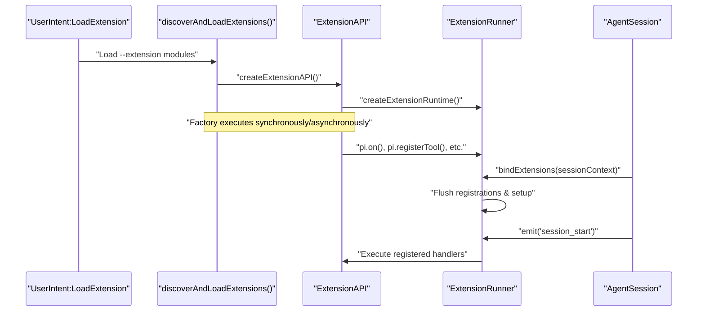
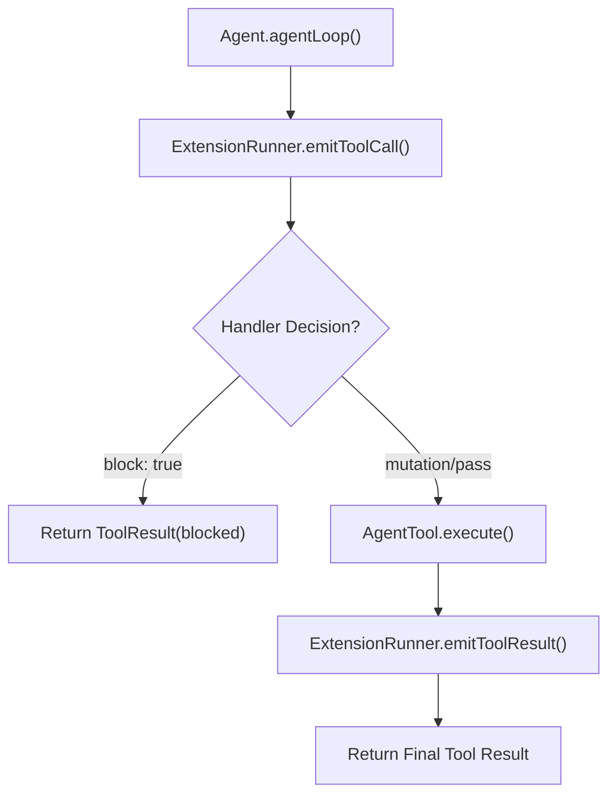
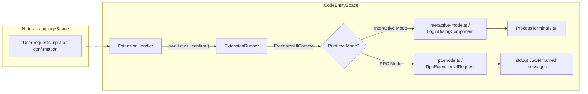

# Extension API and Lifecycle Events

Relevant source files

The following files were used as context for generating this wiki page:

- [packages/coding-agent/docs/extensions.md](packages/coding-agent/docs/extensions.md)
- [packages/coding-agent/examples/extensions/README.md](packages/coding-agent/examples/extensions/README.md)
- [packages/coding-agent/src/core/agent-session.ts](packages/coding-agent/src/core/agent-session.ts)
- [packages/coding-agent/src/core/extensions/index.ts](packages/coding-agent/src/core/extensions/index.ts)
- [packages/coding-agent/src/core/extensions/loader.ts](packages/coding-agent/src/core/extensions/loader.ts)
- [packages/coding-agent/src/core/extensions/runner.ts](packages/coding-agent/src/core/extensions/runner.ts)
- [packages/coding-agent/src/core/extensions/types.ts](packages/coding-agent/src/core/extensions/types.ts)
- [packages/coding-agent/src/core/sdk.ts](packages/coding-agent/src/core/sdk.ts)
- [packages/coding-agent/src/index.ts](packages/coding-agent/src/index.ts)
- [packages/coding-agent/src/modes/interactive/interactive-mode.ts](packages/coding-agent/src/modes/interactive/interactive-mode.ts)
- [packages/coding-agent/src/modes/print-mode.ts](packages/coding-agent/src/modes/print-mode.ts)
- [packages/coding-agent/src/modes/rpc/rpc-mode.ts](packages/coding-agent/src/modes/rpc/rpc-mode.ts)
- [packages/coding-agent/test/extensions-discovery.test.ts](packages/coding-agent/test/extensions-discovery.test.ts)
- [packages/coding-agent/test/extensions-runner.test.ts](packages/coding-agent/test/extensions-runner.test.ts)

Extensions in `pi` are TypeScript modules enabling developers to intercept agent behavior, register custom tools, create slash commands, extend CLI functionality, and interact via custom terminal UI components [packages/coding-agent/docs/extensions.md:1-8](). The extension system is event-driven and tightly integrated with the `AgentSession` lifecycle [packages/coding-agent/src/core/agent-session.ts:1-14]().

---

## ExtensionAPI Interface

The `ExtensionAPI` interface exposes the main API surface for extensions at runtime. It is passed as the sole argument to the extension's default exported factory function [packages/coding-agent/docs/extensions.md:13-30](), [packages/coding-agent/src/core/extensions/types.ts:413-451]().

### Key Methods and Registrations

| Method | Description | Code Source |
| --- | --- | --- |
| `pi.on(event, handler)` | Subscribe to lifecycle, agent, tool, prompt, or session events. Handlers may mutate data, block operations, or observe state. | [packages/coding-agent/src/core/extensions/types.ts:416-417]() |
| `pi.registerTool(definition)` | Register a new LLM-callable tool with input/output handling. | [packages/coding-agent/src/core/extensions/types.ts:419-420]() |
| `pi.registerCommand(name, definition)` | Define a slash command (`/my-command`) with execution handler and description. | [packages/coding-agent/src/core/extensions/types.ts:422-423]() |
| `pi.registerShortcut(key, definition)` | Bind keyboard shortcuts to semantic actions for TUI and CLI. | [packages/coding-agent/src/core/extensions/types.ts:425-426]() |
| `pi.registerFlag(name, definition)` | Declare CLI flags recognized by the `pi` runner. | [packages/coding-agent/src/core/extensions/types.ts:431-432]() |
| `pi.registerProvider(name, config)` | Register a custom LLM provider configuration for model requests. | [packages/coding-agent/src/core/extensions/types.ts:434-435]() |
| `pi.unregisterProvider(name)` | Remove a previously registered LLM provider. | [packages/coding-agent/src/core/extensions/types.ts:437-438]() |
| `pi.appendEntry(entry)` | Append persistent structured entries (e.g., custom state) to the session JSONL store. | [packages/coding-agent/src/core/extensions/types.ts:446-447]() |
| `pi.sendUserMessage(text, options)` | Programmatically insert a user message into the active conversation. | [packages/coding-agent/src/core/extensions/types.ts:450-451]() |
| `pi.registerVirtualModel(name, definition)` | Register a virtual model that routes requests to other models based on criteria. | [packages/coding-agent/src/core/extensions/types.ts:440-441]() |

Sources:  
[packages/coding-agent/docs/extensions.md:13-30](),  
[packages/coding-agent/src/core/extensions/types.ts:413-451]()

---

## Extension Loading and Binding Flow

Extensions are dynamically loaded via the `jiti` runtime loader enabling native support for TypeScript modules without separate compilation [packages/coding-agent/src/core/extensions/loader.ts:1-180](). Once loaded, extension factories execute and register event listeners via the `ExtensionAPI` [packages/coding-agent/src/core/extensions/runner.ts:1-250](). When an `AgentSession` is initialized or rebound, the `ExtensionRunner` binds all loaded extensions and emits the `session_start` event [packages/coding-agent/src/core/agent-session.ts:720-760]().

### Diagram: Extension Binding Sequence (Natural Language Space to Code Entity Space)

Title: "Extension Binding and Loading Flow"

Sources:  
[packages/coding-agent/src/core/extensions/loader.ts:1-180](),  
[packages/coding-agent/src/core/extensions/runner.ts:1-250](),  
[packages/coding-agent/src/core/agent-session.ts:720-760]()

---

## Lifecycle Events Catalog

Extensions can register handlers for a thorough set of lifecycle events spanning session management, agent turn execution, tool calls, and provider API interactions [packages/coding-agent/src/core/extensions/types.ts:200-355]().

### Session and Environment Events
- `session_start` / `session_shutdown`: Fired at initialization and termination [packages/coding-agent/src/core/extensions/types.ts:150-165]().
- `resources_discover`: Emitted when scanning for resources like skills and themes [packages/coding-agent/src/core/extensions/types.ts:146-148]().
- `session_before_switch`, `session_before_fork`, `session_before_compact`, `session_before_tree`: Interception hooks prior to state mutations [packages/coding-agent/src/core/extensions/types.ts:150-157]().
- `project_trust`: Emitted to determine if a project's resources should be trusted [packages/coding-agent/src/core/extensions/types.ts:130-138]().

### Agent Turn and Tool Events
- `turn_start` / `turn_end`: Marks beginning and end of an agent loop iteration [packages/coding-agent/src/core/extensions/types.ts:184-195]().
- `before_agent_start`: Modify prompt or system prompt options before LLM requests [packages/coding-agent/src/core/extensions/types.ts:40-45]().
- `tool_call` / `tool_result`: Intercept and mutate tool inputs or outputs [packages/coding-agent/src/core/extensions/types.ts:170-192]().
- `tool_execution_start`, `tool_execution_update`, `tool_execution_end`: Detailed events during tool execution [packages/coding-agent/src/core/extensions/types.ts:179-183]().
- `user_bash`: Intercept user-initiated bash commands [packages/coding-agent/src/core/extensions/types.ts:202-204]().

### Provider and Model Events
- `before_provider_request`, `before_provider_headers`, `after_provider_response`: Hooks for modifying or observing LLM provider requests and responses [packages/coding-agent/src/core/extensions/types.ts:20-25]().
- `provider_stream_event`: Fires for each parsed provider stream event before normalization [packages/coding-agent/docs/extensions.md:108-112]().
- `model_select`, `thinking_level_select`: Notifies when the active model or thinking level changes [packages/coding-agent/src/core/extensions/types.ts:124-129]().

### Message and Context Events
- `message_start`, `message_update`, `message_end`: Events during the generation of assistant messages [packages/coding-agent/src/core/extensions/types.ts:117-123]().
- `context`, `context_with_system`: Transform conversation messages or the complete transcript [packages/coding-agent/docs/extensions.md:114-116]().
- `agent_before_settle`, `agent_settled`: Final actionable and notification-only boundaries of an agent run [packages/coding-agent/docs/extensions.md:65-67]().

### Diagram: Tool Execution Interception Logic

Title: "Tool Execution Interception Pipeline"

Sources:  
[packages/coding-agent/src/core/extensions/runner.ts:530-580](),  
[packages/coding-agent/src/core/extensions/types.ts:250-260]()

---

## ExtensionContext and ExtensionCommandContext Objects

Event and command handlers receive typed context objects providing methods and properties for interacting with session state, agent tools, model routing, and UI interaction [packages/coding-agent/src/core/extensions/types.ts:355-412]().

### ExtensionContext
- `ctx.sessionManager`: Read-only access to session history [packages/coding-agent/src/core/extensions/types.ts:360-365]().
- `ctx.model`: Active LLM metadata [packages/coding-agent/src/core/extensions/types.ts:370-375]().
- `ctx.cwd`: Current working directory [packages/coding-agent/src/core/extensions/types.ts:380-385]().
- `ctx.ui`: UI primitives for dialogs and notifications [packages/coding-agent/src/core/extensions/types.ts:149-190]().
- `ctx.scopedModels`: List of models available in the current scope [packages/coding-agent/src/core/extensions/types.ts:376-377](), [packages/coding-agent/test/extensions-runner.test.ts:114-127]().

### ExtensionCommandContext
Slash command handlers inherit from `ExtensionContext` and add session lifecycle methods such as `ctx.newSession()`, `ctx.fork()`, `ctx.reload()`, `ctx.switchSession()`, and `ctx.shutdown()` [packages/coding-agent/src/core/extensions/types.ts:413-435]().

Sources:  
[packages/coding-agent/src/core/extensions/types.ts:355-435](),  
[packages/coding-agent/test/extensions-runner.test.ts:114-127]()

---

## UI Primitives and Execution Mode Adaptations

The `ctx.ui` property exposes interactive user interface methods [packages/coding-agent/src/core/extensions/types.ts:149-190](). To accommodate different runtime modes (Interactive TUI vs. Headless JSON-RPC), the UI context abstracts user input differences.

### Diagram: UI Request Routing (Natural Language Space to Code Entity Space)

Title: "UI Request Routing Architecture"

Sources:  
[packages/coding-agent/src/core/extensions/types.ts:138-190](),  
[packages/coding-agent/src/modes/interactive/interactive-mode.ts:1315-1565](),  
[packages/coding-agent/src/modes/rpc/rpc-mode.ts:54-215]()

---

## Session Persistence and `appendEntry`

Extensions can persist custom metadata across sessions by appending entries to the session JSONL store [packages/coding-agent/docs/extensions.md:79-85](). When `pi.appendEntry()` is invoked, the `AgentSession` delegates to `SessionManager.appendEntry()` which serializes and writes the JSON line to disk [packages/coding-agent/src/core/session-manager.ts:570-590]().

Sources:  
[packages/coding-agent/docs/extensions.md:79-85](),  
[packages/coding-agent/src/core/session-manager.ts:570-590]()