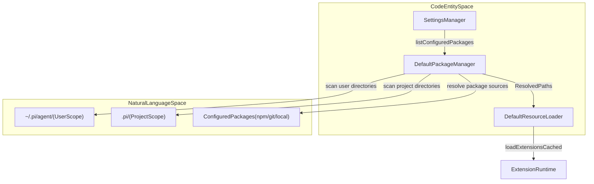
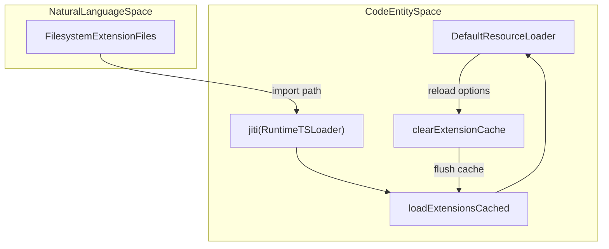

# Extension Loading, Packages, and Resource Discovery

<details>
<summary>Relevant source files</summary>

The following files were used as context for generating this wiki page:

- [packages/coding-agent/docs/packages.md](packages/coding-agent/docs/packages.md)
- [packages/coding-agent/src/config.ts](packages/coding-agent/src/config.ts)
- [packages/coding-agent/src/core/package-manager.ts](packages/coding-agent/src/core/package-manager.ts)
- [packages/coding-agent/src/core/resource-loader.ts](packages/coding-agent/src/core/resource-loader.ts)
- [packages/coding-agent/src/package-manager-cli.ts](packages/coding-agent/src/package-manager-cli.ts)
- [packages/coding-agent/src/utils/management-http.ts](packages/coding-agent/src/utils/management-http.ts)
- [packages/coding-agent/src/utils/version-check.ts](packages/coding-agent/src/utils/version-check.ts)
- [packages/coding-agent/test/config.test.ts](packages/coding-agent/test/config.test.ts)
- [packages/coding-agent/test/git-update.test.ts](packages/coding-agent/test/git-update.test.ts)
- [packages/coding-agent/test/management-http.test.ts](packages/coding-agent/test/management-http.test.ts)
- [packages/coding-agent/test/package-command-paths.test.ts](packages/coding-agent/test/package-command-paths.test.ts)
- [packages/coding-agent/test/package-manager.test.ts](packages/coding-agent/test/package-manager.test.ts)
- [packages/coding-agent/test/resource-loader.test.ts](packages/coding-agent/test/resource-loader.test.ts)
- [packages/coding-agent/test/version-check.test.ts](packages/coding-agent/test/version-check.test.ts)
- [scripts/build-coding-agent-bundle.mjs](scripts/build-coding-agent-bundle.mjs)

</details>


Extensions in the `pi` codebase are modular TypeScript or JavaScript components that enhance the agent by registering tools, commands, flags, and interactive features. This page details the mechanisms behind extension discovery, resource loading from packages, runtime binding, dependency management, safety controls like project trust, and interactive configuration via the `pi config` selector.

---

## Purpose and Scope

The extension and packaging subsystem handles three primary responsibilities:
1. **Three-tier resource discovery** spanning global user directories, project-local directories, and external package sources (npm, git, local paths) [packages/coding-agent/docs/packages.md:29-37]().
2. **Jiti-based dynamic runtime loading** and caching of extensions without a mandatory pre-compilation step [packages/coding-agent/src/core/resource-loader.ts:14-19]().
3. **Package management, dependency validation, and interactive configuration** via `DefaultPackageManager`, `DefaultResourceLoader`, and the `ConfigSelectorComponent` [packages/coding-agent/src/core/package-manager.ts:129-145](), [packages/coding-agent/src/core/resource-loader.ts:14-19](), [packages/coding-agent/src/package-manager-cli.ts:15-16]().

Sources: [packages/coding-agent/docs/packages.md:29-37](), [packages/coding-agent/src/core/package-manager.ts:129-145](), [packages/coding-agent/src/core/resource-loader.ts:14-19](), [packages/coding-agent/src/package-manager-cli.ts:15-16]()

---

## Three-Tier Resource Discovery

The `pi` extension system discovers resources (extensions, skills, prompt templates, and themes) using a three-tier layered model managed by `DefaultPackageManager` and `DefaultResourceLoader` [packages/coding-agent/src/core/package-manager.ts:129-145]().

### The Three Discovery Tiers

1. **Global (User) Scope**
   - Resources installed globally for the user reside under `~/.pi/agent/` (e.g., `~/.pi/agent/extensions/`) [packages/coding-agent/docs/packages.md:19]().
   - These resources apply across all projects unless overridden by project-local resources.

2. **Project-Local Scope**
   - Resources under the current project's `.pi/` directory (e.g., `.pi/extensions/`) [packages/coding-agent/docs/packages.md:19]().
   - They take precedence over global resources and affect only the active project, subject to project trust validation [packages/coding-agent/docs/packages.md:19-21]().

3. **Configured Package Sources**
   - Explicitly configured package sources (npm, git, local paths) declared in user or project `settings.json` [packages/coding-agent/docs/packages.md:19-37]().

### Resource Precedence

Conflicts between identically named resources are resolved deterministically using `resourcePrecedenceRank()` [packages/coding-agent/src/core/package-manager.ts:207-211]() based on metadata:

| Rank | Metadata (Source / Scope / Origin) | Description |
| :--- | :--- | :--- |
| `0` | Project-local settings entry (`local`, `project`) | Highest priority explicitly declared project resource [packages/coding-agent/src/core/package-manager.ts:207-211](). |
| `1` | Project auto-discovered (`auto`, `project`) | Auto-discovered resource inside project `.pi` [packages/coding-agent/src/core/package-manager.ts:207-211](). |
| `2` | User settings entry (`local`, `user`) | Explicitly declared global user resource [packages/coding-agent/src/core/package-manager.ts:207-211](). |
| `3` | User auto-discovered (`auto`, `user`) | Auto-discovered resource inside global user agent directory [packages/coding-agent/src/core/package-manager.ts:207-211](). |
| `4` | Package resource (`origin: "package"`) | Resources bundled inside npm, git, or local packages [packages/coding-agent/src/core/package-manager.ts:207-211](). |
| `5` | Built-in extensions (`source: "builtin"`) | Built-in extensions load last and can be overridden by third-party extensions [packages/coding-agent/src/core/package-manager.ts:207-211](). |

### Discovery Pipeline Diagram



Sources: [packages/coding-agent/src/core/package-manager.ts:129-145](), [packages/coding-agent/src/core/package-manager.ts:207-211](), [packages/coding-agent/src/core/resource-loader.ts:14-19](), [packages/coding-agent/docs/packages.md:19-37]()

---

## PackageManager and Package Sources

`DefaultPackageManager` provides methods for managing package lifecycles across three distinct source types [packages/coding-agent/src/core/package-manager.ts:129-145]().

### Supported Package Source Types

- **npm Packages**
  - Specified via `npm:@scope/package@version` or `npm:package` [packages/coding-agent/docs/packages.md:12]().
  - Versioned specs are pinned by exact semver validation via `isExactNpmVersion()` and `getNpmVersionRange()` [packages/coding-agent/src/core/package-manager.ts:66-72]().
- **Git Repositories**
  - Identified by the `git:` prefix or git URLs (`https://`, `ssh://`) [packages/coding-agent/docs/packages.md:13,35]().
  - Cloned into `agentDir/git/<host>/<path>` [packages/coding-agent/test/git-update.test.ts:88]().
  - Supports pinned refs, tags, and commits; `update()` reconciles checkouts [packages/coding-agent/docs/packages.md:38]().
- **Local Paths**
  - Absolute or relative filesystem paths pointing to directories or individual extension files [packages/coding-agent/docs/packages.md:14,40]().

### Package Manifests (`PiManifest`)

Packages can explicitly declare resources via the `"pi"` key in their `package.json` [packages/coding-agent/docs/packages.md:57-70]():

```json
{
  "name": "my-pi-package",
  "keywords": ["pi-package"],
  "pi": {
    "extensions": ["./src/extension.ts"],
    "skills": ["./resources/skills"],
    "prompts": ["./resources/prompts/*.md"],
    "themes": ["./resources/themes/*.json"]
  }
}
```

If no `pi` manifest is present, convention-based subdirectories (`extensions/`, `skills/`, `prompts/`, `themes/`) are auto-discovered [packages/coding-agent/docs/packages.md:44-55]().

Sources: [packages/coding-agent/src/core/package-manager.ts:66-72](), [packages/coding-agent/src/core/package-manager.ts:129-145](), [packages/coding-agent/docs/packages.md:12-70](), [packages/coding-agent/test/git-update.test.ts:88]()

---

## Extension Packages, Dependencies, and Warnings

`DefaultResourceLoader` inspects installed package manifests (`package.json`) to enforce correct host dependency declarations [packages/coding-agent/src/core/resource-loader.ts:71-102]().

### Host-Provided Package Guard

Certain core packages must **not** be bundled as regular dependencies inside extensions. Instead, they must be declared in `peerDependencies` with a `"*"` range [packages/coding-agent/docs/packages.md:88]():
- `@earendil-works/pi-agent-core` [packages/coding-agent/src/core/resource-loader.ts:58-69]()
- `@earendil-works/pi-ai` [packages/coding-agent/src/core/resource-loader.ts:58-69]()
- `@earendil-works/pi-coding-agent` [packages/coding-agent/src/core/resource-loader.ts:58-69]()
- `@earendil-works/pi-tui` [packages/coding-agent/src/core/resource-loader.ts:58-69]()
- `typebox` [packages/coding-agent/src/core/resource-loader.ts:58-69]()

`HOST_PROVIDED_EXTENSION_PACKAGES` defines this restriction set [packages/coding-agent/src/core/resource-loader.ts:58-69]().

### Warning Collection and Replaceable Extensions

- `collectExtensionPackageWarnings()` scans extension package manifests and warns if host packages appear in `dependencies`, preventing duplicate runtime module instances [packages/coding-agent/src/core/resource-loader.ts:71-102]().
- `omitReplacedExtensions()` filters out replaceable built-in extensions if a third-party extension registers conflicting tool, command, or flag names [packages/coding-agent/src/core/resource-loader.ts:149-195]().

Sources: [packages/coding-agent/src/core/resource-loader.ts:58-102](), [packages/coding-agent/src/core/resource-loader.ts:149-195](), [packages/coding-agent/docs/packages.md:76-90]()

---

## Resource Loader, Jiti Caching, and Hot-Reload

Extensions are loaded dynamically via `jiti` at runtime, enabling direct execution of TypeScript files without pre-compilation [packages/coding-agent/src/core/resource-loader.ts:14-19]().

### Key Functions and Classes

- `DefaultResourceLoader`: Orchestrates loading of extensions, skills, prompts, and themes, exposing `getExtensions()`, `getSkills()`, `getPrompts()`, `getThemes()`, and `reload()` [packages/coding-agent/src/core/resource-loader.ts:153-164]().
- `loadExtensionsCached()`: Asynchronously loads extension modules using `jiti` caches [packages/coding-agent/src/core/resource-loader.ts:14-19]().
- `clearExtensionCache()`: Flushes extension and module caches prior to reloading [packages/coding-agent/src/core/resource-loader.ts:14-19]().

### Resource Loading Architecture Diagram



Sources: [packages/coding-agent/src/core/resource-loader.ts:14-19](), [packages/coding-agent/src/core/resource-loader.ts:153-164]()

---

## Project Trust, Hot-Reload via `/reload`, and Config Selector

Because extensions execute arbitrary system code, project-local packages and extensions require project trust before activation [packages/coding-agent/docs/packages.md:19-21]().

### Hot-Reload Mechanism

The interactive slash command `/reload` triggers `DefaultResourceLoader.reload()` [packages/coding-agent/src/core/resource-loader.ts:153-164](), which:
1. Clears existing extension caches via `clearExtensionCache()` [packages/coding-agent/src/core/resource-loader.ts:14-19]().
2. Rescans resource tiers via `DefaultPackageManager` [packages/coding-agent/src/core/package-manager.ts:129-145]().
3. Re-imports and re-binds all active extensions to the session runtime [packages/coding-agent/src/core/resource-loader.ts:14-19]().

### Interactive Configuration Selector

The `ConfigSelectorComponent` provides a TUI interface for inspecting and toggling discovered resource states (enabling or disabling specific extensions, skills, prompts, and themes) across global and project scopes [packages/coding-agent/src/package-manager-cli.ts:15-16]().

Sources: [packages/coding-agent/src/core/package-manager.ts:129-145](), [packages/coding-agent/src/core/resource-loader.ts:14-19](), [packages/coding-agent/src/core/resource-loader.ts:153-164](), [packages/coding-agent/src/package-manager-cli.ts:15-16](), [packages/coding-agent/docs/packages.md:19-21]()