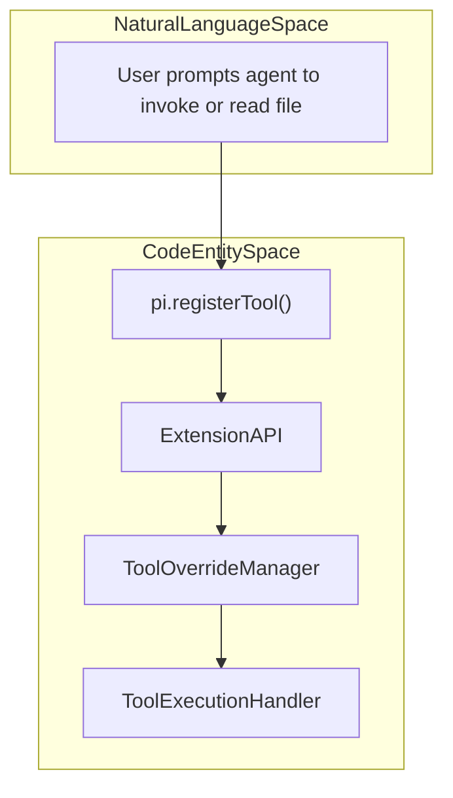
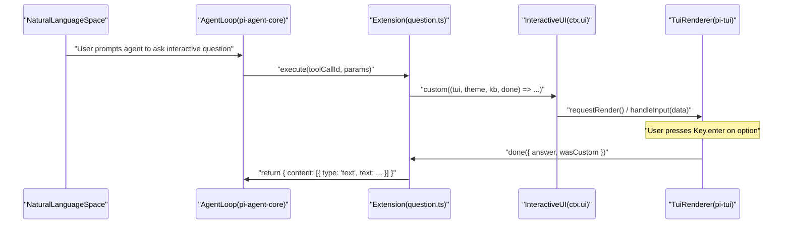

# Extension Examples and Patterns

Relevant source files

The following files were used as context for generating this wiki page:

- [packages/coding-agent/docs/llama-cpp.md](packages/coding-agent/docs/llama-cpp.md)
- [packages/coding-agent/examples/README.md](packages/coding-agent/examples/README.md)
- [packages/coding-agent/examples/extensions/built-in-tool-renderer.ts](packages/coding-agent/examples/extensions/built-in-tool-renderer.ts)
- [packages/coding-agent/examples/extensions/custom-compaction.ts](packages/coding-agent/examples/extensions/custom-compaction.ts)
- [packages/coding-agent/examples/extensions/custom-provider-anthropic/package-lock.json](packages/coding-agent/examples/extensions/custom-provider-anthropic/package-lock.json)
- [packages/coding-agent/examples/extensions/custom-provider-anthropic/package.json](packages/coding-agent/examples/extensions/custom-provider-anthropic/package.json)
- [packages/coding-agent/examples/extensions/custom-provider-gitlab-duo/package.json](packages/coding-agent/examples/extensions/custom-provider-gitlab-duo/package.json)
- [packages/coding-agent/examples/extensions/gondolin/package-lock.json](packages/coding-agent/examples/extensions/gondolin/package-lock.json)
- [packages/coding-agent/examples/extensions/gondolin/package.json](packages/coding-agent/examples/extensions/gondolin/package.json)
- [packages/coding-agent/examples/extensions/handoff.ts](packages/coding-agent/examples/extensions/handoff.ts)
- [packages/coding-agent/examples/extensions/hello.ts](packages/coding-agent/examples/extensions/hello.ts)
- [packages/coding-agent/examples/extensions/minimal-mode.ts](packages/coding-agent/examples/extensions/minimal-mode.ts)
- [packages/coding-agent/examples/extensions/preset.ts](packages/coding-agent/examples/extensions/preset.ts)
- [packages/coding-agent/examples/extensions/qna.ts](packages/coding-agent/examples/extensions/qna.ts)
- [packages/coding-agent/examples/extensions/question.ts](packages/coding-agent/examples/extensions/question.ts)
- [packages/coding-agent/examples/extensions/questionnaire.ts](packages/coding-agent/examples/extensions/questionnaire.ts)
- [packages/coding-agent/examples/extensions/sandbox/index.ts](packages/coding-agent/examples/extensions/sandbox/index.ts)
- [packages/coding-agent/examples/extensions/sandbox/package-lock.json](packages/coding-agent/examples/extensions/sandbox/package-lock.json)
- [packages/coding-agent/examples/extensions/sandbox/package.json](packages/coding-agent/examples/extensions/sandbox/package.json)
- [packages/coding-agent/examples/extensions/shutdown-command.ts](packages/coding-agent/examples/extensions/shutdown-command.ts)
- [packages/coding-agent/examples/extensions/subagent/README.md](packages/coding-agent/examples/extensions/subagent/README.md)
- [packages/coding-agent/examples/extensions/subagent/agents.ts](packages/coding-agent/examples/extensions/subagent/agents.ts)
- [packages/coding-agent/examples/extensions/subagent/index.ts](packages/coding-agent/examples/extensions/subagent/index.ts)
- [packages/coding-agent/examples/extensions/summarize.ts](packages/coding-agent/examples/extensions/summarize.ts)
- [packages/coding-agent/examples/extensions/todo.ts](packages/coding-agent/examples/extensions/todo.ts)
- [packages/coding-agent/examples/extensions/tool-override.ts](packages/coding-agent/examples/extensions/tool-override.ts)
- [packages/coding-agent/examples/extensions/truncated-tool.ts](packages/coding-agent/examples/extensions/truncated-tool.ts)
- [packages/coding-agent/examples/extensions/with-deps/package-lock.json](packages/coding-agent/examples/extensions/with-deps/package-lock.json)
- [packages/coding-agent/examples/extensions/with-deps/package.json](packages/coding-agent/examples/extensions/with-deps/package.json)
- [packages/coding-agent/src/core/tools/render-utils.ts](packages/coding-agent/src/core/tools/render-utils.ts)
- [packages/coding-agent/src/core/tools/renderers/read.ts](packages/coding-agent/src/core/tools/renderers/read.ts)
- [packages/coding-agent/src/extensions/llama/client.ts](packages/coding-agent/src/extensions/llama/client.ts)
- [packages/coding-agent/src/extensions/llama/huggingface.ts](packages/coding-agent/src/extensions/llama/huggingface.ts)
- [packages/coding-agent/src/extensions/llama/index.ts](packages/coding-agent/src/extensions/llama/index.ts)
- [packages/coding-agent/src/extensions/llama/provider.ts](packages/coding-agent/src/extensions/llama/provider.ts)
- [packages/coding-agent/src/extensions/llama/ui.ts](packages/coding-agent/src/extensions/llama/ui.ts)
- [packages/coding-agent/test/compaction-extensions-example.test.ts](packages/coding-agent/test/compaction-extensions-example.test.ts)
- [packages/coding-agent/test/llama-extension.test.ts](packages/coding-agent/test/llama-extension.test.ts)
- [packages/coding-agent/test/read-line-range-display.test.ts](packages/coding-agent/test/read-line-range-display.test.ts)
- [packages/coding-agent/test/suite/regressions/8261-subagent-project-trust.test.ts](packages/coding-agent/test/suite/regressions/8261-subagent-project-trust.test.ts)
- [packages/coding-agent/test/tool-renderer-examples.test.ts](packages/coding-agent/test/tool-renderer-examples.test.ts)

The purpose of this page is to document canonical extension examples and architectural patterns in `pi`, covering lifecycle event handling, custom tools, commands, UI overlays, dynamic resource loading, tool interception, custom LLM providers, and local model orchestration. It details implementations found in `packages/coding-agent/examples/extensions/` and the built-in extensions under `packages/coding-agent/src/extensions/`.

---

## 1. Tool Definition and Interception Patterns

Extensions can define brand new tools, modify existing tools via overrides, or intercept execution results for auditing and safety.

### Minimal and Todo Tools (`hello.ts`, `todo.ts`)
- **`hello.ts`**: Demonstrates basic tool registration using `pi.registerTool()`. It defines input schemas via `Type.Object` and implements an asynchronous `execute` function returning structured text and UI details.
- **`todo.ts`**: Implements a todo-list tracker tool, showing state maintenance across tool calls within an extension session.

Sources:
[packages/coding-agent/examples/extensions/hello.ts:1-26](),
[packages/coding-agent/examples/extensions/todo.ts:1-50]()

### Tool Override and Interception (`tool-override.ts`, `truncated-tool.ts`, Dynamic Tools)
- **`tool-override.ts`**: Wraps built-in tools (such as `read`) to log file access or enforce security policies (e.g., blocking `.env` or SSH keys using `isBlockedPath`).
- **`truncated-tool.ts`**: Intercepts tool outputs to prevent context window overflow by truncating excessively large responses.
- **Dynamic Tools**: Extensions can dynamically register or unregister tools based on runtime state, project configuration, or user commands.

Sources:
[packages/coding-agent/examples/extensions/tool-override.ts:1-144](),
[packages/coding-agent/examples/extensions/truncated-tool.ts:1-50]()

### Bridge: Natural Language Space to Code Entity Space (Tool Interception)
This diagram bridges user intent to invoke or modify tools with the concrete codebase classes and functions handling tool registration and interception.

Sources:
[packages/coding-agent/examples/extensions/tool-override.ts:1-144](),
[packages/coding-agent/examples/extensions/hello.ts:1-26]()

---

## 2. Interactive UI and Custom Overlays (`question.ts`, `questionnaire.ts`, `qna.ts`)

Extensions can present rich interactive terminal UIs during tool execution by leveraging `ctx.ui`.

- **`question.ts`**: Pauses agent processing to render a multiple-choice prompt using `ctx.ui.custom()`, handling keyboard events (`Key.up`, `Key.down`, `Key.enter`) via an interactive component lifecycle.
- **`questionnaire.ts` & `qna.ts`**: Extend this pattern into multi-tab or multi-question interfaces, managing focus and tab cycling with `Key.tab`.

### Bridge: Natural Language Space to Code Entity Space (Interactive UI)
This diagram maps a user instruction requesting interactive clarification to the concrete TUI and extension event handling classes.

Sources:
[packages/coding-agent/examples/extensions/question.ts:73-208](),
[packages/coding-agent/examples/extensions/qna.ts:112-118]()

---

## 3. Safety, Sandboxing, and Version Control Gates (`permission-gate`, `sandbox`, `gondolin`, `git-checkpoint`)

- **`permission-gate`**: Intercepts sensitive operations and prompts the user for explicit authorization before executing destructive tool calls.
- **`sandbox`**: Routes all `bash` executions through `@anthropic-ai/sandbox-runtime` using `SandboxManager.wrapWithSandbox` to enforce filesystem and network boundaries [packages/coding-agent/examples/extensions/sandbox/package.json:1-19]().
- **`gondolin`**: Integrates `@earendil-works/gondolin` to run untrusted code inside microVM-backed secure isolation environments [packages/coding-agent/examples/extensions/gondolin/package.json:1-19]().
- **`git-checkpoint`**: Automatically creates git stashes or commit checkpoints before allowing tools to perform wide-scale workspace edits.

Sources:
[packages/coding-agent/examples/extensions/sandbox/index.ts:1-227](),
[packages/coding-agent/examples/extensions/sandbox/package.json:1-19](),
[packages/coding-agent/examples/extensions/gondolin/package.json:1-19]()

---

## 4. Advanced Context Management and Subagents (`subagent`, `handoff`, `summarize`, `custom-compaction`)

- **`subagent`**: Launches specialized agent tasks as separate `pi` subprocesses via `child_process.spawn` in JSON event mode, isolating context windows across single, parallel, or chained execution modes [packages/coding-agent/examples/extensions/subagent/index.ts:1-203]().
- **`handoff.ts`**: Implements `/handoff` to extract conversation history and bootstrap a new agent session.
- **`summarize.ts`**: Builds serialized conversation text and renders a structured markdown summary overlay.
- **`custom-compaction.ts`**: Listens to `session_before_compact` events to execute custom LLM-driven summarization strategies instead of default truncation.

Sources:
[packages/coding-agent/examples/extensions/subagent/index.ts:1-203](),
[packages/coding-agent/examples/extensions/handoff.ts:1-190](),
[packages/coding-agent/examples/extensions/summarize.ts:1-199](),
[packages/coding-agent/examples/extensions/custom-compaction.ts:1-117]()

---

## 5. Custom Providers, External Dependencies, and Built-in Extensions (`custom-provider-anthropic`, `custom-provider-gitlab-duo`, `llama.cpp`, `with-deps`)

- **`custom-provider-anthropic`**: Integrates `@anthropic-ai/sdk` as a custom LLM provider registered through extension entry points [packages/coding-agent/examples/extensions/custom-provider-anthropic/package.json:1-19]().
- **`custom-provider-gitlab-duo`**: Maps GitLab Duo AI gateway endpoints to supported model interfaces, handling PKCE OAuth flows.
- **`llama.cpp` (Built-in)**: Implements native local model orchestration (`createLlamaProvider`), Hugging Face GGUF model search (`HuggingFaceClient`), and model management commands (`/llama`) [packages/coding-agent/src/extensions/llama/provider.ts:1-185](), [packages/coding-agent/test/llama-extension.test.ts:41-181]().
- **`with-deps`**: Demonstrates how extensions declare and consume external npm packages (e.g., `ms`) via extension-local `package.json` manifests resolved by the extension loader [packages/coding-agent/examples/extensions/with-deps/package.json:1-22]().

Sources:
[packages/coding-agent/examples/extensions/custom-provider-anthropic/package.json:1-19](),
[packages/coding-agent/examples/extensions/custom-provider-gitlab-duo/index.ts:1-228](),
[packages/coding-agent/src/extensions/llama/provider.ts:1-185](),
[packages/coding-agent/test/llama-extension.test.ts:41-181](),
[packages/coding-agent/examples/extensions/with-deps/package.json:1-22]()