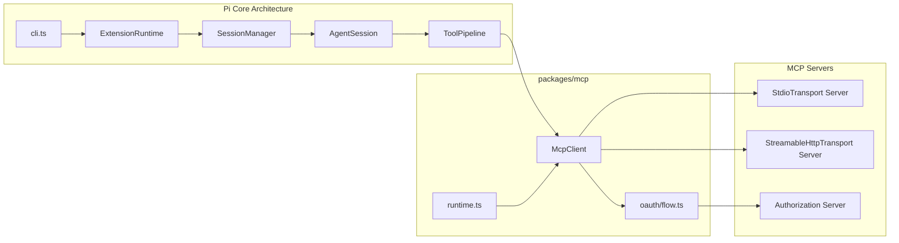
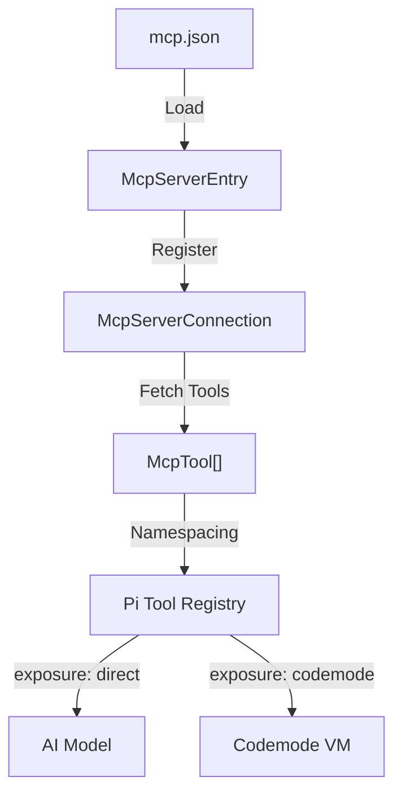

# 6.4 MCP Integration (Model Context Protocol)

<details>
<summary>Relevant source files</summary>

The following files were used as context for generating this wiki page:

- [packages/codemode/CHANGELOG.md](packages/codemode/CHANGELOG.md)
- [packages/coding-agent/docs/cli.md](packages/coding-agent/docs/cli.md)
- [packages/coding-agent/docs/mcp.md](packages/coding-agent/docs/mcp.md)
- [packages/coding-agent/src/core/mcp-servers.ts](packages/coding-agent/src/core/mcp-servers.ts)
- [packages/coding-agent/src/extensions/mcp/cli.ts](packages/coding-agent/src/extensions/mcp/cli.ts)
- [packages/coding-agent/src/extensions/mcp/config.ts](packages/coding-agent/src/extensions/mcp/config.ts)
- [packages/coding-agent/src/extensions/mcp/index.ts](packages/coding-agent/src/extensions/mcp/index.ts)
- [packages/coding-agent/src/extensions/mcp/oauth.ts](packages/coding-agent/src/extensions/mcp/oauth.ts)
- [packages/coding-agent/src/extensions/mcp/runtime.ts](packages/coding-agent/src/extensions/mcp/runtime.ts)
- [packages/coding-agent/src/extensions/mcp/tools.ts](packages/coding-agent/src/extensions/mcp/tools.ts)
- [packages/coding-agent/test/mcp-extension.test.ts](packages/coding-agent/test/mcp-extension.test.ts)
- [packages/coding-agent/test/mcp-oauth-refresh.test.ts](packages/coding-agent/test/mcp-oauth-refresh.test.ts)
- [packages/coding-agent/test/suite/agent-session-mcp.test.ts](packages/coding-agent/test/suite/agent-session-mcp.test.ts)
- [packages/coding-agent/test/suite/mcp-oauth-server.ts](packages/coding-agent/test/suite/mcp-oauth-server.ts)
- [packages/env/CHANGELOG.md](packages/env/CHANGELOG.md)
- [packages/mcp/CHANGELOG.md](packages/mcp/CHANGELOG.md)
- [packages/mcp/src/oauth/callback.ts](packages/mcp/src/oauth/callback.ts)
- [packages/mcp/src/oauth/discovery.ts](packages/mcp/src/oauth/discovery.ts)
- [packages/mcp/src/oauth/errors.ts](packages/mcp/src/oauth/errors.ts)
- [packages/mcp/src/oauth/flow.ts](packages/mcp/src/oauth/flow.ts)
- [packages/mcp/src/oauth/index.ts](packages/mcp/src/oauth/index.ts)
- [packages/mcp/src/oauth/types.ts](packages/mcp/src/oauth/types.ts)
- [packages/mcp/test/oauth.test.ts](packages/mcp/test/oauth.test.ts)
- [packages/telemetry/CHANGELOG.md](packages/telemetry/CHANGELOG.md)

</details>


This section covers the integration of MCP (Model Context Protocol) servers into Pi through the `packages/mcp` client library and the built-in `mcp` extension. It provides a deep technical overview of the MCP server configuration via `mcp.json`, MCP transports over stdio and streamable HTTP, OAuth discovery and authorization flows for secure server authentication, tool registration with proper namespacing, and the `pi mcp` CLI commands that facilitate server management.

---

## 6.4.1 Purpose and Scope

The Model Context Protocol (MCP) defines a standard for AI models to access external tools and resources hosted by MCP servers. Pi integrates MCP servers to extend the model's capabilities dynamically by:

- Managing MCP server configurations from user and project level `mcp.json` files [packages/coding-agent/docs/mcp.md:30-32]().
- Connecting to MCP servers via stdio or streamable HTTP transports [packages/coding-agent/src/extensions/mcp/runtime.ts:98-121]().
- Supporting OAuth with dynamic client registration for secure authentication [packages/mcp/src/oauth/flow.ts:47-68]().
- Registering MCP tools in Pi’s tool pipeline with namespaced names [packages/coding-agent/src/extensions/mcp/tools.ts:82-91]().
- Providing CLI commands and interactive UI (`/mcp`) for server inspection, signing in/out, and configuration management [packages/coding-agent/src/extensions/mcp/index.ts:22-26]().

Pi’s MCP integration hides implementation complexity behind a managed connection layer, adjusting tool visibility via exposure modes and dispatching tool calls transparently [packages/coding-agent/src/extensions/mcp/index.ts:9-18]().

Sources:
- `packages/coding-agent/src/extensions/mcp/index.ts:9-26`()
- `packages/coding-agent/docs/mcp.md:30-32`()
- `packages/coding-agent/src/extensions/mcp/runtime.ts:98-121`()
- `packages/mcp/src/oauth/flow.ts:47-68`()

---

## 6.4.2 MCP Server Configuration (`mcp.json`)

Pi reads MCP servers configuration primarily from:

- User-level config: `~/.pi/agent/mcp.json` [packages/coding-agent/docs/mcp.md:32]()
- Project-level config: `<project>/.pi/mcp.json` (only if the project is trusted) [packages/coding-agent/docs/mcp.md:32]()

Both configs share the standardized MCP client shape, making configs transferable across MCP-compatible clients [packages/coding-agent/docs/mcp.md:44-60]().

### Config Format

A typical `mcp.json` includes an object with an `"mcpServers"` field mapping server names to configurations [packages/coding-agent/docs/mcp.md:46-60]():

```json
{
  "mcpServers": {
    "filesystem": {
      "command": "npx",
      "args": ["-y", "@modelcontextprotocol/server-filesystem", "."]
    },
    "docs": {
      "url": "https://example.com/mcp",
      "headers": {
        "Authorization": "Bearer ${DOCS_TOKEN}"
      },
      "description": "Search and read the product documentation"
    }
  }
}
```

- **Stdio Servers** specify executable commands (`command`, `args`) and environment variables (`env`), relative `cwd` [packages/coding-agent/docs/mcp.md:62]().
- **HTTP Servers** specify a base `url` and optional `headers` [packages/coding-agent/docs/mcp.md:64]().
- Both types support optional fields like `timeout`, `enabled`, `exposure`, `toolExposure`, and `description` [packages/coding-agent/docs/mcp.md:66-71]().

### Configuration Rules and Validation

- Server names must only include letters, digits, `_`, and `-` [packages/coding-agent/src/core/mcp-servers.ts:152]().
- Tools are named with the pattern `mcp__<server>__<tool>`, sanitizing invalid characters to `_` [packages/coding-agent/src/extensions/mcp/tools.ts:82-91]().
- Names that differ only in `-` vs `_` are considered duplicates and rejected [packages/coding-agent/test/mcp-extension.test.ts:117-123]().
- `type` is optional and inferred (`command` → stdio, `url` → HTTP) [packages/coding-agent/docs/mcp.md:76-78]().
- Invalid servers are reported and skipped without failing startup [packages/coding-agent/docs/mcp.md:81-82]().
- Environment variables and header values support `${VAR}` syntax and commands with `!cmd` [packages/coding-agent/docs/mcp.md:79-80]().

The Pi MCP extension merges global and trusted project servers, with project entries overriding global ones of the same name [packages/coding-agent/test/mcp-extension.test.ts:70-81]().

Sources:
- `packages/coding-agent/docs/mcp.md:30-82`()
- `packages/coding-agent/src/core/mcp-servers.ts:152`()
- `packages/coding-agent/src/extensions/mcp/tools.ts:82-91`()
- `packages/coding-agent/test/mcp-extension.test.ts:70-81,117-123`()

---

## 6.4.3 MCP Transports

Pi supports two main transport methods to connect to MCP servers:

- **StdioTransport**: Spawns the configured executable on stdio, communicates over stdin/stdout pipes [packages/mcp/src/client.ts:100-101]()
- **StreamableHttpTransport**: Connects to HTTP/HTTPS endpoints exposing the MCP protocol over streaming HTTP [packages/mcp/src/client.ts:102-103]()

The default transport selection is automatic based on server configuration keys [packages/coding-agent/src/extensions/mcp/runtime.ts:104-121]():

- Servers with `"command"` use stdio transport [packages/coding-agent/src/extensions/mcp/runtime.ts:115-121]().
- Servers with `"url"` use streamable HTTP transport [packages/coding-agent/src/extensions/mcp/runtime.ts:104-109]().

Custom transport factories can be supplied to support other transports or modify behavior [packages/coding-agent/src/extensions/mcp/index.ts:73]().

### Transport Setup

The `createDefaultTransport()` function (in `runtime.ts`) prepares the transport [packages/coding-agent/src/extensions/mcp/runtime.ts:98-121]():

```ts
export function createDefaultTransport(
	entry: McpServerEntry,
	cwd: string,
	authProvider: AuthProvider | undefined,
): McpTransport {
	const { config, name } = entry;
	if ("url" in config) {
		return new StreamableHttpTransport({
			url: config.url,
			headers: resolveHeadersOrThrow(config.headers, `MCP server "${name}"`),
			authProvider,
		});
	}
  // Stdio transport setup...
	return new StdioTransport({...});
}
```

It expands `~` in paths and environment variables before constructing the transport [packages/coding-agent/src/extensions/mcp/runtime.ts:90-96,115-121]().

Sources:
- `packages/coding-agent/src/extensions/mcp/runtime.ts:90-121`()
- `packages/mcp/src/client.ts:100-103`()
- `packages/coding-agent/src/extensions/mcp/index.ts:73`()

---

## 6.4.4 OAuth Authentication for MCP Servers

Remote HTTP MCP servers often require OAuth authorization for protected resource access. Pi handles OAuth seamlessly with well-defined discovery and authentication flows.

### OAuth Flow Highlights

- Pi detects if OAuth is required by checking for the presence of Authorization headers or the absence thereof [packages/coding-agent/src/extensions/mcp/runtime.ts:82-86]().
- If no header is present and a 401 Unauthorized with OAuth metadata is received, Pi signals that sign-in is required [packages/coding-agent/src/extensions/mcp/runtime.ts:77-80]().
- OAuth uses the authorization code flow with PKCE, supporting dynamic client registration if no client ID is configured [packages/mcp/src/oauth/flow.ts:47-68,163-168]().
- Pi runs a local loopback HTTP server to receive the OAuth authorization code callback, validating redirect URIs [packages/coding-agent/src/extensions/mcp/oauth.ts:36-39]().
- OAuth state, tokens, and client registrations are persisted securely [packages/coding-agent/src/extensions/mcp/oauth.ts:141-142]().
- Token refreshes are handled with appropriate state storage and client validation [packages/mcp/src/oauth/flow.ts:47-68]().

The implementation for OAuth is encapsulated in `packages/coding-agent/src/extensions/mcp/oauth.ts` and `packages/mcp/src/oauth/flow.ts`.

Sources:
- `packages/coding-agent/src/extensions/mcp/oauth.ts:36-39,141-142`()
- `packages/coding-agent/src/extensions/mcp/runtime.ts:77-86`()
- `packages/mcp/src/oauth/flow.ts:47-68,163-168`()

---

## 6.4.5 MCP Server Connection Lifecycle

`McpServerConnection` objects represent active connections to configured MCP servers [packages/coding-agent/src/extensions/mcp/runtime.ts:139-141](). They manage:

- Background connection startup and reconnect on demand [packages/coding-agent/src/extensions/mcp/runtime.ts:171-172]().
- Fetching tool lists and resource metadata [packages/coding-agent/src/extensions/mcp/runtime.ts:141-151]().
- Maintaining server state: `connecting`, `connected`, `disconnected`, `needs-auth`, `failed`, `closed` [packages/coding-agent/src/extensions/mcp/runtime.ts:57]().
- Retrying connections on transient errors like network timeouts or 5xx [packages/coding-agent/src/extensions/mcp/runtime.ts:69-75]().
- Capturing stderr output tail for failed stdio servers to aid diagnostics [packages/coding-agent/src/extensions/mcp/runtime.ts:49]().

Connections lazily reconnect after disconnections detected during calls or keepalive pings.

Sources:
- `packages/coding-agent/src/extensions/mcp/runtime.ts:49,57,69-75,139-172`()

---

## 6.4.6 MCP Tool Registration and Namespacing

Tools exposed by MCP servers are registered with Pi’s tool pipeline, allowing the model and scripts to call them uniformly, with hooks, permission checks, and usage telemetry applied [packages/coding-agent/src/extensions/mcp/index.ts:21]().

### Tool Names

Tools follow the namespace pattern:

```
mcp__<server>__<tool>
```

- Server and tool names convert invalid characters to `_` [packages/coding-agent/src/extensions/mcp/tools.ts:82-91]().
- If conflicts occur, names are shortened with a hash suffix to remain unique [packages/coding-agent/src/extensions/mcp/tools.ts:82-91]().
- This name is also the identifier scripts use inside codemode, e.g., `await tools.mcp__filesystem__read(...)`.

### Exposure Modes

MCP tools can be exposed to the model and UI in various ways, controlled by `exposure` and `toolExposure` in server config [packages/coding-agent/src/extensions/mcp/index.ts:9-15]():

| Exposure | Effect |
|---|---|
| `codemode` | Tools are callable only from codemode scripts, not declared to the model. |
| `deferred` | Tools are declared to the model after being loaded by `tool_search`, no codemode needed. |
| `direct` | Tools are declared to the model immediately and callable as normal tools. |
| `hidden` | Tools are registered but unreachable by the model or scripts. |

Sources:
- `packages/coding-agent/src/extensions/mcp/index.ts:9-21`()
- `packages/coding-agent/src/extensions/mcp/tools.ts:82-91`()

---

## 6.4.7 MCP CLI Commands (`pi mcp`)

Pi provides a set of CLI commands to manage MCP servers from the shell, independent of interactive sessions [packages/coding-agent/src/extensions/mcp/cli.ts:33-40]():

| Command | Description |
|---|---|
| `pi mcp list` | Connects all enabled servers, lists their state, tools, and errors. Exits with error if any fail [packages/coding-agent/src/extensions/mcp/cli.ts:47](). |
| `pi mcp add` | Adds a new MCP server entry, supporting flags to set URL, command, environment vars, tokens [packages/coding-agent/src/extensions/mcp/cli.ts:34-35,55-67](). |
| `pi mcp remove <name>` | Removes a server entry from config [packages/coding-agent/src/extensions/mcp/cli.ts:36](). |
| `pi mcp login <server>` | Triggers OAuth sign-in for the given server if supported [packages/coding-agent/src/extensions/mcp/cli.ts:38,48](). |
| `pi mcp logout <server>` | Clears authentication credentials for the given server [packages/coding-agent/src/extensions/mcp/cli.ts:39,49](). |

Configurations added or removed by these commands update the correct config file (global user or project) depending on flags [packages/coding-agent/src/extensions/mcp/cli.ts:52]().

Sources:
- `packages/coding-agent/src/extensions/mcp/cli.ts:33-52,55-67`()

---

## 6.4.8 Data Flow Diagram: MCP Integration Overview

Diagram: "MCP Integration Architecture Data Flow"


Sources:
- `packages/coding-agent/src/extensions/mcp/runtime.ts`()
- `packages/coding-agent/src/extensions/mcp/cli.ts`()

---

## 6.4.9 Data Flow Diagram: MCP Tool Lifecycle and Exposure

Diagram: "MCP Tool Lifecycle and Exposure"


Sources:
- `packages/coding-agent/src/extensions/mcp/index.ts`()
- `packages/coding-agent/src/extensions/mcp/tools.ts`()

---

## 6.4.10 Key Classes and Functions

| Entity | Role and Description | Location |
|---|---|---|
| `loadMcpConfig()` | Loads and validates MCP server configs from global and project files. | `packages/coding-agent/src/extensions/mcp/config.ts`() |
| `createDefaultTransport()` | Factory constructing stdio or streamable HTTP transports. | `packages/coding-agent/src/extensions/mcp/runtime.ts:98-121`() |
| `McpServerConnection` | Manages single MCP server connection state and tool execution. | `packages/coding-agent/src/extensions/mcp/runtime.ts:139-172`() |
| `createMcpToolName()` | Generates sanitized, uniquely namespaced tool identifiers. | `packages/coding-agent/src/extensions/mcp/tools.ts:82-91`() |
| `runMcpCommand()` | CLI runner for `pi mcp` shell operations. | `packages/coding-agent/src/extensions/mcp/cli.ts:185-186`() |

Sources:
- `packages/coding-agent/src/extensions/mcp/config.ts`()
- `packages/coding-agent/src/extensions/mcp/runtime.ts:98-172`()
- `packages/coding-agent/src/extensions/mcp/tools.ts:82-91`()
- `packages/coding-agent/src/extensions/mcp/cli.ts:185-186`()