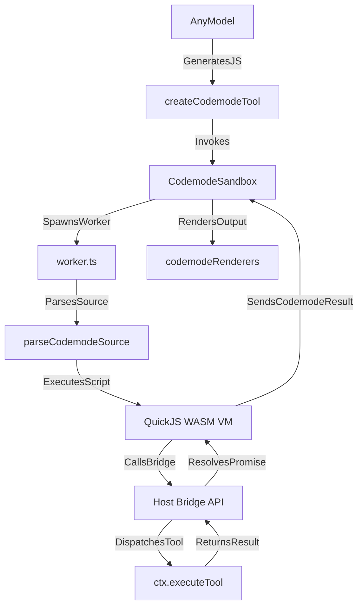
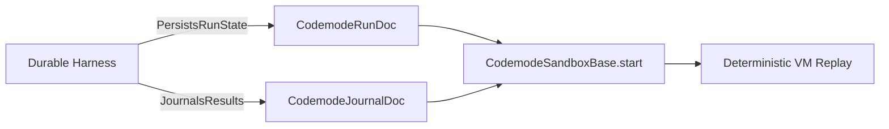

# Codemode Sandbox

Relevant source files

The following files were used as context for generating this wiki page:

- [packages/codemode/README.md](packages/codemode/README.md)
- [packages/codemode/src/runtime/host.ts](packages/codemode/src/runtime/host.ts)
- [packages/codemode/src/runtime/prelude-source.ts](packages/codemode/src/runtime/prelude-source.ts)
- [packages/codemode/src/runtime/worker.ts](packages/codemode/src/runtime/worker.ts)
- [packages/codemode/src/types.ts](packages/codemode/src/types.ts)
- [packages/codemode/test/fixtures/raw-worker.ts](packages/codemode/test/fixtures/raw-worker.ts)
- [packages/codemode/test/fixtures/worker-process-exit.ts](packages/codemode/test/fixtures/worker-process-exit.ts)
- [packages/codemode/test/sandbox.test.ts](packages/codemode/test/sandbox.test.ts)
- [packages/codemode/test/worker-lifetime.test.ts](packages/codemode/test/worker-lifetime.test.ts)
- [packages/coding-agent/docs/codemode.md](packages/coding-agent/docs/codemode.md)
- [packages/coding-agent/src/extensions/codemode/execute.ts](packages/coding-agent/src/extensions/codemode/execute.ts)
- [packages/coding-agent/src/extensions/codemode/tool.ts](packages/coding-agent/src/extensions/codemode/tool.ts)
- [packages/coding-agent/test/codemode-worker-admission.test.ts](packages/coding-agent/test/codemode-worker-admission.test.ts)
- [packages/coding-agent/test/suite/agent-session-codemode.test.ts](packages/coding-agent/test/suite/agent-session-codemode.test.ts)
- [packages/coding-agent/test/tool-search.test.ts](packages/coding-agent/test/tool-search.test.ts)
- [packages/durable/src/codemode/codemode.ts](packages/durable/src/codemode/codemode.ts)
- [packages/durable/src/codemode/describe.ts](packages/durable/src/codemode/describe.ts)
- [packages/durable/src/codemode/index.ts](packages/durable/src/codemode/index.ts)
- [packages/durable/src/codemode/models.ts](packages/durable/src/codemode/models.ts)
- [packages/durable/src/codemode/output.ts](packages/durable/src/codemode/output.ts)
- [packages/durable/src/search.ts](packages/durable/src/search.ts)
- [packages/durable/src/tool-search/index.ts](packages/durable/src/tool-search/index.ts)
- [packages/durable/src/tool-search/tool-search.ts](packages/durable/src/tool-search/tool-search.ts)
- [packages/durable/test/codemode-describe.test.ts](packages/durable/test/codemode-describe.test.ts)
- [packages/durable/test/codemode.test.ts](packages/durable/test/codemode.test.ts)

The Codemode Sandbox subsystem, implemented in `packages/codemode` and the builtin codemode extension (`packages/coding-agent/src/extensions/codemode`), provides a secure JavaScript execution runtime based on QuickJS and WASI [packages/codemode/README.md:1-3](). It executes model-authored JavaScript scripts that orchestrate parallel tool invocations, aggregate results, and access auxiliary models (classifiers and image generators) without exposing raw underlying systems to uncontrolled execution [packages/coding-agent/docs/codemode.md:1-3]().

This page documents the internal architecture of the Codemode Sandbox, covering sandbox host and worker implementations, multi-environment runtimes (`CodemodeSandbox`, `RemoteCodemodeSandbox`, `InlineCodemodeSandbox`) [packages/codemode/README.md:9-15](), deterministic execution via `start()` [packages/codemode/README.md:31](), tool exposure modes [packages/coding-agent/src/extensions/codemode/tool.ts:70-71](), data persistence via `store()` [packages/coding-agent/src/extensions/codemode/tool.ts:18-21](), and result rendering [packages/coding-agent/src/extensions/codemode/renderer.ts:65-68]().

---

## 1. Overview and Purpose

Codemode embeds a QuickJS WebAssembly runtime inside the agent architecture to let models write programmatic scripts instead of performing slow sequential tool loops [packages/coding-agent/docs/codemode.md:1-3](). Scripts execute inside an isolated environment where the only external side effects are performed through injected tool bridges and model runtimes [packages/codemode/README.md:1-6]().

The builtin extension (`packages/coding-agent/src/extensions/codemode`) binds this sandbox to Pi's session management, tool registry, and model catalog, enabling:
- Asynchronous parallel execution of tools using standard JavaScript constructs like `Promise.allSettled()` [packages/coding-agent/src/extensions/codemode/tool.ts:110-113]().
- Configurable tool exposure modes (`on` vs `only`) to manage model token budgets and declutter system prompts [packages/coding-agent/src/extensions/codemode/tool.ts:70-71]().
- State persistence across script executions via `store(key, value)` and `load(key)` [packages/coding-agent/src/extensions/codemode/tool.ts:18-21]().
- Deterministic session replay and persistence integration for durable runtimes [packages/durable/src/codemode/codemode.ts:10-15]().

Sources:
- `packages/coding-agent/docs/codemode.md:1-3`()
- `packages/coding-agent/src/extensions/codemode/tool.ts:18-21`()
- `packages/coding-agent/src/extensions/codemode/tool.ts:70-71`()
- `packages/coding-agent/src/extensions/codemode/tool.ts:110-113`()
- `packages/codemode/README.md:1-6`()
- `packages/durable/src/codemode/codemode.ts:10-15`()

---

## 2. Sandbox Host and Worker Architecture

The `@earendil-works/pi-codemode` package provides three sandbox classes sharing a common `CodemodeSandboxBase` interface [packages/codemode/README.md:7-15]():

| Sandbox Class | Environment | Execution Target |
|---|---|---|
| `CodemodeSandbox` | Node.js and Bun | Worker thread (`packages/codemode/src/runtime/worker.ts`) |
| `RemoteCodemodeSandbox` | Cloudflare Workers / Browser | Remote Durable Object (`CodemodeSandboxDurableObject`) |
| `InlineCodemodeSandbox` | Restricted Runtimes | Calling thread with an `interruptBudget` |

### 2.1 Host Runtime (`CodemodeSandbox`)
The host runs on the main thread, managing QuickJS WASM loading (`loadQuickJSWasm()`), enforcing heap limits (`memoryLimitBytes`, default 256 MiB in agent execution via `CODEMODE_MEMORY_LIMIT_BYTES`) [packages/coding-agent/src/extensions/codemode/execute.ts:56](), and orchestrating message passing with worker threads. It handles worker lifecycle hooks like `acquireWorker()` and `onWorkerStarted()` to track concurrency limits, bounded by `PI_CODEMODE_MAX_WORKERS` (defaulting to 2 concurrent workers) [packages/coding-agent/src/extensions/codemode/execute.ts:58-64]().

### 2.2 Worker Runtime (`worker.ts`)
The worker loads the QuickJS WASM module and executes script bodies parsed by `parseCodemodeSource()` [packages/codemode/src/index.ts:26](). It exposes injected globals (`tools`, `ALL_TOOLS`, `text`, `image`, `console`, `store`, `load`, `models`) [packages/coding-agent/docs/codemode.md:22-35]() and polls for interrupts during promise draining via a shared interrupt flag in a `SharedArrayBuffer` [packages/codemode/src/runtime/host.ts:28-60]().

Sources:
- `packages/codemode/README.md:7-15`()
- `packages/codemode/README.md:64-79`()
- `packages/codemode/src/runtime/host.ts:28-60`()
- `packages/coding-agent/src/extensions/codemode/execute.ts:56-64`()
- `packages/coding-agent/docs/codemode.md:22-35`()

---

## 3. Core Execution and Deterministic Replay

### 3.1 Script Execution and Limits
Scripts run as async function bodies where top-level `await` and `return` are fully supported [packages/coding-agent/docs/codemode.md:7](). Output is restricted to prevent memory exhaustion: text and image streams are bounded by `MAX_OUTPUT_CHARS` (16 MiB) and `MAX_OUTPUT_ITEMS` (100,000) [packages/codemode/src/runtime/prelude-source.ts:42-43](). 

### 3.2 Deterministic Replay (`sandbox.start()`)
To support durable executions where a session may restart mid-execution (e.g., during long-running tool batches), `CodemodeSandboxBase.start()` provides deterministic runs [packages/codemode/README.md:31](). Given a fixed `startedAt` timestamp, random `seed`, and recorded tool results delivered in strict sequence through `CodemodeJournalDoc`, the sandbox reproduces identical execution paths without re-running past tool calls [packages/durable/src/codemode/codemode.ts:10-25]().

Sources:
- `packages/codemode/README.md:31`()
- `packages/codemode/src/runtime/prelude-source.ts:42-43`()
- `packages/coding-agent/docs/codemode.md:7`()
- `packages/durable/src/codemode/codemode.ts:10-25`()

---

## 4. Tool Exposure Modes

The builtin extension governs tool visibility via the `codemode.mode` configuration setting [packages/coding-agent/src/extensions/codemode/tool.ts:70-71]():

| Mode | Behavior |
|---|---|
| `"on"` (default) | Declared tools remain in the model prompt; script calls use `tools.<name>()`. |
| `"only"` | Tools are hidden from the primary prompt and listed inside the `codemode` description, forcing the model to execute them exclusively via scripts. |

Tools not listed in the prompt remain discoverable inside scripts using `searchTools()`, `describeTool()`, `describeNamespace()`, or `ALL_TOOLS` [packages/coding-agent/docs/codemode.md:31-35]().

Sources:
- `packages/coding-agent/docs/codemode.md:31-35`()
- `packages/coding-agent/src/extensions/codemode/tool.ts:70-71`()

---

## 5. Result Rendering and Store Persistence

- **Result Rendering**: Codemode execution outputs are wrapped in `CodemodeResult` [packages/codemode/src/types.ts:94-110](). The `codemodeRenderers` component formats execution headers (`Script completed` / `Script failed`), elapsed wall time, console streams, and nested tool calls [packages/coding-agent/src/extensions/codemode/renderer.ts:65-68]().
- **Store Persistence**: Successful scripts write values via `store(key, value)`. These writes are captured in `CodemodeStoreWrites` and appended to session logs as `codemode-store` custom entries via `CODEMODE_STORE_ENTRY_TYPE` [packages/coding-agent/src/extensions/codemode/tool.ts:41-47](), ensuring branch isolation across session forks.

Sources:
- `packages/coding-agent/src/extensions/codemode/renderer.ts:65-68`()
- `packages/coding-agent/src/extensions/codemode/tool.ts:41-47`()
- `packages/codemode/src/types.ts:94-110`()

---

## 6. Data Flow and Execution Sequence

*Figure 6.5.1: Codemode execution pipeline linking `AnyModel` script generation through `CodemodeSandbox` and `worker.ts` to `codemodeRenderers`.*

Sources:
- `packages/coding-agent/src/extensions/codemode/execute.ts:1-162`()
- `packages/coding-agent/src/extensions/codemode/renderer.ts:65-68`()
- `packages/codemode/src/runtime/worker.ts:1-100`()

---

## 7. Key Code Entities and Functions

- `CodemodeSandbox`: Manages worker thread lifecycle, WASM loading, and execution message bridging [packages/codemode/src/runtime/host.ts:84-88]().
- `parseCodemodeSource()`: Validates script source and extracts `// @options:` configurations [packages/codemode/src/source.ts:30-40]().
- `executeCodemodeScript`: Main extension runner coordinating token budgeting, concurrency locks, and model catalogs [packages/coding-agent/src/extensions/codemode/execute.ts:1-164]().
- `createCodemodeTool()`: Factory constructing the core `codemode` tool definition and injecting declarations [packages/coding-agent/src/extensions/codemode/tool.ts:75-85]().

Sources:
- `packages/codemode/src/runtime/host.ts:84-88`()
- `packages/codemode/src/source.ts:30-40`()
- `packages/coding-agent/src/extensions/codemode/execute.ts:1-164`()
- `packages/coding-agent/src/extensions/codemode/tool.ts:75-85`()

---

## 8. Integration with Durable Harness

*Figure 6.5.2: Integration of Durable Harness session documents (`CodemodeRunDoc`, `CodemodeJournalDoc`) with `CodemodeSandboxBase.start` for crash-resilient script replay.*

Sources:
- `packages/durable/src/codemode/codemode.ts:10-35`()
- `packages/codemode/README.md:31`()