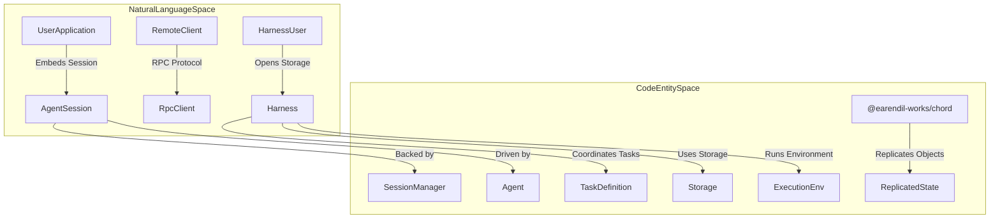

# SDK and Programmatic Usage

<details>
<summary>Relevant source files</summary>

The following files were used as context for generating this wiki page:

- [packages/coding-agent/docs/json.md](packages/coding-agent/docs/json.md)
- [packages/coding-agent/docs/rpc.md](packages/coding-agent/docs/rpc.md)
- [packages/coding-agent/docs/sdk.md](packages/coding-agent/docs/sdk.md)
- [packages/coding-agent/src/modes/json-event.ts](packages/coding-agent/src/modes/json-event.ts)
- [packages/coding-agent/src/modes/rpc/rpc-client.ts](packages/coding-agent/src/modes/rpc/rpc-client.ts)
- [packages/coding-agent/src/modes/rpc/rpc-types.ts](packages/coding-agent/src/modes/rpc/rpc-types.ts)
- [packages/coding-agent/test/rpc.test.ts](packages/coding-agent/test/rpc.test.ts)
- [packages/coding-agent/test/suite/regressions/7911-json-stream-usage.test.ts](packages/coding-agent/test/suite/regressions/7911-json-stream-usage.test.ts)
- [packages/coding-agent/test/suite/regressions/7925-toolcall-start-metadata.test.ts](packages/coding-agent/test/suite/regressions/7925-toolcall-start-metadata.test.ts)
- [packages/durable/CHANGELOG.md](packages/durable/CHANGELOG.md)
- [packages/durable/README.md](packages/durable/README.md)
- [packages/durable/docs/spec.md](packages/durable/docs/spec.md)
- [packages/durable/src/harness/generation.ts](packages/durable/src/harness/generation.ts)
- [packages/durable/src/harness/harness.ts](packages/durable/src/harness/harness.ts)
- [packages/durable/src/harness/scheduler.ts](packages/durable/src/harness/scheduler.ts)
- [packages/durable/src/harness/tool.ts](packages/durable/src/harness/tool.ts)
- [packages/durable/src/harness/types.ts](packages/durable/src/harness/types.ts)
- [packages/durable/src/index.ts](packages/durable/src/index.ts)
- [packages/durable/src/session/session.ts](packages/durable/src/session/session.ts)
- [packages/durable/src/types.ts](packages/durable/src/types.ts)

</details>


This page serves as the parent overview for section 7, covering how `pi` can be embedded, orchestrated, and extended programmatically across various architectural layers—from the high-level `@earendil-works/pi-coding-agent` SDK down to the durable harness, chord replication runtime, storage persistence layer, and remote execution environments.

---

### Integration Landscape

This diagram illustrates the architectural spectrum of programmatic entry points into `pi` capabilities, bridging natural language intent and application contexts to concrete codebase entities:

**Programmatic Integration Architecture**


Sources: [packages/coding-agent/docs/sdk.md:3-12](), [packages/durable/README.md:1-8]()

---

## 7.1 pi-coding-agent SDK

The `@earendil-works/pi-coding-agent` SDK provides high-level programmatic access to agent capabilities for Node.js or Bun applications. It exposes TypeScript APIs to create and control agent sessions, send messages or commands, manage session lifecycle, persistent history, tools, models, and discovered resources [packages/coding-agent/docs/sdk.md:3-18]().

The main entry point is the `createAgentSession()` factory, which creates an `AgentSession` representing a single conversation. The session manages prompt streaming, queued steering or follow-up messages, compaction state, and extension runtimes [packages/coding-agent/docs/sdk.md:28-29](). Session storage is handled by `SessionManager`, supporting both file-backed JSONL storage and in-memory execution [packages/coding-agent/docs/sdk.md:36-55]().

For detailed configuration parameters, provider composition, telemetry integration via `packages/telemetry`, and full code examples from minimal setups to full-control patterns, see the child page: **[pi-coding-agent SDK](#7.1)**.

Sources: [packages/coding-agent/docs/sdk.md:3-115]()

---

## 7.2 Durable Harness API (packages/durable)

The durable harness in `packages/durable/src/harness` provides a robust foundation for building crash-resilient agents. It manages atomic commits, task scheduling, inboxes, generation loops, and tool execution [packages/durable/README.md:5-9](). 

The architecture centers around the `Harness` class and conversation handlers that enforce strict consistency invariants [packages/durable/docs/spec.md:43-79](). It includes a complete hook system, the `Result` error pattern, automatic compaction policies, and a resume contract that allows interrupted tasks to pick up precisely where they left off [packages/durable/README.md:5-115]().

For deep dives into the registry, scheduler, inbox management, tool hooks, and subagent orchestration, see the child page: **[Durable Harness API (packages/durable)](#7.2)**.

Sources: [packages/durable/README.md:1-121](), [packages/durable/docs/spec.md:1-79]()

---

## 7.3 Chord Replication Runtime (packages/chord)

The `@earendil-works/chord` package provides the underlying replication runtime used for distributed object coordination and state synchronization [packages/durable/README.md:7](). It manages replicated objects and cells, delta synchronization across nodes, hosts, and clusters, as well as link maintenance and wire protocols over WebSocket transports [packages/durable/src/types.ts:1-10]().

Chord enables seamless state replication, generations tracking, and reload semantics, supporting multi-agent collaboration and distributed synchronization topologies.

For specifications, specs, and tutorials on the chord protocol, see the child page: **[Chord Replication Runtime (packages/chord)](#7.3)**.

Sources: [packages/durable/README.md:5-8](), [packages/durable/src/types.ts:1-12](), [packages/durable/docs/spec.md:1-15]()

---

## 7.4 Durable Storage and Persistence

The storage layer within `packages/durable` abstracts persistence across multiple backend implementations, including ephemeral memory storage, node-based SQLite databases, and Cloudflare Durable Object SQLite adapters [packages/durable/CHANGELOG.md:31-44]().

The storage subsystem manages schema versioning and automatic migrations [packages/durable/CHANGELOG.md:9](), session transactions, immutable log entries, documents, timers, and test-workers. It enforces strict serialization rules and conformance test suites to guarantee durability guarantees [packages/durable/docs/spec.md:43-79]().

For comprehensive details on storage interfaces, SQLite migration protocols, and session document schemas, see the child page: **[Durable Storage and Persistence](#7.4)**.

Sources: [packages/durable/CHANGELOG.md:1-58](), [packages/durable/docs/spec.md:43-79]()

---

## 7.5 Execution Environments and Remote Env (packages/env)

Execution environments are abstracted through the `ExecutionEnv` interface, supporting local execution via `NodeExecutionEnv` (handling filesystem access, shell execution, and file watchers) and remote execution via `RemoteExecutionEnv` over SSH [packages/durable/src/harness/types.ts:17]().

Remote isolation is facilitated by the Rust `pi-env` daemon, which implements a framed protocol, PTY management, and host-key trust verification. The package also includes differential tests, conformance suites, and durable environment adapters.

For complete protocol definitions, semantics, and remote daemon integration details, see the child page: **[Execution Environments and Remote Env (packages/env)](#7.5)**.

Sources: [packages/durable/src/harness/types.ts:1-17](), [packages/durable/src/harness/scheduler.ts:1-5](), [packages/durable/src/harness/generation.ts:1-16]()

---

## Summary of Programmatic Interfaces

**Programmatic Interfaces Overview**
```mermaid
graph TD
    subgraph "High-Level SDK"
        A[pi-coding-agent SDK] --> B[AgentSession]
        B --> C[createAgentSession()]
        B --> D[prompt(), steer(), followUp()]
        B --> E[subscribe()]
    end

    subgraph "Durable Harness"
        F[packages/durable] --> G[Harness]
        G --> H[Scheduler, Inbox, Generation]
        G --> I[ToolTask, NestedCallDoc]
    end

    subgraph "Chord Replication"
        J[@earendil-works/chord] --> K[Replicated Objects & Cells]
        J --> L[Delta Sync & WebSocket Transport]
    end

    subgraph "Durable Storage"
        M[Storage Layer] --> N[MemoryStorage]
        M --> O[Node SQLite & Cloudflare DO]
    end

    subgraph "Execution Environments"
        P[packages/env] --> Q[NodeExecutionEnv]
        P --> R[RemoteExecutionEnv & pi-env daemon]
    end

    A --"Persists via"--> M
    G --"Stores in"--> M
    G --"Runs in"--> P
    G --"Replicates via"--> J
```

Sources: [packages/coding-agent/docs/sdk.md:3-53](), [packages/durable/README.md:5-15](), [packages/durable/CHANGELOG.md:31-44](), [packages/durable/src/harness/types.ts:17]()

| Interface Package / Module           | Primary Abstraction            | Core Capabilities                                                                                   |
| ---------------------------------- | ----------------------------- | ------------------------------------------------------------------------------------------------- |
| **pi-coding-agent (SDK)**           | `AgentSession`, `SessionManager`      | High-level embedding, multi-turn conversation, session persistence, event subscription [packages/coding-agent/docs/sdk.md:3-53]() |
| **packages/durable**                   | `Harness`, `Task`             | Low-level durable agent loops, execution lanes, hooks, compaction, crash recovery [packages/durable/README.md:5-15]() |
| **packages/chord**                     | `ReplicatedState`, `Transport`| Distributed object replication, delta synchronization, cluster management [packages/durable/docs/spec.md:1-15]() |
| **packages/durable (Storage)**         | `Storage`, `SqliteStorage`    | Durable persistence, memory, SQLite (node & Cloudflare), schema migrations [packages/durable/CHANGELOG.md:31-44]() |
| **packages/env**                       | `ExecutionEnv`, `pi-env`      | Local filesystem/shell/watchers and SSH remote execution daemon [packages/durable/src/harness/types.ts:17]() |

Sources: [packages/coding-agent/docs/sdk.md:3-53](), [packages/durable/README.md:5-15](), [packages/durable/CHANGELOG.md:31-44](), [packages/durable/src/harness/types.ts:17](), [packages/durable/docs/spec.md:1-15]()

---

## Navigation to Detailed Subpages

For full details on APIs, patterns, session management, and examples, visit these child pages:

- **[pi-coding-agent SDK](#7.1)**
- **[Durable Harness API (packages/durable)](#7.2)**
- **[Chord Replication Runtime (packages/chord)](#7.3)**
- **[Durable Storage and Persistence](#7.4)**
- **[Execution Environments and Remote Env (packages/env)](#7.5)**

Sources: [packages/coding-agent/docs/sdk.md:3-60](), [packages/durable/README.md:1-40](), [packages/durable/docs/spec.md:1-45]()