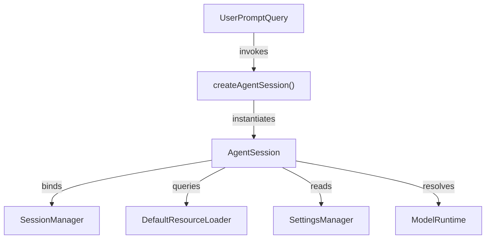
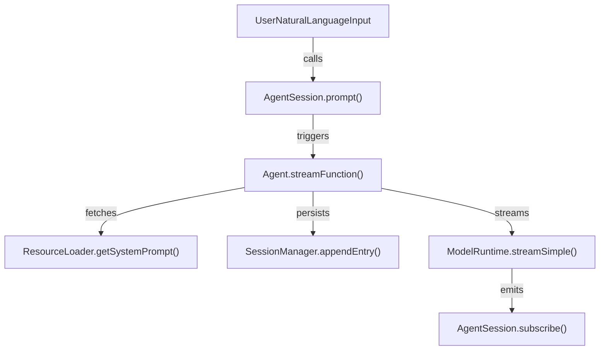

# pi-coding-agent SDK

<details>
<summary>Relevant source files</summary>

The following files were used as context for generating this wiki page:

- [packages/coding-agent/docs/json.md](packages/coding-agent/docs/json.md)
- [packages/coding-agent/docs/rpc.md](packages/coding-agent/docs/rpc.md)
- [packages/coding-agent/docs/sdk.md](packages/coding-agent/docs/sdk.md)
- [packages/coding-agent/examples/sdk/01-minimal.ts](packages/coding-agent/examples/sdk/01-minimal.ts)
- [packages/coding-agent/examples/sdk/02-custom-model.ts](packages/coding-agent/examples/sdk/02-custom-model.ts)
- [packages/coding-agent/examples/sdk/03-custom-prompt.ts](packages/coding-agent/examples/sdk/03-custom-prompt.ts)
- [packages/coding-agent/examples/sdk/04-skills.ts](packages/coding-agent/examples/sdk/04-skills.ts)
- [packages/coding-agent/examples/sdk/05-tools.ts](packages/coding-agent/examples/sdk/05-tools.ts)
- [packages/coding-agent/examples/sdk/07-context-files.ts](packages/coding-agent/examples/sdk/07-context-files.ts)
- [packages/coding-agent/examples/sdk/08-prompt-templates.ts](packages/coding-agent/examples/sdk/08-prompt-templates.ts)
- [packages/coding-agent/examples/sdk/09-api-keys-and-oauth.ts](packages/coding-agent/examples/sdk/09-api-keys-and-oauth.ts)
- [packages/coding-agent/examples/sdk/10-settings.ts](packages/coding-agent/examples/sdk/10-settings.ts)
- [packages/coding-agent/examples/sdk/11-sessions.ts](packages/coding-agent/examples/sdk/11-sessions.ts)
- [packages/coding-agent/examples/sdk/12-full-control.ts](packages/coding-agent/examples/sdk/12-full-control.ts)
- [packages/coding-agent/examples/sdk/README.md](packages/coding-agent/examples/sdk/README.md)
- [packages/coding-agent/src/core/index.ts](packages/coding-agent/src/core/index.ts)
- [packages/coding-agent/src/modes/json-event.ts](packages/coding-agent/src/modes/json-event.ts)
- [packages/coding-agent/src/modes/rpc/rpc-client.ts](packages/coding-agent/src/modes/rpc/rpc-client.ts)
- [packages/coding-agent/src/modes/rpc/rpc-types.ts](packages/coding-agent/src/modes/rpc/rpc-types.ts)
- [packages/coding-agent/test/rpc.test.ts](packages/coding-agent/test/rpc.test.ts)
- [packages/coding-agent/test/sdk-skills.test.ts](packages/coding-agent/test/sdk-skills.test.ts)
- [packages/coding-agent/test/suite/regressions/7911-json-stream-usage.test.ts](packages/coding-agent/test/suite/regressions/7911-json-stream-usage.test.ts)
- [packages/coding-agent/test/suite/regressions/7925-toolcall-start-metadata.test.ts](packages/coding-agent/test/suite/regressions/7925-toolcall-start-metadata.test.ts)
- [packages/coding-agent/test/utilities.ts](packages/coding-agent/test/utilities.ts)

</details>


## Purpose and Scope

The `@earendil-works/pi-coding-agent` SDK embeds the Pi coding agent directly within Node.js or Bun processes [packages/coding-agent/docs/sdk.md:3-3](). It provides direct TypeScript access to the agent loop, conversation sessions, tool execution, model runtimes, and resource discovery mechanisms used by the command-line application [packages/coding-agent/docs/sdk.md:3-5](). 

This SDK is designed for in-process TypeScript integrations, offering complete programmatic control over session states, event streams, and resource pipelines [packages/coding-agent/docs/sdk.md:3-5]().

```typescript
import { createAgentSession } from "@earendil-works/pi-coding-agent";

const { session } = await createAgentSession();

try {
  await session.prompt("What files are in the current directory?");
  console.log(session.getLastAssistantText());
} finally {
  session.dispose();
}
```

Sources: [packages/coding-agent/docs/sdk.md:1-23]()

---

## Core API: `createAgentSession()` & Factory Architecture

The `createAgentSession()` factory function initializes and wires together the core services required to run an agent session [packages/coding-agent/docs/sdk.md:27-50](). It configures workspace context (`cwd`), global agent directories (`agentDir`), model runtimes, settings managers, resource loaders, and session state persistence [packages/coding-agent/examples/sdk/README.md:105-119]().

### Configuration Options

| Option | Default | Description |
|---|---|---|
| `modelRuntime` | Runtime using `agentDir/auth.json` and `models.json` | Model registry and credential discovery runtime [packages/coding-agent/examples/sdk/README.md:109-109]() |
| `cwd` | `process.cwd()` | Project workspace context for resource discovery and tool paths [packages/coding-agent/docs/sdk.md:54-54](), [packages/coding-agent/examples/sdk/README.md:110-110]() |
| `agentDir` | `~/.pi/agent` | Global agent configuration directory [packages/coding-agent/examples/sdk/README.md:111-111]() |
| `model` | Automatic from settings or first available | AI model instance assigned to the session [packages/coding-agent/examples/sdk/README.md:112-112]() |
| `thinkingLevel` | From settings or `"off"` | Reasoning level for LLM queries (`off`, `low`, `medium`, `high`) [packages/coding-agent/examples/sdk/README.md:113-113]() |
| `tools` | Predefined built-ins (`read`, `bash`, `edit`, `write`) | Allowlist tool names across built-in, extension, and custom tools [packages/coding-agent/examples/sdk/README.md:114-114]() |
| `customTools` | `[]` | Additional bespoke tool definitions supplied programmatically [packages/coding-agent/examples/sdk/README.md:115-115]() |
| `resourceLoader` | `DefaultResourceLoader` | Resource loader for extensions, skills, prompts, themes, and context files [packages/coding-agent/examples/sdk/README.md:116-116]() |
| `sessionManager` | `SessionManager.create(cwd)` | Conversation storage and branching manager [packages/coding-agent/examples/sdk/README.md:117-117]() |
| `settingsManager`| `SettingsManager.create(cwd, agentDir)` | Settings provider with global and project scope [packages/coding-agent/examples/sdk/README.md:118-118]() |

### Diagram: Natural Language Space to Code Entity Space (Service Wiring)



Sources: [packages/coding-agent/docs/sdk.md:27-50](), [packages/coding-agent/examples/sdk/README.md:105-119]()

---

## AgentSession API & Event-Driven Lifecycle

The `AgentSession` class manages a single conversation thread, tracking conversation state, prompt queues, compaction status, and active extensions [packages/coding-agent/docs/sdk.md:27-30]().

### Core API Methods

- `prompt(text, options)`: Processes external user input, expands file templates, and executes agent turns [packages/coding-agent/docs/sdk.md:64-65]().
- `steer(text)` / `followUp(text)`: Manages queued inputs injected during or after active agent runs [packages/coding-agent/docs/sdk.md:66-68]().
- `subscribe(listener)`: Registers an event listener receiving live `AgentSessionEvent` notifications [packages/coding-agent/docs/sdk.md:77-81]().
- `compact(customInstructions)`: Summarizes conversation history to free context window space [packages/coding-agent/docs/sdk.md:38-38]().
- `abort()`: Stops active operations and waits for the session to become idle [packages/coding-agent/docs/sdk.md:70-70]().
- `dispose()`: Aborts tasks, invalidates extension contexts, and releases event listeners [packages/coding-agent/docs/sdk.md:56-56]().

### Diagram: Natural Language Space to Code Entity Space (Prompt Execution Flow)



Sources: [packages/coding-agent/docs/sdk.md:27-95](), [packages/coding-agent/examples/sdk/README.md:121-140]()

---

## ResourceLoader Configuration

`ResourceLoader` defines the interface for discovering project resources like extensions, skills, prompt templates, and context files (`AGENTS.md`) [packages/coding-agent/docs/sdk.md:96-108](). `DefaultResourceLoader` scans standardized filesystem paths, whereas custom implementations can be provided for virtualized environments [packages/coding-agent/examples/sdk/12-full-control.ts:36-49]().

```typescript
interface ResourceLoader {
  getExtensions(): LoadExtensionsResult;
  getSkills(): { skills: Skill[]; diagnostics: Diagnostic[] };
  getPrompts(): { prompts: PromptTemplate[]; diagnostics: Diagnostic[] };
  getThemes(): { themes: Theme[]; diagnostics: Diagnostic[] };
  getAgentsFiles(): { agentsFiles: AgentsFile[] };
  getSystemPrompt(): string | undefined;
  getSystemPromptSource(): SourceInfo | undefined;
  getAppendSystemPrompt(): string[];
  getAppendSystemPromptSources(): SourceInfo[];
  extendResources(extension: Extension): void;
  reload(): Promise<void>;
}
```

Sources: [packages/coding-agent/docs/sdk.md:96-108](), [packages/coding-agent/examples/sdk/12-full-control.ts:36-49]()

---

## Session Management: File-Backed vs In-Memory (`SessionManager`)

`SessionManager` maintains conversation histories as directed trees of entries, supporting branching, forking, and compaction [packages/coding-agent/docs/sdk.md:36-40]().

- **File-Backed**: Stores session entries as JSONL files within structured directories under `cwd` [packages/coding-agent/test/rpc.test.ts:61-70]().
- **In-Memory**: Keeps entries entirely in memory, avoiding disk I/O for testing or ephemeral processes [packages/coding-agent/docs/sdk.md:42-50]().

```typescript
import { createAgentSession, SessionManager } from "@earendil-works/pi-coding-agent";

const { session } = await createAgentSession({
  sessionManager: SessionManager.inMemory(),
});
```

Sources: [packages/coding-agent/docs/sdk.md:36-52](), [packages/coding-agent/test/rpc.test.ts:47-70]()

---

## Provider Composition, Attribution, and Telemetry

`ModelRuntime` handles model discovery and authentication credentials [packages/coding-agent/examples/sdk/README.md:109-109](). When connecting through proxy endpoints like OpenRouter or NVIDIA NIM, attribution headers (`HTTP-Referer`, `X-OpenRouter-Title`, `X-OpenRouter-Categories`) are automatically injected by the SDK [packages/coding-agent/docs/sdk.md:3-108](). Telemetry tracking via `@earendil-works/pi-telemetry` monitors diagnostic usage when enabled [packages/coding-agent/docs/sdk.md:3-108]().

Sources: [packages/coding-agent/docs/sdk.md:3-108](), [packages/coding-agent/examples/sdk/README.md:109-109]()

---

## SDK Examples from Minimal to Full-Control

The SDK package provides a series of complete examples located under `packages/coding-agent/examples/sdk/` [packages/coding-agent/examples/sdk/README.md:9-25]():

| Example File | Description |
|---|---|
| `01-minimal.ts` | Simplest usage with default parameters [packages/coding-agent/examples/sdk/README.md:11-11]() |
| `02-custom-model.ts` | Model selection and thinking levels [packages/coding-agent/examples/sdk/README.md:12-12]() |
| `03-custom-prompt.ts` | System prompt customization and overrides [packages/coding-agent/examples/sdk/README.md:13-13]() |
| `04-skills.ts` | Skill discovery, filtering, and custom injection [packages/coding-agent/examples/sdk/README.md:14-14]() |
| `05-tools.ts` | Built-in tool allowlists and restrictions [packages/coding-agent/examples/sdk/README.md:15-15]() |
| `06-extensions.ts` | Registering and composing runtime extensions [packages/coding-agent/examples/sdk/README.md:16-16]() |
| `07-context-files.ts` | Using project context files like `AGENTS.md` [packages/coding-agent/examples/sdk/README.md:17-17]() |
| `08-prompt-templates.ts` | Prompt template expansions [packages/coding-agent/examples/sdk/README.md:18-18]() |
| `09-api-keys-and-oauth.ts` | API key resolution and OAuth configurations [packages/coding-agent/examples/sdk/README.md:19-19]() |
| `10-settings.ts` | Compaction, retry, and settings overrides [packages/coding-agent/examples/sdk/README.md:20-20]() |
| `11-sessions.ts` | Managing in-memory and persistent session forks [packages/coding-agent/examples/sdk/README.md:21-21]() |
| `12-full-control.ts` | Explicit configuration replacing all defaults [packages/coding-agent/examples/sdk/README.md:22-22]() |
| `13-session-runtime.ts` | Managing runtime-backed session replacements [packages/coding-agent/examples/sdk/README.md:23-23]() |

Sources: [packages/coding-agent/examples/sdk/README.md:9-25]()